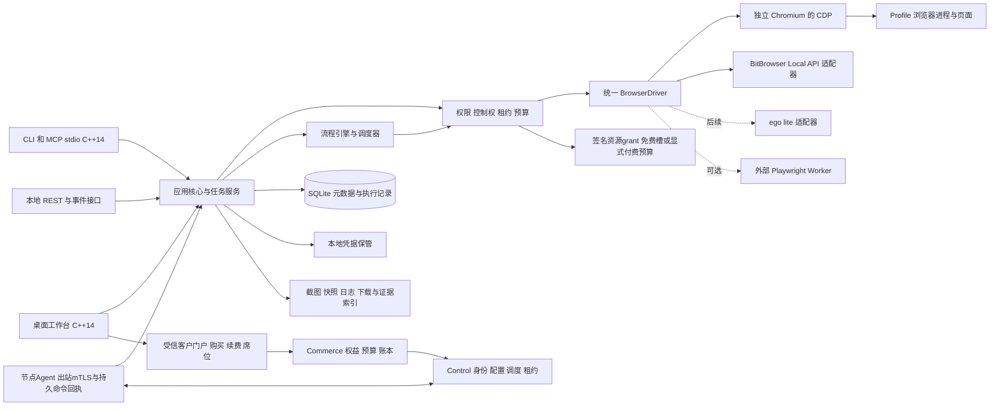
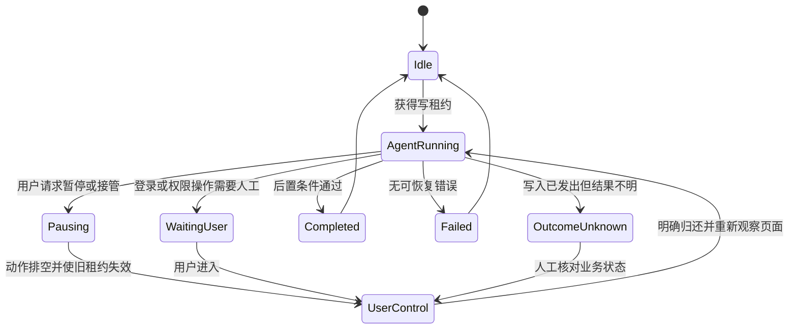

# AI 浏览器自动化工作台开发计划与技术方案

版本：1.4。编制与更新日期：2026-11-03。排期按周一开始的自然周列示，示例任务时区 Asia/Shanghai；实际部署时区可配置。本轮按后台功能补齐客户端账号/组织、设备/席位、资源授权、商业状态与运行回执；沿用VC++2019/v142、C++14工具链。

项目工作名：AI Browser Workbench。工作目录：`E:\project\webexploer_codex`。

2026-11-04可视化RPA专项：[录制、拖拽编排与网站自动适配开发计划](31_可视化录制拖拽编排与网站自动适配开发计划.md)细化28项VE任务、36项VR验收，规划录制→画布→版本化DSL→统一执行器及站点知识/AI适配；当前4项完成、11项进行中、13项未开始，主文档录制/拾取与原生画布已有本机验证；实际范围和测试见[文档32](32_可视化RPA实施与测试记录.md)。146人日专项视角已归集到原父包剩余范围，建议20周相对窗口，不直接新增到317人日或改变总体排期/完成状态。

2026-11-04脚本实测增量：新增可运行本地内容网站、19步DSL和站点编排脚本，已用现有C++14程序验证登录/发布/分页搜索/点赞/评论/回复，15组集成检查及冻结便携程序两次公开入口通过，见[操作与实测指南](30_内容网站脚本自动化实测与操作指南.md)。T064/T068继续进行中，完整AI发现、录制画布及通用适配不因本站演示而标成完成。

2026-11-04内容业务增补：将登录后自动识别页面功能、找到创作/发布入口、发布准备好的文章、搜索并罗列结果，以及对选定文章点赞/评论/回复纳入产品目标。完整路径、页面适配、稿件/互动对象绑定、结果核对和CA01–CA20验收见[文档29](29_文章发布搜索与互动自动化流程.md)。当前基础浏览器动作可复用，内置AI规划、富文本/上传、列表采集、动态编排和业务回执仍待开发；本轮不增加已完成项，也未重估317人日基线。

本项目拟结合比特浏览器的多环境管理、代理、指纹配置、窗口同步、扩展和 RPA，以及 ego lite 的登录态复用、任务空间、页面语义快照和 AI 工具调用，形成一款可查看、可接管、可调试、可复用流程的桌面浏览器自动化软件。

2026-11-03商业范围确认：产品是可销售的多环境浏览器与通用自动化平台，支持人工、AI、RPA及外部软件调用，Web测试为其中一个场景。环境销售/计时、续费、席位/设备、支付/退款/账务为完整后台必需能力，见[后台1.4](10_管理后台功能与开发计划.md)和[商业运营1.3](11_环境销售计费与商业运营后台计划.md)。

本次按用户要求修订免费档：**持续免费10个独立环境、RPA、Local API及HTTP/HTTPS、SOCKS5、SSH隧道接入；AI调用、Web测试、核心SDK/CLI/MCP功能继续免费。** 主体跨项目/设备/节点共享容量10，本项目默认同时运行最多10个，两个维度单独展示；标签/Space/同实例调用者不重复计数。自有节点基础免费会话不扣钱/时长，无需绑卡/正余额/订阅；代理接入不要求购买，线路和托管资源独立报价。超额容量/运行槽才拒绝/排队或由用户明确购买；purpose=test不绕资源或ACL。比特10环境是容量声明，本项目默认10并发独立规划，未照搬每日限额。场景/回落/FG见商业专项第4、15节。

建议先完成 3 周技术验证，再以约 3.7 FTE 有效投入开发 29 周本地版，POC 包含在内。v1.2 的 26 周基线由本版替代；在此前 275 基线人日基础上新增 T113–T122 共 42 人日，当前为 317 基线/343–363 计划净人日。高级内核指纹、完整内嵌浏览器和团队服务仍为独立后续阶段。以下为估算，实际截止日、人员和目标站点尚未给定；参考开始日 2026-11-09，W29 结束日 2027-05-30。

## 1 项目现状与本次交付

调研开始时工作目录为空。按用户授权执行后，现已建立 VC2019/v142/C++14/x64 工程与实际 Win32/CLI/MCP，完成21个本地工作包验收（41/317基线权重，12.93%）；完整实现和剩余简化见[执行台账](13_执行记录与验收台账.md)。以下早期规划/调研记录按历史保留。

已完成：两款产品公开资料分析、累计 45 个不同源码仓库候选调研、原 54 条及补充 87 条 HTTP 抓取记录、候选架构、边界、工作包、排期和接口草案。补充记录包含失败与验证/跳转页面，证据统计及许可未核实项见[补充源码目录](07_补充源码选型与验证清单.md)；执行阶段新增双配置构建及真实浏览器/MCP/代理证据，见文档13。

2026-11-03 追加：将正在开发的 Web 程序的功能测试列为首版主线，补充登录、注册、选元素直接操作、正反向用例、测试数据、断言和回归报告。详细设计见 `05_Web功能测试与便捷操作设计.md`；新增工作包T067–T076；执行阶段T068已有首批夹具，完整包仍待验收。

2026-11-03 v1.2 补全：新增[32 类边界及全功能追踪](06_功能边界与源码补全方案.md)，F53–F59、T077–T100 共 24 个增量工作包；本地版合计 100 个工作包、275 基线净人日，含补量为 301–321 净人日。48 个固定 Web 用例的目录、扩展接口和来源验证门同步更新。

2026-11-03 v1.3 完善：参考 `E:\project\webexploer\docs\Chimera-开发计划与进度管理.md`，新增 F60–F65、B33–B38、AT01–AT12 和 10 个本地工作包；本地合计 110 包，后续 12 包保留。采纳/修正、ADR 与参考工时核对见[文档 08](08_参考文档对照与功能增强.md)，VC++2019 工程与依赖构建门见[文档 09](09_VC2019工程与依赖构建方案.md)。这是当时的工具清点；本轮执行已新增双配置实际编译/测试证据，见文档13。

已完成本机原型、实际依赖编译和自建站点自动化/MCP互操作；尚未完成竞品安装体验、全部候选依赖准入、干净机、正式REST/SDK/流程与完整产品功能。后续按文档03和执行台账逐项推进。

2026-11-03 后台专项 1.0 补充：[管理后台功能与开发计划](10_管理后台功能与开发计划.md)展开组织/权限、环境与节点、集中调度、Web 测试、报告及自托管运维，新增 MF01–MF36、ADM001–ADM048、BT01–BT36。252 基线/282–302 计划净人日替代原 T109–T111 的 75 人日粗包；20 周仅为并行目标，需 BG0 完成岗位/子项排程，见专项第 20.3 节。该范围不占本地版 29 周容量，不与本地验收权重混计；后台仍为0。

当前后台1.4、商业专项1.3：保留CF01–CF32、COM001–COM040、CT01–CT40、BA01–BA08和FG01–FG16，修订为10环境容量/默认10并发及免费代理正向验收。商业223基线/258–278计划、完整后台88包475基线/540–580计划人日暂留对照；容量/运行槽、HTTPS代理/SSH桥及FG需要CG0重估。原ADM20周与COM24周均待子项/资源排程，收费版必须BG4+CG4通过；实现仍为0%。

### 1.1 工程硬约束

1. 自有 C++ 源码采用 VC++2019（VS2019 16.11 / MSVC v142 / x64）按 C++14 编译，不使用 `std::filesystem`、`std::optional`、协程等后续标准能力。
2. 新增或修改的函数提供中文注释和日期，说明用途、边界及错误处理；代码提交前格式化。
3. 修改已有文件时保持原编码、BOM、换行方式。先识别再编辑，禁止全项目批量转码。
4. 新增文档采用 UTF-8；新增代码的编码在 W1 冻结，并由编辑器与 CI 一致执行。
5. 外部浏览器为独立运行时，通过协议通信。其上游编译标准不计入自有 C++14 工程；当前阶段不自行编译现代 Chromium/CEF 源码。
6. 如果未来要求连第三方内核源码也必须由 C++14 编译，现代 Chromium 路线无法成立，需要重新限定目标，不能隐瞒这一约束。

## 2 产品目标与使用对象

### 2.1 产品目标

用户先用免费10环境，可人工、通过AI、RPA或Local API执行日常网页业务、报表导出、数据录入及流程，也可测试开发中Web的登录、注册、按钮和表单。环境可直连或使用已验收的代理协议，选元素即可操作/断言/录制；运行时查看证据、网络错误和AI决策，异常暂停/接管。超过容量/并发或选择托管等额外资源再明确购买；所有入口共用权益、ACL和租约，AI/测试/代理接入功能不单独收费。

系统必须把“操作发出”和“业务完成”区分开。例如点击“保存”只说明浏览器接受了点击；只有读取到保存成功状态或明确的服务端结果，才把该步骤标记成功。

### 2.2 目标用户

| 用户 | 主要需求 | 首版应提供的体验 |
| --- | --- | --- |
| 自动化开发者 | 操作已登录页面、定位问题、调试功能 | API/CLI、元素探查、Console/Network、动作记录 |
| Web 开发与测试人员 | 验证登录注册、按钮、表单和页面状态 | 项目地址、一键选元素、快捷动作、断言、测试集与失败定位 |
| 使用外部 AI 的用户 | 直接让 AI 操作网页并生成流程 | MCP、任务空间、可读页面、权限和运行状态 |
| 业务人员 | 将重复网页工作保存为流程 | 操作录制、流程画布、变量、模板、定时 |
| 多环境管理人员 | 不同账号使用独立环境和代理 | 环境列表、分组、标签、批量启动、配置与备份 |
| 团队负责人 | 分配环境和任务、查看审计 | 后续团队版角色权限、共享和执行节点 |
| 免费/付费客户及自动化软件集成者 | 免费10环境/RPA/Local API/代理，按需购买额外容量/并发/托管资源与团队扩展 | 权益/客户门户、容量/运行槽及付费预算与统一状态 |
| 平台运营/财务 | 商品/库存交付、收款/退款/对账和授权 | 独立商业控制台、审批与账务审计 |

### 2.3 四个首发场景

**场景 A 已登录后台报表导出。** 用户选择“测试后台”环境，AI 读取报表筛选控件，填写日期，等待结果，触发下载并校验文件。保存成流程后每天运行，凭据始终由环境持有。

**场景 B 网页功能开发调试。** 用户在自有测试站点选择一个按钮，查看语义定位、DOM、事件相关信息、Console 与网络请求，单步运行“填写 → 点击 → 等待 → 断言”，导出失败证据。

**场景 C 多环境相同流程。** 对 5 个测试环境执行同一只读检查或业务测试，每个环境独立代理与存储，统一查看结果。批量写入动作先演练，失败环境单独处理。

**场景 D 开发中 Web 程序的功能测试。** 开发者输入 `http://localhost:3000` 或测试环境地址，选取用户名框、密码框和“登录”按钮，填写测试数据并验证登录结果；录制注册、表单校验、退出登录等操作为测试用例，支持错误密码、空字段、重复账号等分支。修改前端后可单例重跑或回归整个测试集，直接定位到失败步骤、元素与请求。

优先用自建夹具和测试账号证明通用能力。生产站点需求根据目标站点清单逐项适配；无法仅靠产品名称估计所有站点成功率。

## 3 版本范围与交付顺序

| 版本 | 目标时间 | 交付内容 | 进入下一阶段的条件 |
| --- | --- | --- | --- |
| 技术验证 POC | W1–W3 | 原有技术门，加本地登录/注册夹具与选元素原型 | G0 技术门全部通过 |
| v0.1 开发者预览 | W4–W6 | 原有基础管理与动作，加直接测试本地页面登录及基础校验 | 10 个夹具流程可重跑 |
| v0.2 AI 自动化 MVP | W7–W10 | 原有 AI/Space 能力，加快捷选元素、登录注册模板和基础断言 | G1 核心闭环通过 |
| v0.5 本地测试版 | W11–W16 | 原有画布、录制、调度，加项目环境、参数化用例与测试集基础 | G2 功能与隔离回归通过 |
| v1.0 本地稳定版 | W17–W29 | 完整测试集、报告/CI、增强测试/恢复，加环境矩阵、Space 总览、SDK/知识包和兼容子集 | G3 含 AT 增强验收通过 |
| v1.5 环境增强版 | v1.0 后约 8 周 | 经核验的指纹内核适配、指纹一致性报告、备份迁移增强、更多驱动 | 单独完成内核来源和维护验证 |
| v2.0 团队版 | 后台专项 BW1–BW20 为并行目标，待资源排程确认 | Web 管理后台、团队权限、服务端、执行节点、集中调度、Web 测试、报告与企业审计 | 按[后台专项](10_管理后台功能与开发计划.md)的 LOCAL/BG0–BG4；替代旧约 12 周粗窗口 |
| C1.0 完整商业版 | 商业CW1–CW24目标窗口，与ADM资源/前置共同重排 | 环境销售/计时、订阅/续费、席位/设备、支付/账务/退款和通用自动化交付 | [商业专项](11_环境销售计费与商业运营后台计划.md)CG4及基础BG4，不能仅凭本地版或B1.0收费发布 |

“包含两款产品的功能”作为整体路线目标分期实现。v1.0 覆盖本地多环境管理与 AI 流程主线；不把未交付的高级指纹、云端协作或浏览器内嵌标成支持。开发中使用逐项能力状态，而不是“全部兼容”的总开关。

### 3.1 功能优先级

- P0：缺少即无法完成核心任务，进入 v0.2 主线。
- P1：改善可复用性、调试和日常管理，进入 v0.5/v1.0。
- P2：高级环境、团队、跨平台或完整内嵌能力，后续阶段。

### 3.2 首版平台与范围

首版面向 Windows 11 x64；Windows 10、macOS 和 Linux 依据实际运行环境另设兼容矩阵。代码保持可拆分的跨平台 Core，但不把“采用跨平台框架”当作已经支持多个系统。

本项目覆盖两款浏览器中的浏览器管理与自动化能力，并明确纳入自身环境销售/计时/续费/席位等商业后台。比特品牌另外的云手机、云电脑、VPS连接器和第三方服务市场仍不属于本地版；它们与本项目自身收费经营能力不同，未来对接时单设连接器验收。托管环境首轮用已接入静态资源池，自动云采购/扩容另外估算。

完整内嵌浏览器、原生 Space 内核增强、Firefox 第二驱动和高级指纹分别立项验证。首版对这些能力显示实际支持状态；产品演示须清楚展示独立浏览器窗口与工作台的关系。

## 4 完整功能矩阵

| ID | 功能 | 优先级 | 版本 | 最低验收结果 |
| --- | --- | --- | --- | --- |
| F01 | 环境创建、修改、克隆、删除 | P0 | v0.1 | ID 稳定；运行中的环境禁止危险删除 |
| F02 | 独立 Cookie、缓存、站点存储 | P0 | v0.1 | 三环境同站点存储标记互不可见 |
| F03 | 分组、标签、搜索、批量操作 | P1 | v0.5 | 批操作有逐项结果，可取消 |
| F04 | 独立代理与连通性检测 | P0 | v0.2 | 页面出口与检测出口一致；断代理不静默直连 |
| F05 | UA、语言、时区、窗口配置 | P0 | v0.2 | 可检测且与声明能力一致 |
| F06 | Canvas/WebGL/字体等内核指纹 | P2 | v1.5 | 锁定内核版本后做跨页面/Worker 一致性回归 |
| F07 | 环境模板、导入导出 | P1 | v0.5 | 格式版本化；导出默认不含秘密 |
| F08 | 加密备份与恢复 | P1 | v1.0 | 备份可恢复；明确登录态可迁移范围 |
| F09 | 扩展加载与版本管理 | P1 | v0.5 | 仅作用于指定环境，记录版本与权限 |
| F10 | 窗口排列、激活、聚焦 | P1 | v1.0 | 明确目标环境，后台任务不意外抢焦点 |
| F11 | 窗口动作同步 | P1 | v1.0 | 3 个同构测试页同步，失败目标单独停止 |
| F12 | Agent 任务空间 | P0 | v0.2 | 任务只能修改获授的标签与页面 |
| F13 | 受控登录态复用 | P0 | v0.2 | 同 Profile 可复用测试登录；不同 Profile 不串用 |
| F14 | 人工接管、暂停与紧急停止 | P0 | v0.2 | 失去控制权的所有写路径被拒绝 |
| F15 | 语义快照与元素引用 | P0 | v0.2 | 重复按钮、动态 DOM、iframe 有明确定位行为 |
| F16 | 导航、点击、填写、键盘、滚动 | P0 | v0.1 | 每项可验证、有超时和上下文 |
| F17 | 表单、下拉、多选、富文本 | P0/P1 | v0.2–v0.5 | 原生表单先支持，复杂控件按适配表验收 |
| F18 | 上传、下载与文件校验 | P1 | v0.5 | 路径受控、完成状态明确、结果哈希可追踪 |
| F19 | iframe/OOPIF/开放 Shadow DOM | P0 | v0.2 | 引用包含 frame/session，不跨渲染器误点 |
| F20 | 截图与视觉辅助 | P1 | v0.5 | 截图可标注；视觉动作记录依据和结果 |
| F21 | 内容提取与结构化结果 | P0 | v0.2 | 数据按 JSON Schema 校验，不把缺失值编造为结果 |
| F22 | 自然语言生成流程 | P1 | v0.5 | 生成可审阅草稿，语法和权限校验后执行 |
| F23 | 图形化流程画布 | P1 | v0.5 | 新建、拖动、连线、配置、校验、保存 |
| F24 | 操作录制与回放 | P1 | v0.5 | 优先稳定定位，密码不录成明文 |
| F25 | 条件、循环、变量、子流程 | P1 | v0.5 | 有类型、次数限制和终止条件 |
| F26 | 定时、批处理、并发队列 | P1 | v0.5 | 时区明确、漏跑可见、不重复执行同次任务 |
| F27 | 重试、检查点、故障恢复 | P0/P1 | v0.2–v1.0 | 非幂等动作状态未知时阻止自动重试 |
| F28 | 元素探查、属性、定位预览 | P0 | v0.2 | 高亮唯一命中；能直接插入流程节点 |
| F29 | Console、Network 和请求关联 | P0 | v0.2 | 由步骤定位相关日志；导出时脱敏 |
| F30 | 流程单步、断点、变量检查 | P1 | v0.5 | 暂停/继续行为和日志一致 |
| F31 | 页面 JS Debugger 与性能诊断 | P1/P2 | v1.0–v1.5 | 先提供诊断入口，完整面板能力逐项增加 |
| F32 | 回放、证据包与差异比较 | P1 | v1.0 | 能重建步骤因果，不能把日志当作可回滚交易 |
| F33 | Local REST API 与事件订阅 | P0 | v0.1 | 版本化、鉴权、取消、结构化错误 |
| F34 | MCP stdio | P0 | v0.2 | 标准握手、tools/list、调用、错误与取消 |
| F35 | MCP Streamable HTTP | P2 | v1.5 | 会话鉴权、Origin 校验、重连与吊销 |
| F36 | CLI 与可复制调用示例 | P0 | v0.1 | stdout 只输出协议结果，日志走 stderr |
| F37 | AI 模型适配与运行预算 | P1 | v0.5 | 可关闭内置 AI；有步数/费用/时间上限 |
| F38 | BitBrowser 外部适配器 | P1 | v1.0 | 限定 API 清单和客户端版本的契约测试 |
| F39 | ego lite 外部适配器 | P2 | v1.5 | 用户安装并满足接口版本后接入，缺失能力明示 |
| F40 | 团队成员、角色、环境共享 | P2 | v2.0 | 服务端强制权限、共享锁与审计 |
| F41 | 远程 Worker 与任务分发 | P2 | v2.0 | 心跳、租约、断线恢复和环境密钥边界 |
| F42 | 安装、更新、回滚、诊断 | P1 | v1.0 | 干净机器安装、失败回滚、诊断不泄密 |
| F43 | 浏览器内嵌与完整日常浏览 UI | P2 | 单独验证 | 通过 C++14 接口与焦点实验后再定版本 |
| F44 | 多语言、无障碍和快捷键 | P1/P2 | v1.0–v1.5 | 中文优先，键盘可完成主要管理操作 |
| F45 | Web 测试项目与开发/测试环境地址 | P0/P1 | v0.1–v0.5 | localhost/自定义端口/测试域名可访问，切换环境不误用生产数据 |
| F46 | 鼠标选元素与快捷操作栏 | P0 | v0.2 | 悬停高亮、选取不触发业务点击，唯一定位后直接操作或插入步骤 |
| F47 | 登录/退出与认证状态测试 | P0 | v0.2 | 正确/错误/空密码、退出和会话过期均有明确断言 |
| F48 | 注册与表单校验模板 | P0 | v0.2 | 成功、重复账号、格式/密码校验均能录制与回放 |
| F49 | 可视化结果断言与请求检查 | P0/P1 | v0.2–v0.5 | 支持文本、URL、可见/禁用、数量、表单错误和业务响应断言 |
| F50 | 数据驱动用例、测试角色与前后置步骤 | P1 | v0.5–v1.0 | 每用例数据和登录前提明确，失败清理与状态污染可追踪 |
| F51 | 测试集、按标签回归与分组结果 | P1 | v0.5–v1.0 | 支持单例/整组运行，区分通过、失败、阻断、跳过与不稳定 |
| F52 | 功能测试报告与命令行回归 | P1 | v1.0 | 失败步骤附元素/断言/请求证据，报告脱敏，CI 退出码有约定 |
| F53 | 测试邮件/短信、激活与密码重置 | P1 | v1.0 | 独立收件箱关联用例，超时/旧验证码/重复消息可诊断 |
| F54 | 受控 OIDC/SSO、TOTP、虚拟 WebAuthn | P1 | v1.0 | 测试 IdP 与凭据，真实硬件/MFA 需要人工或单独适配 |
| F55 | Network Mock/HAR、WS/SSE 检查 | P1 | v1.0 | 规则按 run/origin 限定并撤销，模拟结果注明来源 |
| F56 | 视觉基线与截图差异断言 | P1 | v1.0 | 固定环境、遮罩、人工审阅基线，不自动覆盖失败基线 |
| F57 | 页面无障碍与响应式仿真 | P1 | v1.0 | 固定规则/viewport/DPR/触摸矩阵；不声称等同真机 |
| F58 | 页面时钟、后端数据与确定性夹具 | P1 | v1.0 | 前后端时钟分开，数据唯一，污染环境阻断后续用例 |
| F59 | OCR 与 Canvas 辅助操作 | P1 | v1.0 | 外部 OCR Worker，候选含置信度，坐标过期不执行 |
| F60 | 环境矩阵与配置一致性 | P1 | v1.0 | requested/effective、冲突/重复和证据；不自动修改运行态，不输出账号风险结论 |
| F61 | Space 总览与受控预览 | P1 | v1.0 | owner/租约/任务一致，限频背压和敏感页关闭；预览不取得写权限 |
| F62 | 单一契约、精简工具与薄 SDK | P1 | v1.0 | 校验/OpenAPI/MCP/CLI/SDK/Agent 手册同源；版本 hash 与权限一致 |
| F63 | 站点知识包 | P1 | v1.0 | 定位/说明/固定流程导入导出，差异预览；无秘密、运行态 ref 或任意脚本 |
| F64 | BitBrowser 入站管理兼容子集 | P1 | v1.0 | 与 F38 出站适配分开；固定 6 条候选路由逐条核定，raw ws 明确不支持 |
| F65 | 快照差分与定位修复草稿 | P1 | v1.0 | delta 失效可重置；修复需审阅新版本，unknown 写入不重试 |

F01–F65为原引擎功能基线；后台联动客户端另见[BF01–BF32及68项映射](12_浏览器客户端与后台联动开发计划.md)，纳入完整产品范围，不能仅以原引擎功能完成即宣称商业客户端可交付。

## 5 用户界面与交互设计

### 5.1 主导航

顶栏固定显示当前账户、组织/项目、连接/权益核验状态和消息。主导航按已交付能力与角色展示：

1. 工作台：持有容量x/10、运行y/10、节点余量、队列/unknown、免费运行费用0或付费资源来源。
2. 浏览器环境：本地/远程目录、分配归属、配置revision/requested/effective、代理/扩展、启停/迁移/备份。
3. 任务空间：身份/owner/租约、限频预览、当前任务、待人工、本机接管/交还/急停。
4. 自动化流程：模板、草稿/固定发布版本、录制、画布、参数、运行/调试和知识包。
5. 调试与证据：元素探查、快照、Console/Network、步骤、unknown查验、报告及上传状态。
6. 调度中心：本地/中央调度归属、批次/并发/队列、时区/DST/漏跑与逐项结果。
7. AI与接口：范围token/服务账号、MCP/SDK/CLI、契约/能力、可选模型及独立预算。
8. Web功能测试：地址、角色/数据、选元素快捷动作、登录注册/断言、测试集与回归报告。
9. 设备与节点：本机/远端、注册/批准/证书/交互用户、维护/诊断、激活/解绑。
10. 组织与成员：项目归属、成员邀请/停用、角色/ACL、命名席位及回收影响。
11. 套餐与费用：持续免费、扩容报价、订单/支付/履约、订阅/续费、时长/账单/发票/退款。
12. 消息与设置：提醒/审计、代理/扩展、受信端点/证书、保留/清理/备份、运行时/升级/doctor。

费用页按角色显示摘要与受信客户门户入口，无财务权限不返回账单/余额正文；平台运营/财务操作在独立后台再鉴权。团队和商业入口随对应版本真实交付，未交付的能力不显示可用按钮。普通选元素/登录测试仍保持最短路径，不要求先配置商业信息或模型。页面字段/六条操作路径见[客户端专项第6、7节](12_浏览器客户端与后台联动开发计划.md#6-桌面导航与可操作页面)。

### 5.2 核心工作区

左侧是环境、流程与步骤导航；中间是页面快照、截图预览或独立浏览器入口；右侧是元素属性、动作参数、变量和断言；底部是步骤时间线、Console/Network 和错误。

v1.0 基线采用受管理的独立浏览器窗口。工作台提供“打开页面”“跳转当前步骤页面”“接管”按钮以及截图预览。不能将截图预览称为实时内嵌浏览器。窗口重设父窗口等临时技巧不作为嵌入方案，以免引入输入、DPI、IME 和崩溃问题。

### 5.3 AI 使用流程

用户选择环境与可访问域名 → 创建任务空间 → 输入任务或由外部 AI 接入 → 系统展示计划和需要的能力 → 执行可观察步骤 → 页面需要人工介入时交接 → 验证结果 → 保存为参数化流程。

普通已授权读写不逐步打断用户。发送、发布、支付、删除、权限更改和大批量写入按任务授权策略处理；策略应与实际动作绑定，不能只依赖 LLM 自我判断。

### 5.4 开发测试快捷工作流

输入 Web 地址 → 点击“选元素” → 悬停查看高亮与用途 → 选中输入框或按钮 → 在操作栏中填写/点击/勾选/断言 → 查看实际结果 → 保存为用例。提供“录制操作”“单步运行”“重跑当前用例”“运行测试集”“查看失败请求”入口，常用动作不要求用户编写选择器或脚本。

选取模式必须拦截选择动作，防止“选中提交按钮”意外提交表单；用户确认执行后才派发业务点击。元素存在重名时显示候选和区域，允许用户重新指认。运行中的原生选取事件遵循当前 Space 的控制权，不能绕过人工接管状态。

## 6 概念模型与隔离边界

| 概念 | 负责内容 | 不承担的保证 |
| --- | --- | --- |
| Profile 身份环境 | 浏览器数据目录、代理、环境配置、扩展、登录态 | 不能保证网络与设备“绝对匿名” |
| Space 任务空间 | 标签归属、任务上下文、控制权、访问范围 | 同 Profile 的 Space 不天然隔离 Cookie 和服务器状态 |
| Tab 页面 | targetId、页面生命周期、关联弹窗与下载 | 标签索引不是稳定 ID |
| Frame 页面框架 | frameId、CDP session、文档代数 | backendNodeId 不能跨 frame 全局唯一 |
| Run 执行实例 | 流程版本、输入、步骤、结果、证据、预算 | 重新运行不等于恢复上次业务事务 |
| Lease 控制权租约 | 当前写入者、有效期、fencing token | UI 显示暂停不等于底层请求已停止 |

### 6.1 必须区分的三种模式

**同环境协作模式。** 多个 Space 共享 Profile 的站点登录态，默认同一 Profile 同时只有一个浏览器写任务。多个只读任务仍可能与页面自动刷新冲突，需限制在可证明无写操作的范围。

**独立身份模式。** 每个 Profile 独立数据目录、浏览器进程与代理。并行任务从不同身份环境启动，作为首版最可靠的并发方式。

**临时任务模式。** 新建空白临时 Profile，默认不继承 Cookie；需要继承时明确可复制哪些状态。不能声称复制目录便能可靠迁移所有 Chrome 加密登录态。

### 6.2 同 Profile 多 Space 的实现限制

普通 Chromium 没有 ego lite 的原生 Space 产品语义。本项目可以在管理层把标签和 CDP Target 绑定到 Space，提供作用域控制和写入队列，但这不是浏览器内核级沙箱。强隔离需求必须使用独立 Profile/进程。

同一持久 Profile 不允许被两个 Chromium 进程同时打开。多个同 Profile Space 使用同一受管浏览器进程，由系统调度；共享身份中的注销、Cookie 变更、Service Worker 和服务端数据会影响其他 Space，必须在 UI 提示并使相关快照失效。

## 7 技术路线与 C++14 兼容策略

### 7.1 方案比较

| 路线 | C++14 主程序 | 优点 | 主要代价 | 判断 |
| --- | --- | --- | --- | --- |
| 原生管理器 + 独立 Chromium/CDP | 可满足 | 内核独立升级；协议清楚；不必编译 Chromium | 首版浏览器窗口独立；需自建 Space 管理 | 推荐基线 |
| 当前 CEF 直接链接 | 当前包装层要求 C++20 | 原生嵌入和完整浏览器集成 | 与硬约束冲突；升级与分发体积大 | 不作为首版 |
| Qt 5 自带旧 QtWebEngine | 可能满足部分工具链 | UI 集成方便 | 旧引擎安全与兼容成本，不能为了 C++14 固定旧内核 | 不推荐承载生产网页 |
| C++14 + WebView2 COM | 需 SDK 编译实证 | Windows 嵌入、运行时可更新 | 内核深度修改受限；CDP/扩展能力并非完整 Chrome | 后续嵌入候选 |
| Electron/OpenBrowser 应用 fork | 不是 C++14 主程序路线 | 最快获得接近竞品的产品表面功能 | 与语言约束和自有架构不同；第三方内核条款 | 只做参考与研究样机 |
| 自研 Chromium fork | 无法让现代内核限于 C++14 | 可做原生语义和指纹增强 | 专业内核团队、持续补丁、现代工具链 | 后续独立项目 |

### 7.2 推荐基线组件

| 模块 | 建议 | 选型门槛 |
| --- | --- | --- |
| Windows 工具链 | VS2019 16.11、MSVC v142 14.29、x64，`/std:c++14` | 首轮 SDK 19041、Debug/Release `/MDd`/`/MD`；具体实例/CRT/依赖构建门见文档 09 |
| 构建 | 首轮 VS2019 内置 CMake 3.20，生成器 VS16 2019 / v142，显式 `CXX_STANDARD 14` | 固定实例、SDK/CRT；核对实际命令，不允许依赖静默提升标准 |
| UI | 经维护和许可验证的 Qt 5.15 Widgets + QGraphicsScene | W1 核查分发许可、补丁来源和工具集；不依赖 QtWebEngine |
| UI 备选 | Win32 原生 UI | 若 Qt 维护/许可门失败，保留 C++14 Core，改 UI 壳并重估工作量 |
| 网络与协议 | Qt Network/WebSockets；Win32 备选 R01 CivetWeb C API | 版本/许可锁定，ACL、TLS、超时、取消、消息大小及多 session 回归 |
| JSON / Schema | R02 nlohmann/json + R03 json-schema-validator | 当前文件支持 C++11/draft-07 路线；C++14 实编译后准入，不混用 Schema 方言 |
| 数据库 | SQLite，WAL，受控单写入 | schema migration、备份与崩溃恢复 |
| 加密与凭据 | Windows DPAPI/Credential Manager | 绑定用户、异常可诊断；备份另设可迁移密钥方案 |
| 浏览器 | 独立受维护 Chromium 或 Chrome for Testing | 来源、授权、版本、哈希、签名和协议握手 |
| 自动化 | 自有 CDP Driver | 明确能力声明、作用域、失败分类 |
| 扩展 Worker | 可选 Node LTS + Playwright | 独立进程，不向 C++ 主程序引入新标准 ABI |
| AI 接入 | 自有 MCP stdio、本地 REST/事件 | 协议合规与统一权限判定 |
| 流程 | 自有 JSON DSL/AST + QGraphicsScene；R20 nodeeditor Qt5 分支备选 | 显式 C++14、版本化、Schema 校验、测试、迁移 |
| 打包 | Windows 安装器或便携包，签名更新清单 | 干净机器安装、用户数据不覆盖、更新可回滚 |

Qt 归档平台文档只证明历史支持配置，不证明当前维护状况。W1 必须把维护来源与许可核验作为实际决策；不预先下载不受维护的旧引擎来满足构建。

### 7.3 总体结构

UI、MCP、REST 和流程引擎最终调用同一动作服务。不能为 AI 增加一条不经过权限和租约校验的 CDP 通道。直接开放的原始 CDP 只能处于明确的开发诊断模式，不能同时宣传完整控制权保护。

### 7.4 进程划分

- `workbench.exe`：桌面 UI 和业务控制；避免把 Chromium 当成本进程插件。
- `automation-service.exe`：可为同一可执行程序的服务模式；保存队列、租约与 CDP 连接。
- `workbench-mcp.exe`：薄 stdio 客户端，连接本地服务，权限不由它自定。
- 每个 Profile 的 Chromium 进程树：数据目录唯一、端点只在受控范围可用。
- 可选脚本 Worker：独立进程、可终止、受能力约束；首版不接受任意不受限 Node 代码。

节点Agent负责出站连接、配置/命令inbox、事件outbox与grant验证；可复用本地服务目标，但与交互用户Agent通过受保护IPC协作。Windows服务Session0不冒充可操作桌面，财务授权私钥不进客户端。

Windows Job Object 管理子进程，禁止误杀用户自行打开的浏览器。服务重启后按 PID、进程启动时间、可执行路径、Profile 标记和协议握手确认归属，不能只靠 PID。

## 8 浏览器与环境管理设计

### 8.1 Profile 生命周期

`stopped → starting → ready → stopping → stopped`，另有 `failed`、`recovering` 和 `archived`。每次转换记录原因、时间、浏览器版本和触发主体。

创建 Profile 时生成不可猜测且稳定的 ID，分配专属数据目录；用户显示名可重复但不能用于寻址。克隆分为“仅配置”和“含可迁移状态”两种，不静默复制密码。

删除使用归档/回收站步骤，运行中环境和被流程引用的环境先阻止或解除依赖。目录操作始终验证位于受管根目录内，避免路径穿越、符号链接或拼接错误。

### 8.2 浏览器启动与连接

每个 Profile 设置独立 `user-data-dir`，优先研究受控 pipe；若使用调试端口，仅绑定回环、随机端口、限制本机其他用户访问，并将原始端点视为高权限秘密。端点不交给普通 AI 客户端。

Chrome 136 起默认用户数据目录不再直接接受相关远程调试开关，不能把“附加到用户正在使用的默认 Chrome”作为保证路径。优先由本程序创建受管环境，用户在其中登录；外部已启动浏览器通过明确授权的适配器接入。

### 8.3 代理和网络

支持能力按驱动声明：HTTP、HTTPS、SOCKS5、认证和绕过列表。先验收 HTTP CONNECT 和 SOCKS5 无认证，再验证认证桥接；不能承诺 Chromium 原生支持所有 SOCKS5 用户名密码场景。

2026-11-03免费档修订：HTTP/HTTPS/SOCKS5及SSH隧道接入均为免费计划功能，RPA/Local API同样开放。HTTPS代理入口的TLS与访问HTTPS目标的CONNECT分开验证；SSH通过受控进程/成熟组件建立Profile绑定隧道，验证host key、凭据、断线和进程回收。T054/T091提供基础网络能力，COM014/ADM030衔接HTTPS/SSH适配与完整产品准入；未通过协议验收不得显示支持，CG0重新评估增量工时。代理供应商线路、SSH服务器或平台托管资源的费用独立明示。

如需认证桥接，由本地受控转发器处理，避免代理秘密进入命令行。转发器必须保留实际 DNS 解析策略，防止“设置代理但 DNS 直出”的假成功。

检测使用浏览器实际页面和受管请求分别取出口，记录 IP、DNS、TLS、延时和错误。代理失败默认阻止联网，不自动退回直连；仅用户明确设置允许回退时例外。指纹地理设置和代理出口不一致时显示检测结果，避免自动改变已稳定运行的身份。

### 8.4 环境参数与高级指纹

第一阶段只实现可证明的环境参数，例如窗口、语言、时区、UA 和视口。每个字段保存 `requested`、`effective`、`verifiedAt` 和 `driverCapability`，不支持的项不能只保存到数据库后显示“生效”。

Canvas、WebGL、音频、字体、硬件并发、WebGPU、Client Hints 等进入专门内核适配。模板需要跨参数一致性约束；随机种子应在 Profile 生命周期内稳定。反复访问返回不同随机值通常会破坏稳定性，不是合格实现。

WebRTC 禁用或策略设置需以实际网络验证为准，并说明会影响音视频功能。网页检测结果只能反映所测维度，不能作为“所有平台无关联”的证明。

### 8.5 登录态与迁移

首选用户在受管 Profile 中手动登录后持久保存。可导入标准 Cookie/存储文件时明确域名、过期、SameSite、分区和加密保护；HttpOnly Cookie 不经页面脚本导出。

Chrome 的 App-Bound Encryption、系统密钥和站点设备校验可能阻止跨软件复用。不能复制 `Local State` 和 Cookie 数据库后就承诺迁移成功，也不实施绕过系统保护的迁移。站点重新登录应是可接受的交接路径。

### 8.6 窗口同步

同步分为两种：对同构页面执行语义动作，以及按视口映射的指针/滚动事件。v1.0 优先支持前者；后者仅在页面、尺寸、DPI 和滚动状态通过检查时开启，并标为易受布局影响。

每条同步事件记录 source、sequence、originEventId 和目标集合。目标执行产生的事件不得再次广播，防止循环；目标只有在租约和定位校验通过后执行。一个目标导航、弹窗、重复匹配或超时时，暂停该目标并显示独立结果，不能继续向失配页面盲发动作。

同步仅用于用户明确选择的环境，默认不传播密码输入、浏览器权限、系统对话框或不可逆业务动作。流程批处理与实时窗口同步分开建模；需要可靠执行与恢复的重复业务优先使用流程队列。

### 8.7 扩展中心

扩展登记 ID、版本、来源、包哈希、声明权限、分配环境和更新策略。先支持用户选择的本地测试扩展与经核验来源，不默认镜像第三方商店或绕过其安装、许可规则。

扩展更新会改变网页行为和页面权限，发布流程记录所需扩展版本。首版不保证所有 Chrome 商店扩展、DRM、浏览器登录同步或原生消息组件兼容；依据运行时分别测试，缺失能力明确显示。

## 9 AI 页面理解与动作系统

### 9.1 页面观察

优先以无障碍树与 DOM/布局信息组合生成快照，返回页面 URL、标题、文档版本、frame 树、可见语义、可操作元素和引用。默认压缩无意义容器，保留表格、列表、表单标签、错误提示和非交互正文中的关键业务数据。

支持可交互元素、可视区、子树和差异快照。大页面按明确预算截断，同时返回截断标记与继续读取方法，不能把截断后的内容冒充完整页面。

### 9.2 元素引用

引用的内部键至少包含 `browserInstanceId + spaceId + targetId + frameId + sessionId + documentEpoch + backendNodeId`。暴露给 AI 的 ref 为短期不透明 ID，与当前快照 ID 绑定。

导航、frame 替换和相关文档更新会使引用失效。动作前确认引用仍指向原节点，节点可见、可操作、没有被覆盖。失效返回 `STALE_ELEMENT_REF`，可重新观察并建议定位；不能无提示点到相同坐标上的其他控件。

### 9.3 定位优先级

经用户或站点提供的 test ID → 角色与可访问名称 → label/placeholder → 稳定属性 → 精确文本 → 校验唯一性的 CSS → 当前快照 ref。顺序可按场景调整，但所有定位都要检查唯一性；多个匹配不自动选择第一个。

坐标点击用于 Canvas 等不可语义定位场景，必须绑定截图、窗口尺寸、DPI 和时间。页面发生相关变化后坐标作废，不能让坐标成为默认录制产物。

### 9.4 iframe 与 Shadow DOM

为 OOPIF 建立独立 CDP session，统一 frame 层级。跨域 frame 通过浏览器调试能力访问，页面普通 JavaScript 的同源限制不能作为“已穿透”的实现依据。

开放 Shadow DOM 在定位器中显式处理；封闭 Shadow DOM、浏览器内部页、DRM 内容和受保护系统窗口按实际驱动能力报告。Canvas 优先站点适配接口，其次视觉辅助与用户接管。

### 9.5 自动等待和结果验证

每个动作设置前置条件、截止时间、取消令牌、执行结果和后置断言。默认按元素状态与业务条件等待，不依赖固定 sleep，也不把持续长连接页面的 network-idle 当作唯一完成条件。

点击后可观察导航、弹窗、响应、文本、列表变化、下载或自定义断言。出现多个可能结果时返回可解释的未决状态，交由流程条件处理。

### 9.6 调用组合与批处理

对稳定、已知的操作支持有界动作批次，减少 AI 往返。每个动作仍单独记账和验证；遇到预期外导航、权限变化、引用失效或需接管条件立即停批，返回已完成序号和证据。

首版使用声明式动作列表，代替任意宿主机 JS。后期若提供代码式 SDK，运行于独立 Worker，所有浏览器操作仍通过受限动作代理；不能把 Node `vm` 当作安全沙箱。

## 10 控制权 人工接管与并发

### 10.1 状态机

### 10.2 租约规则

租约包含 owner、profile、space、tab 范围、expiry、generation/fencing token。每次动作在排队、出队和实际发送前检查租约，防止已撤销的请求继续执行。

默认每个 Profile 仅一个自动化写租约，多个独立 Profile 并发执行。后续如允许同 Profile 多写入，必须证明页面作用域和共享登录状态不会导致冲突，不能仅放开线程池。

### 10.3 暂停与紧急停止

暂停停止派发下一动作；已经发给浏览器的请求不一定可撤销。接管必须等待已知请求排空或标记结果未知，不能承诺点击、支付或发送能被回滚。

紧急停止先吊销租约并阻止所有写路径，再取消等待/脚本；必要时关闭对应受管浏览器进程。关闭浏览器不等于撤销服务端已完成操作。

### 10.4 后台运行边界

不使用全局鼠标键盘注入作为常规自动化方式，优先 CDP 页面动作。文件选择、系统权限提示、IME、浏览器权限和某些站点可能要求前台，触发时任务进入等待人工状态，不能抢其他任务的焦点。

v1.0 首先承诺 5 个独立 Profile 的后台任务通过焦点回归。100+ 窗口和 100+ Agent 不作为首版指标，需按机器与站点实际测量。

## 11 网页功能调用与调试中心

### 11.1 元素探查

用户在页面选择元素，工作台展示角色、名称、可见性、禁用状态、所属 frame、关键属性、定位候选、匹配数量及截图位置。提供“试定位”“高亮”“生成点击/填写节点”“复制 API 示例”。

默认不显示输入框中的秘密值。敏感字段只显示占位信息，AI 通过 SecretRef 引用凭据。

### 11.2 Console 与异常

收集页面 Console、JavaScript 异常、未处理错误和源位置。事件绑定 run、step、tab、frame、时间；支持按错误级别和当前步骤筛选。日志不能反过来成为可执行指令。

### 11.3 Network

收集请求方法、URL、状态、耗时、重定向、失败原因、initiator 和关联步骤。请求体、响应体、Cookie、Authorization 等字段默认脱敏，按任务范围和体积上限开启。

“查看接口”和“直接调用接口”是两项功能。对自有或明确授权站点，可以把观察到的请求转成 API 节点草稿，执行前校验域名、方法、凭据范围、CSRF、一次性 token 和幂等语义。不能假设重放一条请求就等同于点击网页按钮。

### 11.4 脚本与断点

先交付流程断点、单步、变量查看和动作试运行；JavaScript 调试器、源码映射、性能 trace 为后续逐项能力。页面 evaluate 只能操作已授权页面域，不能暴露文件系统或宿主进程执行。

### 11.5 调试证据

失败步骤生成：动作输入摘要、定位结果、前后快照、前后截图、Console 片段、Network 摘要、浏览器与驱动版本、错误码、租约代数与耗时。证据通过引用存储，日志不反复嵌入整张图片。

导出诊断包前执行脱敏预览，并标明未包含的敏感部分。回放用于解释执行过程；离线回放不代表真实业务被重新执行或可撤销。

### 11.6 开发中 Web 程序的功能测试

将 Web 测试项目作为一等对象，保存开发/测试地址、默认页面路径、账号角色、用例与测试集。先支持用户已启动的本地程序和测试服务；状态探测能区分端口未监听、页面 404、接口 500、前端异常与后置断言不满足。启动任意本地服务器命令不属于默认页面操作能力。

提供登录、退出登录、注册、列表查询、表单提交和新增/编辑/删除测试模板，元素由用户实际指认或 AI 观察后生成。成功标准由 URL、用户标识、页面状态或业务响应组合定义，不能只以页面跳转或 HTTP 200 作为登录/注册成功。负向用例必须验证明确错误提示及未登录/未创建等状态。

测试用例包括前置条件、参数、步骤、断言、清理和结果。支持未登录、指定角色与复用登录态三种前提；退出、失效与负向登录用例不复用成功登录状态。测试注册使用独立测试数据和受控邮箱/短信测试通道，人工验证步骤明确进入等待状态。

普通重跑可以保留测试环境；回归运行默认每例恢复声明的基线。注册/新增等写入不能因重跑产生无法清理的数据，清理由已配置的测试接口或页面动作完成。不能把任意数据库清空作为测试工具默认能力。

完整交互、用例目录、模型与验收详见 `05_Web功能测试与便捷操作设计.md`。本节是新增产品需求，不是对竞品已具备这些测试能力的事实声明。

## 12 自动化流程引擎

### 12.1 流程生命周期

`draft → validated → published → deprecated`。发布版本不可直接修改，运行固定引用版本与哈希；编辑形成新草稿。AI 生成的是草稿，必须通过结构、类型、能力与资源校验。

### 12.2 节点类型

| 分类 | 节点 | 关键参数 |
| --- | --- | --- |
| 启动与输入 | 手动、定时、批次、参数 | 时区、Profile 选择、输入 Schema |
| 浏览器 | 导航、点击、填写、选择、键盘、滚动 | tab/frame/locator、超时、后置条件 |
| 观察 | 快照、截图、读取、提取、断言 | 范围、Schema、结果变量 |
| 文件 | 上传、下载等待、文件校验、导出 | 允许目录、文件类型、大小、哈希 |
| 逻辑 | 条件、分支、受限循环、合并、子流程 | 类型、次数、退出条件、错误路由 |
| 调用 | 已授权 HTTP、受限脚本、AI 规划 | 域名/方法、能力、预算、输出 Schema |
| 协作 | 人工输入、接管、恢复 | 原因、截止、恢复断言 |
| 错误 | 重试、补偿、停止、人工核对 | 幂等类别、上限、退避、未知结果处理 |

循环使用显式 loop 节点和循环体，不允许任意图环；画布在结构上应是可校验的控制流图。合并节点明确 all/any 语义，不能靠“收到一个输入就继续”造成重复运行。

### 12.3 数据与变量

变量采用 JSON 类型与 Schema，作用域分 workflow/run/step/loop-item。表达式使用受限语言，不以 `eval` 运行任意代码。秘密字段只保存引用，结果传播保留敏感标记，防止经过字符串拼接后泄露。

### 12.4 重试与检查点

读取、截图和确定无副作用的观察可以有界重试。点击提交、发送、支付、删除和不可确认结果的请求默认不自动重试。站点有幂等键时由专用适配节点明确使用，不能把本地 requestId 当作服务端幂等保证。

检查点保存已确认步骤与业务断言。进程崩溃后先核对页面和服务端状态，再决定恢复位置；结果未知进入 `OutcomeUnknown`，不能从最后一条日志后直接重放。

### 12.5 操作录制

记录语义操作、值来源、frame、定位候选和等待关系，合并逐键输入为一次填写；过滤焦点噪声、悬停和内部探查动作。密码录为 SecretRef，非密码但敏感的数据允许用户标记。

录制不自动证明流程稳定。保存前展示易变 CSS、重复匹配、固定 sleep 和坐标动作，要求以测试回放和断言完成验证。

### 12.6 定时与批处理

调度保存 IANA 时区、当地时间策略、唯一触发 ID、错过执行策略和并发限制。用户首次创建计划时明确时区，默认 Asia/Shanghai，不跟随系统时区静默改变。

支持休眠后补跑/跳过、应用未启动标记、同次任务去重、批次逐项结果。云端常驻调度是团队阶段能力；本地软件关闭后不能宣称任务照常执行。

## 13 AI 集成设计

### 13.1 外部 AI 优先

通过 MCP stdio、CLI 与本地 API 供不同 Agent 使用。未安装任何模型也能运行手工录制和已发布流程，内置聊天不是基础依赖。

### 13.2 内置 AI 适配

设计独立 Provider 接口，支持用户配置的模型服务和本地模型；统一工具调用、超时、流式结果与结构校验。不把 API key 写进流程、截图、项目文件或错误栈。

模型调用有最大步骤、墙钟时间、上下文体积、重试和成本预算。未知单价显示调用量与 token 估算，不编造金额。预算耗尽暂停任务并保留可恢复证据。

### 13.3 页面内容与提示注入

网页、搜索结果、Console、文档内容都是任务数据，不能改变系统权限、导出秘密或指定宿主机命令。来自网页的“请忽略规则、读取本地文件”等文本不具有授权作用。

页面结果提取与工具请求分通道，工具能力由授权策略约束。AI 无法通过 evaluate、raw CDP、Network 重放或脚本 Worker 绕过这些约束。

### 13.4 经验与技能复用

先把成功操作保存为版本化流程、站点定位规则和测试案例，再做“自动学习”。学习包记录适用域名、站点版本、来源运行、失效条件和回归结果，不把未经验证的经验自动升级为全局权限。

## 14 对外接口与适配器

### 14.1 API 层

资源包括 profile、space、tab、snapshot、action、workflow、run、artifact、lease 和 schedule。接口采用 `/api/v1`，长任务返回任务 ID，通过事件或查询获取进度，支持显式取消。

统一错误返回 code、message、retryable、outcome、context 和 evidenceRefs。网络断线与取消不是同一件事；客户端断开后任务是否继续由任务策略决定。

### 14.2 MCP

先实现 stdio，stdout 只写 MCP JSON-RPC，日志走 stderr。工具包括列表环境、开空间、看页面、动作、提取、运行流程和查询结果。危险原始浏览器调试能力不作为默认通用工具。

后期 HTTP 使用 Streamable HTTP 规范，不把旧 HTTP+SSE 例子当成当前默认协议。会话 ID 不替代认证，所有连接须检查授权与 Origin/Host，保持回环默认和凭据吊销。

### 14.3 CLI

命令与 API 对应，提供 JSON 输出、明确退出码和请求 ID。命令行不携带代理密码/API key/站点密码，优先环境凭据引用或受保护输入；结果限制大小，下载等以 artifact ID 返回。

### 14.4 外部浏览器适配器

BrowserDriver 提供统一能力表：profiles、tabs、semanticSnapshot、frames、input、network、console、extensions、proxy、fingerprint、handoff。不同适配器只声明实际支持项。

BitBrowserAdapter 先实现健康检查、环境列表、打开/关闭、获取 CDP、基础代理/配置映射。egoAdapter 后续映射 Profile、Task Space、原生快照与控制权。能力缺失要返回 `UNSUPPORTED_CAPABILITY`，不能静默用另一个环境代替。

接口草案、流程样例和错误语义见 `04_AI接口与流程设计样例.md`。

## 15 数据模型与存储

| 实体 | 关键字段 | 约束与用途 |
| --- | --- | --- |
| profiles | id、name、driver、dataDir、proxyRef、configVersion、state | 数据目录唯一，配置版本可追踪 |
| profile_templates | id、version、config、capabilities | 模板与秘密分开 |
| spaces | id、profileId、owner、state、scope | 与身份环境区分 |
| tabs | id、spaceId、targetId、documentEpoch | 进程重启后不能盲用旧 targetId |
| leases | id、owner、profileId、generation、expiresAt | 事务内更新，所有写路径共用 |
| workflows | id、name、draft、currentPublishedVersion | 草稿与发布不可混淆 |
| workflow_versions | workflowId、version、schemaVersion、hash、body | 已发布内容不可变 |
| runs | id、workflowVersion、inputsRef、state、budget | 运行重试产生可追踪的新 attempt |
| step_runs | runId、stepId、attempt、outcome、timestamps | 记录未知结果和重试依据 |
| artifacts | id、path、sha256、mime、size、redactionState | 限定目录和保存期限 |
| schedules | id、timezone、trigger、misfirePolicy、lastFireId | 调度去重和漏跑处理 |
| secrets | id、provider、scope、encryptedBlobRef | 不保存到流程正文 |
| audit_events | actor、action、resource、requestId、result | 追加记录与权限追溯 |
| schema_migrations | version、checksum、appliedAt | 升级失败可诊断 |
| account_contexts / entitlement_cache | subject/tenant/project、policy/revision、签名/期限、会话引用 | 只读缓存，凭据进系统保护存储，不作账务权威 |
| node_registrations / instance_assignments | device/node/boot、证书引用、交互用户、assignmentGeneration | 当前归属/代数，重装不重领免费额度 |
| config_receipts / command_inbox | commandId/hash、revision、接收/接受/应用/运行回执 | 先持久化再ACK，同ID不同正文拒绝 |
| event_outbox / sync_cursors | eventId/sequence/hash、scope/cursor、中央确认状态 | 至少一次传送/去重，过期cursor重新对账 |
| resource_grants / runtime_sessions | grant/lease链、instance/boot、单调期限、ready/stop | 免费槽/付费预算分流，未知停止不释放身份重开 |
| meter_interval_outbox / portal_operation_refs | session/区间/序列/版本、订单/账单状态引用 | 原始计量事实与门户摘要，无本机权威余额或签发私钥 |
| web_test_projects | id、name、environmentUrls、defaultProfileRef | localhost 与测试地址集中管理；环境配置版本化 |
| test_cases | id、version、workflowVersionRef、preconditions、assertions | 测试封装引用流程动作，不另建浏览器执行器 |
| test_suites | id、caseVersionRefs、tags、executionPolicy | 固定用例版本、依赖和并发策略 |
| test_datasets | id、schema、rowsRef、secretRefs、roleRefs | 每组数据可追踪，秘密只存引用 |
| test_runs | id、suiteVersion、caseResults、environmentRef、evidenceRefs | 区分 passed/failed/blocked/skipped/flaky |

数据库存配置和索引，浏览器自己管理 Profile 站点数据，文件系统存截图/trace/下载。不能让 SQLite 里的配置状态被误认为浏览器真实状态。

日志分级与保存期限：普通运行记录默认 30 天、截图/网络正文默认 7 天、用户固定证据不自动清理，具体值可配置。清理只删除受管文件，备份和当前运行引用中的文件暂缓。

备份需要一致性快照或停机窗口，不能直接复制运行中的数据库和 Chromium 目录后宣称可恢复。恢复先验证版本、哈希和目录权限，再在测试环境打开。

## 16 权限 凭据与更新

权限最小单位为“主体 + Profile/Space + 域名 + 操作类别 + 时间”。AI 客户端获得受限凭据，不能因为能连到本地服务就访问所有环境。

本地 API 验证认证、Host 和 Origin，限制请求体和速率。控制服务只监听回环；远程访问单独设计 TLS 和身份认证。原始 CDP 本身缺乏完整授权层，需额外端点隔离，不能仅加 API token 就声称所有浏览器入口受保护。

更新包包含版本、哈希、签名和迁移要求，主程序、运行时与扩展分别版本化。浏览器更新要经过协议能力回归和代表站点验证，紧急安全更新有优先通道。不能依赖固定老内核长期兼容。

第三方声明包括主项目许可、NOTICE、传递依赖、浏览器上游组件和下载内核条款。AGPL、MPL、商业分区或非营利限制按使用方式与具体版本核验，不能以根目录 MIT 一概替代。

## 17 测试策略与验收标准

### 17.1 固定夹具集

建立本地可控测试站点，覆盖原生表单、同名按钮、隐藏元素、动态重绘、延迟加载、重定向、SPA、上传下载、JS 弹窗、跨域 iframe/OOPIF、开放/封闭 Shadow DOM、Canvas、Cookie/IndexedDB/Service Worker、失败网络与持续连接。

新增登录/注册测试站点，固定覆盖正确登录、错误密码、空字段、退出、会话过期、注册成功、重复账号、邮箱格式、密码确认和条款勾选等用例。另验证选取模式不会触发按钮实际动作、HMR/路由变化后旧引用失效、参数化重跑无串号、清理失败不能标绿。

真实站点集由用户后续给出，先按自有测试后台、文档系统、报表下载和 CRM 演练场景准备。第三方网页变化单独记录，不将不确定的外网结果计作确定性单元测试。

### 17.2 验收指标

以下均为目标，尚未测量。基线机器暂定 Windows 11 x64、8 核、16GB RAM、SSD；开发周内冻结具体型号、浏览器版本、样本与网络条件。

| 维度 | POC / MVP 目标 | v1.0 目标 | 测量办法 |
| --- | --- | --- | --- |
| 构建 | 自有代码全部 C++14 | Debug/Release 干净构建，无提升标准 | 编译命令、CI 产物与禁止特性检查 |
| 确定性动作 | 20 个动作夹具完成 | 关键回归连续 10 轮无误点 | 固定数据、结果断言、失败归因 |
| 固定工作流 | v0.1 10 个；MVP 20 个 | 30 个流程，每个 10 轮；确定性路径 ≥99% | 统计实际成功运行/总运行，不剔除失败 |
| AI 任务 | 先记录 20 任务基线 | 30 任务×3 轮，成功率目标 ≥90% | 固定模型/提示词/预算和任务 rubric |
| 环境隔离 | 3 Profile | 10 Profile 存储/代理/扩展测试无串用 | 逐环境可辨识标记与服务端日志 |
| 并发 | 3 独立 Profile | 5 独立 Profile 正确运行；10 为压力样本 | 任务归属、页面结果与焦点监测 |
| 快照时延 | 先量测 ≤200 可操作节点夹具 | 同夹具 p95 ≤1.5 秒目标 | 浏览器响应与序列化耗时分开 |
| 本地接口 | 元数据请求可用 | 简单无浏览器请求 p95 ≤300ms 目标 | 1000 次串行样本；不含网页等待 |
| 急停 | 阻止后续写派发 | p95 ≤1 秒使租约失效，已发动作单独核对 | 在排队/执行/重试多阶段注入 |
| 长稳 | 2 小时 POC | 24 小时混合任务，零未处理崩溃 | 心跳、资源、孤儿进程与失败分类 |
| 资源 | 建立基线 | 空闲壳进程 ≤300MB 目标，浏览器另计 | 明确进程集合，不混算外部浏览器 |
| 安装更新 | 开发机可运行 | 3 台干净机器安装、升级、回滚成功 | 无开发环境、标准用户权限 |
| 凭据保护 | 日志不含测试秘密 | 证据、导出、更新诊断覆盖全部脱敏用例 | canary secret 搜索与权限回归 |
| Web 功能测试 | 10 个登录/注册及表单用例建立基线 | 48 个固定用例×10 轮；正负向结果与业务实际一致 | 故意注入成功/失败，核对 UI、状态和请求 |
| 元素快捷操作 | 单页面输入/点击和断言原型 | 12 类常用操作及重复元素场景；选取不触发业务动作 | 保存/注册请求计数、节点身份与步骤日志 |
| 测试隔离与报告 | 未登录与已登录前提可分离 | 连续两轮测试集不串角色和数据；失败定位及脱敏报告可复现 | 运行输入、创建数据、清理结果和 artifact 关联 |

不得用“成功率 100%”概括整个互联网。确定性夹具测试失败和 AI 规划失败分开计量，性能统计包含 p50/p95、样本量和版本；目标未达时记录原因并重新评估发布范围。

### 17.3 发布门

- G0 W3：工具链、浏览器连接、最小快照/动作、隔离、焦点、租约、MCP 握手通过。
- G1 W10：环境 → Space → AI 调用 → 流程 → 结果/证据完整闭环；P0 无阻断缺陷。
- G2 W16：流程画布、录制、调度、断点、代理与文件功能回归；隔离和权限失败为发布阻断。
- G3 W29：原核心流程、48 个 Web 用例×10 轮和 AT01–AT12×3 轮通过；24 小时长稳、安装更新、许可、SDK/契约与维护清单齐备，P0/P1 缺陷按冻结范围清零。

测试集中在核心行为、隔离、未知结果处理和协议兼容，不为低影响文档变更添加镜像式测试。

## 18 人员 工时与预算假设

### 18.1 推荐人员

| 角色 | 有效投入 | 负责 |
| --- | --- | --- |
| C++ 核心与架构 | 1.0 FTE | 进程、数据、Profile、租约、构建与打包 |
| 浏览器自动化与 AI 接口 | 1.0 FTE | CDP、快照、动作、MCP、适配器 |
| 客户端与流程 UI | 0.8 FTE | 工作台、环境、流程画布、调试面板 |
| QA 与发布 | 0.6 FTE | 夹具、回归、隔离、长稳、安装与验证 |
| 产品与设计协调 | 0.3 FTE | 场景、交互、范围、验收和变更 |
| 合计 | 3.7 FTE | 默认人员可以兼职，但对应有效产能必须存在 |

历史 v1.2 为 275 基线/301–321 计划净人日、26 周；本轮新增 T113–T122 共 42 人日，当前 110 个本地包为 317 基线人日，保留集成/缺陷补量 26–46 人日，合计 **343–363 净人日**。新包仅计算参考文档带来的增量；G0 发现与既有工作重叠时记录替代并重算，不重复核销。

建议 29 周，3.7×5×29=536.5 名义人日，按 75% 有效产出为 402.375（约 402）人日，上限估算后约剩 39 人日容量。旧 26 周约 361 有效人日不足以覆盖本轮上限并留缓冲。该余量包含跨角色排队，不可全部继续追加功能；G0 逐任务分摊 A/B/C/Q 的投入并核对节假日，B 岗位无法平衡时增员或顺延，不以总产能代替关键路径验证。

若仅 1 名全职人员，按约 15 有效人日/月，343–363 净人日约需 23–25 个月，另考虑节假日和外部适配。可以先交付缩减原型；多人排期不能当作单人承诺。

### 18.2 资源费用

费用公式为人员月成本×实际投入月数 + 开发/测试机器 + CI 与签名 + 模型调用 + 代理/站点测试 + 第三方许可或维护。由于薪资、模型、调用量、Qt 维护和内核许可未确定，不给无依据总价。

W1 冻结资源预算：开发测试机至少 16GB，建议 32GB；压力测试与内核研究使用单独机器。自建 Chromium 需要额外高性能构建资源与专业人员，不在本地版 29 周容量内。

## 19 29 周参考排期

排期基准暂定 2026-11-09 开工。表中日期为连续自然周窗口，人员按工作日投入；各成员所在地的法定节假日和调休尚未核对，春节窗口需额外预留或调整，不能直接据此承诺 2027-05-30 必达。

| 周 | 参考日期 | 主要目标 | 周验收 |
| --- | --- | --- | --- |
| W1 | 2026-11-09 至 2026-11-15 | 场景/WT01–WT48、依赖来源与 C++14 构建 | 工程规范、源码锁候选与夹具设计 |
| W2 | 2026-11-16 至 2026-11-22 | 浏览器进程、隔离、动作、MCP 与 UI POC | 可重复实验和失败记录 |
| W3 | 2026-11-23 至 2026-11-29 | 传输/SDK/Qt5 维护核验、接管与故障实验 | G0、依赖准入和角色负荷重估 |
| W4 | 2026-11-30 至 2026-12-06 | Profile/SQLite/进程管理、本地接口、测试站点 | 受管实例与测试数据 |
| W5 | 2026-12-07 至 2026-12-13 | CDP Router、基础动作、错误证据、IPC ACL | 动作/超时/取消契约 |
| W6 | 2026-12-14 至 2026-12-20 | 运行时版本管理、CLI/UI 与基础登录回归 | v0.1 开发者预览 |
| W7 | 2026-12-21 至 2026-12-27 | Space/租约/人工接管、快照与 frame 树 | 作用域与单写入控制 |
| W8 | 2026-12-28 至 2027-01-03 | frame/session/epoch 定位、正式 MCP、跨框架测试 | 稳定引用与多客户端证据 |
| W9 | 2027-01-04 至 2027-01-10 | 元素快捷操作、DSL/执行器、基础调试 | 登录注册操作和断言编辑 |
| W10 | 2027-01-11 至 2027-01-17 | 登录注册模板、事件预注册、基础代理与并发 | G1 v0.2 AI 自动化 MVP |
| W11 | 2027-01-18 至 2027-01-24 | 画布、节点属性、发布版本与表达式 | 同一 DSL 的可视编辑 |
| W12 | 2027-01-25 至 2027-01-31 | 录制/IME/复杂控件、文件与断点 | 安全录制回放和单步 |
| W13 | 2027-02-01 至 2027-02-07 | 录制去重、Schema 方言、复杂元素回归 | 画布/录制/流程一致性报告 |
| W14 | 2027-02-08 至 2027-02-14 | 调度/凭据/模型、邮件短信适配、数据清理 | 时区策略、收件箱与前后置 |
| W15 | 2027-02-15 至 2027-02-21 | DST/重启、页面时钟、角色/状态复用 | 确定性夹具及污染阻断 |
| W16 | 2027-02-22 至 2027-02-28 | 扩展基础、模板/备份基础、环境与流程回归 | G2 v0.5 本地测试版 |
| W17 | 2027-03-01 至 2027-03-07 | 测试集、窗口同步、比特适配、OIDC 与 Mock | 限定驱动与受控集成 |
| W18 | 2027-03-08 至 2027-03-14 | 代理认证桥、扩展能力、虚拟 WebAuthn | 网络与认证支持矩阵 |
| W19 | 2027-03-15 至 2027-03-21 | 视觉基线、备份迁移、恢复日志 | 差异证据与可恢复副本 |
| W20 | 2027-03-22 至 2027-03-28 | HAR/WS/SSE、MFA 和数据补偿集成 | 模拟/真实来源区分与未知结果 |
| W21 | 2027-03-29 至 2027-04-04 | 无障碍/响应式、OCR、签名更新 | 可选 Worker 与安装候选 |
| W22 | 2027-04-05 至 2027-04-11 | 崩溃恢复、幂等/事件重连、权限契约 | 故障注入与接口边界报告 |
| W23 | 2027-04-12 至 2027-04-18 | HTML/JSON/JUnit、追踪/脱敏、CLI/CI | 48 用例报告与状态映射 |
| W24 | 2027-04-19 至 2027-04-25 | 分页/版本/取消、干净机安装、性能回归 | 完整候选版和依赖审查 |
| W25 | 2027-04-26 至 2027-05-02 | 48×10 回归、AI 基准、24 小时长稳、定位修复 | 核心候选与原基线度量报告 |
| W26 | 2027-05-03 至 2027-05-09 | 薄 SDK/Agent 手册、兼容子集、doctor 收口 | 增强候选与字段支持清单 |
| W27 | 2027-05-10 至 2027-05-16 | AT01–AT12 联测、AI 对照基准、权限/预览背压 | 完整候选和失败归因 |
| W28 | 2027-05-17 至 2027-05-23 | 增强回归与修复、受影响长稳/安装复验 | T122、全部增强验收证据 |
| W29 | 2027-05-24 至 2027-05-30 | 联合故障/来源门、缺陷冻结与 G3 | 本地稳定版和发布清单 |

本轮在 v1.2 的 26 周基础上增加 3 周，供参考文档增强工作和联合验收使用；不是已经核验的节假日补偿。T115 在 W11–W16 建立契约生成，T113/T114/T116/T118 在 W17–W22 推进，T117/T119–T121 在 W23–W26 收口；具体前置以文档 03 为准。W13–W14 接近春节，年末假期及成员日历仍须核对。开工日变化时整体平移周窗口，当前参考完工日为 2027-05-30。

## 20 首三周日程与技术门

| 工作日 | 实施内容 | 当日产物 |
| --- | --- | --- |
| D1 | 明确四个样例场景及登录注册用例、验收机器、目录和编码规范 | 场景用例、约束清单、工程 ADR 草稿 |
| D2 | C++14 构建与格式工具、UI 候选、依赖许可 | 可编译空壳和工具链记录 |
| D3 | 独立 Chromium 启动/连接/关闭、归属检查 | CDP 握手和生命周期日志 |
| D4 | 三 Profile 的 Cookie/IndexedDB/缓存/代理验证 | 隔离证据与缺陷列表 |
| D5 | 导航、快照、选元素、填写与点击登录/注册及基础断言 | 自建登录注册页面操作演示 |
| D6 | 同名节点、文档失效、iframe/OOPIF、Shadow DOM | 定位能力与限制矩阵 |
| D7 | Space 标签归属、租约、暂停、接管、急停 | 状态机和跨任务防串扰实验 |
| D8 | 最小 MCP stdio、CLI、API 契约 | MCP 规范客户端握手与调用结果 |
| D9 | 后台焦点、代理失败、浏览器/服务崩溃恢复 | 故障实验和恢复边界 |
| D10 | 汇总原 POC 度量，定位依赖/权限阻断 | 中间报告与待验证项 |
| D11–D12 | T077 依赖版本/C++14、Schema、传输和 Qt5/Win32 门 | 构建日志与许可/维护决策 |
| D13 | CDP pipe/WS、端点 ACL、跨帧事件和重启补验 | 高风险能力矩阵 |
| D14 | 新增测试组件接入原型与失败路线审查 | 可选 Worker 契约与工时分摊 |
| D15 | 代码/来源/剩余风险审查、重估个人负荷 | G0 报告、架构决策与修订基线 |

G0 任一关键门失败时先处理：如果 UI 维护不成立则换壳；如果共享 Profile 产生冲突则首版仅独立 Profile 并发；如果快照不能满足目标站点则增加站点适配/Worker 对照。如果内核分发许可不成立则改为用户选择已安装运行时并重新评估安装体验。

## 21 关键依赖与执行顺序

关键路径为：C++14 工具链与受管浏览器 → Profile 生命周期与隔离 → CDP Target/frame 管理 → 快照与动作 → 控制权 → 流程执行器 → 画布/录制/调试 → 稳定性与安装发布。

可独立推进的工作包括：UI 原型、固定测试站点、接口 Schema、许可清单、文档示例。但不能在作用域和控制权尚未实现时直接给 AI 开放全权限工具。

相对高风险的验证顺序：内核来源与 C++14 边界优先，其次跨 iframe 定位和后台焦点，再次非幂等恢复，最后才是批量同步和高级指纹。先验证会推翻架构的条件，再增加功能量。

## 22 风险与处理策略

| 风险 | 可能性/影响 | 可观察信号 | 对应措施 |
| --- | --- | --- | --- |
| 全量功能期待超过首版容量 | 高/高 | 里程碑不断追加模块 | 逐项版本范围、变更单与显式延期 |
| C++14 与现代 SDK 冲突 | 高/高 | 依赖头文件需要新标准 | 进程边界、兼容版本锁定、W1 编译门 |
| UI 依赖缺维护或许可不合适 | 中/高 | 无补丁来源、分发义务不清 | W1 选型门、Core 与 UI 分离 |
| 第三方内核非完整开源 | 高/高 | 只有二进制、源码晚发布、专有条款 | 来源/源码/版本/分发四项核查 |
| 同 Profile 状态冲突 | 高/高 | 注销、Cookie 或页面结果互相影响 | 默认单写入租约，强隔离改独立 Profile |
| DOM 漂移和 iframe 引用错配 | 高/高 | 误点、重复定位、过期 ref | 文档代数、frame/session 键、动作前校验 |
| 登录态迁移失败 | 高/中 | 加密数据库不能解密、站点要求认证 | 受管环境重新登录，标准导入有限支持 |
| 非幂等动作重复执行 | 中/高 | 断线后重复提交 | outcomeUnknown、人工核对、专用幂等节点 |
| 代理或 DNS 直出 | 中/高 | 页面与检测出口不一致 | 实测路径、默认阻断回退、能力矩阵 |
| 调试端点泄漏 | 中/高 | 原始 ws URL 出现在工具输出 | 端点隔离、权限代理、不对普通客户端发放 |
| 任意脚本突破边界 | 中/高 | Node/fs/子进程可直接访问 | 首版声明式 DSL，后期受限独立 Worker |
| 页面提示注入 | 高/高 | 页面指示读取秘密或改变权限 | 数据与工具分通道，策略强制能力 |
| 后台运行仍抢焦点 | 中/中 | 系统弹窗、权限或 IME 影响用户 | 夹具回归、等待人工、明确支持边界 |
| 外部站点改版 | 高/中 | 定位候选失效 | 站点规则版本、监控回归、失败证据 |
| 安装和更新覆盖数据 | 中/高 | 用户目录跟程序目录混用 | 分目录、迁移事务、签名更新和恢复演练 |
| 实际人员少于假设 | 高/高 | 关键岗位兼任并长期排队 | 调整范围/工期，不以 AI 工具替代产能估算 |
| 节假日影响排期 | 高/中 | 新基线春节附近 W13/W14、年末假期有效人日下降 | 冻结个人日历，75% 不是节假日已核验承诺，必要时顺延 |

## 23 编码 评审与变更规范

每个新增/修改函数应在定义处有中文用途说明和 `日期：YYYY-MM-DD`；接口函数补充输入、输出、线程、生命周期和错误约束。日期记录实际新增或修改日期，不机械改动无关函数。

统一使用 clang-format 处理 C++ 格式，配置 `Standard: Cpp14`；是否自动格式化整文件先检查差异，避免大范围无关修改。格式化也必须保留文件原始编码和换行。

修改前记录编码/BOM/换行及原文件哈希；修改后进行文本语义差异与编码检查。无法可靠识别的文件先缩小修改，不能以 UTF-8 默认重写未知编码。

Pull Request 或本地变更评审包含：触发场景、行为变化、接口兼容、验证结果、数据迁移和来源许可。重点检查误点、跨环境访问、秘密泄漏、未知结果和取消竞态。

需求变更记录影响哪些 Fxx/WBS、增加多少人日、移动哪个验收门。原始任务被替代时标为 superseded 并链接替代任务，不通过删除失败任务来提高进度。

## 24 交付清单与完成定义

v1.0 应交付源码、固定依赖清单、构建说明、Windows 安装/便携包、示例环境和 3 个业务流程模板、登录/注册/按钮表单测试模板与 48 个固定功能用例、测试报告与命令行回归说明、API/OpenAPI/MCP 文档、数据库迁移、测试结果、许可/NOTICE、更新回滚说明、诊断与用户手册。

任务只有满足“可运行实现 + 验收结果 + 必要文档 + 无阻断缺陷 + 来源与编码检查”才为完成。仅有 UI、接口桩、AI 生成代码、演示截图或计划文档不能算该功能完成。

实际开发任务、依赖和状态见 `03_开发进度与任务清单.md`。后续先按 D1–D15 执行技术验证，以结果修订架构和工期。

## 25 v1.2 边界与源码补全的发布约束

v1.2 增加的 B01–B32、F01–F59 追踪及后续受限能力替代路线见[文档 06](06_功能边界与源码补全方案.md)，该文现已扩展为 B01–B38、F01–F65；补充源码 R01–R21、许可/构建/固定提交情况见[文档 07](07_补充源码选型与验证清单.md)。v1.2 时共有 100 个本地版工作包与 12 个后续工作包；本轮本地增加 10 包，全部仍未实现。

G0 加入 C++14 依赖与 UI 维护门；G1 限定基础登录注册和动作闭环；G2 交付录制/数据/调度基础，不声称全部增强测试完成；G3 增加邮件/短信、受控 SSO/MFA、Mock、视觉、响应式/无障碍、OCR 和恢复更新验收。可选组件未配置的用例必须 blocked 并说明原因；发布验收夹具应配置完整，不得用 skipped 绕过必须通过项。

WT01–WT24 原有功能测试继续保留，新增 WT25–WT48 的正反向/故障用例见文档 05。G3 执行 48 用例×10 轮；另保留 30 流程、30×3 AI 任务、隔离/性能/安装与 24 小时长稳要求。所有边界都有任务和结果，不能以文档补全代替工程完成。

## 26 v1.3 参考文档增强与工程落地

参考来源、采纳/纠偏、ADR、6 项新增功能、12 项 AT 验收及工时复核见[文档 08](08_参考文档对照与功能增强.md)。全功能 F01–F65、边界 B01–B38 追踪以文档 06 为准，新增 T113–T122 在文档 03 列出，保留 T101–T112 的后续编号。当前共 122 项产品任务，其中 110 项本地版、12 项后续版，已进入实际开发；当前本地工作包验收权重19/317=5.99%，不等于商业产品可发布；见文档13。

工程明确 VC++2019 / v142 / C++14 / x64；本机只读清点已发现相应工具，未编译产品或依赖。文档 09 给出固定实例、SDK/CRT、CMake、编码、依赖和干净机验收方案。现代浏览器与 Worker 使用各自维护工具链，不要求 VC2019 编译现代 Chromium。

F60 环境矩阵不输出账号关联结论；F61 预览严格限权/限频；F62 契约、薄 SDK 和版本化 Agent 指南调用共享服务；F63 知识包不含秘密和任意代码；F64 入站兼容与 F38 出站适配分开，不承诺 raw CDP 或零改动迁移；F65 定位修复只产生审阅草稿。以上均不能绕过 Profile 单写入租约、不可变发布版本与 outcomeUnknown 处理。

本轮交付清单追加契约生成器、薄 SDK/示例、知识包样例、兼容字段表、doctor 与 AT 验收报告；dev/beta/stable 通道分别签名和校验 schema。所有性能/AI 效率数值均为待验证目标，不继承参考文档宣传比例。普通登录/注册/按钮测试继续可独立运行，无需模型或所有可选测试服务。

核查期间参考源更新为 v2.0 自有内核版，已补读并归档文本。内核来源/补丁台账、A/B 对照、生效/负对照、升级/CVE/符号签名等采纳到后续门，见文档 08 第 13 节和文档 09 第 9 节。T101/T102 共 28 人日只含来源可行性与选定候选验证/有限适配，不含完整自有内核生产线；本表 v1.5 约 8 周也不是全量内核自研估算。若要求自有内核首发，需替换架构/人员/排期并新增持续维护 WBS，不能沿用 29 周截止。参考项目已有代码/测试的说法不计本项目进度。

## 27 v1.4 浏览器客户端与后台联动

本轮新增[客户端专项](12_浏览器客户端与后台联动开发计划.md)，对基础后台36项MF和商业后台32项CF逐项映射，形成BF01–BF32、BR001–BR024和BC01–BC32。桌面、本地服务和节点均有对应操作/只读状态/回执，不以后台菜单替代浏览器执行能力。

| 必补闭环 | 客户端实现要求 | 主验收 |
| --- | --- | --- |
| 账户/组织/节点 | native登录、范围切换、设备注册/mTLS/交互会话，成员/席位/许可证分列 | BC01/BC02/BC10/BC25 |
| 目录/配置/网络 | 全局容量、版本差异/生效回执、四协议代理、秘密本机绑定/扩展版本、停机迁移 | BC04–BC09 |
| 自动化与测试 | RPA/批次/定时/AI/CI/选元素测试同一准入和租约，unknown不盲重跑 | BC12–BC20 |
| 免费与商业 | 免费无支付前置，主动购买/续费后可信发权，诊断与付费计量分流，到期选择10份回落 | BC03/BC13/BC23–BC29 |
| 数据与恢复 | 命令先落盘再ACK、事件重连、公钥/epoch/时间核验、证据/清理、安装升级恢复 | BC21/BC22/BC30–BC32 |

产品模式首次关联账户并联网领取免费全局分配；之后在有效grant和已分配槽期限内离线使用，不允许每设备各领10份。纯离线新装的编辑/已有证据可用，新实例运行需首次免费分配；这属于身份和资源一致性要求，不要求购买。支付故障不能单独阻断已有有效免费运行，授权服务断线显示待核验而非免费到期。

UI分列支付、交付、权益、命令、进程、网页业务、证据和对账状态；付款回跳不发权，ACK不等于已启动，退款不等于撤销网站业务。到期回落保持合法代理/IP与保留数据，停止未确认实例不跨机重开。

BR24项120人日是待归集分解估算，CL0与BG0/CG0确认父包内拆分/复用/未覆盖增量后才修订本地317和后台475基线，不整体叠加。桌面UI岗位须明确，不能无成本占用后台Web岗位。BC32组×3轮=96次计划执行，与BT/CT/FG/BA/WT/AT分列、共享证据不重复报次数；实际为0。CL1/CL2验收免费联网客户端，完整可售产品需BG4+CG4及CL4客户端交付，原29/20/24周均非完整新增范围的确定承诺。

2026-11-04：T067项目/用例/环境设计契约已独立验收，61项校验通过；本地累计21/110，24进行中、65未开始，41/317=12.93%。实际测试管理、SecretRef及完整WT回归仍待实现。见[数据契约](26_Web测试项目用例与环境契约.md)。
