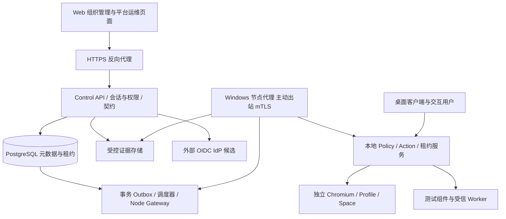

# 管理后台功能与开发计划

> 2026-11-05 / 0.1.13实施更新：三官方支付创建/查询/全额退款、OIDC/PKCE与主体绑定、桌面一次性连接码，以及单持久协调器+多个真实Windows执行节点已实现。双配置、本地独立签名夹具、同机两个真实节点、旧商业业务/SDK/API回归通过。参数默认空并关闭；真实商户、企业IdP、TLS/mTLS握手与第二台机器未验收。详见[本轮逐项实施与测试](44_官方支付OIDC与多机调度实施验收.md)、[操作/部署/编译](45_官方支付企业登录与多机自动化操作部署指南.md)。原完整父包的未完范围继续保留，不把本地协议测试当外部商业验收。

专项版本：1.4。编制与更新日期：2026-11-03。关联主项目v1.4、商业专项1.3：补齐浏览器客户端联动，免费10环境/RPA/Local API及代理规则继续有效。当前已实现商业业务链及单协调器多节点核心，正式部署与原完整验收未完成。

项目目录：`E:\project\webexploer_codex`。本专项承接桌面浏览器工作台，提供组织、成员、环境、执行机器、通用业务自动化和 Web 测试的集中管理，并通过[商业运营专项](11_环境销售计费与商业运营后台计划.md)管理环境销售、计时、续费、席位、支付及授权。自有 C++ 服务与 Windows 执行端继续采用 **VC++2019 / MSVC v142 / C++14 / x64**；新增或修改函数写中文注释及日期，格式化并保留原文件编码。

关联文档：[总计划](01_开发计划与技术方案.md)、[任务与进度](03_开发进度与任务清单.md)、[本地接口](04_AI接口与流程设计样例.md)、[Web 功能测试](05_Web功能测试与便捷操作设计.md)、[边界](06_功能边界与源码补全方案.md)、[VC2019 构建](09_VC2019工程与依赖构建方案.md)、[商业运营](11_环境销售计费与商业运营后台计划.md)。后台工作量独立于本地版 29 周；文档10/11共同构成完整后台计划。

本次范围修订：产品是可销售的多环境浏览器与自动化软件，Web测试只是应用之一。原1.0把商业计费/许可证/续费/席位留待独立立项的结论已被替代；这些现在是商业发布必需功能。本文保留48个ADM基础包，文档11新增40个COM商业包；完整后台为88包、475基线/540–580计划净人日。B1.0仅为内部管理基础里程碑，对外完整收费版C1.0必须同时通过BG4与CG4。

本次免费层按用户最新要求修订：**持续免费10个环境、RPA、Local API及HTTP/HTTPS、SOCKS5、SSH隧道接入，AI调用、Web测试和核心SDK/CLI/MCP功能继续免费。** 主体跨项目/设备/节点持有容量10；本项目计划默认并发10单列，不视为比特实际并发证据。免费自有节点无需订单/绑卡/充值/付费订阅，正常业务同样可用；代理功能不触发购买，超容量/并发或选择额外托管资源才收费。见[商业专项第4节](11_环境销售计费与商业运营后台计划.md#4-商品套餐与定价模型)。

## 1 交付目标、适用场景与完成口径

交付自托管或运营方Web团队/商业管理后台。客户先创建免费环境、选直连/代理、运行RPA/API/测试，查看已持有x/10和运行y/10；组织管理员授权成员/环境/节点，开发者发布流程/用例，人工/AI/外部软件按同一权限运行。超额或选择托管资源再明确购买，查询时长/续费/席位；运营/财务管理政策、商品、库存、支付与账务。具体数据/状态机见文档11。

实际网页操作在已注册的执行端进行。后台能管理浏览器，但不要求把 Chromium 嵌进管理页面；同一受管 Profile 的共享身份、单写入控制、未知业务结果和人工接管语义继续有效。

首版验收：两个项目、六类角色、两台Windows节点、十个独立Profile，完成环境分配、登录/注册测试、查证据、接管、未知结果核对与报告。免费变体证明主体共10容量/默认10运行槽、直连/四类代理免费及跨租户越权拒绝；第11份环境/超额运行拒绝或排队。额外托管资源/更高容量使用明确内部演练付费权益。FG与BT分列，身份角色数量不等于免费席位数量承诺。

当前已实现的接口、页面与可运行服务见文档42；本计划保留更广的节点控制面范围，工作包验收比例按台账计算，不能理解为没有后台源码。总工时与任务见第 20–21 节。

## 2 管理面的范围与迭代

| 管理面 | 使用者 | 主要责任 | 本专项范围 |
| --- | --- | --- | --- |
| 桌面管理工作台 | 单机用户、执行机器上的开发者 | 本机环境、元素拾取、录制、调试、凭据绑定和人工操作 | 沿用本地版，增加团队连接与受控命令桥 |
| Web 组织管理后台 | 团队负责人、开发、操作、测试、审计人员 | 成员/权限、配置目录、节点、流程/测试、调度、报告与审计 | 本专项首版核心 |
| 平台运维管理面 | 自托管部署维护者 | 组织开通/停用、资源配额、服务状态、版本、备份和故障诊断 | 提供最小运维功能，默认不拥有租户业务数据读取权 |
| 商业运营后台与客户门户 | 平台运营/客服/财务、客户付款管理员 | 商品/环境销售、订单/支付、时长、续费、许可证、席位、账单/发票 | 完整后台必需；COM001–COM040、CG4，见文档11 |

| 后台版本 | 参考窗口 | 交付内容 | 开放限制 |
| --- | --- | --- | --- |
| B0 技术验证 | BW1–BW3 | 服务/数据库/前端壳、契约、鉴权/执行端协议原型 | 自建环境验证，不对普通成员开放浏览器写命令 |
| B0.1 管理预览 | BW4–BW8 | 组织成员、权限、节点注册、配置目录和状态查询 | 没有通过分布式控制门的功能只读或禁用 |
| B0.2 自动化测试版 | BW9–BW13 | 固定版本流程/测试运行、队列、租约、取消、未知结果 | 在已通过权限/故障用例的项目和节点内运行 |
| B0.5 完整候选版 | BW14–BW17 | Space 总览、受控预览、接管、调试、报告、配额和运维 | 受控验收环境，不用缺组件跳过必选用例 |
| B1.0 团队稳定版 | BW18–BW20 | 权限/分区/恢复/长稳/升级验收、部署手册与完整制品 | 达到 BG4 后才视为可交付 |
| C1.0 商业稳定版 | 商业专项CW窗口，排程待CG0确认 | 环境销售/计时/续费/席位/支付/账本及通用自动化商业闭环 | BG4与CG4均通过后才具备完整收费交付条件 |

BW 是基础后台周号，与本地版W、商业增量CW分开。B1.0是ADM基础阶段，不能代替C1.0商业发布。Web图形流程画布、完整远程桌面、跨机器无损登录态同步与多地域弹性仍后续单列；环境售卖、计时、续费和席位已纳入完整后台。首轮商业支持单部署多租户及静态受管资源池，公网收费实际启用需完成文档11的部署/运营条件。

## 3 六个核心用户流程

| 场景 | 操作顺序 | 完成判据 |
| --- | --- | --- |
| 团队初始化 | 部署服务 → 受保护的首次组织所有者初始化 → 接入 IdP → 建项目 → 邀请成员 | 无默认公共管理员密码；邀请过期/撤回不能使用 |
| 接入执行机器 | 后台生成一次性注册令牌 → 节点主动连接 → 核对机器/交互用户 → 签发节点身份 | 令牌不可重放，节点归属组织与批准项目明确 |
| 分配浏览器环境 | 选配置模板 → 选节点 → 绑定本机凭据槽 → 检查能力 → 创建独立实例 | 目录归节点管理；配置/身份/权限都可追踪 |
| Web 功能回归 | 选开发/测试地址与角色 → 选择已发布用例/测试集 → 检查前后置 → 运行 → 查报告 | 成功/失败/阻断/跳过/不稳定/unknown 不混淆 |
| 人工协作与恢复 | 查待人工项 → 请求接管 → 执行端确认吊销自动写入 → 本机处理 → 重新观察后交还 | 旧 owner/旧 generation 的所有写路径都被拒绝 |
| 节点离线或提交不明 | 心跳异常 → 停止新派发 → 核对租约/命令 → 冻结未知写 → 查业务资源 → 恢复/补偿 | 不因换机器、重连或重试而重复注册/保存 |

后台账号的邀请/登录，与被测试网站的注册/登录是两套身份体系。测试注册账号不能成为后台成员，后台管理员凭据不得作为网站测试数据。

## 4 组织、项目、角色与资源权限

### 4.1 权限模型

层级为部署 → tenant 组织 → project 项目 → 环境配置/Profile 实例/节点/流程/测试/报告。每次请求由服务端验证 tenantId、projectId、主体、资源关系、动作能力和资源状态；URL 中传 tenantId 不代表被授权。列表、搜索、统计、事件订阅、导出和对象存储访问同样过滤。

组织角色与项目授权共同决定有效能力。节点身份、CI 服务账号和 AI 调用主体是独立主体，不能借用成员 Cookie；短期 token 包含明确 audience、项目、能力、资源和期限。角色调整后服务端及时拒绝新操作并撤销相关活动控制权；不等待网页刷新。

| 动作 | 组织所有者 | 组织管理员 | 开发者 | 操作员 | 测试人员 | 审计员 |
| --- | --- | --- | --- | --- | --- | --- |
| 管理组织与管理员 | 是，转移所有权需原身份校验 | 受限，不能提升为所有者 | 否 | 否 | 否 | 否 |
| 邀请/停用普通成员 | 是 | 是 | 否 | 否 | 否 | 只读审计 |
| 修改项目 ACL/节点授权 | 是 | 是 | 否 | 否 | 否 | 只读审计 |
| 编辑环境配置草稿 | 授权项目内 | 授权项目内 | 授权项目内 | 默认只读 | 默认只读 | 只读元信息 |
| 发布流程/用例 | 另需 publish 能力 | 另需 publish 能力 | 授权项目内 | 否 | 可发布测试，需能力 | 否 |
| 运行已发布任务 | 另需 run 能力 | 另需 run 能力 | 授权项目内 | 授权项目内 | 授权测试内 | 否 |
| 人工接管/调试读取 | 需单独 handoff/debug 能力 | 同左 | 获授时 | 获授时 | 获授时 | 否 |
| 查看截图/请求正文/导出 | 需对应证据能力 | 同左 | 获授时 | 获授时 | 获授时 | 默认仅脱敏摘要 |
| 读取凭据明文 | 无通用读取入口 | 无通用读取入口 | 无通用读取入口 | 无通用读取入口 | 无通用读取入口 | 无 |
| 查审计 | 组织范围 | 组织范围 | 默认本人/项目摘要 | 默认本人/项目摘要 | 默认测试摘要 | 授权范围 |

“组织所有者”不自动拥有任意页面数据、明文凭据或不受限浏览器操作能力。必须由服务端确定有效权限，并在执行节点再次约束命令。平台运维者默认只查看部署/组织状态和资源指标；故障支持若需租户证据，采用显式、限时、限资源的授权并审计。

entitlement同时表达基础免费政策和已购资源，不等同付费订阅。免费所有者/服务账号共享主体10容量及计划默认10槽，不能每token/项目/设备各领10个，基本所有者不要求付费席位。创建/导入/克隆先原子校验容量，运行再校验ACL/节点/effective代理/并发/租约；免费non_billable只预留资源，不访问付款/余额作为前置。四类代理支持与免费身份无收费绑定；席位/设备扩展价格另定，货币/时长预留仅针对明确购买的额外资源。

### 4.2 状态变化与授权细节

- 移除成员：注销服务端会话、吊销其 token、取消尚未派发任务、处理活动租约；已提交业务动作仍需查验。
- 节点移出项目：拒绝新任务，正在执行的任务按原策略暂停/终止后核对；不能把节点瞬间归给另一组织。
- 项目归档：禁止新运行，保留报告/审计，按保留策略处理数据；引用中的资源不能直接物理删除。
- 生产环境：使用独立 environmentClass、origin 白名单及运行能力；测试后端 reset/清理接口只能指向测试命名空间。
- 所有批量变更返回逐项结果和 revision 冲突；不能把批处理部分成功展示为全部成功。

## 5 信息架构与页面导航

```text
组织管理
  总览 / 待处理事项
  项目 / 成员 / 角色与权限 / 服务账号
浏览器资源
  环境配置 / Profile 实例 / 模板 / 配置分发记录
  代理目录 / 扩展目录 / 凭据槽 / 知识包
执行与自动化
  执行节点 / 节点详情 / 兼容性与诊断
  流程与版本 / 任务批次 / 定时计划 / 队列
  Space 总览 / 待人工接管 / 未知结果核对
Web 功能测试
  测试项目 / 环境地址与角色 / 用例与测试集
  数据与前后置 / 测试运行 / 报告与问题
观测与治理
  日志与事件 / 证据 / 审计 / 配额与保留 / 服务状态
平台运维（独立权限与路由）
  组织开通与资源限额 / 部署配置 / 版本与升级 / 备份恢复
```

页面统一显示当前组织/项目/环境类别；切换上下文清除旧缓存与事件订阅。列表支持分页、筛选、标签和导出权限；详情页显示版本、实际状态、最近检测时间、失败原因和下一步。离线、陈旧、未知、未配置、无权限分别呈现，不能统一成绿色“正常”。

## 6 后台功能矩阵 MF01–MF36

下表是后台功能编号，与原 F01–F65 分开。P0 为团队运行链路必需，P1 为稳定交付所需；每项最低验收通过后才声明支持。

| ID | 功能 | 优先级 | 主要内容与最低验收 | 工作包 | 验收 |
| --- | --- | --- | --- | --- | --- |
| MF01 | 总览与待处理事项 | P1 | 节点/队列/运行/失败/待人工可筛选，统计遵循资源权限且标明时间范围 | ADM011/ADM029/ADM033 | BT01 |
| MF02 | 组织和项目 | P0 | 创建/停用/归档、项目配额与资源归属；禁止跨组织引用 | ADM006/ADM007 | BT02 |
| MF03 | 成员与邀请 | P0 | 一次性邀请、角色分配、停用与会话/任务影响可追踪 | ADM006 | BT03 |
| MF04 | 角色、ACL 与能力 | P0 | UI/API/事件/导出/Worker 一致判权；无默认越权 | ADM007/ADM041 | BT04 |
| MF05 | 登录、会话与 SSO | P0 | OIDC、会话过期/注销/禁用、恢复管理员流程 | ADM005/ADM035 | BT05 |
| MF06 | 执行节点注册 | P0 | 一次性令牌、节点证书、归属和设备确认；重放拒绝 | ADM009/ADM010 | BT06 |
| MF07 | 节点与交互会话 | P0 | 在线/离线/维护、用户会话、心跳与容量；服务会话不冒充可操作桌面 | ADM011/ADM038 | BT07 |
| MF08 | 节点能力与版本 | P0 | 驱动、协议、浏览器/Worker/契约版本；不支持时运行前阻断 | ADM012/ADM034 | BT08 |
| MF09 | 环境和实例目录 | P0 | 配置与物理实例分开，归属/状态/节点/目录元信息可追踪 | ADM013 | BT09 |
| MF10 | 配置版本与分发 | P0 | 固定 revision、差异预览、节点 ACK/应用结果；不覆盖运行态禁改项 | ADM014/ADM032 | BT10 |
| MF11 | 实例迁移与恢复 | P1 | 停机一致性、来源/目标绑定、重新登录限制；不共享浏览器目录 | ADM015 | BT11 |
| MF12 | 免费代理目录与分配 | P1 | HTTP/HTTPS/SOCKS5/SSH接入、槽绑定/effective路由；能力/认证/故障明确，不因免费身份拒绝 | ADM030 | BT12 |
| MF13 | 扩展目录与策略 | P1 | 来源/版本/权限、分配与应用记录；不执行任意上传插件 | ADM030 | BT13 |
| MF14 | 凭据槽与秘密绑定 | P0 | 中央只存元信息；节点保管明文，域/项目/用途检查、诊断脱敏 | ADM016/ADM035 | BT14 |
| MF15 | 流程与版本管理 | P0 | 导入/编辑受限草稿、校验、发布、固定 hash 和运行引用 | ADM017 | BT15 |
| MF16 | 用例、测试集与模板 | P0 | 登录/注册/按钮断言、角色、已发布用例集、参数预检 | ADM018/ADM044 | BT16 |
| MF17 | 批次、队列与任务运行 | P0 | 能力匹配、排队/取消、逐项结果、去重与有界并发 | ADM019/ADM020/ADM032 | BT17 |
| MF18 | 定时与漏跑处理 | P1 | 时区、DST、触发 ID、去重、暂停/补跑策略可见 | ADM024 | BT18 |
| MF19 | 分布式租约与 fencing | P0 | 服务端权威代数与节点本地派发门，离线不同时产生第二写入者 | ADM021/ADM042 | BT19 |
| MF20 | 未知结果与补偿 | P0 | unknown 冻结、业务查验、新授权补偿、失败污染隔离 | ADM021/ADM022/ADM043 | BT20 |
| MF21 | Space 总览与预览 | P1 | owner/任务/身份关系、限频预览、敏感页关闭、陈旧标记 | ADM025 | BT21 |
| MF22 | 人工接管与交还 | P0 | 排空/吊销确认、全写入口门禁；未确认不显示已安全接管 | ADM022/ADM026 | BT22 |
| MF23 | Console/Network 调试 | P1 | 步骤关联、按需读敏感正文、超时/截断/权限；无通用 raw CDP | ADM027 | BT23 |
| MF24 | 报告、证据与导出 | P0 | HTML/JSON/JUnit、签名短期下载、恶意内容隔离、状态真实 | ADM028/ADM029 | BT24 |
| MF25 | 测试数据与前后置 | P0 | 测试命名空间、唯一数据、清理失败与污染阻断、远端地址含义明确 | ADM018/ADM019/ADM044 | BT25 |
| MF26 | 免费AI/CI与资源预算 | P1 | RPA/Local API/AI/测试免费，主体10容量/默认10槽，付费资源预算与模型独立归因 | ADM007/ADM023 | BT26 |
| MF27 | 模板与知识包 | P1 | 固定版本、适用站点、导入差异、许可与禁止内容检查 | ADM017/ADM031 | BT27 |
| MF28 | 审计与追踪 | P0 | 谁在何时对何资源做何操作、拒绝/失败也有记录；权限过滤 | ADM008/ADM037 | BT28 |
| MF29 | 配额和数据保留 | P1 | 并发/队列/图像/磁盘限额原子生效；清理不破坏活动证据链 | ADM023/ADM028/ADM033 | BT29 |
| MF30 | 诊断与待修复项 | P1 | 缺组件/端口/版本/磁盘/认证有影响范围与建议，检查默认只读 | ADM012/ADM027/ADM037 | BT30 |
| MF31 | 平台组织与限额 | P1 | 开通/停用组织、资源额度与服务状态；平台角色不读取租户秘密 | ADM033 | BT31 |
| MF32 | 策略、审批与发布控制 | P1 | 能力/环境规则、必要高风险审批、配置/版本差异可追踪 | ADM023/ADM034 | BT32 |
| MF33 | 备份、灾备和恢复 | P0 | 元数据/证据/密钥分别恢复；旧调度代数失效，未知任务不盲重跑 | ADM036/ADM046 | BT33 |
| MF34 | 指标、告警与健康 | P1 | 排队/拒绝/unknown/节点/DB/存储指标；告警聚合，不携带秘密 | ADM037/ADM040 | BT34 |
| MF35 | 安装、升级与回滚 | P0 | 干净机部署、版本兼容、数据迁移、Windows 会话/CRT 检查 | ADM034/ADM038/ADM046 | BT35 |
| MF36 | 系统设置和集成 | P1 | API/CI token 生命周期、IdP/证书/端点配置与审计，无任意脚本入口 | ADM003/ADM005/ADM035/ADM039 | BT36 |

## 7 页面与交互细化

### 7.1 总览、项目和成员

总览展示当前项目的运行、失败、排队、节点、unknown、待人工和配额，不默认展示组织全部数据。每个指标可进入带相同筛选的列表。成员页分别列有效成员、邀请、停用、服务账号；邀请凭据只显示一次，缺少邮件服务时提供受控复制链接，不要求为了普通后台登录接入邮件供应商。

角色编辑提供权限差异预览、资源范围和受影响活动任务；服务端判断是否允许提升。组织所有权转移、恢复管理员和停用组织提供明确步骤及审计，禁止修改数据库直接跳过状态机作为日常操作流程。

### 7.2 环境配置、实例和分发

环境详情页分“配置定义”“实例”“检测证据”“分发”“运行”“历史”页签。配置包含浏览器/驱动约束、代理槽、扩展、语言/时区/视口、origin 范围和测试项目；实例记录所属节点、交互用户、profileInstanceId、状态和有效版本。requested/effective 对照保留，未知值不伪装正常。

批量分发先检查目标节点能力/凭据槽/配额，返回预计变更、重启要求和不兼容项。用户提交后进入 operation，分别展示 queued/accepted/applying/applied/failed/blocked；HTTP 接收或节点 ACK 都不等于已生效。后台没有任意浏览器启动参数和任意宿主路径输入框。

克隆配置默认创建全新身份实例。复制登录态、跨节点迁移和恢复备份是独立操作，不称“无损同步”。同一个 Profile 实例只能由其所属节点持有本地目录，服务端不把网络共享目录分发给多个 Chromium 进程。

### 7.3 执行节点详情

展示节点证书身份、批准组织/项目、OS/架构、程序/协议/契约版本、驱动和可选组件、浏览器版本、当前 Windows 交互用户/桌面会话、心跳、正在执行的租约、配额和诊断。

“维护模式”阻止新任务并允许现有任务按策略完成/暂停；“停用”吊销身份并停止后续派发，未决任务需核对。节点重装/证书丢失按新注册处理，不只凭机器名自动恢复旧身份。NAT 节点主动建立出站通道，管理端不要求开放节点入站 CDP 端口。

### 7.4 流程、测试项目与测试集

首版 Web 编辑器支持步骤表单、参数/断言配置、受限 DSL JSON 编辑、导入、校验和版本 diff，复用同一 DSL。桌面复杂图形画布继续可用；完整 Web DAG 拖拽画布另估，不在本专项重复开发一整套。

测试项目提供开发/测试地址、路径、角色、数据槽、后端钩子、邮件/IdP/Mock/视觉组件能力。登录、注册、退出、按钮点击、字段填写、请求和结果断言沿用现有模板。后台通过固定模板/已发布版本运行；节点端元素探查与录制可由桌面客户端完成后同步草稿。首版不承诺在 Web 后台远程任意点击截图即可完整录制所有控件。

运行前显示实际节点、目标 origin、环境类别、角色、数据准备/清理、缺失组件、所需权限和预算。远端节点的 `localhost` 指该节点自身；开发机应用需部署到节点可访问测试地址，或另行配置有明确授权的开发隧道，不能自动公开本机端口。

### 7.5 任务详情、接管和未知结果

任务详情显示不可变流程/用例 hash、输入摘要、实际实例、状态/步骤、业务 outcome、控制命令、事件时间线、断言、请求和证据。显示已发动作与尚未派发动作，取消后保留“已提交、待查验”等事实。

接管按钮先发受控命令，节点吊销本地自动租约并排空待发动作，再返回确认；状态变为 handoff-ready 后才能表明自动派发已阻断。首版交接到节点上的桌面客户端/本机人工；不提供任意远程桌面、通用键鼠隧道或不受限 DevTools。网页预览只读，若后续加入远程交互，需要独立授权和输入协议验收。

unknown 页面提供“查看证据”“业务查验”“标记查验结果”“生成授权补偿/新运行”，要求说明和结果证据，不提供通用“一键强制重试注册”。人工标记不得改写历史步骤或删除失败分母。

### 7.6 报告、证据、诊断与运维

报告按项目、运行、版本、角色、标签、时间和失败原因筛选。截图/视频/正文需要额外权限，短期下载 URL 绑定主体/对象/用途；报告中的第三方 HTML 通过隔离域或安全 sandbox 呈现，禁止执行页面采集的脚本。导出审计权限与内容权限分开检查。

诊断提供结构化code、影响能力、证据和建议；服务/节点工具存在不代表构建或行为通过。基础运维页管理组织配额、版本、备份和服务指标，商业页另按文档11管理商品、账单、计量、续费和席位，并作为C1.0必需依赖。告警提供站内事件/仪表盘；邮件/IM/Webhook出站通知按配置验收，本次不创建实际外部联系。

免费/付费页面分别显示持有容量、运行并发、政策、代理协议/实际路由及资源来源；免费无到期欠费提示。第11份容量拒绝保留草稿，运行槽满排队/扩容；支持的代理可直接配置，不显示需升级。付费到期选择最多10份环境/默认10活动会话，核对归属/停止后回落，保留合法代理/IP和数据；额外租用节点/线路本身期限独立处理，见文档11第4.3节。

## 8 总体架构与技术选型



### 8.1 首轮推荐组件

| 层 | 推荐方案 | 准入门和替代 |
| --- | --- | --- |
| 自有 Control API/调度/网关 | C++14、VS2019/v142/x64，共享领域契约，使用无 GUI 的服务目标 | 先验证传输/数据库/OIDC/并发；不默认将 Qt Widgets 链入服务 |
| API 传输 | 沿用已列 CivetWeb C API 或独立 Qt Network 适配，单选并验证 | 认证、WS/SSE、TLS、超时、取消/背压；不叠加多个未经验证服务器 |
| JSON/契约 | 现有 nlohmann/json、draft-07 Schema 和契约生成器 | 原生 `/api/v1` 与控制面 `/control/v1` 分版本，生成规则可复用 |
| 事务数据库 | PostgreSQL 候选，使用 libpq C API 的窄适配层 | 固定受支持版本，实测 v142/CRT/连接池/事务；SQLite 保留节点本地用途 |
| Web 前端 | Vue3/TypeScript/Vite 候选；编译成静态文件 | Node 仅作构建工具，不改变 C++ 服务语言；依赖/许可/浏览器支持待锁定 |
| 身份认证 | Keycloak/OIDC 候选，服务端会话/BFF | 验证 OIDC/JWT 库的 v142 兼容，不能自行设计签名算法；受控鉴权代理为备选 |
| TLS/节点证书 | Windows 系统证书能力或锁定的 TLS 库，节点 mTLS | CA/用途/期限/吊销/轮换、丢失恢复；不把证书字符串当可靠机器标识 |
| 存储 | 首版单节点受保护文件存储适配；兼容对象存储接口作为后续替换点 | 所有读取经过主体/资源检查，上传校验类型/大小/hash 和保留策略 |
| 队列与事件 | PostgreSQL 事务 outbox + 受控网关 + 有界事件缓冲 | 首版无需先部署 Redis/Kafka；新增中间件另做一致性与维护估算 |
| 部署 | Windows x64 自托管；管理服务可作 Windows 服务，浏览器在交互用户会话 | 候选 Windows Server 版本先做依赖/CRT 验收；Linux 服务端另设工具链与部署范围 |

本节是方案候选，未在本次进行新增上游源码/许可/构建验证。[PostgreSQL](https://www.postgresql.org/)、[libpq](https://www.postgresql.org/docs/current/libpq.html)、[Vue](https://vuejs.org/)、[Vite](https://vite.dev/) 和 [Keycloak](https://www.keycloak.org/) 链接用于后续准入查证；不能据名称直接认定指定版本满足 v142 或分发要求。既有 45 个仓库候选统计不变。

### 8.2 服务拆分与构建边界

首版采用可分模块的单部署控制面，API、调度、网关和后台作业边界明确；无需提前拆成大量微服务。可扩展多个 API 实例，但调度的原子领取、epoch 和租约由数据库约束，不依赖“只启动一个进程”的假设。首轮以单控制面实例部署通过验收，再验证主备恢复；跨地域多活不在首版。

服务端、节点和前端有各自构建产物。自有 C++ 目标显式 C++14、Debug/Release、v142、匹配 CRT；libpq/Qt/TLS 等依赖逐项检查 ABI、来源、部署。新增函数写实际日期的中文说明，前端/脚本函数同样说明用途与边界；修改前记录编码/BOM/换行，不能格式化时顺便全仓转码。

Windows 服务通常运行在非交互会话。服务只能做安全网络接入/受控 IPC，浏览器 Agent 需运行在授权交互用户会话；锁屏、退出、RDP 断开、桌面缺失和系统弹窗的支持范围分别测量。不能把 LocalSystem 服务启动 Chromium 当作完整无人值守方案。

## 9 数据所有权、中央表与节点状态

### 9.1 存储归属

| 数据 | 权威位置 | 共享/同步方式 | 重要限制 |
| --- | --- | --- | --- |
| 组织/项目/角色/授权/配额 | 中央事务库 | 版本化 API/事件，节点缓存有期限 | 缓存不能永远维持已吊销权限 |
| 环境配置定义/流程/用例 | 中央版本库与元数据 | 固定 revision/hash 的受控包 | 发布版本不可变，运行不读取可变草稿 |
| Profile 物理实例与浏览器目录 | 所属执行节点 | 中央保存目录别名/实例元信息 | 不挂载共享目录让多节点并写 |
| Cookie/IndexedDB/SW/设备绑定状态 | 节点浏览器 Profile | 显式停机备份/迁移流程 | DPAPI/站点设备密钥可能不可迁移，需重登 |
| 网站/代理/模型凭据 | 节点凭据保管层 | 中央仅槽和绑定状态 | 首版不集中收集明文，不把 SecretRef 当加密本身 |
| 调度/控制租约与 outbox | 中央事务库；节点保存已接受命令及本地 fencing | 带 epoch/deadline 的受控消息 | 数据库恢复和节点重启必须避免旧命令复活 |
| 运行事件与证据 | 节点先记录，按权限上传中央存储 | 去重事件、分片/校验上传、manifest | 上传成功不代表业务成功；断线保留缺口标记 |
| 审计 | 中央追加记录及独立备份/可选外部锚点 | 有权限的查询与导出 | 本地数据库 owner 可篡改，不能宣称绝对不可篡改 |

### 9.2 中央数据表草案

| 表/聚合 | 核心字段与约束 |
| --- | --- |
| tenants / projects | 不透明 ID、状态、revision、配额、environmentClass；项目必须归单一组织 |
| subjects / memberships / invitations | 外部 issuer+sub、组织成员、到期/撤回/使用状态；邀请令牌存摘要 |
| roles / grants / service_accounts | 能力、项目/资源范围、期限、吊销版本；服务账号 token 不存可还原明文 |
| nodes / node_sessions / node_credentials | 组织归属、证书序列/公钥绑定、bootId、交互会话、版本/能力、心跳 |
| profile_specs / profile_instances | 配置版本与实例分离；实例固定 nodeId/交互用户，迁移有 assignmentGeneration |
| configuration_releases / distribution_operations | 固定 hash、目标、revision、逐项接受/应用/失败及原因 |
| credential_slots / node_bindings | 用途、origin、项目、版本、节点存在性；不包含网站密码/代理密码/模型 key |
| workflow_versions / test_case_versions / test_suite_versions | 草稿与发布对象分离，引用闭包和来源/内容 hash |
| schedules / trigger_occurrences | 时区/规则/漏跑策略、唯一 triggerId、状态；DST 行为显式 |
| runs / run_attempts / steps | 不可变输入引用、业务 outcome、控制状态、未知/补偿关联、attempt ID |
| leases / node_commands / command_receipts | 资源/owner/epoch/deadline、正文 hash、接受/派发/结果、重放拒绝 |
| outbox / inbound_event_dedup | 事务写入待发事件；节点/bootId/序号去重、缺口和重连 cursor |
| artifacts / upload_sessions / report_manifests | 所属组织/项目/run、hash/size/type、权限/保留、分片完成状态 |
| approvals / policy_revisions | 决策主体/理由/范围/版本/到期；不能复用到其他正文或资源 |
| quota_reservations / usage_records | 原子预留/释放、实际用量、幂等对账；unknown 不按零消费回收 |
| audit_events / diagnostic_events | 主体、租户、请求、动作、资源、结果、脱敏差异、服务/节点时间 |

租户/项目字段进入查询和复合外键/唯一约束，阻止错误跨租户引用；数据库 RLS 若采用，需验证应用账号和维护账号权限，不能仅依赖一条 ORM 全局过滤。事务持有期间不等待节点网络回应；先提交 outbox，再收结果推进状态。浏览器目录不存进中央数据库。

## 10 节点注册、通信与配置下发

### 10.1 注册和证书生命周期

管理员创建一次性、短期、有用途/组织范围的 enrollment，节点在本地生成密钥并主动向中央注册。中央校验令牌和批准状态后签发节点身份；登记 bootId、能力与交互用户。密钥留在系统保护存储，注册 token 使用后失效，不进入日志/安装包。

日常通道使用 TLS 和节点身份，按所选协议验证 audience、证书用途/期限、吊销和组织归属；不能因 TLS 握手成功就允许访问所有项目。轮换允许短时受控重叠，旧身份到期/吊销后新命令拒绝。离线节点不能续用过期身份无限执行中央任务。

节点主动建立出站 443 通道，HTTPS 轮询可作降级，协议版本、心跳、背压和重连语义一致。中央不返回 raw CDP 地址到 Web/AI/SDK；节点调用本机共享 Policy/Action 服务，默认无 arbitrary executable/script/path 输入。

### 10.2 配置与命令协议

公共信封至少有 protocolVersion、tenantId/projectId、nodeId/bootId、commandId/requestId、profileInstanceId、assignmentGeneration、leaseEpoch、deadline、payloadHash、固定资源版本、能力/来源和取消上下文。节点先验证组织/资源/版本/期限/代数，再写本地接收日志和返回 ACK；执行前再次检查，旧消息不能因队列延迟获得新权限。

消息按性质区分 query/configuration/browser-action/run/control。配置接受、浏览器动作派发、目标业务成功和证据上传是独立事实。节点事件至少有 eventId、bootId、序号、run/step、commandId、eventTime/receivedAt、outcome 和证据；中央不拿最后到达的事件直接覆盖状态。

“至少一次投递 + 命令接收去重”只能限制协议重复，不保证外部网站业务 exactly-once。正文 hash 冲突明确失败；重试既有 commandId 返回已有结果，新 attempt 必须有业务恢复依据。旧节点的迟到证据可追加，但不能恢复被吊销的写权或覆盖新 owner 的终态。

## 11 分布式租约、接管和未知结果

### 11.1 控制原则

一个物理 Profile 实例默认只有一个自动写入者。中央 lease 与节点本地 lease 的标识、generation/epoch 和 owner 对齐；节点在入队、出队、协议发送前检查，UI、REST、CLI、MCP、Workflow、Worker 和调试入口共用门禁。新授权或接管使旧代数失效。

建议 POC 初值：中央授予最长 60 秒、每 15 秒续租，节点在到期前留保护裕量停止派发；具体值由网络/时钟/长动作测试决定。节点使用单调时钟计算已授予有效期，不能只相信可跳变的墙钟。中央租约到期不等于节点上的浏览器已经停止，更不等于已提交业务没有发生。

首版对有状态实例默认**关闭基于心跳的自动跨节点接管**。重新授予前需原节点确认停止/释放，或可靠确认进程终止并完成状态查验；无法确认则隔离、冻结并人工核对。仅从未派发或明确幂等且有独立身份/业务依据的任务允许按策略重新调度。不能凭数据库锁过期就把同一身份在另一机器重开。

### 11.2 状态与故障结果

| 场景 | 中央处理 | 节点处理 | 结果要求 |
| --- | --- | --- | --- |
| 排队期间取消/权限撤销 | 更新命令/授权代数，拒绝后续领取 | 收到/派发前再校验 | 不发送取消前尚未发送的动作 |
| 收到命令但未派发即崩溃 | 查询 receipt/本地日志，不假定业务已执行 | 重启核对，旧 boot 消息无权直接执行 | 可确认未执行才按策略重排 |
| 提交已到网站但结果丢失 | 标记 outcomeUnknown，阻断依赖写 | 保存派发证据，不透明重发 | 查验账号/订单/资源是否已存在 |
| 网络分区/心跳超时 | 停止新派发，显示 disconnected/stale | 授权到期/提前吊销后停止新写 | 已发动作单列，不能报“全部停止成功” |
| 人工接管 | 发布 handoff，等待节点排空/吊销确认 | 所有自动写路径失效，交本机人工 | 未确认时保持 handoff-pending |
| 控制面重启/主备切换 | 事务重新领取、提升协调 epoch、核对未决命令 | 拒绝旧 epoch，重新协商 | 不重复派发未知写，不重开旧租约 |
| 恢复旧数据库备份 | 服务保持恢复模式，提升部署/调度代数，核对各节点账本 | 接受新协调前不上线写任务 | 旧 outbox/触发/租约不能复活 |
| 桌面端本机人工接管 | 接收本机事实并冻结相应中央派发 | 立即吊销自动租约，无需等待外网 | 中央短暂陈旧不影响本地立即急停 |

已发布任务发生 unknown 时，补偿是独立新授权步骤，保持原结果/证据；补偿失败记录污染并阻断相关测试。停止、回滚程序版本和恢复浏览器备份都不能撤销外部网站已发生的交易。

## 12 Web 功能测试、AI 与调度边界

执行节点复用本地版 WT01–WT48、AT01–AT12 的模板、动作、断言、Schema、报告和受信 Worker，不另建一套行为不一致的后台自动化引擎。中央发送冻结的 run 包，节点负责页面动作和本地事件预注册；不把每次 DOM 轮询都放到公网往返。

登录/注册测试使用 run/case/attempt 唯一标记，账号/数据准备与清理由项目授权钩子完成。测试角色、已登录状态和多个账号并行用不同 Profile 实例；同 Profile 的多个 Space 共享身份。在测试节点缺 Mailpit/IdP/Mock/OCR 时，只阻断使用该能力的用例；普通登录可继续运行。

AI/CI/RPA与Local API调用校验/运行/查询/取消等核心功能免费。模型key留节点，自配模型/线路账单独立；付费资源才做金额/时长预算预留，免费仅诊断计时。测试/流程按主体10容量/默认10槽及节点真实能力排队，purpose=test不绕资源或ACL，合法代理不要求购买。自然语言生成只产草稿，页面不能改授权或执行宿主代码。MCP Streamable HTTP仍为原T108后续能力，后台存在不代表远程MCP已实现。

定时计划由中央生成唯一 occurrence/triggerId，再调度到获授节点；节点不再对同一中央计划自行重复计时。本地独立计划与中央计划用不同 scheduleAuthority，连接团队时检测冲突并显式选择。时区、DST、休眠、漏跑、补跑、截止和最大积压均有策略；批量任务按项目/节点/身份配额公平排队，不能一个租户占满全部服务。

## 13 身份、秘密和接口保护

后台使用 OIDC 授权码/PKCE、state/nonce、issuer/audience/签名/期限校验与服务端会话。推荐 BFF 和 HttpOnly/Secure/SameSite Cookie，写操作增加 CSRF/Origin 检查；refresh token 不放浏览器 localStorage。JWKS 更新、IdP 不可用、密钥轮换、注销/停用和时钟误差有明确失败语义，不把任意 JWT 解码成功当登录成功。

首位部署管理员通过受保护的一次性初始化流程创建，部署后关闭初始化入口；自托管部署公开注册默认关闭。运营方产品另有客户注册入口，允许无购买创建客户主体并发基础免费权益，不能把部署初始化或财务开户作为免费使用前置；公开注册的邮箱核验、速率和滥用策略在CG0明示。开发环境模拟身份不得进发布包。IdP候选不能通过v142库集成时，可用受保护鉴权代理，但后端只接受可信入口且签名/身份可验证的结果，不能盲信X-User等可伪造请求头。

中央保存网站/代理/模型凭据槽的名字、用途、origin、项目、绑定节点和是否可用，不保存明文。用户在节点桌面凭据页绑定并受 DPAPI/系统凭据保护；Web 只收到可用性，不提供“查看密码”。跨节点换机重新绑定或使用后续独立密钥方案；中央 Vault/KMS 与浏览器端端到端秘密下发不在首版，避免把未设计的加密传输写成已完成能力。

日志/截图/请求/测试数据仍可能含秘密，需敏感标记、canary 检查、权限、保留和导出预览。代理 URL、验证码、激活链接、Authorization、Cookie、原生调试端点和个人路径不得进入默认指标/诊断。加密数据库备份、审计备份、签名密钥与节点私钥分别保管；组织管理员不能导出节点系统密钥。

## 14 审计、配额、证据与运维

审计记录 requestId、主体/来源、租户/项目、资源、动作、授权/策略版本、前后脱敏摘要、成功/拒绝/失败、节点/租约/命令与证据。管理员修改权限、配置发布、运行/取消/接管、token/证书、导出/删除、组织停用和恢复均留痕。审计写入失败时，管理敏感操作默认拒绝或进入明确受控降级，不能无声继续。

资源配额包括活跃节点、实例、并发运行、队列深度、控制请求速率、预览、上传、证据容量、测试批次数和 AI 预算；服务端原子预留/释放，节点本地也有硬限制。队列满返回 429/Retry-After，超大输入 413，磁盘不足暂停新产物并保留控制/失败记录，不能以丢日志后正常结束掩盖失败。

初始保留建议：运行摘要 90 天、审计 180 天、详细日志 14 天、截图/正文 7 天，按项目可缩短或授权延长；这是待确认默认值。活动/unknown/审计保全资源进入受限保留，超过配额须显式处置，不能无限占盘。删除采用先标记、检查引用、受控 GC 与审计，短期 URL 失效后不能绕过访问检查。

部署提供内部 HTTPS、节点网关、PostgreSQL、受控存储、证书和 IdP 配置指南。Windows 服务以最小权限运行；浏览器依赖交互用户 Agent。升级先备份、验证版本/Schema、进入维护模式、排空/核对运行，再迁移；破坏性 schema 不承诺随意二进制降级。

建议灾备目标：元数据 RPO≤15 分钟、RTO≤4 小时；需要实际备份/PITR 和恢复演练证明。证据文件首轮 RPO≤24 小时，manifest 与缺失对象分别核对，不以数据库恢复成功表示截图都已恢复。恢复旧调度记录必须提升协调代数并对账，不能自动重放所有未完成任务。

## 15 控制面 API 草案

前缀为 `/control/v1`，与节点本地 `/api/v1` 分开；统一契约生成器可复用定义结构，但组织授权与节点身份是新增服务端责任。默认 HTTPS、版本/contractHash、opaque ID、分页 cursor、If-Match、requestId、deadline、operation/run 查询和结构化错误。

| 方法与资源 | 用途 | 关键限制 |
| --- | --- | --- |
| GET `/session`；POST `/session/logout` | 当前后台身份/组织及注销 | 服务端会话、CSRF、防缓存 |
| GET/POST `/tenants`；PATCH `/tenants/{id}` | 平台开通/停用组织 | 平台运维能力，不能读取租户业务秘密 |
| GET/POST `/projects`；PATCH `/projects/{id}` | 项目配置/归档 | tenant/project 授权、revision |
| GET/POST `/invitations`；DELETE `/invitations/{id}` | 邀请/撤回成员 | 一次性令牌、到期/作用域；不默认发送外部消息 |
| GET `/members`；PATCH `/members/{id}` | 成员与状态 | 变更权限与活动租约联动 |
| GET/POST `/roles`；GET/POST `/grants` | 角色和资源授权 | 禁止自我提升/越权资源 |
| POST `/service-accounts`；POST `/tokens/{id}/revoke` | AI/CI 主体与 token | 资源/能力/audience/期限，明文只显示一次 |
| POST `/node-enrollments`；POST `/nodes/register` | 节点注册 | 单次 token、设备密钥、归属确认 |
| GET `/nodes`；GET/PATCH `/nodes/{id}` | 节点/会话/维护状态 | 项目过滤，变更不是立即停止的证明 |
| POST `/nodes/{id}/credentials/rotate` | 轮换节点身份 | 受保护身份、旧证书截止和确认 |
| GET `/nodes/{id}/capabilities` | 能力/版本/诊断摘要 | stale/unknown 可见，不出原生 ws |
| GET/POST `/profile-specs`；PATCH `/profile-specs/{id}` | 环境配置草稿 | origin、参数白名单、revision |
| POST `/profile-specs/{id}/releases` | 固定配置版本 | hash、能力/秘密槽检查 |
| GET/POST `/profile-instances` | 实例目录/创建请求 | node/user 归属、不共享目录 |
| POST `/configuration-distributions` | 多节点分发版本 | 逐项 operation、ACK/应用分离 |
| POST `/profile-instances/{id}/migrations` | 停机迁移流程 | 确认停止/状态、重新绑定/重登录限制 |
| GET/POST `/credential-slots`；GET `/node-bindings` | 凭据元信息/绑定状态 | 不提供网站/代理/模型秘密读取 |
| GET/POST `/workflow-drafts`；POST `/workflow-versions` | 流程导入/编辑/发布 | 受限 DSL、Schema/权限，固定 hash |
| GET/POST `/web-test-projects`、`/test-cases`、`/test-suites` | 测试资产 | 角色/数据/前后置/站点适用性 |
| POST `/runs/validate`；POST `/runs`；GET `/runs/{id}` | 预检/运行/状态 | 固定版本、实例、预算、权限/租约 |
| POST `/runs/{id}/pause`、`/cancel` | 控制运行 | 接收/确认/已发生业务分开 |
| POST `/runs/{id}/handoffs` | 请求人工接管 | 节点确认前不报已安全交接 |
| POST `/runs/{id}/reconciliations` | unknown 结果查验 | 证据/理由，不改写历史事实 |
| POST `/runs/{id}/compensations` | 新补偿操作 | 独立授权/固定动作/查验前置 |
| GET/POST `/schedules` | 中央定时计划 | 时区、triggerId、去重和积压限制 |
| GET `/spaces`；POST `/spaces/{id}/previews` | Space 状态/预览订阅 | screen.read、配额/期限、只读 |
| GET `/runs/{id}/events`、`/diagnostics` | 时间线/调试摘要 | cursor 重连、内容能力、截断 |
| GET `/reports`；POST `/report-exports` | 报告与导出 | 内容访问+导出权限、隔离 HTML |
| POST `/artifact-uploads`；GET `/artifacts/{id}` | 证据上传/读取 | 分片 hash、主体/run 归属、短期地址 |
| GET `/audit-events`、`/quotas`、`/health` | 审计/限额/服务状态 | 分级健康信息，不泄漏 secrets/内部地址 |
| GET/POST `/system-policies`、`/backup-operations` | 平台策略/备份 | 独立能力、revision、审计；恢复有维护门 |

节点网关消息协议不等同 Web 事件订阅；REST SSE 不等于 MCP 传输。兼容 BitBrowser 的本地子集也不自动暴露到公网控制面。未知字段/操作明确拒绝，不能 success 后忽略。

### 15.1 关键错误语义

| code | 返回与处理 |
| --- | --- |
| TENANT_RESOURCE_MISMATCH | 跨组织引用拒绝；不泄漏目标资源是否存在 |
| PERMISSION_REVOKED | 新命令拒绝并处理相应租约；已发动作查验 |
| NODE_NOT_READY | 节点离线/无交互会话/维护/组件缺失；blocked |
| NODE_CAPABILITY_MISMATCH | 协议/版本/运行能力不足；展示可操作诊断 |
| CONFIG_REVISION_CONFLICT | 412，读取新 revision 后解决，不盲覆盖 |
| LEASE_EPOCH_STALE | 拒绝旧代数，不自动取新租约再执行旧写 |
| ASSIGNMENT_UNCONFIRMED | 实例迁移/归属或原节点停止未确认，冻结 |
| COMMAND_PAYLOAD_CONFLICT | 同 commandId 不同正文，409，不执行 |
| OUTCOME_UNKNOWN | 业务是否完成未知，阻断依赖写并进入查验 |
| REMOTE_LOCALHOST_UNREACHABLE | 节点无法访问声明站点，解释 localhost 所属机器 |
| QUOTA_EXCEEDED | 429 或 blocked，返回配额范围/重试策略 |
| ARTIFACT_INCOMPLETE | 证据缺片/hash 不符，报告保留缺失，不假装完整 |
| RECOVERY_RECONCILIATION_REQUIRED | 控制面/数据库恢复后，节点/任务待对账，禁止自动重放 |

## 16 两个运行契约示例

示例都是设计占位值，hash/签名不代表真实可验证凭据；正式契约在 ADM003/ADM020/ADM021 固定。网页不获得节点本地目录、网站密码或 raw CDP。

### 16.1 后台提交注册后登录测试

```json
{
  "requestId": "req-example-register-001",
  "projectId": "project-web-demo",
  "workflowVersionId": "workflow-register-login-v3",
  "workflowHash": "sha256:example-workflow-hash",
  "testSuiteVersionId": "suite-auth-v2",
  "profileInstanceId": "instance-demo-node-a",
  "targetEnvironment": "test",
  "input": {
    "baseUrl": "https://test.example.invalid",
    "role": "test-member",
    "datasetRef": "dataset-unique-auth-fixture"
  },
  "credentialSlots": ["test-login-slot"],
  "budget": {
    "maxDurationSeconds": 600,
    "maxSteps": 100,
    "maxArtifactBytes": 52428800
  },
  "onOutcomeUnknown": "freeze-and-reconcile"
}
```

服务端预检项目/环境/节点能力、发布引用闭包、凭据槽、配额和授权，再事务创建 run/outbox。202 只表示受理。角色/数据集引用属于该测试项目；不能让输入改成任意生产清理地址。

### 16.2 中央到节点的受控命令

```json
{
  "protocolVersion": "control-node/1-draft",
  "commandId": "command-example-1001",
  "tenantId": "tenant-demo",
  "projectId": "project-web-demo",
  "nodeId": "node-a",
  "bootId": "node-a-boot-7",
  "coordinatorEpoch": 12,
  "profileInstanceId": "instance-demo-node-a",
  "assignmentGeneration": 3,
  "leaseEpoch": 41,
  "leaseRemainingMilliseconds": 60000,
  "deadline": "2027-08-01T10:10:00Z",
  "operation": "run.start",
  "resourceVersionId": "run-package-example-v1",
  "payloadHash": "sha256:example-payload-hash",
  "requiredCapabilities": ["workflow.run", "web-test.execute"],
  "outcomePolicy": "freeze-on-unknown"
}
```

leaseRemainingMilliseconds 只是原型字段，正式协议需绑定已认证会话和授权颁发/接收时序、防止过期授权经延迟重放；传输、时钟和续租规范通过分区测试后固定。不能仅凭这个值在消息到达时重新开始一段完整租约。

## 17 非功能指标与运行条件

下列是待测目标，非已实现性能。基线暂定控制服务 8 核/16GB/SSD、独立 PostgreSQL 与受控存储，两台 Windows 交互节点；CPU/数据库/网络/浏览器版本在 BG0 固定，容量不足据实重估。

| 维度 | B1.0 目标/条件 | 测量与限制 |
| --- | --- | --- |
| 容量 | 1 部署/至少 2 租户，50 节点、2000 配置、100 活跃后台会话 | 数据规模与实际浏览器进程分开；2000 配置不等于同时启动 |
| 调度并发 | 20 个跨节点独立实例任务样本，按配额运行 | 每 Profile 默认一写入者；节点容量不足排队，不超卖 |
| 元数据 API | p95≤500ms，1000 次带实际鉴权/过滤样本 | 不含网页等待/大证据传输；报告错误率与样本量 |
| 状态更新 | 健康局域网中事件 p95≤2 秒进入后台 | 标明 RTT、丢包、节点时间/中央接收时间；离线显示 stale |
| 接管/急停 | 控制已到达节点后 p95≤1 秒停止后续写派发 | WAN 传播、无法送达和已发动作另计，不承诺远端一秒撤销业务 |
| 预览 | 全用户配额下最多 6 活跃采样、每路≤1fps、320px 初值 | 离屏回收，图像限流不能阻塞控制/吊销 |
| 权限隔离 | BT 权限/跨租户反例全部符合预期 | UI 隐藏不代替 API/事件/对象存储检查 |
| 长稳 | 72 小时混合任务，零未处理控制服务崩溃 | 记录节点/浏览器/Worker 故障与资源曲线；业务失败不隐藏 |
| 故障恢复 | 控制重启/断网/迟到消息/旧备份不重复未知写 | 自动化注入+业务保存计数/命令账本 |
| 灾备 | 元数据 RPO≤15 分钟、RTO≤4小时；证据 RPO≤24小时 | 备份/恢复/缺失对象/租约代数实演，不只检查备份文件存在 |
| 部署 | 3 组干净机环境完成安装/升级/恢复 | 包括无 VS 环境、标准权限、CRT、浏览器交互会话 |
| 易用性 | 5 名目标用户完成节点接入和测试运行演练 | 记录时长、成功/失败与求助；首轮目标≤20分钟，不含下载安装/业务账号准备 |
| 自有工程 | v142/C++14 双配置，函数中文注释/日期、格式/编码检查 | 前端为独立构建；现代浏览器/外部组件不改变主程序标准 |

## 18 固定后台验收 BT01–BT36

每个编号包含正常/拒绝/故障变体，基准每项至少 3 轮，共 108 次基础执行；参数组合另外列出。以下验证目标来自产品边界，当前未运行。正向功能本身失败不能用“能返回错误”算通过，预设反例应按预期拒绝。

| ID | 主题 | 输入/故障 | 必须观察的结果 |
| --- | --- | --- | --- |
| BT01 | 总览权限与分母 | 两项目运行/失败/unknown，受限观察者 | 指标仅含获授资源，时间范围和失败分母完整 |
| BT02 | 租户/项目隔离 | 改 URL/body/外键/cursor 指向另一租户 | API/事件/统计/导出统一拒绝，不泄漏资源存在性 |
| BT03 | 邀请和停用 | 过期/撤回/重复使用邀请，运行中停用成员 | 令牌拒绝，后续授权与租约撤销，已发业务保留待核对 |
| BT04 | 服务端权限 | 隐藏按钮后直接调用 API，旧 token/角色变更 | 无权操作拒绝，旧页面不能保留新写权 |
| BT05 | SSO/会话 | 错 issuer/audience/nonce、过期、IdP断线、注销 | 无伪会话，失效流程可诊断，不降级为默认管理员 |
| BT06 | 节点注册身份 | 重放 enrollment，错误组织/证书/密钥 | 注册/连接拒绝，旧 token 与身份不能绑定新机器 |
| BT07 | 交互会话和心跳 | 服务在线但用户退出/Session0/RDP断开 | 能力/状态真实，不能将不可操作桌面标 ready |
| BT08 | 能力与版本 | 缺 OCR/IdP，协议/contract 不兼容 | 相应任务预检 blocked，普通登录不被全部禁用 |
| BT09 | 实例目录 | 一个配置创建两节点实例，尝试同目录并开 | 身份实例分离，同实例多进程/跨组织引用拒绝 |
| BT10 | 配置分发 | 旧 If-Match、节点接受但应用失败/离线 | revision 冲突可见，逐项 applied/failed 区分，不以 ACK 记成功 |
| BT11 | 实例迁移 | 原节点未停、DPAPI不可解、目标已存在 | 冻结/明确需重登，原数据保留，不双开共享身份 |
| BT12 | 免费代理目录 | 四协议正向、未绑槽、认证/TLS/host key失败、桥崩溃 | 支持的免费代理可用，effective出口可核对；失败不直连、不泄密、不要求付费 |
| BT13 | 扩展策略 | 不同版本/越权扩展/不支持加载能力 | 分配/生效记录真实，不任意运行上传内容 |
| BT14 | 秘密保护 | canary 密码/key/验证码进入测试页面 | 默认 UI/日志/报告/指标/导出无未授权明文；槽不提供读取 |
| BT15 | 流程固定版本 | 发布后改草稿/缺失子流程/循环越界 | 原运行固定 hash，非法图/引用/脚本拒绝 |
| BT16 | 登录注册测试 | 正错密码、重复注册、同名按钮与缺断言 | 复用正确业务语义，不把点击成功当登录成功 |
| BT17 | 去重和批次 | commandId 重发、正文冲突、队列满/部分失败 | 重放返回已知结果或冲突，逐项结果/429 正确 |
| BT18 | 调度/DST | 春缺秋重、重启漏跑、本地与中央计划冲突 | triggerId 不重复；补跑/跳过有依据和记录 |
| BT19 | 租约/网络分区 | 断网/延迟/旧 epoch/重启/时钟跳变 | 旧写拒绝，到期不产生第二写入者，禁止仅凭心跳超时迁移 |
| BT20 | 非幂等 unknown | 注册已存后断应答、节点/中央重启 | 账号只创建一次，unknown 查验后新决策，不透明补点 |
| BT21 | 预览 | 越权/高敏感/离屏/图像洪泛/旧截图 | 关敏感页、超额降频、stale可见；控制事件优先 |
| BT22 | 接管和交还 | UI/CLI/MCP/Worker 同时写，发起人工接管 | 全自动写路径拒绝旧租约，未确认不报 handoff-ready |
| BT23 | 调试内容 | 查看他人 Console/正文、原生 CDP、持续流 | 无权拒绝，敏感字段/截断可见，无任意 raw 通道 |
| BT24 | 报告/证据 | 恶意 HTML、越权 URL、分片缺失/hash错误 | 隔离渲染、下载鉴权/过期、缺证据不伪装完整 |
| BT25 | 数据和地址 | Worker localhost、不通测试站、生产reset、清理失败 | 提示真实机器范围；禁止生产清理；污染依赖阻断 |
| BT26 | 免费AI/CI/RPA/API与付费预算 | 越权token、10容量/默认10槽、免费代理、付费预算竞争、无模型 | 同主体配额、核心功能零扣、付费预算原子化，固定流程可无模型 |
| BT27 | 知识包 | 路径穿越/脚本/秘密/runtime ref/不适用站点 | 坏包拒绝；好包差异预览，新节点重新绑定 |
| BT28 | 审计 | 成功/拒绝/失败、审计存储断开、导出越权 | 关键操作有链路，敏感操作受控失败，审计查询隔离 |
| BT29 | 配额/保留 | 并发超额、磁盘满、活动unknown证据清理 | 原子限额，保全/缺口可见，不删关键证据后报成功 |
| BT30 | 诊断 | 缺CRT/组件/权限/端口/磁盘、开发工具未装 | 精确影响能力/建议，不把工具存在当功能通过 |
| BT31 | 平台运维隔离 | 平台角色访问租户凭据/截图/运行数据 | 默认拒绝，限时支持授权与行为可审计 |
| BT32 | 策略与版本 | 旧审批正文/资源、运行中变策略/升级节点 | 决策绑定正文/期限，旧版本不能绕过新授权 |
| BT33 | 恢复旧状态 | 还原含旧lease/outbox的备份、证据缺失 | 进入恢复对账，协调代数更新，不自动复活旧任务 |
| BT34 | 指标和告警 | 节点/DB/存储故障、频繁同类告警、秘密标记 | 正确聚合/区分观测与业务事实，默认不上传秘密 |
| BT35 | 部署/升级 | 干净机、非交互会话、schema不兼容、失败回滚 | CRT/会话明确，恢复可用，拒绝不兼容降级 |
| BT36 | 接口保护 | CSRF/Origin、旧token、越权对象、超大消息/重连 | 各入口一致拒绝/限流，事件cursor隔离与过期处理正确 |

另外执行原本地 WT01–WT48 在两台节点各 3 轮，共 288 次 Web 业务基础执行；原 AT01–AT12 在远程链路至少各 1 轮，验证预览/契约/知识包/修复不破坏边界。计数与 108 次 BT 分列，不重计同一次运行。必选组件在发布夹具中配置齐全，缺配置 blocked 不能充作通过。

## 19 开发工作包 ADM001–ADM048

角色：A 为 C++ 服务端/架构，B 为节点/浏览器/分布式执行，W 为 Web 前端，Q 为 QA，D 为部署运维，P 为产品协调。表中人日为有效净工作量；多人角色不表示可以同时完成所有前置。状态全部未开始。跨项复用本地服务按增量计算，前置 `LOCAL` 指第 22 节的本地能力门。

### 19.1 范围、公共工程和身份基础

| ID | 任务 | 角色 | 净人日 | 前置 | 完成证据 | 状态 |
| --- | --- | --- | --- | --- | --- | --- |
| ADM001 | 场景/范围、组织模型、资源归属与验收冻结 | P/A | 3 | LOCAL | 范围、权限对象、BT目录与边界决策 | 未开始 |
| ADM002 | 导航/关键页面原型、交互和空/错/离线状态 | W/P | 4 | ADM001 | 六流程原型、角色差异和可用性rubric | 未开始 |
| ADM003 | 控制面/节点契约、版本、错误和生成器扩展 | A/B | 5 | ADM001 | draft-07/OpenAPI/消息schema、正反例与兼容表 | 进行中 |
| ADM004 | v142服务/前端工程、数据库迁移/存储适配与CI | A/W | 5 | ADM001 | C++14双配置、前端制品、干净库迁移与编码/许可门 | 进行中 |
| ADM005 | OIDC/BFF登录、会话/CSRF/注销与首次初始化 | A | 6 | ADM003/ADM004 | BT05/BT36、过期/IdP失败/管理员恢复演练 | 进行中 |
| ADM006 | 组织/项目/成员/邀请生命周期及页面 | A/W | 5 | ADM002/ADM005 | BT02/BT03、撤回/停用与数据范围 | 进行中 |
| ADM007 | RBAC/ACL/服务账号、判权与免费政策接入点 | A | 5 | ADM003/ADM006 | BT04/BT26；与COM010/COM014衔接，免费接口无购买前置 | 进行中 |
| ADM008 | 审计基础、事务outbox与请求去重骨架 | A | 4 | ADM004/ADM007 | BT28、敏感操作审计失败策略和事务证据 | 进行中 |

本组 **37 人日**。BG0 可先验证关键切片，完整身份/权限在后续管理预览门验收。

### 19.2 节点、配置目录和秘密槽

| ID | 任务 | 角色 | 净人日 | 前置 | 完成证据 | 状态 |
| --- | --- | --- | --- | --- | --- | --- |
| ADM009 | 一次性节点注册、设备密钥与归属批准 | B/A | 5 | ADM004/ADM007 | BT06、enrollment重放/错组织/重装身份 | 进行中 |
| ADM010 | 节点mTLS、证书轮换/吊销和主动出站通道 | B | 6 | ADM009 | 证书/权限/过期/轮换、NAT出站与受限降级协议 | 进行中 |
| ADM011 | 节点/交互会话/心跳/容量与详情页 | B/W | 5 | ADM002/ADM010 | BT01/BT07、离线/Session0/用户退出状态 | 进行中 |
| ADM012 | 能力/版本/契约握手、节点doctor和预检 | B | 4 | ADM003/ADM011 | BT08/BT30、缺组件仅影响对应能力 | 进行中 |
| ADM013 | 环境配置与实例目录、节点/用户绑定及页面 | A/W | 6 | ADM006/ADM007/ADM011 | BT09、定义/实例分离和目录归属 | 进行中 |
| ADM014 | 配置发布/分发、revision/ACK/应用结果及差异 | B/A | 5 | ADM008/ADM012/ADM013 | BT10、离线/冲突/部分失败；写启用另待ADM021 | 进行中 |
| ADM015 | 实例独占归属、停机迁移/恢复和重登录边界 | B/A | 5 | ADM014/ADM021 | BT11、原节点停止确认、不可迁移状态不伪装支持 | 未开始 |
| ADM016 | 凭据槽、节点本机绑定与中央可用性管理 | A/B | 5 | ADM007/ADM010/ADM013 | BT14、秘密不进中央库/日志/默认导出 | 未开始 |

本组 **41 人日**。配置协议可以提前验证，但真实浏览器写入须在租约/fencing 门通过后启用。

### 19.3 流程、测试、队列与分布式控制

| ID | 任务 | 角色 | 净人日 | 前置 | 完成证据 | 状态 |
| --- | --- | --- | --- | --- | --- | --- |
| ADM017 | 流程/模板目录、步骤表单/DSL草稿、版本校验发布 | A/W | 5 | ADM003/ADM007/ADM013 | BT15、不可变版本/引用闭包/受限表达式 | 进行中 |
| ADM018 | 测试项目/用例/测试集、角色/数据/前后置页面 | W/B | 6 | ADM013/ADM016/ADM017 | BT16/BT25、登录注册和按钮断言可配置 | 进行中 |
| ADM019 | 固定run包、批次/步骤/业务结果与本地测试桥 | A/B | 6 | ADM018/ADM021 | BT16/BT17/BT20、两节点执行和唯一测试数据 | 进行中 |
| ADM020 | 调度领取、公平配额、outbox投递/receipt/去重 | A | 7 | ADM008/ADM011/ADM017 | BT17、事务领取/正文冲突/背压/不透明重发 | 进行中 |
| ADM021 | 中央/节点租约、epoch、分区到期与unknown冻结 | B/A | 7 | ADM010/ADM014/ADM020 | BT19/BT20、旧代数/时钟/迟到消息/恢复对账 | 进行中 |
| ADM022 | 暂停/取消/急停/人工交接、查验和补偿状态 | B/W | 5 | ADM019/ADM021 | BT20/BT22、确认与已发业务分开，旧写全拒绝 | 进行中 |
| ADM023 | 项目策略/审批、AI/CI预算与运行配额预留 | A/W | 6 | ADM007/ADM019/ADM020 | BT26/BT29/BT32、并发预留/吊销/对账 | 进行中 |
| ADM024 | 中央定时、DST、漏跑、trigger去重/本地计划冲突 | A | 5 | ADM020/ADM021 | BT18、同一次触发不双跑及补跑上限 | 未开始 |

本组 **47 人日**。中央协调先保证不越权/不重复未知写，再扩大并发；不把网页成功返回当任务终态。

### 19.4 运行工作台、报告与资源交互

| ID | 任务 | 角色 | 净人日 | 前置 | 完成证据 | 状态 |
| --- | --- | --- | --- | --- | --- | --- |
| ADM025 | Space总览、状态/owner/限频预览与背压 | W/B | 5 | ADM011/ADM019/ADM021 | BT21、敏感页关闭/离屏回收/控制优先 | 未开始 |
| ADM026 | Web交接请求、本机桌面联动/交还与待人工页 | B/W | 6 | ADM022/ADM025 | BT22、handoff-pending/ready和本机即时急停 | 进行中 |
| ADM027 | Console/Network/节点诊断的受控查询页面 | B/W | 5 | ADM012/ADM019/ADM021 | BT23/BT30、内容权限/截断/无raw CDP | 未开始 |
| ADM028 | 证据上传/校验/存储、报告/隔离HTML与导出 | A/W | 6 | ADM007/ADM019 | BT24/BT29、权限URL/缺片/hash/保留与引用 | 未开始 |
| ADM029 | 事件时间线、重连cursor、运行筛选和统计 | A/W | 5 | ADM008/ADM019/ADM028 | BT01/BT24、迟到事件不覆盖终态/失败分母 | 未开始 |
| ADM030 | 代理/扩展目录、节点分配/槽绑定/生效记录 | W/B | 5 | ADM014/ADM016/ADM021 | BT12/BT13；HTTP/HTTPS/SOCKS5/SSH能力/凭据/实际路由，向COM014提供核验桥 | 未开始 |
| ADM031 | 知识包/模板导入差异、版本/来源管理 | W | 4 | ADM017/ADM028 | BT27、坏包拒绝/凭据槽重新绑定/适用性 | 未开始 |
| ADM032 | 批操作页面、运行控制台和逐项失败处理 | W/B | 5 | ADM014/ADM022/ADM023/ADM029 | BT10/BT17、部分成功/取消/权限差异可见 | 未开始 |

本组 **41 人日**。预览与调试是受控读取，不扩展为完整远程桌面或 arbitrary script。

### 19.5 平台运维、部署和资源治理

| ID | 任务 | 角色 | 净人日 | 前置 | 完成证据 | 状态 |
| --- | --- | --- | --- | --- | --- | --- |
| ADM033 | 平台组织开通/停用、配额/保留和资源页面 | A/W | 5 | ADM006/ADM007/ADM023/ADM028 | BT29/BT31、平台不默认读取业务秘密 | 进行中 |
| ADM034 | 策略/制品通道、服务/节点兼容与受控升级 | A/W | 4 | ADM012/ADM021 | BT08/BT32/BT35、维护/排空/schema门 | 未开始 |
| ADM035 | IdP/证书/会话key配置、恢复管理员和轮换 | A/D | 5 | ADM005/ADM010/ADM016 | BT05/BT14/BT36、配置审计/丢失恢复/无默认密码 | 进行中 |
| ADM036 | DB/证据/配置备份、恢复模式与调度epoch重建 | D/A | 5 | ADM021/ADM028/ADM035 | BT33、RPO/RTO实演、旧命令不复活 | 未开始 |
| ADM037 | 指标/审计查询、健康/诊断和站内告警聚合 | D/A | 5 | ADM008/ADM011/ADM029 | BT28/BT30/BT34、观测脱敏/缺口/权限 | 进行中 |
| ADM038 | Windows自托管安装、服务/交互Agent、证书/CRT | D/B | 5 | ADM004/ADM010/ADM034/ADM035 | BT07/BT35、3组干净机/标准权限/卸载保留数据 | 未开始 |
| ADM039 | Web/API保护、内容隔离、依赖/许可/SBOM门 | A/W | 5 | ADM005/ADM007/ADM028/ADM035 | BT24/BT36、CSRF/Origin/对象权限/构建来源 | 未开始 |
| ADM040 | 容量/性能/限流/72小时负载夹具与指标采集 | Q/D | 4 | ADM024/ADM025/ADM033/ADM037 | p50/p95/失败分母、队列/存储/控制优先 | 未开始 |

本组 **38 人日**，仅计ADM运维增量。商业计费/销售/续费/席位另由COM包纳入完整后台；自动采购云资源、跨地域多活和外部消息发送实施仍不在本组。

### 19.6 联合验收、缺陷收口和交付

| ID | 任务 | 角色 | 净人日 | 前置 | 完成证据 | 状态 |
| --- | --- | --- | --- | --- | --- | --- |
| ADM041 | 租户/项目/角色/事件/对象存储权限正反验收 | Q/A | 6 | ADM007/ADM016/ADM033/ADM039 | BT02–BT06/BT14/BT31/BT36矩阵，零越权 | 未开始 |
| ADM042 | 节点/证书/租约/分区/接管/迟到消息故障验收 | Q/B | 6 | ADM015/ADM021/ADM026/ADM030 | BT07–BT13/BT19/BT21/BT22，旧写拒绝 | 进行中 |
| ADM043 | 调度/DB/outbox/unknown/备份恢复联合故障 | Q/A | 6 | ADM022/ADM024/ADM036 | BT17–BT20/BT33，业务提交计数与账本一致 | 进行中 |
| ADM044 | 两节点Web测试、数据/组件/AI边界和报告回归 | Q/B | 6 | ADM018/ADM019/ADM023/ADM028/ADM031 | BT15/BT16/BT23–BT27；288次WT和远程AT分列 | 进行中 |
| ADM045 | 后台E2E/键盘/多角色/易用性和浏览器兼容 | Q/W | 6 | ADM002/ADM025/ADM029/ADM032/ADM033 | 六流程/BT01/BT03/BT21/BT29/BT32，5人演练 | 未开始 |
| ADM046 | 干净部署、升级/恢复、长稳/容量和运维验收 | Q/D | 5 | ADM036/ADM038/ADM040 | BT28–BT30/BT33–BT35，RPO/RTO/72h报告 | 未开始 |
| ADM047 | 中文用户/管理员/部署手册、API/CI示例与交接 | P/W | 5 | ADM032/ADM037/ADM038/ADM039 | 无秘密示例、权限/故障/恢复说明，按文档演练 | 未开始 |
| ADM048 | BT汇总/缺陷冻结、来源/编码审查和BG4交付 | 全体 | 8 | ADM041–ADM047 | 36项×3轮、无阻断缺陷、制品/源码/报告/维护清单 | 未开始 |

本组 **48 人日**。前置测试对应模块先建最小夹具，本组负责系统集成、故障和完整回归；不把全部测试推迟到最后三周从零开始。

## 20 工时、人员及与原计划的替代关系

### 20.1 基础后台ADM估算

| 工作包 | 净人日 | 实现状态 |
| --- | --- | --- |
| ADM001–ADM008 身份与公共基础 | 37 | 未开始 |
| ADM009–ADM016 节点/配置/秘密槽 | 41 | 未开始 |
| ADM017–ADM024 运行/测试/分布式控制 | 47 | 未开始 |
| ADM025–ADM032 工作台/证据/资源交互 | 41 | 未开始 |
| ADM033–ADM040 运维/部署/配额 | 38 | 未开始 |
| ADM041–ADM048 联合验收与交付 | 48 | 未开始 |
| 48 项基线合计 | **252** | 完成 0 人日 |
| 估算细化/集成缺陷补量 | 30–50 | 未分配，不记已完成 |
| ADM基础后台计划净工作量 | **282–302** | 不含COM增量；独立于本地版343–363 |

人日是有效工时，不等于日历。UI/协议/测试复用已经按增量计，若实际依赖缺口或本地引擎行为未达门，需要单列缺口，不用后台补量掩盖全部核心开发。

| 建议角色 | 有效投入 FTE | 主要责任 |
| --- | --- | --- |
| A 服务端/架构 | 1.0 | API、事务、授权、Schema和调度 |
| B 节点/浏览器 | 1.0 | mTLS/Agent、租约/接管、动作/测试集成 |
| W Web 前端 | 1.0 | 页面、流程/测试表单、运行/报告/运维 |
| Q QA | 0.8 | 权限/故障、E2E、夹具/长稳与验收 |
| D 部署运维 | 0.4 | 数据库/证书/部署/监控/恢复 |
| P 产品协调 | 0.3 | 场景、原型、手册/易用性/范围 |
| 合计 | **4.5** | 是有效产能假设，尚未实际分配人员 |

20 周名义容量为 4.5×5×20=450 人日，按 75% 有效率为 **337.5 人日**，上限估算后约余 **35.5 人日**。这是总量容量检查，不能证明依赖链与每个岗位都可排开。按单人每月 15 有效人日，约 **19–21 个月**，不含本地引擎尚未完成的工作。

成本公式为角色月成本×有效投入月数 + 服务器/数据库/备份/签名 + 测试机器/模型 + 身份/第三方维护；未确定薪资、采购和服务条款，不给无依据固定报价。

### 20.2 原 T109–T111 如何处理

原 30+25+20=75 人日的团队包是没有独立 Web 后台细分时的粗估。本专项完整团队管理范围**替代该 75 人日估算，不在其上重复加 252 人日**。保留父任务 ID 作为需求追踪和历史，完成进度只按 ADM 工作包计。

| 历史父包 | 历史净人日 | 本专项主要覆盖 | 计量方法 |
| --- | --- | --- | --- |
| T109 团队身份/角色/环境共享 | 30 | ADM001–ADM008、ADM013–ADM018、ADM023/ADM031/ADM033 | 展开到 ADM，不再单独计完成权重 |
| T110 远程Worker与分发 | 25 | ADM009–ADM012、ADM019–ADM026、ADM030/ADM032 | 展开到 ADM，不再加一次 25 |
| T111 审计/密钥/灾备/观测 | 20 | ADM008/ADM028/ADM029、ADM034–ADM048 | 展开到 ADM，跨组项也只算一次 |

历史后台1.0用ADM252替代旧团队75后，后续曾为401–441基线/431–491含ADM补量。本次新增COM223基线、35–55补量，当前完整后台为 **475基线/540–580计划人日**；其他后续149–189不变，因此当前全部后续为 **624–664基线/689–769含后台补量**。其他路线额外集成/维护尚未细化，完整自有内核生产线仍未包含。明细见[商业专项第17节](11_环境销售计费与商业运营后台计划.md#17-工时合并估算与人员)。

### 20.3 排期可信度与冻结条件

当前 ADM 表只列总净人日和参与角色，尚未给每个任务分配岗位人日、可并行子项及持续时间。因此，**第 21 节的 20 周是并行开发目标，尚未成为经资源平衡确认的交付基线**，也不能仅凭总容量余额对外承诺日期。

此20周仅针对基础ADM，不包含新增商业COM。商业增量另有CW1–CW24目标窗口；完整后台不能继续沿用20周总工期，两个窗口合并/重叠须同时满足资源和真实依赖后重算。

把每个工作包暂按一名执行者完成、全包完成后才释放后继，按当前前置计算，最长链为 **104 个有效工作日**：`ADM001 → ADM004 → ADM005 → ADM006 → ADM007 → ADM009 → ADM010 → ADM011 → ADM013 → ADM017 → ADM020 → ADM021 → ADM019 → ADM028 → ADM029 → ADM037 → ADM040 → ADM046 → ADM048`。按 75% 有效率，约需 139 个工作日，即约 **28 周**，尚未叠加岗位竞争和缺陷补量。这个数是该串行假设下的依赖估计，不是已验证的 28 周承诺；多人工作包有可能缩短，但必须有拆分依据。

BG0 必交一张按 A/B/W/Q/D/P 分摊的任务表及资源日历：合计仍为 252 基线人日，补量 30–50 单列；标出每个子项的前置、负责人、持续时间和集成验收。只有在岗位负荷不超容量、所有前置满足、故障验收和长稳有完整窗口时，才能冻结 20 周或修订工期。若维持粗粒度串行方式，应从上述约 28 周依赖估计继续增加岗位排队与补量，不能直接沿用 20 周目标。

## 21 20 周并行目标与两种开始方式

优先使用 BW 相对目标窗口。开始前应满足第 22 节 LOCAL 门，并完成第 20.3 节岗位/子项排程后再冻结日期。专项可提前做原型/契约/夹具，真实写入/发布验收必须等待本地能力和中央控制门。

| 周 | 主要目标 | 周交付/门 |
| --- | --- | --- |
| BW1 | 场景、资源/权限、后台范围、六流程原型 | ADM001/ADM002初稿、依赖与范围冻结 |
| BW2 | 契约、服务/前端/数据库骨架、OIDC和节点协议POC | C++14/数据库/前端构建与高风险记录 |
| BW3 | 权限/节点/租约原型、路径和失败语义验证 | **BG0**：技术路线/依赖/人员重估，不代表全部功能完成 |
| BW4 | 正式会话/组织成员/授权/审计，节点注册 | 身份/权限基础、单次注册链路 |
| BW5 | mTLS/证书与节点会话，项目/实例模型 | 组织和节点归属、状态与能力 |
| BW6 | 节点详情/诊断、环境/凭据槽、契约集成 | 目录/能力/槽状态和脱敏 |
| BW7 | 配置版本/分发原型、流程发布目录、outbox | 分发ACK/应用分离、只读或模拟命令 |
| BW8 | 管理端到端、权限/节点/目录回归 | **BG1**：管理预览；租约未验收的写功能禁用 |
| BW9 | 中央领取、租约/epoch、节点派发门和unknown | 协调状态与分区负测试 |
| BW10 | 测试项目/固定run包、批次和本地执行桥 | 单节点登录/注册基础与状态记录 |
| BW11 | 取消/接管/查验、第二节点、定时/配额基础 | 不重复提交、双节点身份隔离 |
| BW12 | DST/漏跑、证书/权限吊销、unknown/数据库恢复 | 协议/调度/恢复故障夹具 |
| BW13 | 流程→测试→执行→证据完整链路 | **BG2**：授权运行与分布式控制门 |
| BW14 | Space/预览/本机人工交接、调试/报告 | 工作台链路与内容权限 |
| BW15 | 代理/扩展/知识包、批操作、事件筛选 | 来源/版本/逐项结果和复用 |
| BW16 | 平台配额/保留、备份/监控/升级/安装 | 自托管候选和恢复演练 |
| BW17 | 全功能集成、性能/长稳启动、权限/故障回归 | **BG3**：完整候选、部署/文档草案 |
| BW18 | BT/WT/AT联测、跨租户/节点/会话与长稳 | 首轮完整报告与缺陷归因 |
| BW19 | 缺陷修复复验、干净机升级/恢复、用户演练 | 无未处置阻断项，手册可执行 |
| BW20 | 发布门、来源/编码/证据清单和交接 | **BG4**：B1.0团队稳定版验收 |

这张表是希望达到的交付顺序，不是已经资源平衡的逐日排程。ADM 前置定义真实交付依赖；不能仅把任务写在同周就认为可以提前完成前置。POC/页面草稿可提前验证，正式完成时间必须由第 20.3 节子项排程重算；未完成此项时，周目标、门日期和以下示例日期均不得当作已确定截止。

| 开始方式 | 示例日期 | 含义与限制 |
| --- | --- | --- |
| 新增独立后台团队，在本地版之后开始 | 2027-05-31 至 2027-10-17 | 20周目标示例；需本地G3按2027-05-30完成、4.5FTE到位且BG0排程证明可行 |
| 同一团队先完成原环境增强W30–W37，再做后台 | 2027-07-26 至 2027-12-12 | 替代旧W38–W49的12周粗窗口；20周仍待岗位/子项排程确认，不自动承诺此日 |
| 部分提前并行 | 具体日期待资源表 | 可提前做UI/契约/假节点，最终联测仍依赖真实本地门；不能重复使用同一个岗位容量 |

以上非用户指定硬截止；春节、年末假期、项目开工变化和岗位可用性未逐日核验。本地 29 周主线保持原参考日，后台追加范围的日历单独列示。

## 22 技术门、外部依赖与首十个工作日

### 22.1 LOCAL 进入条件

本地引擎至少提供稳定的 Profile 生命周期/归属、CDP Target/frame/epoch、统一 Policy/Action、generation fencing、不可变流程/用例、测试状态、证据/脱敏、requestId 和取消/unknown。优先复用 T021/T025/T026/T034/T035/T073/T075/T079/T095/T097/T115–T117 的成果；跨节点 WT/AT验收前，本地对应能力需通过。

可以使用假节点推进中央工程，但它不是实际浏览器行为或隔离验收。上述本地任务未完成时，在依赖看板明确阻断和增量，不让后台任务吸收全部本地工时。PostgreSQL/libpq、OIDC/JWT/TLS、前端依赖和服务传输选型在 BG0 固定版本/许可/工具链，未通过时替换并重估。

### 22.2 里程碑判据

| 门 | 时间 | 必须提供的证据 | 不通过处理 |
| --- | --- | --- | --- |
| BG0 | BW3目标 | v142服务/数据库/前端POC、身份与节点/租约高风险原型、依赖/岗位人日/子项资源排程 | 重算最长链和各岗位负荷，冻结或修订20周目标；不给普通用户开放写入 |
| BG1 | BW8 | 两租户/角色、注册证书、节点/配置目录、只读授权链路 | 修复权限/归属，浏览器写继续禁用 |
| BG2 | BW13 | 两节点运行、epoch/分区/接管/unknown与去重、普通登录注册闭环 | 停止扩大并发，优先修复控制正确性 |
| BG3 | BW17 | MF完整候选、证据/报告/配额/部署、初轮BT和长稳 | 缺陷分类、受影响功能限制并重估BG4 |
| BG4 | BW20 | 36BT×3轮、288WT、远程AT、72h、恢复/升级/权限/来源和手册齐备 | 不以跳过必选能力凑发布通过 |

### 22.3 首十个工作日

| 工作日 | 动作 | 可审阅产物 |
| --- | --- | --- |
| BD1 | 确认六流程、组织/项目、后台与运营范围 | 场景/权限对象、范围与原父包替代记录 |
| BD2 | 页面原型和错误/离线/unknown交互 | 导航/列表/任务/接管原型 |
| BD3 | 控制面/节点契约及资源ID/版本规则 | schema/OpenAPI/消息样例与禁止项 |
| BD4 | v142服务、libpq/事务和前端静态包POC | 实际构建命令、CRT/编码与依赖记录 |
| BD5 | OIDC/BFF登录/注销/错误token和首位管理员 | POC正反例和恢复边界 |
| BD6 | 两租户资源访问与简单授权拦截 | 越权拒绝和列表/事件范围样例 |
| BD7 | 假节点注册、身份/bootId与主动出站 | 可重放消息夹具和拒绝结果 |
| BD8 | outbox/命令receipt/epoch原型 | 断线/重复/正文冲突和本地派发门对照 |
| BD9 | 交互会话、localhost、证据/秘密边界实验 | 无桌面/远端地址/敏感数据诊断 |
| BD10 | 汇总不确定项、任务岗位分摊与预算 | BG0中间报告、剩余验证与修订估算 |

这些都是下一阶段工作，本次没有执行BD1–BD10的工程实验，也没有部署IdP/数据库或注册实际节点。

## 23 风险登记与调整方式

| 风险 | 可观察信号 | 处理/责任 |
| --- | --- | --- |
| 粗估被当完整商业后台预算 | 仍只报旧75人日/12周，或把新增COM塞进ADM20周 | ADM252替代旧75，COM223另增；完整475基线/540–580计划，P/A维护范围 |
| 本地核心未就绪 | 无稳定lease/unknown/测试契约 | LOCAL门/假节点分开，B明确阻断，不标集成完成 |
| C++14依赖不兼容 | libpq/TLS/OIDC/传输要求新标准或CRT冲突 | BG0实编译/C API或受控代理，A重估，不静默升标准 |
| 资源/租户越权 | 搜索/事件/URL或统计泄露他项目 | 服务端范围/复合约束/BT02–BT04，A/Q阻断发布 |
| 分区脑裂或业务重复 | 心跳断后旧节点仍写、新节点又启动 | 禁止无确认有状态failover、epoch/本地门/unknown查验，B负责 |
| Windows无交互会话 | 服务在线但浏览器不可操作 | 分离服务/交互Agent，明确能力/blocked，B/D验收 |
| 迁移登录态不可解 | DPAPI/设备绑定/站点二次认证 | 停机导入、保留原数据、重登，不宣称无损，B说明支持表 |
| Web预览/证据泄密 | 默认截图或HTML含密码/脚本/他人信息 | 敏感页关闭、额外权限、隔离渲染/canary，W/A/Q |
| 中央秘密仓库范围膨胀 | 为方便把所有网站密码上传后台 | 首版槽元信息+本机绑定；Vault独立设计，A记录边界 |
| 恢复旧数据库重放 | 旧outbox/lease又被执行 | 恢复模式/协调epoch/节点账本对账，A/D/Q |
| 前端与本地流程语义漂移 | 同DSL在桌面/Web运行结果不同 | 同一契约/验证器/版本和fixture，A/W/B联合 |
| 岗位过载/排期误用 | 4.5FTE未到位、104日串行链未拆分，或原桌面团队被双计容量 | 20周仅目标；BG0逐角色/子项排程，缩范围/增员/顺延，P透明记录 |
| 运维成本遗漏 | 证书/数据库/备份/浏览器安全更新没人负责 | 发布有维护负责人、升级/恢复演练与预算，D/A |

需求变更记录影响MF/ADM/BT及CF/COM/CT/BA/FG、人日、角色和里程碑。免费10容量/默认10运行槽、RPA/API及代理协议纳入现有COM；HTTPS代理/SSH桥、原子额度和48次FG需CG0重新估算，保留旧粗基线不表示零成本。完整远程交互、Web画布、集中Vault、自有内核等仍独立增量，不从缓冲无记录吸收。

## 24 交付清单与进度记录

B1.0交付：Web前端与C++服务/节点桥源码、固定依赖与NOTICE/SBOM、v142/前端构建说明、控制面/节点契约、数据库迁移、Windows自托管包、组织/权限模板、节点注册/证书手册、登录注册/按钮测试样例、运行/调度/unknown/接管说明、报告/证据规范、BT/WT/AT/性能/长稳/故障报告、备份恢复/升级手册和运维责任表。

基础后台进度=已验收ADM人日÷252；商业增量=已验收COM人日÷223；完整后台=(已验收ADM+COM人日)÷475。补量拆成正式任务后调整分母。只有实现/构建/行为验收/必要文档/来源与编码检查均通过才记完成。T109–T111不再另算完成权重，规划、模拟器或静态页面不能代替真实后台行为。

| 记录日期 | 文档/研究进展 | 产品进展 | 待完成 |
| --- | --- | --- | --- |
| 2026-11-03 | 完成本专项功能、边界、36MF、48ADM、36BT、20周目标窗口及主计划衔接 | 0/252=0%，全部未开始 | BG0工具/身份/节点/租约验证、岗位/子项排程和依赖确认 |
| 2026-11-03，1.1商业范围补充 | 文档11新增32CF/40COM/40CT/8BA；环境销售、时长、续费、席位、支付账务纳入必交 | ADM0/252、COM0/223；完整0/475=0% | CG0规则/渠道/可信计量和完整后台资源排程 |
| 2026-11-03，1.2历史免费补充（已替代） | 免费场景/16项FG设计已由本次1.3政策修订；此前检查仅作历史证据 | 完整0/475=0% | 后续按最新10环境/RPA/API/代理规则实施 |
| 2026-11-03，1.3免费档修订 | 10免费环境、RPA/Local API/四类代理、AI测试免费，容量与默认10并发分列，16项FG改正向/故障验收 | 完整0/475=0%，均未开发/测试 | COM001/COM014/ADM030及CG0协议/容量/联测重估，BG4+CG4联合 |

周报保留基线/当前预测、ADM状态、实际耗时、验收位置、缺陷/风险、依赖阻断、人员变化及下一步；本文没有设置后台定时提醒、自动部署、外部通知或持续运行任务。

## 25 商业范围与其他扩展的归属

| 模块 | 必需设计/验收 | 当前处理 |
| --- | --- | --- |
| 环境销售/计时/套餐/续费 | 商品、库存交付、可信计量、预算、期限和恢复 | 已纳入COM004–COM021/COM025–COM029，C1.0必需 |
| 许可证/席位/设备 | entitlement签名、有限离线/吊销、命名席位与设备限制 | 已纳入COM010–COM014/COM031，不再待另行立项 |
| 订单/支付/发票/退款/财务 | 回调验签/幂等/对账、账本、审批和权益联动 | 已纳入COM005–COM008/COM018–COM024/COM032–COM033 |
| 单部署商业托管 | 实际资源池、客户/运营门户、HTTPS/域名/隔离/清理与运营值班 | 商品交付模式和CG4必需条件；自动扩容/多地域另估 |
| 完整Web流程画布 | 图形编辑、撤销/布局/调试映射、复杂DSL一致性 | 首版用步骤表单/DSL与桌面画布复用 |
| 远程交互式浏览器/桌面 | 图像/输入时序、敏感内容、授权、延迟/会话、焦点/系统窗口 | 首版只读预览+本机人工交接，不搭任意远程控制通道 |
| 中央Vault/KMS | 端到端交付、节点信任/密钥轮换、审计/恢复、租户主密钥 | 首版本机保管+中央凭据槽，不承诺秘密自动跨机同步 |
| Git/Webhook/邮件/IM集成 | 签名/回放防护/出站域与token、失败/重试、内容脱敏 | 保留接口扩展点，未实际向外发送消息 |
| 多区域HA/跨平台节点 | 事务/协调一致性、平台凭据/桌面/签名与实机 | 单独平台与容量计划，不占本专项目标窗口 |
| 完整自有内核生产线 | KG0–KG4、现代工具链、补丁/安全维护/制品与分发 | 沿用文档08/09的独立后续路线 |

后续模块有需求时先形成具体范围、来源/接口、WBS、资源和验收；不能因后台菜单出现就标记已实现。


## 26 浏览器客户端与后台的交付联动

客户端专项见[文档12](12_浏览器客户端与后台联动开发计划.md)。MF01–MF36全部逐行映射到BF客户端功能、操作/只读状态/回执、原父包和BC验收；CF01–CF32同表补全。新增账户/组织/节点/席位/费用导航、持久命令接收/事件发送、签名资源grant、免费与付费计量分流、到期10环境保留回落，不允许只交后台页面而客户端无对应行为。

ADM工作包ID/人日/依赖本轮不改，BR001–BR024是待校准客户端分解120人日；CL0/BG0/CG0逐项明确已有覆盖、父包拆分与未覆盖增量，禁止直接给ADM252或完整475再加120，也禁止据分配父包声称新增成本全已覆盖。桌面UI岗位U与Web前端W需分别排班，实际增量确认后修订范围/人日/排期。

节点命令可靠收到≠配置已生效≠进程已启动≠网页业务成功；UI/本地服务/Agent均需展示阶段，旧代写全入口拒绝。出站mTLS与交互Agent按Windows会话边界落地；首次免费关联/全局槽分配不要求支付，已有合法免费授权不因支付渠道故障阻断。

新增BC32组×3=96次客户端联动计划，和BT计划108/CT计划120/BA计划48/FG计划48等分列，证据共用不重复统计实际执行。BG4验收应包含文档12的对应客户端BF/BC证据；完整可售产品除BG4+CG4外，还需CL4客户端交付。单纯后台部署成功不能宣称完整产品可用。

2026-11-03专项1.4：已完成客户端联动规划，产品实现仍0/475，未编译/运行/部署；当前检查见[客户端联动记录](research/browser_backend_alignment_validation_2026-11-03.json)。
