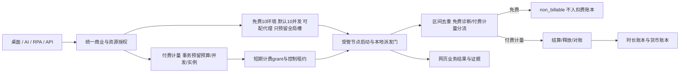

# 环境销售、计时计费与商业运营后台计划

> 2026-11-05 / 0.1.13实施更新：三官方支付创建/查询/全额退款、OIDC/PKCE与主体绑定、桌面一次性连接码，以及单持久协调器+多个真实Windows执行节点已实现。双配置、本地独立签名夹具、同机两个真实节点、旧商业业务/SDK/API回归通过。参数默认空并关闭；真实商户、企业IdP、TLS/mTLS握手与第二台机器未验收。详见[本轮逐项实施与测试](44_官方支付OIDC与多机调度实施验收.md)、[操作/部署/编译](45_官方支付企业登录与多机自动化操作部署指南.md)。原完整父包的未完范围继续保留，不把本地协议测试当外部商业验收。

专项版本：1.3。编制与更新日期：2026-11-03。关联后台专项：1.4；主项目：v1.4 浏览器客户端联动修订，免费10环境与代理规则继续有效。当前状态：商业业务链、三官方支付协议及计费实测已落地；正式支付商户联调及商业部署未验收。

关联文档：[产品总计划](01_开发计划与技术方案.md)、[任务进度](03_开发进度与任务清单.md)、[基础后台](10_管理后台功能与开发计划.md)、[本地 API/AI 契约](04_AI接口与流程设计样例.md)、[功能边界](06_功能边界与源码补全方案.md)、[VC2019 工程](09_VC2019工程与依赖构建方案.md)。

## 1 产品定位与本次范围修订

产品面向多账号环境管理、日常网页业务操作、RPA、AI Agent 和外部自动化软件，也服务 Web 开发测试。Web 测试是业务场景之一，不能把产品销售范围限定成测试工具。外部软件可以通过获授的 SDK/API/CLI/MCP 复用环境、调用页面动作、运行固定版本流程、查询结果及请求接管；其商业授权与人工桌面操作遵循同一规则。

产品目标与比特浏览器同类，增加AI调用、便捷Web测试、调试、协作和商业管理。按用户最新要求，**持续免费10个环境、RPA、Local API及HTTP/HTTPS、SOCKS5、SSH隧道接入；AI调用和测试功能继续免费。** 本项目默认免费并发上限10，容量和并发独立计量；超额或明确购买托管等额外资源才收费，代理接入本身不要求付费。第4节取代此前免费政策；purpose=test不能绕过容量、并发和ACL。

**环境售卖、时长计费、套餐订阅、续费、席位和许可证纳入完整后台的必交范围。** 原文档 10 将这些列为“后续独立模块”的处理由本计划替代。基础后台 B1.0 可以作为内部联调版本，但不能单独宣称为完整可售产品；对外收费发布需同时通过 BG4 与本专项 CG4。本次没有真实收款、续费扣款或发送客户通知。

基础后台保留 ADM001–ADM048、252 基线人日；本专项新增 COM001–COM040、223 基线人日，计量时分别计算增量。本地引擎 317 人日仍独立。新范围不是原 20 周窗口内的零成本菜单扩展。

## 2 销售对象与五类数量的定义

| 对象 | 售卖/管理含义 | 不应混淆的对象 |
| --- | --- | --- |
| 环境容量 | 客户可持有的 Profile 实例数量上限、配置/存储规格与授权功能 | 一个模板可产生多个独立身份实例；配置草稿不等于物理实例 |
| 环境运行时长 | 指定计费实例实际运行会话的时间，按价格版本和结算规则消耗时长包/计费余额 | 订阅有效天数、任务耗时、浏览器 CPU 时间不是同一个计量项 |
| 并发额度 | 组织/项目允许同时运行的环境数及任务数，可分别设限 | 持有 100 个环境不等于允许同时运行 100 个 |
| 成员席位 | 获得产品使用资格的命名成员数量；首版采用 named seat | 后台角色权限、同时在线数、设备数量和机器人服务账号分别管理 |
| 设备/节点授权 | 允许激活的桌面设备、执行节点与迁移规则 | 新增设备不能自动新增席位、环境容量或并发 |

“卖环境”首版至少支持两条交付线：客户自有执行机器上的付费环境额度，以及运营方已接入受管节点上的环境实例租用。后者必须有真实可交付容量、节点归属、存储隔离、停机确认和回收清理证据；没有受管资源池时，只允许销售已具备的本地额度产品，不展示托管环境可立即交付。首版包含静态资源池，不承诺自动采购云机器或弹性伸缩。

销售的是软件使用权、额外实例容量/时长和约定服务，不把网站账号、Cookie、第三方线路或“所有站点不可识别”包含进商品。HTTP/HTTPS/SOCKS5/SSH接入能力免费；只有线路/IP/SSH服务器/托管等真实资源供应服务如售卖，才需单独商品、来源、成本、可用性和退款规则。高级内核另走原验证门。配置克隆默认不复制另一客户的网站身份。

## 3 用户、管理面与权限

| 管理面/角色 | 必需功能 | 关键权限 |
| --- | --- | --- |
| 客户购买门户 | 商品、报价、下单、支付、账单、时长、续费、发票申请 | 只访问本组织，付款管理员独立于浏览器操作者 |
| 客户组织管理员 | 席位分配、节点、环境分配、成员停用、余额/到期提示 | 组织管理员不得修改支付或计量事实 |
| 平台商品运营 | 商品/价格版本、库存、试用/优惠、上下架、交付记录 | 发布价格与变更促销需要审计，不回改已成交订单 |
| 平台客服 | 查询订单、故障、争议、发起退款/调账工单 | 默认不能读取网页内容、私钥或直接记账 |
| 平台财务 | 支付/账单/退款/渠道对账、开票、调整审批 | 受限复核与导出；不能直接控制客户浏览器 |
| 平台技术运维 | 节点容量、计量异常、证书/授权密钥、恢复 | 不因运维身份自动拥有财务记账和租户证据权限 |

使用两类授权：entitlement确定免费或付费可用额度/能力/期限；RBAC/ACL确定谁可操作哪些资源。免费账户自动取得基础免费权益，无需购买、绑卡、充值、有效付费订阅或正余额。有效能力同时满足资源额度、ACL、节点能力、控制租约和策略；付款成功不能替代浏览器写权限。免费所有者及其获授AI/服务账号可用基础功能，不能因缺少“付费席位”被统一拒绝；团队席位管理继续保留，独立席位/设备收费价格不在本次擅自确定。

财务调整、退款、赠送额度和长期授权采用发起/复核分离。小团队可以一人兼任岗位，但系统仍记录每次决策主体和理由，不能使用没有审计的后台数据库改数作为日常操作。

## 4 商品、套餐与定价模型

### 4.1 已确定的免费与付费边界

2026-11-03按用户最新要求，免费档改为**10个环境、RPA、Local API和代理协议可用**，AI调用、Web功能测试及核心SDK/CLI/MCP功能继续免费；本节取代此前免费政策。代理接入不再是付费门槛，费用扩展转向超过免费额度的环境/并发、明确购买的托管资源、时长包及团队扩展。

| 能力/情况 | 免费基础档 | 付费扩展档 |
| --- | --- | --- |
| 独立环境容量 | 同一主体全项目/设备/节点合计可持有10个可用Profile，保留独立登录态 | 按购买后的总容量M扩展，M可大于10 |
| 同时运行独立环境数 | 本项目计划默认最多10个，同时受持有容量和节点能力约束 | 按购买后的总并发N扩展；容量M与并发N分别展示 |
| RPA与Local API | 流程编排、录制、运行、调试、调度及环境/页面接口免费，不按调用次数收费 | 核心功能同样免费，不另卖API/RPA开关 |
| AI、Web测试、SDK/CLI/MCP | 页面读取/动作、登录注册/选元素/断言/回归/报告及接入功能免费 | 功能继续免费，只有已确认扩展资源按套餐计费 |
| 浏览器代理 | 支持HTTP、HTTPS、SOCKS5及SSH隧道接入；允许用户自配线路和凭据 | 同样支持；代理/VPS供应商线路费用或托管资源单独明示 |
| 第11个环境/并发超额 | 超容量创建明确拒绝并保留草稿；超并发启动可排队，无财务副作用 | 确认购买相应容量/并发后才扩容，不自动加10 |
| 运行计时/扣费 | 用户自有执行节点的基础免费会话为non_billable，不扣余额或时长包 | 仅按事先确认的资源套餐/报价计费；租用平台节点需独立资源订单 |
| 有效期 | 持续免费基础档，非限时试用；不要求绑卡、充值或付费订阅 | 有明确周期、续费、额度和失效策略 |
| 席位/设备/每日次数 | 免费所有者可用；团队席位/设备继续管理，每日创建/打开次数本轮未定 | 扩展按明示套餐；不直接复制竞品成员数或每日限额 |

环境容量、运行并发、每日创建/打开次数是独立维度。**10个环境容量是本次确定的免费承诺；最多10并发是本项目的计划默认值，不是对比特实际并发的核验结论。** 不再保留仅允许两个并行的旧限制；任务可以按可用槽排队。AI/测试功能免费不代表无限环境或无限节点资源。

独立Profile身份实例计1份环境容量，复制成新的独立身份另占1份；模板和未落盘草稿不占实例容量。归档/回收站中可恢复的Profile仍计容量，只有可靠停止并彻底删除后才释放，避免用回收站反复增发额度；具体保留期限另行明示。跨节点迁移同一身份须确认旧实例停止、归属转移完成，不能复制运行目录后双开；迁移中的同一受管身份不重复计容量。标签、Space和同实例多个调用者不重复占环境/并发，单写租约仍有效。

额度按个人账户/客户组织主体全局累计，不能每项目、API token、设备或节点分别领取10个；AI/服务账号继承主体额度。付费容量M/并发N是生效后的总量，不是M+10/N+10；是否只对超出免费部分计价需商品报价明示，不能默认所有运行都按时扣费。控制台须分别显示已持有x/10、运行y/10、节点可用槽和免费/付费资源来源。

用户自配模型及代理/VPS供应商的独立账单与本软件功能免费分开。免费开放代理接入不包含赠送代理IP、SSH服务器或运营方云机器。平台代付模型、托管节点或线路销售如后续提供，必须独立报价并由用户确认，不能因配置代理、调用AI或标记purpose=test静默收费。

### 4.2 统一准入与代理支持

创建/导入/克隆/恢复先校验主体、ACL和持有容量，事务预留环境名额后提交；启动/恢复运行/调度再检查节点、有效配置、全局并发和实例控制租约。免费分支签发free-slot资源grant并设billingMode=non_billable，跳过货币/时长包预留。不能因支付渠道、账单账户或余额不可用而单独阻断合规免费运行；共享鉴权、节点故障、真实资源不足仍返回具体原因。

代理支持对免费/付费用户采用同一驱动能力与质量标准。覆盖桌面UI、API/SDK/MCP、AI、流程、批量/调度、导入/克隆/恢复、模板、知识包、代理桥和启动参数；服务端及节点核对requested/effective路由、认证槽、权限和驱动支持，而不是按免费档拒绝。凭据留节点、日志脱敏；连接失败不静默回退直连或切换其它IP。

| 协议/入口 | 实现计划与完成证据 | 失败行为 |
| --- | --- | --- |
| HTTP代理/HTTPS目标CONNECT | 核对HTTP出口、HTTPS隧道、认证、重定向和逐环境隔离 | 返回代理连接/认证错误，不静默直连 |
| HTTPS代理入口 | 验证到代理服务器的TLS与证书、认证和CONNECT；与访问HTTPS网站分开验收 | 证书/协议不支持明确报错，不降级为明文 |
| SOCKS5 | 无认证/用户名密码、域名解析、IPv4/IPv6、QUIC/WebRTC路径；原生认证不足采用受控桥 | 失败关闭对应网络路径，禁止暴露秘密或直出 |
| SSH隧道 | 独立受控SSH进程/成熟库建立本地SOCKS或转发端口，绑定Profile、密钥槽和host key；不拼接任意shell命令 | host key不匹配、断线、认证失败即阻断受影响会话，不自动删代理 |
| PAC/系统代理/扩展与外部驱动 | 属于代理配置来源，不是额外收费协议；默认不静默继承，显式启用才解析并展示effective路由；只开放已验证适配路径 | 无法验证的配置/驱动返回UNSUPPORTED_CAPABILITY或PROXY_CONFIG_INVALID，不显示免费需升级 |

HTTP/HTTPS/SOCKS5/SSH均纳入计划验收；当前没有实现或运行结果，不能把支持计划写成已可用能力。基础网络/认证桥沿用T054/T091；HTTPS代理与SSH适配、节点路由契约及免费联测由COM014/COM029与ADM030衔接，CG0重新估算这些增量、检查成熟SSH组件的许可/C++14或进程隔离兼容性。只有协议实际通过正向、认证失败、断线、出口验证才在capabilities报告supported=true，不能用“可选”跳过SSH后宣称全部协议支持。

多节点争最后一个环境容量或运行槽必须原子判定。离线grant预占主体全局名额中的指定槽，不另发每设备10个；未知停止不因心跳超时直接回收并发。免费无订阅到期，但资源grant仍有短期有效期，可正常续授而无需付费续费；纯离线多副本的全局计数受原节点可信度边界约束。

### 4.3 免费、升级及回落状态

1. 新账户直接获得FREE_TEN_ENV_PROXY_V2，持有容量10、计划默认并发10；RPA、Local API、AI/测试和已验收代理接入均不要求支付。
2. 超出10份持有容量时拒绝新增/克隆并保存草稿；超运行槽时排队或明确拒绝。允许用户先停止/删除已确认实例或主动查看扩容报价，不自动创建支付尝试或收费会话。配置代理本身不触发购买。
3. 明确购买后按服务端权益revision开放总容量M/并发N或约定的托管资源；价格、期限和计量范围在确认页明示，不按AI token/点击/测试次数重复收费。
4. 付费到期/取消后，基础10环境及代理功能继续存在。选择保留最多10份环境、最多10个活动会话，确认归属/停止与免费运行资源后发放免费grant；合规代理可保留，不能仅因付费到期断代理、改IP或删除数据。平台租用节点/线路本身的付费到期按其资源合同停止，不能把功能免费当成资源永久免费。
5. 超额付费环境按声明的保护/保留策略处理，先提示选择保留对象并有界停止超额实例，不随机删除；未确认停止继续隔离，不能忽略旧租约重开。同一会话转免费在明确切换点关闭旧计费区间并发新grant，不改变浏览器代理配置、不重复业务操作。

以下为拟定政策，不是已有服务。字段由可信服务端发布与签名校验，客户端不能自行篡改。免费10容量与代理支持是本次已确定规则；并发10为本项目默认设计，应在CG0记录为独立产品参数，不能冒充竞品实测数据。

```json
{
  "policyId": "FREE_TEN_ENV_PROXY_V2",
  "planTier": "FREE",
  "scope": "billing-subject-all-projects-and-nodes",
  "maxOwnedProfileInstances": 10,
  "maxConcurrentProfileInstances": 10,
  "concurrencyLimitBasis": "project-planning-default",
  "proxyAllowed": true,
  "proxyProtocols": ["http", "https", "socks5", "ssh"],
  "rpaFeatureFree": true,
  "localApiFeatureFree": true,
  "aiInvocationFeatureFree": true,
  "webTestingFeatureFree": true,
  "browserAutomationApiFeatureFree": true,
  "billingMode": "non_billable",
  "requiresPaidSubscription": false,
  "requiresPositiveBalance": false,
  "isTimeLimitedTrial": false,
  "paidActivationRequiresExplicitPurchase": true
}
```

### 4.4 付费商品与尚未定价项目

| 商品类型 | 价格/数量维度 | C1.0必需行为 |
| --- | --- | --- |
| 免费基础档（非付费商品） | 10环境容量、默认最多10并发，RPA/API/AI/测试及代理功能免费 | 自动发基础权益，用户自有节点免费运行不预留/扣金额或时长 |
| 环境包月/包年 | 大于免费额度的持有容量M/并发N、保存容量、周期 | 总容量/总并发分别展示；周期/续费/升降级/超额处理明确 |
| 环境时长包/预付额度 | 明确购买的资源秒数、适用池/机型、期限/结转 | 预留→计量→结算→释放；基础免费不消耗已购或赠送批次 |
| 环境按时计费 | 已确认付费运行资源、整数费率、舍入规则 | 起止/暂停/失联/故障、费用上限和争议可核对 |
| 团队席位与设备扩展 | 命名成员、有效设备数与周期 | 必需管理但独立售价待定，不阻断基础免费所有者/API服务账号 |
| 托管节点/额外存储/线路服务 | 真实可交付资源、供应成本/容量及期限 | 客户明确选择购买，实例隔离/停止/清理和履约证据齐全 |

代理接入能力、RPA/Local API和AI/测试不再作为付费SKU开关。保留环境销售、时长计量、续费及席位后台；收费条件为超出免费资源或明确购买额外服务。商品价格和是否仅计超出部分尚未确定，不在计划中编造售价。后付费授信仍为独立后续增量。

商品快照包含skuId、功能/容量维度、价格版本、币种、税费、交付模式、周期锚点、舍入、退款/保留规则及显式确认。改价不回写历史订单；试用/促销与持续免费政策分开。

### 4.5 比特浏览器免费场景参考与差异

2026-11-03已读取官方公开页面；本次按用户要求将免费10环境、RPA、Local API和代理协议纳入本项目。正文、时间、HTTP状态及哈希见[来源记录](research/bitbrowser_free_reference_2026-11-03.json)。以下为网页声明，未注册、安装或实测竞品。

| 核对项目 | 比特官方当前说明 | 本项目采纳与区别 |
| --- | --- | --- |
| 免费期限/环境 | [价格页](https://www.bitbrowser.cn/price)写“永久免费10个窗口环境”，卡片环境10、成员1、每天打开50次、每天最大创建20个 | 采纳持续免费10环境；本项目默认并发10单独设置，不把官网环境容量当作并发证据；未照搬每日次数/成员限制 |
| 免费核心能力 | 免费卡片列Local API、RPA、窗口同步、扩展/脚本市场和HTTP/HTTPS、SOCKS5、SSH | RPA/Local API和四类代理接入免费，AI/Web测试继续免费；线路及云资源本身另计，不因代理功能收费 |
| RPA排队 | [RPA页](https://www.bitbrowser.cn/rpa)称无使用门槛、没有限时免费限制；一个任务执行、其余排队 | 免费录制/运行/调试固定流程；按本项目环境槽和任务队列调度，不照搬单任务并发 |
| 正常业务 | [多账号页](https://www.bitbrowser.cn/multi-account-management)称免费10环境可登录10账号，按需开通更多 | 免费覆盖业务和测试，支持独立身份持久化；超过环境/并发额度时明确购买扩展 |
| 外部接入 | [Local API页](https://www.bitbrowser.cn/local-api)描述窗口、标签、分组接入，子账号需授权 | 同一资源门提供Local API/SDK/CLI/MCP/AI，不按调用单独收费；接口兼容子集仍走原验证门 |
| 扩容购买 | 价格页FAQ在费用中心选套餐、显示金额、确认开通 | 容量/并发超额显示排队/调整/报价，用户确认后购买，不自动扣费 |

价格页付费动态卡片本次抓取有0值占位，不据此推导实际售价。帮助中心FAQ只取得渲染壳，未用于判定额度。当前45个源码候选统计不变；本次未重新搜索源码、构建依赖或核验竞品所有API/代理实效。

### 4.6 免费用户必须能完成的使用路径

| 场景 | 最短操作与可见结果 | 资源/收费表现 |
| --- | --- | --- |
| 首次使用/环境隔离 | 注册登录 → 创建环境A至J → 自选直连/已支持代理 → 各自登录测试账号 → 关闭重开复用状态 | 无需绑卡/充值/订阅；分别显示已持有x/10、运行y/10和实际代理/直连路由 |
| Web登录/注册/按钮测试 | 输入localhost或测试域名 → 选元素 → 填写/点击 → 断言 → 录制保存 → 单步/回归/查Console与Network | 测试/调试/报告功能免费，最多按可用10槽并行；外部业务写仍遵守原范围和审批 |
| AI/外部自动化 | 创建范围token → 查能力/环境 → 调用Local API/SDK/MCP动作或流程 → 查询证据 → 人工接管 | AI/API/RPA无功能费用；自配模型/线路账单独立，不改变租约权限 |
| 代理配置与验证 | 为某Profile选HTTP/HTTPS/SOCKS5/SSH、绑定凭据槽 → 测连/出口 → 运行 → 查故障 | 配置代理不要求升级；认证/TLS/host key错误或不支持协议明确报错，不静默换IP或直连 |
| 日常业务/多角色回归 | 已登录身份执行报表/表单/调度；10环境内并行，更多任务排队 | 不限测试用途，标签不重复占槽；持有第11环境需容量扩展，排队不产生账单 |
| 扩容与免费回落 | 超额查看容量/并发报价 → 明确购买 → 到期选择最多10份保留环境/会话 → 核对状态后回落 | 免费代理可保留，数据不随机删；租用节点/线路到期另按其资源条款处理 |

客户端和后台客户页展示档位、政策版本、已持有/容量、已运行/并发、实际代理协议/路由、配置保存占用、付费到期及账单。免费可显示“环境3/10，运行2/10，SOCKS5，运行费用0”，不能把代理启用显示成付费待开通；节点容量不足、权限拒绝、代理失败与需扩容分别呈现，并保留任务草稿/输入。

## 5 商业功能矩阵 CF01–CF32

CF 表只列商业增量，基础后台 MF01–MF36 继续有效。所有 CF 都属于商业发布范围；P0 为收款/使用正确性关键项，P1 仍需在 CG4 前完成，不能以标注 P1 长期跳过。

| ID | 功能 | 优先级 | 最低交付与边界 | 工作包 | 验收 |
| --- | --- | --- | --- | --- | --- |
| CF01 | 免费政策/付费套餐/价格版本 | P0 | 免费容量10、默认并发10，RPA/API/AI/测试/代理免费；扩容报价不改旧单 | COM004/COM026 | CT01/FG01/FG13 |
| CF02 | 报价和订单 | P0 | 服务端算价、快照/有效期、重复请求/超时关闭 | COM005 | CT02/CT03 |
| CF03 | 支付渠道与支付尝试 | P0 | 首版一条渠道、沙箱/生产隔离、可查询未决交易 | COM006 | CT04 |
| CF04 | 支付通知可靠处理 | P0 | 验签/金额/主体、inbox去重、乱序/迟到处理 | COM007 | CT04/CT05 |
| CF05 | 支付/渠道对账 | P0 | 查询补单、日结、差异单及人工复核，不盲记到账 | COM008/COM032 | CT05/CT30 |
| CF06 | 订阅与手动续费 | P0 | period锚点、提前/到期/过期续费、并发续费 | COM009 | CT07/CT08 |
| CF07 | 自动续费 | P0 | 明示授权、可取消、授权记录/扣款预告/失败处理 | COM020/COM030 | CT09 |
| CF08 | 升降级与按比例变更 | P1 | 报价差额、期限/配额差异，降级超额预演 | COM019 | CT10/CT11 |
| CF09 | 免费/付费权益服务 | P0 | 免费资格不依赖付款；付费发权幂等，revision/回落保持免费基础档 | COM010 | CT13/FG01/FG14 |
| CF10 | 许可证与设备授权 | P0 | 已签名grant、绑定/迁移/吊销、无通用激活后门 | COM011/COM031 | CT14/CT27 |
| CF11 | 离线与时间可信度 | P0 | 有限离线宽限/预算，倒拨/重装不重置额度 | COM011/COM016 | CT15/CT16 |
| CF12 | 环境容量与免费并发口径 | P0 | 持有容量10与计划默认并发10独立累计；创建/导入/克隆/恢复原子配额 | COM013/COM014 | CT17/FG11 |
| CF13 | 托管库存与环境交付 | P0 | 资源预留、绑定、故障替换/隔离/擦除后回收 | COM013/COM026 | CT18 |
| CF14 | 会话计时和去重 | P0 | 人工/AI/RPA同实例不重计；免费non_billable无扣费，付费区间对账 | COM015/COM016 | CT20/CT21/CT22/CT23/FG16 |
| CF15 | 时长包/预付额度 | P0 | 来源/有效期、原子预留/结算、赠送购买分账 | COM017 | CT24 |
| CF16 | 免费容量/代理/付费并发控制 | P0 | 主体全节点共10容量/默认10运行槽，四类代理免费；超额原子拒绝/排队，无自动扣费 | COM014/COM017 | CT19/CT25/FG02/FG03/FG04/FG07/FG10 |
| CF17 | 席位管理 | P0 | 命名成员分配/回收、邀请预留、超额/停用联动 | COM012 | CT26 |
| CF18 | 设备/节点限制 | P1 | 激活/解绑、冷却、重装和机器指纹变动核验 | COM011/COM012 | CT27 |
| CF19 | 客户购买/续费门户 | P0 | 账单/到期/用量/支付结果、失败恢复和权限 | COM025 | CT28 |
| CF20 | 运营/客服控制台 | P1 | 订单/库存/争议工作台，服务端财务/租户权限 | COM002/COM026 | CT29 |
| CF21 | 财务账本与调账 | P0 | 平衡分录、不可覆写、审批冲正/归因/对账 | COM018/COM023 | CT30 |
| CF22 | 退款与权益回收 | P0 | 原单退款上限、渠道结果、已使用额度/期限联动 | COM022 | CT06/CT31 |
| CF23 | 拒付/异常支付处理 | P1 | 外部拒付事件、冻结/核对/申诉记录与恢复 | COM022/COM032 | CT31 |
| CF24 | 付费欠费、到期和暂停 | P0 | 拒绝未授付费消耗、有界保护/账务分离，基础10环境及合法代理不随订阅失效 | COM021 | CT32 |
| CF25 | 到期数据保护与恢复 | P0 | 保留/导出/删除规则、恢复旧身份不自动重跑 | COM021/COM023 | CT33 |
| CF26 | 免费档、试用、优惠和赠送 | P1 | 持续免费档与限时赠送分开，不把免费AI/测试变成试用到期收费 | COM004/COM023 | CT12/FG01/FG05 |
| CF27 | 账单/发票 | P1 | 账单行到用量/订单可追踪、申请/开具/作废记录 | COM018/COM024 | CT34 |
| CF28 | 用量/费用分析与争议 | P0 | 会话区间、扣费依据、余额与预留拆开、可核对 | COM027/COM032 | CT35 |
| CF29 | 免费自动化接口与资源额度API | P0 | RPA/Local API/AI/测试/SDK及代理接入免费；test标记不绕10容量/并发与ACL | COM014/COM028 | CT19/CT36/FG05/FG06/FG15 |
| CF30 | 到期/余额/续费提醒 | P1 | 站内必需、送达/去重；外部渠道按配置 | COM030 | CT37 |
| CF31 | 商业数据备份和密钥轮换 | P0 | 财务/计量对账、旧授权失效、恢复不重复扣/发权 | COM031/COM037 | CT38 |
| CF32 | 通用自动化免费/付费闭环 | P0 | 业务流程/人工/AI/外部调用统一资源规则，免费无扣费、业务结果独立 | COM029/COM036 | CT39/CT40/FG08/FG09/FG12 |

## 6 核心客户流程

1. 购买环境：选择套餐/地区/资源池 → 查看实际可交付库存 → 报价 → 创建订单/库存短期预留 → 支付确认 → 权益创建 → 环境交付。商品额度型不要求预留云机器；库存型必须预留真实容量。
2. 运行浏览器：选择已有环境 → 预检主体/ACL/免费或付费权益/代理/节点 → 免费分支只预留总并发槽，付费计量分支另预留预算 → 节点ready → 人工或自动化操作 → 停止并核对槽；只有付费计量会话结算费用。新用户可直接免费运行，不必先执行购买流程。
3. 外部自动化：取得项目服务账号 → 查询免费/付费环境容量、运行槽及代理能力 → 指定环境/流程版本（明确付费计量时再带消费上限）→ 获授运行 → 查询状态/证据。RPA、Local API和代理配置无需付款；token不能绕过资源上限或ACL。
4. 续费：提前或过期后发起报价 → 付款确认 → 幂等更新 subscription revision/period → 新授权下发 → 客户查看新期限。续费不创建新的重复 Profile，也不重新执行已完成任务。
5. 扩席/减席：显示当前有效/已分配/邀请预留/待回收数量 → 预览差额及生效时间 → 购买或预约降级 → 执行分配/回收 → 处理活动会话。
6. 退款/到期：显示已消费与可退款依据 → 审批 → 渠道退款/查询 → 账本冲正及权益调整 → 冻结新增消耗 → 保留用户数据/处理运行中动作 → 出具记录。

后台导航新增“商品与套餐、价格、客户与订阅、订单与支付、环境库存与交付、时长与用量、席位与许可证、账单与发票、退款/调账/争议、渠道对账、提醒规则”。客户侧对应提供“购买/续费、我的套餐、环境额度、时长余额、席位、设备、账单/发票”。

## 7 时长计量：起止、粒度和可核对公式

### 7.1 计量口径

付费计量资源的`profile_runtime_seconds`以物理实例运行会话为单位，从节点确认浏览器ready且计费授权已接受开始，到确认进程停止/资源释放或授权到期的受控截止为止。排队、下载组件、失败启动、启动前预检不计费；浏览器仍开着但流程暂停/等待人工通常继续计时，关闭实例才能停止。商品页、启动前确认、后台用量页必须显示此规则；免费会话只留可选诊断计时，不应用本节扣费公式。

本节费用公式仅适用于已经确认报价的付费计量资源。`FREE_TEN_ENV_PROXY_V2`会话可保存诊断时长，但必须标记`non_billable`，不扣购买/赠送时长、不记费用应收、不要求正余额；AI调用次数、测试次数和测试业务成功与否都不产生浏览器功能费用。包月固定并发产品也不能擅自追加未约定的按时扣费。

同一实例人工操作、AI、RPA、多个 Space/标签及调试客户端共用该会话，运行时长只计一次。两个独立实例同时运行各 120 秒，合计 240 环境秒。`run.duration` 仅作业务指标，除非另有明示商品，不再重复扣一次任务分钟数。批量同步实际打开多个实例时，各实例正常计量。

首版内部按整数秒保存，按商品版本决定如何显示和计价：例如按分钟计价时，先对一个可计费会话的去重确认秒数汇总，再 `ceil(seconds/60)`，不能每个心跳或每个步骤分别向上取整。跨账期/价格/赠送包边界拆分计量区间，但保留会话聚合的计价规则，不能因为拆段提高原约定价格。具体选择“按秒”或“会话按分钟”在 CG0 冻结。

### 7.2 示例与账单依据

| 情况 | 原始事实 | 默认结算结果 |
| --- | --- | --- |
| 同实例两个调用者 | 实例ready至停止为0–100秒；A在0–80、B在40–100操作 | 会话计100环境秒，不能记140秒；不以调用次数计费 |
| 两个独立实例 | 每实例运行120秒 | 240环境秒，与标签数无关 |
| 重复事件 | 同 session/boot/sequence 的30秒区间发送3次 | 只接受一次；正文冲突隔离 |
| 分片上报 | 同一61秒会话分为30、30、1秒 | 原始61秒；若会话按分钟计价，合计2分钟 |
| 启动失败 | 排队10秒、启动失败20秒、未ready | 0运行秒，释放未使用预留 |
| 流程失败 | 浏览器ready后运行90秒，业务保存失败 | 运行90秒；平台故障赔付走独立冲正规则 |

计量记录包含 tenant/project、profileInstanceId、billingSessionId、nodeId/bootId、assignmentGeneration、meterVersion、priceVersion、grantId、eventId/sequence、单调时间区间、中央收到时间、来源、确认/未决状态及 hash。客户能从账单行定位到会话区间、已用/赠送/预留/退款，不能只看到无法解释的余额数字。

## 8 计费授权、预留、断线与未知结果



免费槽grant、付费计费grant与控制租约分开：免费校验主体持有容量10、计划默认运行槽10及已验收代理能力；付费计量grant另限消费预算，控制租约限制谁可写。可信政策决定分支并原子预留资源/归属，免费无需余额/支付。grant绑定主体/实例/boot/revision、grantKind/billingMode和有效路由摘要，不能跨节点重放或由客户端把租用付费节点伪装成免费自有资源。

POC 暂以最长 60 秒 grant、15 秒续期、每段最多预留 60 秒为候选，并按中央颁发/节点认证时序与单调时钟裁剪实际期限；不是消息到达后重新开启完整 60 秒。商业计时与原控制租约均需验证延迟、断网、系统休眠、重启及时间跳变，再冻结参数。按秒的运行成本可按已授权区间持续产生，不能因没有网页动作就伪装成免费暂停。

所有运行入口共用预留/准入：桌面打开、批量打开、克隆后打开、调度、CLI/SDK/MCP、AI、RPA、调试和恢复。续租原子更新并发/权益revision，付费计量才更新预算；多机抢最后一分钟、最后一个环境或并发位，最多只允许符合额度的请求成功。免费grant续授不涉及付费订阅续费。

节点本地持久化 accepted/started/stopped 与计量区间。丢失回应时区分“可能启动”“可能已扣款”“可能已提交网站动作”，分别对账，不能靠同一个 success 布尔值概括。金额、计量与网页业务各自保留状态；业务 unknown 不重复点击，计费 unknown 不盲扣第二次，也不凭退款记录判断网页交易已撤销。

| 故障/事件 | 控制与计费行为 | 客户显示/后续 |
| --- | --- | --- |
| 服务端无法续授资源grant | 不发新grant；节点到截止阻止新动作，在有界保护窗保存结果并关闭受管进程 | 显示控制面连接/授权阻断及未决，不伪报免费权益到期或催付款 |
| 心跳丢失但实例可能存活 | 只冻结新授权，不能立即把同一身份交给另一节点 | disconnected/待停止确认，保留最多已授预算 |
| 关闭已请求但没确认 | 不计无限运行；记未决区间且不授予第二写入者 | 对账已发grant、进程状态与可靠计量 |
| 节点重启/重装 | boot变化、旧grant失效，先核对账本/会话 | 不重置时长包，不重放旧扣费/旧业务 |
| 中央恢复旧备份 | 维护/对账模式，提升商业/协调代数 | 不重用旧grant或重发历史权益；查询支付渠道补差 |
| 付费权益到期/付费预算不足 | 停止对应新增付费运行/步骤，短暂有界保护窗口处理在途结果/停机 | 不撤销网站已发生交易，不阻断合规的基础免费资格 |

付费失效保护窗口初值30秒，平台承担保护成本，不扣负余额且不反复续窗。只停止不再获授的超额/租用资源，无法确认则隔离unknown；基础10环境/代理功能继续可用，按第4.3节选择保留并核对容量/运行槽后恢复免费。原免费或可合法回落会话不因付费订阅失效被批量关闭，也不能仅因代理启用而停止；外部线路/租用节点本身到期单独处理。

未确认区间最多按已签发预算暂占，默认 24 小时内完成核对或进入争议；未证明的消耗不自动转成永久实扣。到处理时限仍无可靠证据时，释放相应客户金额/额度预留并由平台计损，但资源/身份继续隔离至可靠停止确认，不能为了释放财务预留而重开同一身份。该时限与赔付策略需 CG0 确认并版本化。

客户完全控制的本机管理员能够修改客户端/本地文件，离线数字签名只能证明授权内容来源，无法证明用户没有修改计时器或复制运行时。强计量按受信受管节点设计；纯本机离线软件优先采用有界期限/容量授权，不能宣称具有不可绕过的远端计时扣费。此技术差异必须体现在商品交付模式和验收中。

## 9 支付、订阅与续费状态机

### 9.1 订单与支付

订单状态示意：`quoted → pending_payment → paid → fulfillment_pending → fulfilled`；另有 `expired/cancelled/refund_pending/partially_refunded/refunded/disputed`。支付尝试单独记录 `created/pending/succeeded/failed/unknown`，允许一单多次尝试，但支付成功金额不能重复用于发权。履约失败不改写“钱已到账”，进入补交付或退款。

支付回调必须校验签名、商户/app、渠道、交易号、订单、金额/币种、状态和重放/正文冲突；保存原始报文的必要脱敏证据后，经 inbox 唯一键和数据库事务写入到账事实、账本及权益 outbox。浏览器“支付成功”跳转页、截图或客户提交的交易号不能直接发权。重复请求/重复回调返回既有结果，不重复加余额/延长期限。

迟到支付发生在库存/报价已过期时，不盲交付：查询渠道确认真实到账，按原价/库存履约规则处理；无法满足则进入明确退款队列。渠道创建/退款调用超时先按商户请求号查询，不换新号盲重发。提供主动查询补单、每日渠道对账、差异处理、人工复核和可追溯重放。

### 9.2 订阅、手动续费和自动续费

付费订阅状态示意：`trialing/active/past_due/grace/suspended/expired/cancelled`，每个状态有策略/生效时间。持续免费资格单独记录，不随付费订阅变成expired，也不要求伪造一张0元订单续期。期限以中央UTC储存，月/年订阅按日历锚点计算，明确月末/闰年/DST，不用一个月30天替代。

手动续费：有效期内从当前 periodEnd 接续；已过期从本次确认的生效点重新起算，除非报价明确补缴历史欠期。时长包充值增加独立余额批次，不修改包月期限。提前续费是否允许多期、原价保护和到期结转都进入报价规则。

同一订阅的相同目标期次使用唯一 renewalOccurrence；两笔独立到账不可丢失，但不能意外双续同一期。第二笔按客户已确认的多期订单分配至下一期，或进入多付款待退处理，不默认为用户同意再买一期。

自动续费先取得明确授权，记录条款/价格/周期/支付委托/取消方式与同意时间；默认不开启。只有支付渠道具备正式委托扣款能力时才开放开关；扫码付款不能伪称能后台自动扣。取消后撤销未来任务，仍核对已发起交易；扣费预告、价格变化同意、失败重试上限/间隔与到期策略明确。没有渠道资质/委托能力时，产品显示“到期提醒+手动续费”，自动扣款能力保持阻断，不能把 CG4 自动续费验收算通过。

升降级首版采用简单可核对策略：同周期同货币升级可即时生效，差额由冻结报价按剩余秒数和整数规则计算；不隐式将剩余权益变现。降级默认下期生效，超额环境/席位需先选择保留对象；不能后台随机删除 Profile 或踢出任意成员。主套餐取消时附加包处理写入报价与订阅关系。

## 10 席位、设备与实例库存

命名席位分已购、已分配、邀请预留、待回收、可分配。邀请可短期预占（初值 24 小时），过期释放；接受邀请与分配席位在同一事务中完成，不因两个管理员同时操作超卖。只读财务联系人是否占席、外部审计员/机器人账号是否占席，通过商品规则声明，不按隐藏约定实现。

停用/回收席位时注销会话、吊销成员 token 并阻止其新操作；活动任务按授权移交/停止策略处理，不能擅自换名继续运行。项目资源归组织，回收席位不删除项目环境。具备席位不等于无限设备登录；同一成员设备上限和是否允许多个并发会话单独设置。

设备激活使用服务端登记与可校验身份，不仅靠可变 MAC/机器名。设备重装、丢失、解绑、换机、冷却和申诉有记录；节点服务身份与人员设备激活分别管理。服务账号有独立套餐额度/并发策略，不能建立无限 token 规避席位计数，也不把每条 token 默认收费为一个人。

库存生命周期：`available → reserved → assigned → active → draining → quarantined/cleaning → available`。订单预留有期限，支付确认后重新核对；付费成功但容量不足进入履约异常，不将同一目录配给两客户。退租/换租需确认停止、撤销凭据/授权、验证浏览器状态与残留数据清理；清理失败保持隔离。新客户不能复用前客户的 Cookie、网站账号、下载、扩展私密数据或调试证据。

环境容量降低时，先限制超额新增/克隆/恢复，再选择保留/导出；基础免费容量10、默认并发10及代理仍可用。额外付费容量非续费后建议保留30天（待条款确认），不承诺额外运行；不能将此期限当成所有免费配置的删除倒计时。回收站/可恢复归档继续占容量，停止确认且彻底删除后释放。财务记录与浏览器数据按各自策略管理。

## 11 账本、退款、发票与财务对账

使用两个明确分离的账本：货币账本和时长/权益数量账本。内部消费余额是闭环预付服务额度，不提供用户间转账、提现或通用支付钱包。所有金额使用货币最小单位整数；按比例计算采用整数/有理数和指定舍入规则，不使用二进制浮点直接算钱。

货币账本以可平衡分录记录到账、预收/消费、退款、支付手续费、争议与调整。详细科目由财务在 CG0 冻结；订单/支付/会话/账单行/退款/调整可追踪到 postingId。每个外部经济事件唯一入账；更正用冲正和新分录，不覆写旧账。已用、冻结、可用、赠送和将过期额度分别展示，不能把预留当已消费。

退款需验证组织、原单、渠道、累计退款上限、已消费/已发权益及税票状态。金额退款和权益回收是可恢复状态机：不能“数据库减额度就认定渠道已退款”，也不能渠道退款成功后漏回收未使用额度。部分退款按原账单规则计算；已消费时长不可凭随意比例恢复成未消费余额。拒付单独冻结对应风险权益并保留申诉/恢复记录。

调账、延长有效期、赠送时长、豁免平台故障消耗必须有工单、理由、额度上限、有效期、发起/审批主体和关联故障证据。平台故障赔付与正常业务失败区分，不把客户网站业务失败自动等同免费使用，也不无记录吞掉因平台故障产生的多扣。

账单行冻结购买/用量/税费/优惠依据，提供 PDF/CSV 等导出但最终实现前不声称格式已支持。首版发票流程包含抬头/税号、申请、人工开具后登记发票号/文件、作废/红冲关联；只有完成税务服务准入才接自动电子开票。开票状态不能当作支付到账或业务运行成功的证据。

## 12 商业授权与浏览器调用契约

保持本地 `/api/v1`、后台 `/control/v1`，商业接口统一 `/commerce/v1`。外部自动化软件不直接请求支付回调来获得权限；运行仍走控制面或本机受控 API，商业服务签发有限 grant，节点持有验证公钥。签名私钥由平台授权密钥服务保护，不交客户端；网站密码留节点的原则不变。

| 方法/资源 | 用途与关键行为 |
| --- | --- |
| GET `/catalog`；POST `/quotes` | 返回可售能力和价格版本；服务端核价/库存/适用性 |
| POST `/orders`；GET `/orders/{id}` | Idempotency-Key、quote校验、逐项交付状态 |
| POST `/orders/{id}/payment-attempts` | 冻结金额/币种/渠道，创建或返回既有支付尝试 |
| POST `/payment-notifications/{provider}` | 渠道专用验签/inbox；不是客户可调用发权工具 |
| GET `/subscriptions`；POST `/subscriptions/{id}/renewals` | 期限/权益、手动续费报价和期次去重 |
| POST `/subscriptions/{id}/auto-renew-consents` | 创建/撤销正式委托，不能只改一个布尔字段 |
| POST `/subscriptions/{id}/changes` | 升降级/取消预演、金额及超额差异 |
| GET `/entitlements`；POST `/licenses/activations` | 查询范围/期限/额度；激活绑定和已签名grant |
| GET/POST `/seat-assignments` | 席位和邀请预占、回收及活动影响 |
| GET `/inventory`；POST `/environment-allocations` | 受控库存/分配，容量和租户隔离 |
| POST `/usage-reservations`；GET `/usage-sessions/{id}` | 可信调用方预留与查询，客户端不能上报任意负扣费 |
| GET `/balances`、`/usage`、`/billing-statements` | 可用/预留/消费/退款及区间明细 |
| POST `/refund-requests`、`/adjustment-requests` | 分权审批、渠道结果和账本状态 |
| GET/POST `/invoice-requests` | 开票资料/状态、受限文件访问 |
| GET `/reconciliation-runs`、`/disputes` | 财务/运维差异单，权限与审计 |

错误至少区分FREE_PLAN_ENVIRONMENT_LIMIT（容量满）、FREE_PLAN_CONCURRENCY_LIMIT（运行槽满）、PROXY_CONFIG_INVALID、UNSUPPORTED_PROXY_PROTOCOL、PROXY_CONNECTION_FAILED、PROXY_AUTH_FAILED、PROXY_TLS_ERROR、SSH_HOST_KEY_MISMATCH、SUBSCRIPTION_EXPIRED、SEAT_REQUIRED、ENVIRONMENT_LIMIT_REACHED、CONCURRENCY_LIMIT_REACHED、BALANCE_RESERVED、INSUFFICIENT_TIME、LICENSE_STALE、DEVICE_LIMIT_REACHED、PAYMENT_PENDING、FULFILLMENT_PENDING、METER_RECONCILIATION_REQUIRED。免费正常运行不返回余额不足/付费订阅过期，支持的代理不返回免费需升级；超额/配置错误均无财务副作用。SDK返回容量/运行槽、驱动能力、请求ID和可操作建议，不泄漏秘密/账单。

下面是付费扩容/计量的请求扩展示例；免费运行不要求提供commerce账单字段，不能让AI/测试客户端先购买才能调用同一个运行接口。免费政策示例见第4.3节。

```json
{
  "requestId": "example-business-run-1",
  "projectId": "project-operations",
  "profileInstanceId": "instance-operations-a",
  "workflowVersionId": "workflow-report-export-v4",
  "purpose": "business-automation",
  "commerce": {
    "billingAccountId": "billing-example",
    "expectedEntitlementRevision": 18,
    "maxRuntimeSeconds": 600,
    "maxChargeMinorUnits": 500,
    "currency": "CNY",
    "onBudgetExhausted": "stop-new-actions-and-reconcile"
  },
  "onOutcomeUnknown": "freeze-and-reconcile"
}
```

此为控制面运行请求的待定扩展示例，不是已有可调用接口。500分是演练消费上限而非商品售价；最终金额由服务端计价。billingAccountId、价格/权益、环境和主体均需服务端核对，客户端不能指定任意其他人的账单账户。200/202受理不证明已启动、已结算或网页业务成功。

## 13 数据表与事务边界

| 聚合/表 | 核心数据、唯一约束或状态 |
| --- | --- |
| billing_accounts / finance_roles | 组织、付款主体、币种、财务联系人、服务状态 |
| products / sku_versions / price_versions | 不可变容量/功能/计价/退款规则和发布窗口 |
| quotes / orders / order_items | 价格快照、有效期、客户确认、幂等键/正文hash、履约状态 |
| payment_attempts / provider_events | 商户请求号、渠道交易号、验签结果、事件唯一键、金额/币种 |
| subscriptions / renewal_occurrences | period、日历锚点、状态、revision、期次唯一键 |
| auto_renew_consents / collection_attempts | 委托范围/版本/撤销、到期通知、每期扣款与重试 |
| entitlements / license_grants / activations | free-policy或订单来源、免费/付费范围、签名keyId、generation、设备/节点绑定；免费无订阅到期 |
| seat_pools / seat_assignments / seat_holds | 已购/有效/邀请预留/到期，命名主体唯一与并发限制 |
| inventory_units / allocations / cleanup_records | 池/节点/实例、预留TTL、租户归属、停止/擦除证据 |
| usage_sessions / meter_events / metered_intervals | boot/session/序列去重、区间重叠、确认/未决及来源；billable标志/政策版本不可由客户端自定 |
| time_lots / balance_reservations | 购买/赠送批次、有效期、可用/冻结/消耗、预留授权上限 |
| journals / postings / billing_statements | 不可覆写财务分录、平衡约束、账单行及来源引用 |
| refunds / disputes / adjustment_approvals | 原单/上限/审批、渠道状态、冲正和权益回收关联 |
| invoice_requests / invoice_records | 抬头/税号受限存储、开具/红冲、文件权限与保留 |
| reconciliation_runs / differences | 渠道/内部账/计量差异、处理结果、复核证据 |
| commercial_outbox / reminder_deliveries | 发权/回收/提醒的事务事实、幂等重试/去重 |

复用基础 PostgreSQL/迁移/审计，不再复制一套租户身份库。持锁事务内不调用支付渠道或等待节点：先写事务/outbox，外部处理后收回执继续状态机。tenantId及必要projectId贯穿查询、复合引用、事件和导出。订单、金额、权益/计量的唯一约束不能只依赖应用内缓存锁。

自有商务 API/授权/计量/节点仍按 **VC++2019 / v142 / C++14 / x64** 开发。优先复用既有 JSON、PostgreSQL/libpq、TLS和受控HTTP适配；签名/支付验签采用成熟、版本锁定且实测C++14兼容的库，禁止自创密码算法。若某渠道只提供其他语言SDK，可评估隔离适配服务，但新增运行时须单列部署/维护和授权边界，不能悄悄改变主工程标准。

本轮没有新增源码检索、渠道版本/许可确认或SDK构建；既有45仓库候选统计不变。CG0需比较所选渠道官方协议/SDK、签名库、日历/金额库和开票服务，记录维护、许可、幂等/查询能力与失败替代。无法真实扣款/查询的渠道模拟器只作研发夹具，不算商业接入完成。

## 14 必须处理的边界登记

| 边界 | 必需处理 |
| --- | --- |
| 付款成功但发权失败 | paid与fulfillment分开，outbox重试/对账/退款，不让用户重复付费 |
| 双击购买/多端同时续费 | 请求幂等+期次唯一；不同真付款都有去向，不覆盖或吞掉 |
| 改价/税率/促销中途变化 | 冻结报价与订单规则，新单新价；过期单显式重新报价 |
| 订单关闭后渠道成功 | 核对到账并履约或退款，旧库存预留不得假装仍有效 |
| 退款调用超时/回调乱序 | 查原渠道请求号；状态可恢复，账本与权益去重 |
| 客户余额争议 | 给出区间/来源/价格版本；冻结争议项与保留证据 |
| 手动/AI/外部软件重复接入 | 同计费会话去重，控制权仍遵守单写和接管规则 |
| 客户到期正在提交保存 | 停新动作、核对在途结果、有限保护；不反复提交或粗暴删环境 |
| 到期后又付款/退款后付款 | 以真实新经济事件/订阅revision更新，不复活已结束run |
| 企业减席/环境降配 | 预演超额、选择保留，阻止新增，不任意删除数据 |
| 离线/机器时间倒拨 | 有界grant/可信中央时间/单调时钟与持久日志，异常重新在线验证 |
| 克隆数据库/恢复旧备份 | 商业epoch/事件账本/渠道对账，旧许可证和旧扣费不复活 |
| 托管节点故障/跨客户回收 | 停止确认、凭据/数据擦除与隔离，不能靠改tenantId重新售卖 |
| 自动续费撤销恰逢扣款 | 标记在途attempt，查渠道并按同意与取消时间处理，不能假装未发生 |
| 通知未送达 | 站内状态可查、发送重试去重；通知不是扣款授权或到账证据 |
| 审计/账本/数据库失败 | 不能确认新收费/发权/放量；已有有限grant按边界结束并对账 |
| 免费账户无订单/订阅/余额 | 从基础政策发权，免费槽不走资金预留；付款服务故障不单独阻断免费路径 |
| 多设备抢最后一个免费容量/运行槽 | 主体全局原子预留；并发争第10个名额仅一方成功，不先启动第11个后回滚 |
| 免费代理从导入/扩展/驱动传入 | 核对配置/凭据/能力与effective路由；支持的配置允许免费使用，不支持明确报错且不静默直连 |
| 付费到期回落免费 | 选择最多10份环境及默认最多10会话，核对归属/停止后转免费；合规代理保留，租用节点/线路到期独立处理 |

## 15 固定商业验收 CT01–CT40

每项含正常/拒绝/故障变体，至少3轮，**40×3=120次基础执行**；支付渠道沙箱、实际节点、可重放事件与财务预期都要齐全。拒绝反例按预期拒绝，正向交易必须真正完成沙箱收款/发权/结算链路。当前没有运行任何验收。

| ID | 验收主题 | 必须观察的结果 |
| --- | --- | --- |
| CT01 | 商品/改价/上下架/免费政策 | 新旧价格隔离，不售未交付能力；AI/测试免费承诺不能变付费开关 |
| CT02 | 报价/篡改数量/币种 | 后端重算并拒绝过期/越权/不适用组合 |
| CT03 | 订单幂等/超时关闭 | 同键同正文返回既有单；冲突拒绝，库存有界释放 |
| CT04 | 支付伪造/重复/错商户/错金额 | 未确认不发权；真实成功只入账/发权一次 |
| CT05 | 延迟/乱序/丢回调/多付款 | 主动查询对账可收口，每笔款都有归宿 |
| CT06 | 已支付但交付失败 | paid事实保留，补交付或可追踪退款，无二次收费 |
| CT07 | 月末/闰年/DST/提前与过期续费 | period锚点和界面期限一致，时长包不改包月期限 |
| CT08 | 双端/双支付并发续费 | 同期不意外双续，额外到账进入确认分配/退款 |
| CT09 | 自动续费同意/撤销/失败/调价 | 无同意不扣款；真实委托可取消，重试有上限 |
| CT10 | 即时升级/差额/重复回调 | 金额整数正确，新增权益一次生效 |
| CT11 | 降级/减席/环境超额 | 下期生效、选择保留，无随机删除和超卖 |
| CT12 | 持续免费/试用/优惠/赠送 | 免费不带试用倒计时，试用不自动收费，赠送/付费批次分开 |
| CT13 | 免费政策/付款/退款/旧revision交集 | 免费无需订单，付费不代替ACL；旧revision及时失效 |
| CT14 | 许可证篡改/错租户/错key | 签名/绑定/期限校验，旧key轮换有界 |
| CT15 | 离线超宽限/预算耗尽 | 不无限运行/签发，已有grant按期限结束 |
| CT16 | 时钟倒拨/休眠/重装 | 不获得额外时长，时间异常转核验 |
| CT17 | 创建/导入/克隆/恢复/回收站容量 | 免费全局持有10；第11份原子拒绝，保留草稿；归档/彻底删除规则一致 |
| CT18 | 双卖库存/超时付款/清理失败 | 唯一归属，履约异常可见，脏实例不回售 |
| CT19 | UI/RPA/Local API/AI/SDK/调度入口 | 同一免费/付费门：支持的代理免费，容量/运行槽/ACL及付费预算不绕过 |
| CT20 | 重复/冲突/乱序计量事件 | 重复不增扣，冲突隔离，遗漏可追踪 |
| CT21 | 同实例重叠、多实例并行 | 同实例区间并集，多实例求和，标签/调用者不倍增 |
| CT22 | 61秒分片/跨期/整数舍入 | 按冻结规则汇总，不能按每个心跳进位多扣 |
| CT23 | 丢停止/进程崩溃/网络分区 | 未决只占已授预算，不无限计费、不双开身份 |
| CT24 | 时长包批次/赠送/最后一分钟竞争 | 原子预留，无负余额；免费诊断秒数不扣任意时长批次 |
| CT25 | 环境容量/运行并发/任务/节点 | 免费跨设备/项目共10容量和默认10运行槽；M/N是总量，真实节点不足可排队 |
| CT26 | 双管理员分席/邀请过期/停用 | 席位不超卖，token/活动权限联动，资源保留 |
| CT27 | 多设备/重装/解绑/机器变更 | 激活额度可核验，设备变化不重置权益 |
| CT28 | 客户门户/越权账单/财务联系人 | 只读本人组织、付款权限独立，失败能恢复 |
| CT29 | 客服/运营/财务越权调账 | 分权审批/审计，不读取租户网站秘密 |
| CT30 | 钱/时长账本与渠道对账 | 分录平衡、整数正确、差异可解释，不直接改余额 |
| CT31 | 部分退款/拒付/渠道超时 | 退款不超原单，冲正/回收可恢复且只一次 |
| CT32 | 付费到期/欠费/保护窗/支付恢复 | 禁新增未授权付费消耗，保护有界，保留免费10环境/代理，恢复不重跑业务 |
| CT33 | 到期保留/导出/删除/续费及免费回落 | 明示期限与权限；付费冻结不删除，合规免费运行不依赖续费 |
| CT34 | 发票/红冲/退款关联 | 财务状态一致，敏感抬头隔离，无伪造开票成功 |
| CT35 | 用量/账单/退款报表 | 行可追溯至会话/单价/分录，预留与已扣拆开 |
| CT36 | 服务账号/免费接口/付费消费上限 | AI/API无调用费，资源先检查；无越权账单，普通运行可无模型 |
| CT37 | 到期/低余额/扣款预告 | 站内去重、取消后不误发，外部失败不影响账务事实 |
| CT38 | 恢复旧库/授权密钥轮换 | 不重复扣费/发权，旧grant失效，未决渠道先查后恢复 |
| CT39 | 通用自动化BA与免费业务 | 人工/AI/RPA/外部软件同规则；10环境及代理日常业务免费，费用与业务结果分离 |
| CT40 | 免费/付费高并发/长稳/数据库失败 | 零免费误扣/重复记账/双卖；槽复用/停授/对账可控，指标含失败 |

### 15.1 免费边界补充验收 FG01–FG16

每项覆盖正常/拒绝/故障变体，至少3轮，共 **16×3=48次补充执行**。使用真实受管浏览器和两台节点验证全局配额/代理路径；页面夹具同时包含登录、注册、按钮和业务导出。免费测试需核对货币账本、已购/赠送时长批次均无消费分录；当前均未执行。

| ID | 场景与必须观察的结果 | 实现/联测工作包 | 关联商业验收 |
| --- | --- | --- | --- |
| FG01 | 新账户无订单/绑卡/余额/付费订阅即获持续免费资格；环境A创建、登录、关闭重开状态可复用，非限时试用 | COM004/COM010/COM025/COM035 | CT01/CT12/CT13/CT28 |
| FG02 | 免费持有并运行环境A至J，权益页分别显示持有10/10、运行10/10；含直连与代理、人工/外部调用 | COM014/COM034 | CT19/CT25 |
| FG03 | 第11份环境创建/克隆/导入拒绝并保留草稿；运行槽满时请求排队/拒绝，未实际启动、无订单/扣费 | COM014/COM034 | CT17/CT19/CT25 |
| FG04 | 两节点争最后1个容量/运行槽仅1方成功；重复请求/重试不重复预留或短暂超10 | COM014/COM034 | CT17/CT25/CT40 |
| FG05 | RPA、Local API及AI/SDK/MCP执行登录/注册/断言/调试/报表，免费无按调用/点击/测试/诊断时长费用，亦可无模型跑固定流程 | COM028/COM029/COM036 | CT19/CT36/CT39 |
| FG06 | business/test/CI标签不放开容量/并发或付费节点；代理功能本来免费，不把test视为代理绕权；扩容不收测试功能费 | COM028/COM035/COM036 | CT19/CT36 |
| FG07 | 免费HTTP/HTTPS/SOCKS5/SSH逐协议正向可用，含认证与出口检测；失败明确分类，无代理功能费或静默直连 | COM014/COM034 | CT19/CT25 |
| FG08 | PAC/系统代理/环境变量默认不静默继承，显式支持路径可用；TLS、SSH host key/桥崩溃/扩展改路由可定位且不直出 | COM014/COM029/COM034 | CT19/CT40 |
| FG09 | 模板/导入/克隆/恢复/知识包/驱动保留合法代理、秘密仅用槽；超容量/无权限/不支持协议明确拒绝而非要求付费 | COM014/COM029/COM035 | CT17/CT19/CT39 |
| FG10 | 多项目/节点/token/服务账号共享主体10份容量与默认10运行槽；不能每入口额外领10个，迁移同身份不双开 | COM010/COM011/COM014/COM035 | CT13/CT25/CT36 |
| FG11 | 标签/Space/调用者不重复计数，单写租约有效；独立克隆另占容量，可恢复归档占额，停止确认且彻底删除才释放 | COM014/COM015/COM034 | CT17/CT20/CT25 |
| FG12 | 停止确认后才释放槽；断网/休眠/重启/旧grant重放不盲复用；免费grant续授无需付费 | COM011/COM016/COM034 | CT15/CT16/CT23 |
| FG13 | 明确购买才开放总容量M/并发N或托管资源，非M+10/N+10；配置代理不触发支付，原免费会话无静默收费 | COM004/COM010/COM025/COM035 | CT10/CT13/CT28 |
| FG14 | 付费到期选择≤10份环境/默认≤10运行会话，核对状态再转免费，保留合规代理/IP及数据；外部线路/托管到期独立处理 | COM021/COM025/COM035/COM036 | CT32/CT33 |
| FG15 | 篡改免费政策、容量/并发、主体、0费用或revision被拒；不能免费占付费托管资源；免费代理不会误报越权 | COM010/COM028/COM035 | CT13/CT19/CT36 |
| FG16 | 免费长运行/重复启动无资金或时长消费，付款渠道故障不单独阻断免费；共享鉴权/节点故障仍真实报错 | COM014/COM015/COM017/COM038 | CT24/CT40 |

### 15.2 通用业务验收 BA01–BA08

另执行通用业务验收 BA01–BA08，在两台节点各3轮，共 **48次基础执行**。CT计划120、BA计划48、FG计划48与原WT/AT分列；同一次运行可提供多项证据，但不得同时虚增执行次数。补充FG明确增加验证范围，不能声称这是已执行的产品测试。

| ID | 通用业务场景 | 完成要求 |
| --- | --- | --- |
| BA01 | 人工打开/关闭付费环境 | 独立网站身份/代理，ready起计、关闭收口，可核对账单 |
| BA02 | 外部RPA/SDK调用已登录环境 | 固定项目/身份，操作按钮/表单/下载并校验结果 |
| BA03 | AI生成草稿并运行批准流程 | 无模型时固定流程可跑；费用上限/页面提示不能改权限 |
| BA04 | 多环境报表导出/批量同步 | 每实例独立身份与逐项结果，无串号/双扣 |
| BA05 | 定时CRM/运营数据处理 | 固定版本、触发去重、生产写审批和业务结果验证 |
| BA06 | 人工接管后交还自动化 | 单写门有效，运行时长只记一个会话，旧写拒绝 |
| BA07 | 业务提交时到期/断网 | unknown查验、不重复保存，保护窗口有界及可核对费用 |
| BA08 | 托管退租/清理/重新交付 | 旧租户凭据/状态/证据不串给新租户，清理失败隔离 |

BA涉及的业务写入在自有演练站点执行，用正式业务模板证明通用能力，不用任意第三方生产结果充当确定性验收。高级指纹仍走原独立内核验证门，商业化范围不使其自动变成可售能力。

## 16 商业工作包 COM001–COM040

角色沿用A服务端/架构、B节点/浏览器、W前端、Q质量、D部署、P产品，新增F财务规则/复核。净人日是任务总工作量，不是自然持续时间。`ADMxxx`是基础后台前置，不在本表重复计费。全部未开始；真实支付、授权和计量联调不得用假节点完成态替代。

### 16.1 商品、订单与支付基础

| ID | 任务 | 角色 | 净人日 | 前置 | 完成证据 | 状态 |
| --- | --- | --- | --- | --- | --- | --- |
| COM001 | 免费10环境/RPA/API/代理与销售规则冻结 | P/A/F | 3 | ADM001 | 容量10/默认并发10独立、协议矩阵、FG/报价/期限/退款与渠道决策 | 未开始 |
| COM002 | 客户/运营/财务页面原型及商业权限 | W/P | 4 | COM001/ADM002/ADM007 | 两类门户、权限/空错状态与资金操作差异 | 未开始 |
| COM003 | 商业契约/表/迁移/账本约束与构建骨架 | A | 5 | COM001/ADM003/ADM004 | C++14、schema/整数/唯一约束/迁移正反例 | 进行中 |
| COM004 | 免费政策、商品/价格/套餐与发布 | A/W | 5 | COM002/COM003 | CF01/CF26、FG01/FG13，持续免费非试用，无AI/API付费开关 | 进行中 |
| COM005 | 报价、订单、幂等与库存预留契约 | A/W | 6 | COM003/COM004 | CT02/CT03、过期报价/重复/价格篡改 | 进行中 |
| COM006 | 首条支付渠道、尝试/查询与沙箱隔离 | A/D | 6 | COM003/COM005 | 正式协议/SDK准入、CT04及unknown查询 | 进行中 |
| COM007 | 回调验签/inbox、到账/outbox与乱序去重 | A | 5 | COM006/ADM008 | CT04/CT05，重复回调只记一次经济事实 | 进行中 |
| COM008 | 主动补单、渠道对账骨架及履约异常 | A/F | 6 | COM005/COM007 | CT05/CT06、迟到/丢回调/重复付款 | 进行中 |

本组 **40人日**。支付通道、委托扣款能力、生产开通条件在CG0固定；此处未执行真实收款。

### 16.2 订阅、授权、席位和计量

| ID | 任务 | 角色 | 净人日 | 前置 | 完成证据 | 状态 |
| --- | --- | --- | --- | --- | --- | --- |
| COM009 | 周期/锚点/手动续费与并发期次 | A/W | 6 | COM007/COM008 | CT07/CT08、月末/DST/过期续费 | 进行中 |
| COM010 | 免费/付费权益聚合、revision及发放/撤销 | A/B | 6 | COM009/ADM007/ADM023 | CT13、FG01/FG10/FG13/FG15；免费无需订单，付费幂等与ACL交集 | 进行中 |
| COM011 | 签名许可证、设备迁移与全局免费槽grant | B/A | 7 | COM010/ADM010 | CT14–CT16/CT27、FG10/FG12；离线不各领10份，免费续授无需付款 | 进行中 |
| COM012 | 席位/邀请预留/回收与设备额度页面 | A/W | 5 | COM010/COM011/ADM006 | CT26/CT27、双管理员不超卖 | 进行中 |
| COM013 | 静态库存、实例交付/隔离/清理回收 | B/A | 6 | COM005/COM010/ADM013/ADM015 | CT17/CT18、双卖/故障/租户残留反例 | 未开始 |
| COM014 | 免费容量/并发准入、四协议代理及启动桥 | B/A | 6 | COM011/COM012/COM013/ADM021 | CT19/CT25、FG02–FG04/FG07–FG11/FG16；衔接T091/ADM030，含HTTPS/SSH、免费无资金预留 | 进行中 |
| COM015 | 免费诊断/付费计量分流、区间去重及预览 | B/A | 5 | COM003/COM014 | CT20–CT22、FG11/FG16；同实例并集，non_billable不进消费账本 | 进行中 |
| COM016 | 有界grant/断线/停机unknown和结算对账 | B/A | 7 | COM015/ADM022 | CT15/CT16/CT23，未证区间不盲实扣 | 进行中 |

本组 **48人日**。计量功能先按内部演练额度运行，未通过CG2不向客户按时间收费。

### 16.3 账务、续费变更与异常处理

| ID | 任务 | 角色 | 净人日 | 前置 | 完成证据 | 状态 |
| --- | --- | --- | --- | --- | --- | --- |
| COM017 | 时长包/预付额度批次和原子预留结算 | A | 5 | COM010/COM016 | CT24/FG16、购买赠送分账/最后额度竞争，免费不消耗任何批次 | 进行中 |
| COM018 | 货币账本/账单行/冲正和平衡校验 | A/F | 6 | COM003/COM008/COM017 | CT30、来源唯一、整数及账实对照 | 进行中 |
| COM019 | 升降级/比例报价/减席/超额选择 | A/W | 5 | COM009/COM012/COM017/COM018 | CT10/CT11、无任意删除和回改旧单 | 未开始 |
| COM020 | 自动续费委托/撤销/按期扣款和重试 | A/W | 6 | COM006/COM009/COM018 | CT09、真实沙箱委托能力/同意记录 | 未开始 |
| COM021 | 付费到期/保护窗/免费回落及数据恢复 | B/W | 5 | COM014/COM016/COM019/COM020 | CT32/CT33/FG14；保留10环境及合规代理，超额有界处理，切换点结束旧计费 | 进行中 |
| COM022 | 部分退款/拒付、渠道查询/账本权益联动 | A/F | 7 | COM008/COM018/COM019/COM021 | CT06/CT31、超时/重复/上限/冲正收口 | 进行中 |
| COM023 | 调账/赠送/赔付审批、有限授权和工单 | A/W/F | 6 | COM018/COM021/COM022 | CT12/CT29/CT30/CT33、分权/来源/期限 | 未开始 |
| COM024 | 账单/发票申请、人工开具登记与红冲 | W/F | 5 | COM018/COM022 | CT34、抬头隔离与原单关联 | 进行中 |

本组 **45人日**。外部自动电子开票、信用后付费和多币种换汇另增量；人工开票管理流程已在本组范围内。

### 16.4 门户、通用自动化与商业运维

| ID | 任务 | 角色 | 净人日 | 前置 | 完成证据 | 状态 |
| --- | --- | --- | --- | --- | --- | --- |
| COM025 | 免费权益/扩容购买/续费/席位/账单门户 | W | 5 | COM002/COM009/COM012/COM019/COM024 | CT28/FG01/FG13/FG14；容量x/10与运行y/10分列、代理免费、无强制充值 | 进行中 |
| COM026 | 商品/客户/库存/订单/客服运营控制台 | W/A | 6 | COM004/COM013/COM022/COM023 | CT01/CT18/CT29、受限批操作/审批 | 进行中 |
| COM027 | 用量区间、费用明细/预留、争议页面 | W/A | 5 | COM016/COM018/COM022 | CT35、账单到会话/价格/冲正可追踪 | 进行中 |
| COM028 | 免费Local API/SDK与资源预检/付费预算契约 | A/B | 5 | COM014/COM017/ADM003 | CT36、FG05/FG06/FG15；RPA/API调用免费，purpose不绕资源，无模型可运行 | 进行中 |
| COM029 | 人工/AI/RPA免费业务及付费扩容联动 | B/W | 6 | COM021/COM028/ADM019/ADM026 | BA01–BA08、FG05/FG08/FG09夹具，免费业务与测试/驱动同边界 | 进行中 |
| COM030 | 到期/余额/续费预告站内提醒及适配 | W/A | 6 | COM020/COM021/ADM037 | CT37、规则/去重/送达/取消，外发默认关闭 | 未开始 |
| COM031 | 授权签名key轮换/备份/恢复及商业epoch | A/D | 5 | COM011/COM018/ADM036 | CT14/CT38、旧key/旧库/支付未决核对 | 未开始 |
| COM032 | 财务结算/渠道/计量三方对账与运营指标 | A/F | 6 | COM008/COM018/COM022/COM027 | CT30/CT35、差异单/费用归因/复核 | 进行中 |

本组 **44人日**。邮件/IM通知通道按实际配置验收；本轮未向客户或外部联系人发送消息。

### 16.5 联测、财务核验与收费发布

| ID | 任务 | 角色 | 净人日 | 前置 | 完成证据 | 状态 |
| --- | --- | --- | --- | --- | --- | --- |
| COM033 | 商品/支付/续费/退款/对账故障联测 | Q/A/F | 6 | COM020/COM022/COM024/COM032 | CT01–CT12/CT30/CT31/CT34，账实一致 | 进行中 |
| COM034 | 免费槽/代理与付费计量/停止故障联测 | Q/B | 6 | COM016/COM017/COM021/COM027 | CT15–CT25/CT32、FG02–FG04/FG07/FG08/FG11/FG12；无误扣/超额 | 未开始 |
| COM035 | 免费/付费权益、席位/设备/门户越权联测 | Q/A | 6 | COM011/COM012/COM025/COM026/COM028 | CT13/CT14/CT26–CT29/CT33/CT36、FG01/FG06/FG09/FG10/FG13–FG15 | 未开始 |
| COM036 | 免费业务与BA/购买到使用E2E | Q/B/W | 6 | COM025/COM026/COM029/COM030 | CT37/CT39、8BA×2节点×3轮、FG05/FG06/FG14免费体验 | 未开始 |
| COM037 | 商业数据/密钥恢复、安全/容量验收 | Q/D/A | 6 | COM031/COM032/ADM039/ADM040 | CT38/CT40，旧库不双扣/双发/双卖 | 未开始 |
| COM038 | 72小时免费/付费混合长稳与损失复核 | Q/B/F | 5 | COM033/COM034/COM035/COM037 | FG16零免费误扣，账本不平/超额/未决分母与平台赔付报告 | 未开始 |
| COM039 | 客户/客服/财务/运营手册及交接构建 | P/W/F | 5 | COM026/COM030/COM032/COM037 | 商业规则/接口/恢复/通知/价格审核与来源清单 | 未开始 |
| COM040 | CT/BA/FG汇总、缺陷收口及CG4交付 | 全体 | 6 | COM036/COM038/COM039/ADM048 | CT120/BA48/FG48分列，BG4齐备、真实渠道准备和免费/收费发布清单 | 未开始 |

本组 **46人日**。收费发布由CG4确认所有必选链路和实际运营条件，不用模拟支付/假节点/静态页面替代。

## 17 工时、合并估算与人员

| 商业增量分组 | 基线净人日 |
| --- | --- |
| COM001–COM008 商品/订单/支付 | 40 |
| COM009–COM016 订阅/授权/计量 | 48 |
| COM017–COM024 账务/续费变更/异常 | 45 |
| COM025–COM032 门户/通用自动化/运维 | 44 |
| COM033–COM040 联测与发布 | 46 |
| 商业40包合计 | **223** |
| 商业集成/规则细化/缺陷补量 | 35–55 |
| 商业增量计划工作量 | **258–278** |

| 当前口径 | 基线/计划净人日 | 替代与叠加关系 |
| --- | --- | --- |
| 基础后台ADM48包 | 252 / 282–302 | 替代历史T109–T111共75，不再加75 |
| 商业增量COM40包 | 223 / 258–278 | 本次新增，不与ADM重复计算 |
| 完整后台88包 | **475 / 540–580** | 252+223；补量30–50加35–55 |
| 其他原后续路线 | 149–189基线 | 原224–264扣75；不含完整内核生产线 |
| 当前全部后续路线 | **624–664基线；689–769含后台补量** | 149–189+475；其他路线额外维护补量未细化 |
| 本地版 | 317 / 343–363 | 独立，不占后台分母；仍为原29周参考线 |

商业增量建议投入：A1.0、B0.8、W0.8、Q0.8、D0.4、P0.3、F0.2，共 **4.3 FTE**。可与基础后台4.5FTE团队复用，但必须重排岗位和开始时间，不能同一人同时重复计容量。24周总量容量按75%为 `4.3×5×24×0.75=387` 人日，足以容纳278的总量不表示依赖/岗位日历已证明24周可交付。

基线是粗粒度工作包估算。本轮将10环境容量/默认10并发、免费代理协议及FG修订纳入现有COM包，暂保留商业223/完整后台475人日用于对照。HTTPS代理/SSH隧道、原子容量/运行槽和48次FG不是零工作量；CG0必须重新估算相关子项/许可/运行时/节点兼容，必要时增加任务及补量，再按角色、子项、持续时间、依赖和节假日日历冻结工期。免费运行无需付款服务不等于完整COM构建依赖可删除。当前单人每月15有效人日下商业约18–19个月、完整后台约36–39个月的旧粗估仍待增量复核，不含本地核心与运营开通等待。

排期反证检查：暂按每个COM工作包由一人完整完成后才释放后继、所有ADM前置已就绪，商业内部最长链为 **136个有效工作日**：`COM001 → COM003 → COM004 → COM005 → COM006 → COM007 → COM008 → COM009 → COM010 → COM011 → COM012 → COM014 → COM015 → COM016 → COM017 → COM018 → COM020 → COM021 → COM022 → COM023 → COM026 → COM035 → COM038 → COM040`。按75%有效率约36.3周，尚未加岗位竞争、补量和ADM等待。这是该串行假设的计算，不是承诺；24周目标需要多人子项并行与真实资源排程证明，不能由总容量387人日直接推出。

将ADM和COM前置合并，同一单执行者工作包假设下最长链为171有效工作日，按75%约45.6周，仍不含本地LOCAL前置、岗位竞争和补量。它与“完全串行两个目标窗口”的20+24算术不是同一口径，合并目标必须重新按子项和资源验证。

## 18 目标窗口、技术门与商业发布条件

商业使用CW周号，与基础后台BW、本地W分开。先给出 **CW1–CW24的并行目标窗口**，最终截止在CG0资源平衡后确定。基础后台的20周仍只描述ADM，不能作为新增商业范围后的总承诺。若完全串行沿用两个目标窗口，算术上为20+24=44周；由于各自尚未证明资源排程，44周也不是已确认交付周期。

| 目标窗口 | 主要内容 | 进入/退出条件 |
| --- | --- | --- |
| CW1–CW4 | 免费政策/商品/计量/渠道POC、门户及契约 | CG0：10容量/默认10并发、HTTPS/SSH桥与协议许可POC，FG增量重估与排程 |
| CW5–CW8 | 商品报价/订单/支付/补单、订阅/续费和发权 | CG1：沙箱支付→订单→账本/权益基础闭环，无重复到账 |
| CW9–CW12 | 席位/设备/库存、免费容量/运行槽、代理桥和付费grant | CG2：两节点抢第10名额，四协议免费正向/失败路径、零扣、分区停止/计量核对 |
| CW13–CW16 | 自动续费/升降级/到期、退款/调账/发票、门户 | CG3初段：正常与异常商业流程完整 |
| CW17–CW20 | 通用RPA/AI/外部调用、对账/提醒、密钥恢复 | CG3：全部CF候选、BA链路与运营手册 |
| CW21–CW24 | CT/BA/FG与基础后台联合、72小时/恢复、缺陷收口 | CG4：免费体验及商业发布共同验收；有阻断就顺延 |

CG0可在基础后台原型期推进规则/渠道沙箱/前端，真实发权、节点计时、商业交付必须等待WBS所列ADM成果。CG4明确依赖ADM048/BG4；基础后台延期直接影响收费发布。托管实例销售还依赖容量、TLS/域名、节点隔离/清理、值班和备份实演，不能用客户本地额度验收替代。

CG4必交：正式支付渠道及查询/退款、自动续费委托能力或明确阻断未通过、完整席位/授权/时长账本、32项CF、40项CT×3轮、BA计划48次、FG16项×3轮共48次及原BT/WT/AT联合证据、72小时混合长稳、密钥/恢复/财务对账、真实资源与清理、条款和运营责任。免费无购买使用、10容量/默认10并发、RPA/Local API/AI/测试免费、HTTP/HTTPS/SOCKS5/SSH正向及故障证据、免费零扣、全局配额和到期回落均须通过。协议尚未实现不能用假节点/仅UI选项凑通过；有阻断则不能按完整商业版发布。

## 19 首十个工作日与待确定业务参数

| 日 | 具体动作 | 产物 |
| --- | --- | --- |
| CD1 | 冻结10免费环境/RPA/API/代理、AI测试免费及商品模式 | 最新政策/旧政策替代记录、容量/并发分列和真实资源前置 |
| CD2 | 冻结持有容量10、默认并发10、运行秒/席位/设备 | 度量字典、四类代理路径/认证/host key与免费/付费预期 |
| CD3 | 确定周期/过期/赠送/升级/退款/保留默认规则 | 商业规则与报价快照schema |
| CD4 | 比较支付渠道正式协议/SDK和委托扣款/退款能力 | 渠道准入/许可/环境与C++14适配决策 |
| CD5 | 设计订单/支付/inbox/outbox/账本事务原型 | 重放/超时/乱序夹具和预期分录 |
| CD6 | 设计席位/节点/环境/许可证多维授权 | 权限与商业额度交集/激活草案 |
| CD7 | 在实际节点验证ready/停止/单调时钟/区间 | 计量协议、断线/重启失败注入计划 |
| CD8 | 客户购买/续费、财务/运营关键页原型 | 页面状态/角色差异和人工复核路径 |
| CD9 | 定义CT/BA/FG固定夹具及免费零扣/付费账单预期 | 120CT、48BA、48FG计划，正向/拒绝/故障目录与测试数据 |
| CD10 | 分解角色人日/子项并复核依赖/运营等待 | CG0中间报告、基线/预测/阻断清单 |

已确定规则：持续免费10环境、RPA/Local API及HTTP/HTTPS/SOCKS5/SSH接入，AI/测试/核心接口免费；代理接入不触发购买。并发10是本项目计划默认，需CG0作为独立产品参数记录，不宣称比特实际并发也为10。待冻结：真实售价、超额如何计价、每日创建/打开次数、团队/设备扩展、渠道/税率/销售地区、资源成本/服务时区、授权保护窗/保留期限。未直接采纳比特每日50次打开/20次创建或成员1的限制；不编造生效合同，所有报价/变更明示。

## 20 进度、交付与范围外项目

| 范围 | 当前实现进度 | 交付口径 |
| --- | --- | --- |
| 本地引擎 | 0/317 | 原本地验收 |
| 基础后台ADM | 0/252 | BG4 |
| 商业COM | 0/223 | CG4商业增量 |
| 完整后台 | **0/475=0%** | BG4与CG4均通过，88包按净人日加权 |

2026-11-03专项1.2：按用户要求改为10免费环境、RPA/Local API与代理接入免费，AI/Web测试继续免费；本项目默认并发10单列，更新32项CF/40个COM/40项CT/8项BA及16项FG。历史政策/检查保留在研究记录，当前正文以本版为准。本次仅改规划，没有开发、构建、产品测试、真实授权/支付/通知或部署。

交付制品新增：免费政策/代理入口清单与商品计价迁移、免费/付费接口/错误字典、客户与运营门户源码/包、全局免费槽/计量/许可证节点桥、支付渠道配置/沙箱验收与正式接入指南、账本/对账/退款/开票流程、财务与客服手册、CT/BA/FG/故障/长稳/恢复报告、价格和权限模板、依赖许可/SBOM、运营负责人及日常对账流程。

后付费授信、用户间余额转账/提现、多币种换汇、复杂渠道分销佣金、自动采购云节点/多地域弹性、自动税务开票服务、完整远程桌面/Web画布、集中网站秘密库和完整自有浏览器内核仍需独立增量。它们不会替代已明确纳入的环境销售、计时、续费、席位、支付、退款与账务核心。


## 21 商业功能对应的浏览器客户端交付

[客户端专项文档12](12_浏览器客户端与后台联动开发计划.md)逐项映射32项CF，免费政策与既有32CF/40COM/40CT/8BA/16FG编号保持有效。客户端补齐权益摘要/容量与运行槽、受信购买门户、订单/支付/履约分态、手动/自动续费正式同意与撤销、席位/许可证/设备、诊断与付费计量分流、用量账单/申请工单、到期回落及恢复对账。

| 商业闭环 | 必须有的客户端能力 | 验收 |
| --- | --- | --- |
| 免费/资源准入 | 首次账户关联自动免费资格、全局10容量/默认10槽、四代理免费，所有入口同门，签名/期限核验 | BC03/BC04/BC07/BC13/BC19 |
| 环境交付/设备团队 | 静态库存交付状态、停机迁移、设备/节点归属、named seat/ACL/激活分别管理 | BC06/BC10/BC25/BC30 |
| 购买续费 | 原生摘要+受信门户、报价/幂等订单/未决查询、到账与发权分开、正式续费委托/撤销 | BC23/BC24 |
| 计时计费 | ready/stop/区间事实持久上报、同实例并集、免费non_billable/赠送时长零消耗、预留与消费分列 | BC26 |
| 到期/退款回收 | 保留10份环境/默认10会话、旧计费切点/新grant、代理不变/数据保护、超额有界处理 | BC27/BC28 |
| 财务/恢复 | 权限过滤的账单/发票/退款/争议入口，提醒、密钥轮换/旧库/时间/离线对账 | BC28/BC29/BC32 |

财务发权/记账仍在后台，客户端仅持验证公钥和受限缓存，不以支付返回页/本机余额/用户free标志发权。AI范围token默认无付款/续费委托/退款/调账能力，财务角色和租户内容权限分开；免费账户不被统一要求付费席位或账单字段。

BR24项120人日是待归集分解视角，CG0与BG0/CL0确认原COM/ADM/本地父包已含、转入拆分与未覆盖增量后修订。223商业/475完整后台粗基线暂留对照，不直接加120，不认定原20/24周目标足够，也不假设新增UI/代理/恢复免费实现。BC计划96计划与CT计划120/BA计划48/FG计划48分列，真实执行0次。

CG4必须具备对应客户端联动/免费零扣/收费交付证据，完整可售产品需BG4+CG4以及CL4客户端交付。免费本地/联网功能按自己的交付门发布，不以开通付费渠道为前置。2026-11-03专项1.3完成的是文档更新；产品实现、支付接入、构建和部署仍未开始，见[当前检查](research/browser_backend_alignment_validation_2026-11-03.json)。
