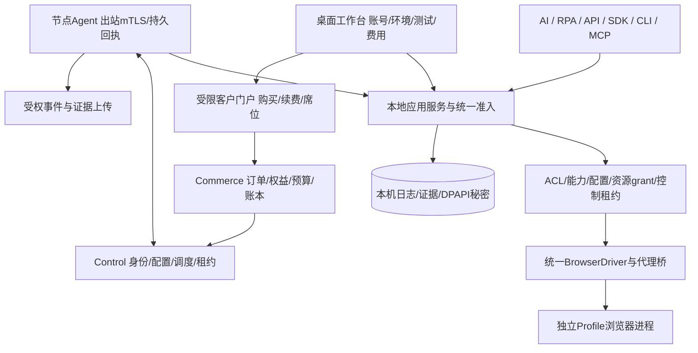

# 浏览器客户端与后台联动开发计划

> 2026-11-05 / 0.1.13实施更新：三官方支付创建/查询/全额退款、OIDC/PKCE与主体绑定、桌面一次性连接码，以及单持久协调器+多个真实Windows执行节点已实现。双配置、本地独立签名夹具、同机两个真实节点、旧商业业务/SDK/API回归通过。参数默认空并关闭；真实商户、企业IdP、TLS/mTLS握手与第二台机器未验收。详见[本轮逐项实施与测试](44_官方支付OIDC与多机调度实施验收.md)、[操作/部署/编译](45_官方支付企业登录与多机自动化操作部署指南.md)。原完整父包的未完范围继续保留，不把本地协议测试当外部商业验收。

专项版本：1.0。编制与更新日期：2026-11-03。对应主计划 v1.4、后台专项 1.4、商业专项 1.3、接口草案 0.7。客户端已有本机Win32/CLI/MCP技术验证子集，BR001/005/008/012/019保持进行中；后台/官方支付/席位及多节点核心联动已落地，完整BC矩阵仍待验收。实际代码、缺口与证据见[文档13](13_执行记录与验收台账.md)。

关联：[产品总计划](01_开发计划与技术方案.md)、[任务进度](03_开发进度与任务清单.md)、[API/AI契约](04_AI接口与流程设计样例.md)、[Web功能测试](05_Web功能测试与便捷操作设计.md)、[功能边界](06_功能边界与源码补全方案.md)、[工程构建](09_VC2019工程与依赖构建方案.md)、[基础后台](10_管理后台功能与开发计划.md)、[商业后台](11_环境销售计费与商业运营后台计划.md)。

## 1 本次更新与产品边界

后台每项功能必须有浏览器端的操作入口、只读状态或受控执行能力，以及接口、持久化、失败处理和验收证据。仅有后台菜单或“后续接入”字样不能视为联动完成。本文新增 BF01–BF32 客户端功能、BR001–BR024 实施子项、BC01–BC32 联动验收；保留原 F01–F65、MF01–MF36、CF01–CF32 及 T/ADM/COM 编号。

“浏览器端”包括桌面工作台、本地自动化服务和执行节点 Agent，网页仍由独立受管 Chromium 进程承载。本文不把截图预览改称内嵌浏览器，不提前引入完整远程桌面或现代 CEF 直接链接。平台商品、对账、调账、密钥签发等由后台完成，客户端按身份显示结果、申请入口或管理门户链接。

### 1.1 全端统一的免费与收费规则

| 维度 | 客户端必须实现的行为 |
| --- | --- |
| 免费环境容量 | 同一个人账户/客户组织跨项目、设备、节点合计持有10个独立Profile；草稿/模板不占容量，独立克隆占1份 |
| 免费运行并发 | 本项目默认10个独立运行实例，容量与运行槽分列；这是本项目规划，未据比特价格页核实其实际并发 |
| 免费能力 | RPA、Local API、AI调用、Web测试、核心SDK/CLI/MCP和HTTP/HTTPS/SOCKS5/SSH接入持续免费；无需绑卡、充值、正余额或付费订阅 |
| 免费运行 | 用户自有节点基础免费会话为non_billable，不消耗购买/赠送时长，不记费用应收；诊断秒数不能伪装成消费 |
| 单独资源 | 代理IP、SSH/VPS、模型和平台托管节点的供应成本不包含在免费功能里；只在用户明确选择后引用其订单/资源授权 |
| 超额与购买 | 第11份容量拒绝并保留草稿；运行槽满可排队。显示扩容入口但不自动下单、扣款或改配置；付费M/N为生效后的总量 |
| 删除与迁移 | 可恢复归档/回收站仍计容量；可靠停止且彻底删除后释放。迁移不双开同一身份，也不重复计持有容量 |
| 到期回落 | 允许选择最多10份环境及默认10个活动会话；免费资格与合规代理保持，超额受控冻结/停止，数据按保留规则处理 |
| 独立数量 | 命名席位、设备、节点、任务数、环境容量、运行槽分别管理；免费所有者及获授服务账号不能被统一要求购买席位 |

免费政策唯一权威为[商业专项第4节](11_环境销售计费与商业运营后台计划.md#4-商品套餐与定价模型)的FREE_TEN_ENV_PROXY_V2。未确定的每日次数、免费成员数、售价、离线宽限和保护期限在BG0/CG0冻结，不从竞品推断。连接失败显示连接或授权核验问题，不显示“永久免费已到期”。

### 1.2 联网、离线与未登录体验

产品模式先关联个人账户或客户组织，自动取得免费权益，再为设备分配全局槽；首次关联不要求付款。已有有效签名和预占槽时允许在授权剩余期限内离线使用，不能每台机器离线各自领取10份。新装纯离线时可编辑流程、查看已有本地证据和使用不占新实例的设计工具；新建/启动受管实例需首次联网完成免费资源分配。离线演示若保留，只限不承诺跨设备额度的开发夹具，发布前须另行明确，不作为绕过产品准入的入口。

本地Web测试、选元素和普通登录/注册不要求模型、容器或后台财务服务可用；已关联并获有效免费授权的执行能力不因支付渠道故障停用。依赖身份/授权服务首次分配或续授的可用性限制必须在安装/离线说明中明示。自有机器管理员可修改程序的可信度边界沿用商业专项，不能宣称离线计量不可绕过。

## 2 分层责任与数据流



| 层 | 必须负责 | 不在本层确认为权威的事实 |
| --- | --- | --- |
| 桌面UI | 当前主体、使用量、参数/差异、操作确认、结果和恢复入口 | 不凭按钮可见性授予权限，不凭付款跳转发放权益 |
| 本地应用服务 | 所有入口统一校验、动作/测试、进程归属、停止与本机急停 | 不持有平台授权私钥，不允许普通UI直接写财务余额 |
| 节点Agent | 注册、能力握手、配置落盘、命令去重、回执、租约/grant校验、计量事实 | ACK不证明动作已发送或网页业务成功；心跳不证明进程停止 |
| Control | 主体/ACL、资源版本、分配代数、中央租约/任务状态 | 不把节点未回报的结果猜为成功，不因离线自动重开身份 |
| Commerce | 商品/报价/订单、支付核验、权益、预算、账本/对账 | 网页业务成功不代表收费成功，退款不撤销目标网站的操作 |

购买门户首版采用系统浏览器打开受信HTTPS门户；桌面原生显示权益/用量摘要与入口。后续可复用Web组件，但不把一个空白WebView称为已实现全部客户页面。单点跳转采用服务端短期一次性交换且校验目标域；账户token、节点证书和秘密不得拼在URL内。没有原生客户端深链时保留复制请求ID和手动返回刷新，不阻塞正确性。

## 3 客户端功能矩阵 BF01–BF32

全部为完整联动产品范围，状态均为未实现。BF是客户端视角的分解，不扩写成第二套浏览器内核。

| ID | 功能与入口 | 最低客户端交付 | 实施子项 | 验收 |
| --- | --- | --- | --- | --- |
| BF01 | 账号与登录 | 登录/退出/过期/禁用、OIDC受信跳转与当前身份，用户会话和节点身份分开 | BR002 | BC01 |
| BF02 | 组织/项目/成员权限 | 切换确认、邀请/角色/ACL摘要、停用影响、可访问环境；切换后清理旧页面缓存 | BR003 | BC02 |
| BF03 | 免费与付费权益 | 档位/政策/revision/容量/运行槽分列，免费无需余额，服务端签名核验 | BR004 | BC03 |
| BF04 | 环境目录与配额 | 本地/远程实例、归属/分配/状态，创建导入克隆恢复的容量预检与最终原子判定 | BR005 | BC04 |
| BF05 | 配置版本与生效 | requested/effective/diff、收到/接受/应用/失败，运行中禁改字段留待停机 | BR005/BR007 | BC05 |
| BF06 | 环境交付与迁移 | 本地额度/托管交付、停机迁移、重登录提醒、清理/回收结果，禁共享目录并写 | BR020 | BC06 |
| BF07 | 四类代理 | HTTP/HTTPS/SOCKS5/SSH、凭据槽/host key、测试出口、实际路由/错误、桥接生命周期 | BR008 | BC07 |
| BF08 | 扩展版本与分配 | 来源/权限/固定版本、兼容检查、安装生效/重启/回滚结果 | BR009 | BC08 |
| BF09 | 秘密绑定 | 本机DPAPI凭据、项目/域/用途、缺失重绑；中央仅引用/可用性，导出诊断脱敏 | BR009 | BC09 |
| BF10 | 设备与节点 | 注册/批准、证书/吊销、出站通道、交互会话、维护模式和设备归属 | BR006 | BC10 |
| BF11 | 能力与诊断 | 浏览器/Worker/协议/契约版本、缺组件、只读doctor、影响范围和建议 | BR018 | BC11 |
| BF12 | 可靠命令与回执 | 信封/正文hash、先持久化再ACK、分阶段回执、取消、去重和断点重连 | BR007 | BC12 |
| BF13 | 资源准入与grant | 全局容量/运行槽、免费non_billable或显式付费预算、有限授权、公钥校验 | BR004/BR015 | BC13 |
| BF14 | 控制租约与接管 | fencing/owner、暂停/急停/交还、unknown查验；旧UI/API/Worker写全部失效 | BR007/BR012 | BC14 |
| BF15 | RPA与固定版本 | 草稿/发布/校验/hash、录制/单步/参数/模板知识包，断线不偷换版本 | BR010 | BC15 |
| BF16 | 批次与队列 | 有界并发、排队原因、逐项状态/取消、同命令去重，禁止unknown批量重试 | BR010 | BC16 |
| BF17 | 定时与漏跑 | 中央/本地调度归属、时区/DST/triggerId、补跑上限和冲突展示 | BR010 | BC17 |
| BF18 | Web功能测试 | 本地/远端地址、角色/数据/前后置、登录注册/选元素/断言、污染隔离与报告 | BR011 | BC18 |
| BF19 | AI/CI与外部调用 | 范围token/服务账号、统一原生API/SDK/CLI/MCP、预检/预算/证据，无模型可运行 | BR011/BR019 | BC19 |
| BF20 | Space/预览/调试 | 身份/owner/状态、限频脱敏预览、本机接管入口、Console/Network受控查询 | BR012 | BC20 |
| BF21 | 证据与报告 | 本地证据/上传状态/hash、权限下载、隔离报告、HTML/JSON/JUnit及缺片标记 | BR017 | BC21 |
| BF22 | 审计与隐私 | UI/API/拒绝/导出追踪、操作者/原因/请求ID、内容分权与日志脱敏 | BR017 | BC22 |
| BF23 | 商品/报价/订单 | 主动购买入口、服务端报价快照、订单/支付/履约分列、未决查询 | BR013 | BC23 |
| BF24 | 订阅/续费/变更 | 周期/锚点、手动续费、自动续费正式同意/撤销、升降级预演 | BR013 | BC24 |
| BF25 | 席位/许可证/设备额度 | named seat与角色分列、邀请预留/回收、激活/解绑/迁移，免费所有者路径 | BR014 | BC25 |
| BF26 | 运行时长/费用/预算 | 诊断计时与付费计量分流、余额/预留/消费分列、账单追溯和本机区间日志 | BR015 | BC26 |
| BF27 | 到期与免费回落 | 资源来源/期限、选择10份保留/预演、超额有界停止、数据保留和代理不改 | BR016 | BC27 |
| BF28 | 账单/发票/退款/争议 | 按财务权限查账/申请/进度；客服工单与运营门户入口，客户端不直接调账 | BR013/BR017 | BC28 |
| BF29 | 消息与提醒 | 站内到期/低余额/续费预告/节点故障、去重/已读、原因和处理入口 | BR016/BR018 | BC29 |
| BF30 | 备份/保留/清理 | 本地包与中央快照来源分开、停机/引用检查、恢复后重新核验，旧命令不复活 | BR020/BR023 | BC30 |
| BF31 | 安装/升级/设置 | 服务与交互Agent、受信端点、更新通道/签名/维护排空/迁移回滚 | BR018/BR024 | BC31 |
| BF32 | 同步/离线/恢复对账 | 受限缓存、event cursor、撤销/revision/商业epoch、时间异常与恢复模式 | BR004/BR007/BR015/BR023 | BC32 |

## 4 后台基础功能到浏览器的逐项映射

MF编号与原后台保持一致。每一行都要求“客户端行为→后台权威→回执/状态→验收”可追踪；平台专用操作只在具备对应角色的独立门户执行。

| 后台项 | 浏览器对应项 | 客户端动作/读侧及回执 | 原父工作包 | 客户端验收 |
| --- | --- | --- | --- | --- |
| MF01 总览 | BF04/BF16/BF21 | 按项目筛选节点/排队/失败；时间范围、离线/陈旧/权限过滤可见 | ADM011/ADM029/ADM033 | BC04/BC16/BC21 |
| MF02 组织项目 | BF02 | 切换/查看归属、管理员进入门户创建/归档；服务端确认后刷新 | ADM006/ADM007 | BC02 |
| MF03 成员邀请 | BF02/BF25 | 邀请链接核验、角色/席位分列、撤回/停用显示活动影响 | ADM006/COM012 | BC02/BC25 |
| MF04 ACL能力 | BF02/BF13/BF19 | UI可见权限与每次调用复核；事件/导出/Worker同时拒绝越权 | ADM007/ADM041 | BC02/BC13/BC19 |
| MF05 登录SSO | BF01 | 系统浏览器OIDC登录、注销/过期/禁用，节点会话不混用 | ADM005/ADM035 | BC01 |
| MF06 节点注册 | BF10 | 本地密钥、一次性注册/批准、重放/错主体拒绝 | ADM009/ADM010 | BC10 |
| MF07 节点会话 | BF10/BF31 | 交互用户/锁屏/维护/离线状态；Session0不显示可人工接管 | ADM011/ADM038 | BC10/BC31 |
| MF08 能力版本 | BF11/BF31 | 握手/缺能力预检、版本不兼容阻断、doctor证据 | ADM012/ADM034 | BC11/BC31 |
| MF09 环境实例 | BF04 | 配置定义/物理实例/节点/目录元信息分开；归属经后台确认 | ADM013 | BC04 |
| MF10 配置分发 | BF05/BF12 | 固定revision/diff，持久接收与应用分开，冲突不覆盖 | ADM014/ADM032 | BC05/BC12 |
| MF11 实例迁移 | BF06/BF30 | 停机/导出校验/新归属/重登录，原节点未停保持隔离 | ADM015 | BC06/BC30 |
| MF12 代理目录 | BF07 | 免费四协议、槽绑定/出口验证/effective；认证错误不降直连 | ADM030/COM014 | BC07 |
| MF13 扩展目录 | BF08 | 版本/权限/策略下发，安装/应用/回滚状态及失败原因 | ADM030 | BC08 |
| MF14 凭据槽 | BF09 | 本地绑定/重绑、中央只回可用性，未知域/用途拒绝 | ADM016/ADM035 | BC09 |
| MF15 流程版本 | BF15 | 草稿编辑、发布校验与不可变hash，本地执行固定run包 | ADM017 | BC15 |
| MF16 测试用例 | BF18 | 登录注册/按钮模板、参数预检、发布版本和测试结果 | ADM018/ADM044 | BC18 |
| MF17 批次任务 | BF12/BF16 | 排队/领取/启动/业务结果分阶段，取消/部分失败逐项展示 | ADM019/ADM020/ADM032 | BC12/BC16 |
| MF18 定时漏跑 | BF17 | 中央与本地唯一调度归属、trigger去重、DST及补跑上限 | ADM024 | BC17 |
| MF19 分布租约 | BF13/BF14 | 代数/epoch与派发门，旧代消息在入队/出队/发送前拒绝 | ADM021/ADM042 | BC13/BC14 |
| MF20 unknown补偿 | BF14/BF16 | 冻结新写、业务查验、显式新授权/attempt，不重复提交注册 | ADM021/ADM022/ADM043 | BC14/BC16 |
| MF21 Space预览 | BF20 | owner/身份/陈旧标记、限频/离屏停流、敏感页关闭 | ADM025 | BC20 |
| MF22 人工接管 | BF14/BF20 | handoff-pending到ready需节点阻断自动写确认，本地急停优先 | ADM022/ADM026 | BC14/BC20 |
| MF23 网页调试 | BF20 | Console/Network步骤关联、正文额外授权、截断/超时，无通用raw CDP | ADM027 | BC20 |
| MF24 报告导出 | BF21 | 上传/校验/可下载分态，权限短链/隔离HTML、缺片保持事实 | ADM028/ADM029 | BC21 |
| MF25 测试数据 | BF18/BF09 | 唯一命名空间、前后置清理、污染阻断、远端localhost提示 | ADM018/ADM019/ADM044 | BC18/BC09 |
| MF26 AI/CI预算 | BF03/BF13/BF19/BF26 | 免费资源先判、模型/付费资源预算分别展示，额度非每token另领 | ADM007/ADM023/COM028 | BC03/BC13/BC19/BC26 |
| MF27 模板知识包 | BF15/BF09 | 来源/许可/差异、站点适用性、重绑秘密、不执行包内任意代码 | ADM017/ADM031 | BC15/BC09 |
| MF28 审计追踪 | BF22 | 客户端发起/拒绝/导出关联requestId，权限过滤、日志脱敏 | ADM008/ADM037 | BC22 |
| MF29 配额保留 | BF04/BF16/BF30 | 原子额度、磁盘/图像上限、活动引用不清理，显示保留期限 | ADM023/ADM028/ADM033 | BC04/BC16/BC30 |
| MF30 诊断修复 | BF11 | 默认只读检查、code/影响能力/证据；修复另确认并产生日志 | ADM012/ADM027/ADM037 | BC11 |
| MF31 平台组织 | BF02/BF03 | 客户显示服务/组织停用原因；平台角色进入独立门户操作 | ADM033 | BC02/BC03 |
| MF32 策略审批 | BF05/BF13/BF31 | 策略revision/待审批状态、版本差异，不提供本地忽略策略开关 | ADM023/ADM034 | BC05/BC13/BC31 |
| MF33 灾备恢复 | BF30/BF32 | 恢复模式校验新epoch、旧run不重跑、证据/秘密分别恢复 | ADM036/ADM046 | BC30/BC32 |
| MF34 健康告警 | BF11/BF29 | 站内故障/排队/unknown告警，聚合/去重且不含秘密 | ADM037/ADM040 | BC11/BC29 |
| MF35 安装升级 | BF31 | 标准用户/服务Agent、受信升级/迁移/回滚和重启后对账 | ADM034/ADM038/ADM046 | BC31 |
| MF36 系统集成 | BF01/BF19/BF31 | 受信端点/证书、token生命周期、CI接入；无任意脚本配置口 | ADM003/ADM005/ADM035/ADM039 | BC01/BC19/BC31 |

## 5 商业后台到浏览器的逐项映射

| 后台项 | 浏览器对应项 | 客户端动作/读侧及回执 | 原父工作包 | 客户端验收 |
| --- | --- | --- | --- | --- |
| CF01 商品价格 | BF03/BF23 | 查看免费政策/可售扩容/价格版本，RPA/API/代理不设付费开关 | COM004/COM026 | BC03/BC23 |
| CF02 报价订单 | BF23 | 主动选择规格→服务端报价→确认下单，重复点击同幂等键 | COM005 | BC23 |
| CF03 支付尝试 | BF23 | 打开受信支付页、查询pending/unknown/失败，渠道密钥不下发 | COM006 | BC23 |
| CF04 支付通知 | BF23/BF03 | 仅轮询或受权事件读取后台核验结果，跳转成功不发权 | COM007 | BC23/BC03 |
| CF05 支付对账 | BF23/BF28 | 显示到账待核验/履约异常和工单；财务对账仅独立门户 | COM008/COM032 | BC23/BC28 |
| CF06 手动续费 | BF24 | 展示周期锚点/有效期、续费报价/期次、到账后刷新revision | COM009 | BC24 |
| CF07 自动续费 | BF24/BF29 | 正式委托同意/撤销/扣款预告，不能默认勾选或本地布尔发权 | COM020/COM030 | BC24/BC29 |
| CF08 升降级 | BF24/BF27 | 差额/生效日/总量差异/超额预演，用户选择保留对象 | COM019 | BC24/BC27 |
| CF09 权益服务 | BF03/BF13 | 免费资格自动取得、签名/revision核验、付费到账与生效分态 | COM010 | BC03/BC13 |
| CF10 许可证 | BF10/BF25/BF32 | 设备绑定、公钥keyId、吊销/迁移，拒绝错租户/错boot | COM011/COM031 | BC10/BC25/BC32 |
| CF11 离线时间 | BF13/BF32 | 显示剩余核验期限、单调时钟/休眠/倒拨处理，不重置额度 | COM011/COM016 | BC13/BC32 |
| CF12 环境容量 | BF04/BF06 | 创建/导入/克隆/恢复原子占位，回收站计数，永久删后才释放 | COM013/COM014 | BC04/BC06 |
| CF13 托管交付 | BF06/BF23 | 已付/待分配/交付失败/可运行分态，隔离擦除后才回收 | COM013/COM026 | BC06/BC23 |
| CF14 会话计时 | BF26 | 同实例区间并集、多个实例求和；免费诊断不进扣费分录 | COM015/COM016 | BC26 |
| CF15 时长预付 | BF26/BF23 | 来源/有效期/可用/预留/已用分列，购买赠送分账，免费不扣 | COM017 | BC26/BC23 |
| CF16 并发代理 | BF07/BF13/BF16 | 全局免费10槽、四协议免费、满额排队/拒绝无财务副作用 | COM014/COM017 | BC07/BC13/BC16 |
| CF17 命名席位 | BF02/BF25 | 分配/邀请预留/回收结果、停用对活动会话和token影响 | COM012 | BC02/BC25 |
| CF18 设备限制 | BF10/BF25 | 激活/解绑/冷却/重装核验；增加设备不增环境/席位 | COM011/COM012 | BC10/BC25 |
| CF19 客户门户 | BF23/BF24/BF28 | 原生摘要与受信门户、财务权限、异常返回/手动刷新恢复 | COM025 | BC23/BC24/BC28 |
| CF20 运营客服 | BF28 | 客户只见本组织工单/状态；运营角色可进入独立工作台 | COM002/COM026 | BC28 |
| CF21 账本调账 | BF26/BF28 | 只读账单和调整结果，申请理由/审批号可追溯，不本机改数 | COM018/COM023 | BC26/BC28 |
| CF22 退款回收 | BF28/BF27 | 原单申请/渠道进度/权益回收原因，退款不等于网页业务撤销 | COM022 | BC28/BC27 |
| CF23 拒付异常 | BF28/BF27 | 争议状态/申诉材料、资源冻结范围与恢复，不自动重跑任务 | COM022/COM032 | BC28/BC27 |
| CF24 欠费到期 | BF27/BF13 | 拒绝新增未授权付费消耗、有界保护，免费资格及合法代理继续 | COM021 | BC27/BC13 |
| CF25 数据保护 | BF27/BF30 | 明示保留/导出/清理，恢复重新核验/登录，不删除超额身份 | COM021/COM023 | BC27/BC30 |
| CF26 免费试用优惠 | BF03/BF23 | 持续免费与限时赠送分列、到期不自动购买、不把AI免费改试用 | COM004/COM023 | BC03/BC23 |
| CF27 发票账单 | BF28 | 财务角色申请/查看开具/作废/红冲文件，抬头/税号受限 | COM018/COM024 | BC28 |
| CF28 费用争议 | BF26/BF28 | 会话→区间→冻结单价→账单行、预留/消费分列与争议证据 | COM027/COM032 | BC26/BC28 |
| CF29 资源API | BF19/BF13 | API/SDK/MCP同一免费/付费资源门，purpose=test不绕额度/ACL | COM014/COM028 | BC19/BC13 |
| CF30 到期提醒 | BF29/BF24 | 站内去重、已读/跳转、取消委托不误提示；外发按配置 | COM030 | BC29/BC24 |
| CF31 备份密钥 | BF32/BF30 | 更新公钥/商业epoch、恢复先查验旧授权/区间，不重复扣/发权 | COM031/COM037 | BC32/BC30 |
| CF32 通用业务 | BF15/BF18/BF19/BF26 | 人工/AI/RPA/外部软件使用同实例/授权，业务结果与账务独立 | COM029/COM036 | BC15/BC18/BC19/BC26 |

## 6 桌面导航与可操作页面

### 6.1 主导航补齐

| 导航 | 必须显示与可操作内容 | 角色/状态 |
| --- | --- | --- |
| 顶栏账号/组织/项目 | 当前主体、切换、身份来源、连接/策略核验状态、消息 | 所有者/操作者可见；切换不偷偷终止其他项目任务 |
| 工作台 | 容量x/10、运行y/10、队列/unknown、实际节点可用量、运行费用0或付费来源 | 概览不能泄漏无权项目；陈旧数据带采样时间 |
| 浏览器环境 | 本地/远程、分配、配置revision、代理/effective、环境矩阵、创建/运行/停机/迁移 | 无权限给出原因；保留输入/草稿；远端路径不可当本机路径打开 |
| 任务空间 | 身份/owner/租约、预览、待人工、接管/交还/急停 | 未有交互桌面显示blocked；预览不提供通用远程键鼠 |
| 流程与调度 | RPA/录制、固定版本、批次、定时与执行节点、队列原因 | 免费标识；调度编辑显示唯一归属/受影响触发 |
| Web功能测试 | 地址/角色/测试数据、选元素快捷动作、登录注册/断言、测试集/报告 | 新手默认最少字段；高级远程/商业配置折叠 |
| 调试与证据 | Console/Network/步骤、unknown查验、报告/上传状态 | 按需正文权限；敏感数据遮罩/隔离 |
| AI与接口 | 服务账号/范围token、MCP/SDK/CLI、能力/契约、模型配置 | token只在创建时受控展示；模型可不配 |
| 设备与节点 | 当前设备/节点、注册/交互用户、维护、诊断、激活/解绑 | 节点注册审批和设备激活是不同状态 |
| 组织与成员 | 归属/角色/ACL、席位占用/邀请/回收 | 免费所有者入口可用；团队管理按实际角色开放 |
| 套餐与费用 | 持续免费、扩容报价、订单/履约、订阅/续费、时长/账单/发票/退款 | 操作者见资源摘要；无财务权限不见金额/账单正文 |
| 消息与设置 | 提醒、审计、代理/扩展、端点/证书、存储/备份、升级/doctor | 高级平台操作跳转受信门户并由后台再鉴权 |

### 6.2 环境详情和状态呈现

详情页至少有“概况、配置与生效、代理与网络、任务/租约、数据与迁移、用量与证据”六页签。概况展示实例ID、组织/项目、节点/交互用户、资源归属、分配代数、当前生命周期、最新核验时间；用户可直接定位本地窗口，远端只按已交付能力查看或请求本机接管。

状态分为连接、配置、控制命令、浏览器进程、网页业务、证据、财务七条轴。比如“付款已确认，实例待交付”“配置已接收，待停机应用”“取消已接收，注册结果待查验”“进程已停，费用待对账”均为合法组合，不能压成一个成功/失败灯。

按钮响应应即时显示requestId/operationId与当前阶段，长操作可离开页面后恢复。运行中不能直接删目录/改代理/迁移，需受控停止或生成待应用版本。表格批操作逐项列出成功、拒绝、unknown、待确认，关闭弹窗不视为取消后台任务。

## 7 六条端到端交互路径

| 路径 | 用户操作 | 后台/节点处理与必须看到的结果 |
| --- | --- | --- |
| 免费首次使用 | 安装→个人账户→自动免费权益→注册当前设备→创建环境→选择直连/代理→运行 | 不出现绑卡/充值步骤；全局容量/运行槽核验后发免费grant；免费运行费用0；第11份保留草稿 |
| 后台配置与远程执行 | 选项目/节点→发布配置/流程→浏览器端收到→预检→运行→回传 | 固定版本/hash，先持久接收再ACK；离线显示待分发，禁改项待停机；已开始/业务结果另确认 |
| 免费代理业务 | 选HTTP/HTTPS/SOCKS5/SSH→本机绑秘密→测试→保存生效→已登录业务/RPA | 展示出口证据/路由，四协议都验收；认证/TLS/host key失败保留配置并阻断，不弹付费开通 |
| AI与Web测试 | 范围token→输入测试地址→选字段/按钮→点击/填写/断言→录制发布→API/CI调用 | 元素引用/租约重验，普通登录无模型可跑；两角色用独立Profile；报告包含业务结果及节点地址解释 |
| 主动购买到使用 | 满额→用户选择扩容→服务端报价→确认订单/支付→核验→权益生效→再次运行 | 到账/履约/权益分别显示；pending不发权，刷新后按总量M/N显示，旧run不因购买自动重放 |
| 到期/撤销/断线恢复 | 查看提醒→选择保留10份→停止超额→新免费grant；或断线重连→对账→恢复 | 不随机删、不改代理/IP；旧计费区间在切换点结束，未停身份不双开，旧权限/命令不复活 |

## 8 协议、持久化与同步契约

### 8.1 账号、节点身份与信任域

桌面登录候选为系统浏览器OIDC授权码+PKCE，须由ADM005验证IdP/native客户端兼容性、state/nonce、回调端口与超时；若采用设备授权流，先确认IdP实际支持，不临时自造登录协议。刷新凭据、节点私钥、API token分别存系统保护存储，不写流程、日志或普通SQLite明文字段。节点注册在本机生成密钥，只提交公钥/一次性注册证明。

注册身份、设备激活、组织席位、项目ACL、商业权益是独立关联。证书失效不能改用用户token伪装节点；切换组织需明确设备/节点归属，清空旧范围缓存和事件订阅。注销阻止该用户新派发，已由服务账号持有的后台任务按其授权继续或受控停止；UI明确显示影响，不默认“关窗口即关全组织浏览器”。

### 8.2 配置和命令信封

信封沿用后台字段：protocolVersion、tenantId、projectId、nodeId、bootId、commandId、requestId、profileInstanceId、assignmentGeneration、leaseEpoch、deadline、payloadHash、resourceVersionId、requiredCapabilities。浏览器端另核对当前有效entitlementRevision、grantId和本机路由摘要；字段来自可信分配/签名数据，不能由调用方任意指定后即生效。

| 阶段 | 节点处理 | 上报含义 |
| --- | --- | --- |
| received | 验证基本信封/归属/版本→命令及hash持久化→ACK | 可靠收到，不能显示已运行 |
| accepted/rejected | 验证资源版本、ACL、能力、配置、租约/grant/期限 | accepted表示可进入队列；后续派发仍需重验 |
| applying/applied/failed | 配置变更按不可变revision应用并读回effective | 配置成功不证明浏览器已启动 |
| started/progress | 核对进程归属/ready，记录启动和业务步骤 | 进程ready是运行事实，网页可能仍未成功 |
| completed/failed/outcomeUnknown | 保存业务结果/查验证据；unknown冻结后续冲突写 | 不将丢回应猜为失败后盲重跑 |
| stopped/reconciled | 可靠进程停止/计量区间/资源释放分别确认 | 停止确认和账务对账可以不同时间完成 |

commandId+payloadHash去重；同ID不同正文返回COMMAND_PAYLOAD_CONFLICT并审计。长连接断开重发既有ID，不能变成新的动作；网站非幂等提交是否成功仍需业务查验。撤销/接管在入队、出队、发送前全部核验epoch/代数。控制/撤销优先于预览和上传；接收日志无法持久化时拒绝新增执行，不先ACK再丢命令。

### 8.3 本地存储增量

本地SQLite只存缓存和执行事实，中央仍为权益/分配/账务权威。各表带schemaVersion、tenantId及需要的projectId，索引和清理按主体隔离。

| 预期本地表/存储 | 最低字段/约束 | 恢复与清理 |
| --- | --- | --- |
| account_contexts | subject/tenant/project、IdP、会话引用、最后核验；不存明文refresh token | 切换清旧订阅；秘密进DPAPI，删除缓存不重置全局额度 |
| entitlement_cache | policy/revision、签名包/keyId、范围/expiry、核验时间、资源来源 | 篡改/错主体拒绝，缓存不是新grant，失联不续出无限期限 |
| node_registrations | node/device/publicKeyRef/certRef、bootId、交互用户、证书状态 | 重装按新boot/核验恢复，不冒领旧槽 |
| instance_assignments | instance、节点/用户、assignmentGeneration、配置/effective哈希 | 同身份迁移保留唯一链，旧代分配不恢复 |
| config_receipts | commandId/revision/hash、received/accepted/applied/failed、错误码 | 已发布版本不覆写；禁改字段待停机 |
| command_inbox | commandId+hash唯一、信封、receipt、run/step/结果引用 | 先落盘再ACK；去重墓碑覆盖消息重投期限，不能过早清除 |
| event_outbox | eventId、boot、sequence、command/run、payloadHash、中央确认cursor | 至少一次发送；中央确认后按保留策略清，乱序不覆盖终态 |
| resource_grants | grantId、kind/billingMode、签名/期限、slot/instance/boot、revision/epoch | 公钥验证；期限裁剪/单调时钟；不存签发私钥 |
| runtime_sessions | session/instance/boot、进程指纹、ready/stop、grant/lease链 | 重启先查验原进程，未确认停止保持unknown |
| meter_interval_outbox | session/sequence、单调区间、价格/grant版本、hash、确认状态 | 免费诊断与付费事件分流；重发去重，原始事实不改成负扣费 |
| sync_cursors | stream/scope/cursor、resource revision、同步时间/缺口 | cursor失效取快照/对账，不把全量历史作为新命令 |
| portal_operation_refs | order/subscription/support等ID、幂等键/hash、最近可信状态 | 只缓存摘要/链接；账单余额非本机权威，不收集支付卡资料 |

### 8.4 资源grant、租约、计量和时间

准入顺序：主体/ACL→实例归属与固定版本→节点/代理能力→持有容量/全局运行槽→免费或已确认付费资源分支→控制租约→最终派发重验。免费分支不请求资金/时长预留。原始CDP、兼容API、恢复、录制、同步窗口和调试都必须走同门；入站兼容open不得返回可绕门的原生ws。

停止、急停、保存已有证据和依法获授的导出必须保留恢复通道，不以新付费grant、正余额或续费为前置。它们仍校验本机/资源权限和数据范围；停止不能隐式切成新的网页业务动作。授权或网络失效时，本机紧急停止不等待中央确认，结果补传，已发生业务继续按unknown查验。

资源grant不等于控制租约。免费grant预占全局槽，付费计量grant另绑预算/价格；两者都有限期且受boot/revision/epoch约束。候选60秒grant、15秒续期、付费失效30秒保护仅沿用POC参数，BG0/CG0须实测冻结。消息到达晚要扣除已耗期限，不能到达时重置60秒；休眠/时间倒拨需要重新核验，不能延长免费资源槽或付费预算。

计量以进程ready至可靠停止/授权受控截止的确认区间为依据。任务暂停、等待人工而浏览器仍开着时，付费计量资源通常继续计时；启动前预检、排队、未ready失败不计运行费。固定包月商品不能擅加按时费。同实例人工/AI/多个Space取区间并集，独立实例求和；按会话冻结规则舍入，不按心跳进位。免费诊断时长始终non_billable，不流入消费账本。

### 8.5 事件订阅、重连和撤销

事件名称至少包括account.session.changed、entitlement.changed、node.certificate.changed、configuration.receipt、command.receipt、runtime.state、lease.changed、run.outcome、artifact.upload.state、usage.reconciliation.state、subscription.changed、notification.created。新增前缀与事件schema由BR001/BR019纳入单一契约；名称是设计，不表示现有推送服务。

事件含scope/eventId/sequence/cursor/resourceVersion/time/hash。收到更新先校验作用域和版本，再持久化/应用；旧消息可追加审计，不降低revision或复活终态。断线恢复先握手身份、版本、撤销/epoch，再对账存活进程和授权，再恢复快照/队列；cursor过期回全量查询，不能重放网页提交。证据上传独立补传，控制通道不等大文件完成。

## 9 本地接口、控制面和商业接口联动

### 9.1 本地新增资源草案

统一前缀`/api/v1`；Control保持`/control/v1`、Commerce保持`/commerce/v1`。下表为拟定新增接口，需与现有`/profiles`、`/runs`、`/actions`、`/contract`和`/diagnostics`整合，同义操作不再造第二条直接驱动路径。

| 方法/本地资源 | 用途 | 关键约束 |
| --- | --- | --- |
| GET `/account-context` | 当前主体/项目/登录与核验状态 | 无秘密；普通操作者不返回其他组织/财务资料 |
| POST `/account-context/switch` | 显式切换已获授组织/项目 | 列明活动任务影响；切换不重新领取免费额度 |
| GET `/entitlement-summary` | 政策/revision、容量/运行槽、节点余量 | 只读可信缓存，标注陈旧；金额字段另验财务权限 |
| GET `/node-status` | 设备/节点/交互用户、版本/证书/能力 | 不返回私钥/enrollment明文/原始CDP |
| POST `/resource-preflights` | 创建/启动/批次前只读预检 | 不预留资金/槽，不下单，结果非执行授权 |
| GET `/commands/{id}` | 接收/准入/应用/运行/业务/停止回执 | 对象归属再验，ACK与completed分开 |
| GET `/profiles/{id}/effective-config` | 当前配置/应用版本/代理路由摘要 | 隐去认证信息；requested/effective分开 |
| POST `/profiles/{id}/proxy-checks` | 有界代理连接/出口检查operation | 属显式诊断网络动作，验域/秘密用途，不提交用户网页业务 |
| GET `/runtime-sessions/{id}` | 进程/控制/诊断或计量会话和对账状态 | 不将本机估值写成已扣费金额 |
| POST `/retention-previews` | 到期回落/保留对象的预演 | 只读方案，无停机/删除；最终提交走控制面确认 |
| GET `/notifications` | 本主体站内提醒/已读状态 | 去重/分页/权限；不泄漏财务正文 |

新建/克隆/启动/测试/调试仍调用已有应用服务，资源预检不代替最终事务判定。预检后槽可能被别人占用，真正执行返回结构化拒绝并保留草稿；运行槽满时排队不是已预约成功。

### 9.2 免费准入预检样例

```json
{
  "requestId": "preflight-example-1",
  "operation": "profile.start",
  "profileInstanceId": "instance-example-a",
  "projectId": "project-example",
  "observedEntitlementRevision": 18,
  "checks": {"proxy": true, "nodeCapabilities": true}
}
```

```json
{
  "requestId": "preflight-example-1",
  "decision": "eligible-at-observed-version",
  "authorizesExecution": false,
  "reservesResources": false,
  "planTier": "FREE",
  "policyId": "FREE_TEN_ENV_PROXY_V2",
  "entitlementRevision": 18,
  "capacity": {"owned": 3, "limit": 10, "scope": "billing-subject"},
  "concurrency": {"running": 2, "limit": 10, "basis": "project-planning-default"},
  "node": {"availableSlots": 4, "interactiveSessionAvailable": true},
  "proxy": {"protocol": "socks5", "supported": true, "credentialBound": true},
  "billingMode": "non_billable",
  "requiresPurchase": false,
  "finalAdmissionRequired": true
}
```

客户端不得通过提交planTier/free=true/billingMode来决定授权；上例为可信服务的只读判断。四协议supported只在对应构建和行为验收通过后为true，不能凭该示例认定当前已实现。

### 9.3 配置回执样例

```json
{
  "protocolVersion": "1.0",
  "tenantId": "tenant-example",
  "projectId": "project-example",
  "nodeId": "node-example",
  "bootId": "boot-example-2",
  "commandId": "command-config-example",
  "requestId": "request-config-example",
  "profileInstanceId": "instance-example-a",
  "assignmentGeneration": 4,
  "leaseEpoch": 23,
  "entitlementRevision": 18,
  "receiptStage": "accepted",
  "requestedRevision": 7,
  "effectiveRevision": 6,
  "applyState": "pending-stop",
  "reasonCode": "CONFIG_REQUIRES_STOP",
  "businessOutcome": "not-applicable"
}
```

此为裁剪后的回执示例，原命令还须具备deadline/payloadHash/resourceVersionId/requiredCapabilities等完整信封和schema校验。不能仅凭accepted把effectiveRevision改成7。

### 9.4 商业门户调用与付款恢复

客户端按角色读取catalog/entitlements/subscriptions/usage等已有商业资源，订单/续费/发票/退款请求进入受信门户。写请求带幂等键、请求正文hash、期望revision或报价ID；超时返回pending/unknown后按既有ID查询，不盲换订单号重试。支付回跳只触发查询，不把截图/URL参数中的success当到账凭据。

用户无财务权限时仅返回运行所需资源授权/截止/拒绝码，不返回余额、商品内部成本、发票或账单。AI范围token默认无购买、自动续费、退款、调账能力；增加付款权限必须显式角色和确认流程，网页内容不能替用户同意购买。

### 9.5 错误与用户恢复

| 错误类别/示例 | 客户端展示和允许动作 |
| --- | --- |
| FREE_PLAN_ENVIRONMENT_LIMIT / ENVIRONMENT_LIMIT_REACHED | 容量已满、当前总量、保存草稿/清理已停实例/主动扩容，不自动支付 |
| FREE_PLAN_CONCURRENCY_LIMIT / CONCURRENCY_LIMIT_REACHED | 运行槽已满、排队或停止自己的实例；与节点物理不足分开 |
| PROXY_AUTH_FAILED / PROXY_TLS_ERROR / SSH_HOST_KEY_MISMATCH | 指明协议/节点/影响实例，重绑或核验host key；不自动直连/换线路 |
| LICENSE_STALE / ENTITLEMENT_REFRESH_REQUIRED | 需要权益核验/重连，免费资格不显示付费到期；最终按服务端revision判断 |
| NODE_SESSION_UNAVAILABLE / UNSUPPORTED_CAPABILITY | 交互会话/组件缺失和诊断，不能靠升级套餐修复 |
| CONFIG_REQUIRES_STOP / CONFIG_REVISION_CONFLICT | 保存差异、请求受控停机或重新合并，不覆盖运行态 |
| COMMAND_PAYLOAD_CONFLICT / STALE_ASSIGNMENT / LEASE_REVOKED | 显示冲突/旧代/撤销，阻止派发，保留审计与原始请求ID |
| PAYMENT_PENDING / FULFILLMENT_PENDING | 查询原支付/订单/交付，提示可离开后恢复，不提前开放付费资源 |
| METER_RECONCILIATION_REQUIRED / OUTCOME_UNKNOWN | 分别显示计量待核对/业务待查验；禁止通用自动重试 |
| PERMISSION_DENIED / SEAT_REQUIRED | 展示缺的具体角色/范围或真实团队席位；免费所有者不套用付费席位前置 |

新增错误码需BR001纳入统一枚举及各端映射；不复用HTTP 200包success=false掩盖状态，也不将所有拒绝显示成“请充值”。

## 10 竞争、断线与恢复边界

| 故障/竞争 | 必须执行的规则 | 恢复依据/证据 |
| --- | --- | --- |
| 多设备争第10个容量/运行槽 | 中央事务唯一分配，节点只能消费指定grant；失败无扣费 | 额度事务、grant、实例唯一归属和拒绝回执 |
| 预检通过后被抢槽/权限撤销 | 最终准入/派发重验，保留草稿，不静默转付费 | preflight版本、实际判定、requestId |
| 命令重复/乱序/正文冲突 | 既有ID返回回执，冲突隔离；旧代不生效 | 持久inbox/outbox、hash与版本链 |
| 节点心跳丢失 | 冻结新分配、已授期限内受控结束，不自动跨机重开 | 进程指纹、停止确认、grant区间、业务查验 |
| 接管与在途提交竞争 | 阻断新写并排空；已发动作保留可能已提交，ready不保证业务回滚 | 派发时间线、代数和业务结果证据 |
| 网页注册/订单提交后断回应 | 标记unknown，先查唯一业务数据，再显式补偿/新attempt | 夹具服务端提交次数/查询证据 |
| 支付渠道故障 | 已有效免费grant按原期限工作；购买pending不发付费权 | 免费路径零财务调用与未决订单查询 |
| 离线/休眠/时间倒拨 | 不重置TTL，不能无限续授；到期阻断新动作并受控保存/停止 | 单调计时、签名时序、重新握手与恢复日志 |
| 节点本机日志磁盘满 | 不先ACK后执行、不丢审计/计量；控制/急停保留空间 | 磁盘配额/故障注入、持久化失败回执 |
| 旧库/克隆系统/重装恢复 | 新boot/epoch，拒绝旧grant和命令，先核对存活进程/财务 | 中央分配链、最新revision、渠道/计量对账 |
| 付费到期且有超过10份身份 | 预演/选择/有界停止；未选按已公开保护策略冻结超额，禁止随机删 | 保留计划、截止点、停止/免费grant切换记录 |
| 托管资源到期 | 停对应租用资源并保留条款约定数据；不可伪装自有资源继续用 | 商品资源来源、履约/停止/导出权限 |
| 退款/调账/密钥轮换 | 仅可信新revision/公钥/epoch改变本机授权；退款不恢复旧业务 | 审批/渠道结果、签名链/区间切点 |
| 数据/证据清理与运行竞争 | 活动引用/未确认事件不清理，超限阻止新增大证据并保留控制事件 | 引用计数、保留策略、缺片标记与清理日志 |

### 10.1 既有本地Profile接管与迁移

首次联机前扫描仅限受管根目录，先列候选归属、运行状态、来源版本和迁移风险，不自动接管用户普通浏览器目录。用户选择加入哪个主体/项目，后台事务登记/占容量；超过10份保留本地候选和草稿，不能伪装多个项目各领取10份。导入副本建立新独立实例需新容量；同身份迁移保持唯一分配链并可靠停旧实例。

不上传网站密码/Cookie到中央；跨机加密状态可能需要重新登录，明确支持表。不运行的超额旧目录可以受控导出/备份，不宣称已取得产品运行授权。迁移失败保留原数据和新版本回执，回滚不能恢复旧epoch写权限，也不能自动重放历史业务。

## 11 VC++2019模块与依赖落地

所有目录为预期设计，当前尚未生成产品源码。自有代码VC++2019/v142/x64/C++14，函数中文说明加实际修改日期，统一格式化；修改前记录编码/BOM/换行并原样保留。扩展工程约束见[文档09](09_VC2019工程与依赖构建方案.md)。

| 预期模块 | 责任 | 复用与新增边界 |
| --- | --- | --- |
| src/control/client、src/control/node | 受信Control客户端、注册/mTLS、握手/事件/配置/命令 | 复用ADM003/ADM009–ADM014，传输不侵入浏览器内核 |
| src/account、src/security | OIDC上下文、系统凭据、ACL缓存、公钥/证书核验 | 复用既有DPAPI/TLS/JSON候选，成熟签名组件需锁版构建 |
| src/commerce/client、src/commerce/admission | 权益摘要/门户引用、免费/付费资源准入、grant验证 | 不链接支付商户私钥或平台签发器；不建客户端财务账本 |
| src/storage/sync、src/runtime | command inbox/event outbox、cursor、进程/会话/计量区间 | SQLite事务/崩溃恢复；重启先查验，不自动恢复旧业务 |
| src/network/proxy | 四协议配置/effective、SOCKS认证桥、受控SSH生命周期 | 沿用T054/T091，HTTPS/SSH由ADM030/COM014补量复核 |
| src/ui/account、src/ui/organization、src/ui/commerce | 原生摘要/差异/错误/门户入口、权限过滤 | Qt/Win32既定路线；支付页交系统浏览器，不嵌入收集卡信息 |
| src/workflow、src/testing、src/api、src/mcp、src/cli | 固定版本、远端地址语义、同门资源/租约、SDK兼容 | 复用本地引擎，无平行直连CDP执行器 |
| tests/client-integration、tests/recovery | BC联调、凭据/日志/恢复/进程与账务对照 | 测试夹具/沙箱，不把模拟支付报告当真实渠道准入 |

本轮不新增源码仓库数量；现有45个候选及许可/工具链验证门继续有效。OIDC/native登录、签名、TLS、SQLite和SSH按已锁定成熟组件复用，缺失能力先固定版本和协议验证再纳入依赖；有源码不等于已适配。现代C++或其他运行时只允许独立协议桥并单列分发维护，不提高主程序标准。

## 12 客户端实施子项 BR001–BR024

### 12.1 估算与进度规则

下列120人日是客户端视角的**待校准分解估算**，可能复用现有本地/节点/后台/门户任务，不能整包再加到317本地或475后台基线上。每个BR只有一个主归集父包，其他父包为协作依赖；BG0/CG0按“复用已有/父包内拆分/确有缺口”逐项核定并记录转入/增量人日，再修改父包和排期。不能因为指定了父包就认定这些新增UI/故障处理已经含足工时，也不能将120人日当作已承诺全部额外成本。

BR进度按设计/实现/构建/验收分别报告，尚无已完成实现。正式进度分母仍为本地317、基础252、商业223，不重复计BR或旧T109–T111的75人日。BG0/CG0未完成归集前，不发布客户端确定截止日。

| ID | 子项与交付 | 角色 | 分解人日 | BR前置 | 主归集父包；协作父包 | 状态 |
| --- | --- | --- | --- | --- | --- | --- |
| BR001 | 客户端契约/状态/事件/错误、68项映射和范围冻结 | A/B/P | 3 | 无 | ADM003；T115/COM003 | 进行中 |
| BR002 | native登录/退出/过期、系统凭据和账号页 | B/U | 5 | BR001 | ADM005；ADM035/T049 | 进行中 |
| BR003 | 组织切换/成员/ACL、客户端缓存隔离 | B/U | 4 | BR002 | ADM006；ADM007/ADM041 | 进行中 |
| BR004 | 免费权益摘要/签名缓存/全局槽grant校验 | B/A | 4 | BR001/BR003 | COM010；COM011/ADM023 | 进行中 |
| BR005 | 本地远程环境目录、版本差异/生效/容量占位 | B/U | 4 | BR003/BR004 | ADM014；ADM013/T016/COM013 | 进行中 |
| BR006 | 设备/节点注册、证书轮换/交互会话和出站连接 | B | 5 | BR001/BR003 | ADM010；ADM009/ADM011/ADM038 | 进行中 |
| BR007 | 持久命令/回执、撤销fencing、重连恢复 | B/A | 6 | BR005/BR006 | ADM021；ADM020/ADM022/T079 | 未开始 |
| BR008 | 四协议代理页/effective、认证桥/HTTPS/SSH及故障 | B/U | 7 | BR005/BR006 | COM014；ADM030/T054/T091 | 进行中 |
| BR009 | 扩展分发版本/本机秘密槽绑定与脱敏 | B/U | 4 | BR005/BR007 | ADM016；ADM030/T092 | 未开始 |
| BR010 | RPA版本、批次/队列、中央本地定时归属 | B/U | 5 | BR007/BR009 | ADM019；ADM017/ADM020/ADM024/T090 | 进行中 |
| BR011 | 远端Web测试/数据清理、AI/CI/SDK免费统一路径 | B/U | 4 | BR010 | ADM018；ADM044/COM028/T072/T117 | 进行中 |
| BR012 | Space预览/本机接管、受控调试与unknown页 | B/U | 5 | BR007/BR010 | ADM026；ADM025/ADM027/T114 | 进行中 |
| BR013 | 原生购买/续费摘要与门户、订单恢复/财务申请 | U/A | 5 | BR004/BR003 | COM025；COM005/COM009/COM020/COM024 | 进行中 |
| BR014 | 席位/许可/设备额度、邀请回收/停用影响 | U/B | 4 | BR003/BR004/BR006 | COM012；COM011/ADM006 | 进行中 |
| BR015 | 免费诊断/付费计量区间日志、预算/费用摘要 | B/A | 6 | BR004/BR007 | COM015；COM014/COM016/COM017/COM027 | 进行中 |
| BR016 | 到期预演/保留选择/免费切换与站内提醒 | B/U | 5 | BR013/BR014/BR015 | COM021；COM019/COM030 | 进行中 |
| BR017 | 证据上传/报告/审计、账单追溯/争议工单摘要 | B/U | 5 | BR011/BR012/BR015 | ADM028；ADM029/ADM037/COM027/COM032 | 未开始 |
| BR018 | 版本/doctor、维护升级/设置/健康提醒 | B/U | 5 | BR006/BR007 | ADM034；ADM012/ADM037/T121 | 未开始 |
| BR019 | Local API/CLI/MCP/SDK契约与兼容入口对齐 | B | 5 | BR011/BR014/BR015 | COM028；ADM003/T097/T115/T120 | 进行中 |
| BR020 | 旧本地Profile入管/导入、停机迁移/备份恢复 | B | 4 | BR005/BR007/BR009/BR015 | ADM015；ADM036/COM013/T093/T103 | 未开始 |
| BR021 | 免费10环境/四协议/多入口/选元素端到端联测 | Q/B/U | 8 | BR008/BR011/BR012/BR017/BR019 | COM034；COM035/COM036/ADM044/ADM045 | 未开始 |
| BR022 | 主动购买/续费/席位/计量/退款到回落联测 | Q/A/B | 7 | BR013/BR014/BR015/BR016/BR017/BR019 | COM036；COM033/COM035 | 未开始 |
| BR023 | 断线/分区/旧库/时间/撤销、升级回滚/72小时长稳 | Q/B/D | 6 | BR018/BR020/BR021/BR022 | COM038；COM031/COM037/ADM042/ADM043/ADM046 | 未开始 |
| BR024 | 干净机安装、手册/接口样例/归集表和CL4交付 | B/U/Q | 4 | BR023 | COM040；COM039/ADM047/ADM048/T065 | 未开始 |

角色：A服务端/架构，B节点/浏览器，U桌面UI，Q测试，D运维，P产品。桌面U是需明确排班的岗位，不能假设后台Web前端W无成本兼做原生UI；同人兼任必须在资源表中扣除重叠产能。BR001–BR009为42人日、BR010–BR018为44人日、BR019–BR024为34人日，合计120；不表示24项可全并行。

### 12.2 阶段门与对外版本

| 门 | 前提与可评审交付 | 必须阻断发布的情形 |
| --- | --- | --- |
| CL0 契约与归集冻结 | BR001设计、68项映射、页面原型、身份/离线规则、父包归集/缺口/岗位排程；与BG0/CG0共同复核 | 尚未处理的后台项、重复估算、免费/付费矛盾、native登录/签名组件未定 |
| CL1 免费基础客户端 | BR002–BR009、BR018对应构建门；账号/节点/环境/代理/命令/诊断最小闭环 | 免费需充值、协议假支持、客户端可自行增发槽、ACK冒充成功 |
| CL2 免费自动化联动 | BR010–BR012/BR017/BR019及BR021免费路径，具备选元素/登录注册/AI/API/远程执行/接管/证据 | old epoch可写、unknown自动提交、跨租户内容泄漏、免费误扣 |
| CL3 商业与数据联动 | BR013–BR016/BR020/BR022，订单/授权/计量/到期回落/迁移实测 | 付款跳转发权、双扣/超卖、随机删环境、到期默改代理 |
| CL4 完整产品交付 | BR023/BR024、BC全部证据、BG4与CG4、构建/部署/许可/手册齐备 | 任一阻断缺陷、真实渠道未准入却收费、无恢复/停止/数据保护证据 |

免费本地版仍按原G门和本地29周参考基线验收；增加联网免费产品模式时至少满足CL0–CL2相关安全/授权闭环，不要求用户购买或等待付费渠道开通。完整可售产品在BG4+CG4之外还必须完成CL4的客户端交付清单。现有ADM20周/COM24周均为目标窗口，本轮新增分解不证明原参考日期足以覆盖完整产品。

CL门只是跨端交付检查，不是新收取费用的开关。免费版可以先发已验收功能子集，但不能以局部发布宣称四协议/后台68项已全实现；未通过能力在capabilities和发布说明中如实标明。

### 12.3 归集表冻结要求

BG0/CG0输出每项BR的主父包、可复用成果、原父包已包含人日、需要转入的拆分人日、确实新增的人日、协作岗位/前置、受影响里程碑和批准版本。主父包可以在冻结前调整，但一次实现/测试只能记一次有效工时；跨端共用测试证据也只能计实际执行次数。

本地317与后台475暂留为历史对照，120为另一个分解视角；`317+475+120`作为本轮承诺总量是错误算法。最终总量只能是去重后的父包基线加核实未覆盖增量，另列风险补量。不用“本来已经包含”掩盖新增原生UI、HTTPS/SSH和故障联测成本。

## 13 联动验收 BC01–BC32

每组计划3轮：正向、权限/资源拒绝、故障/恢复；一组可含多个子断言，至少一轮覆盖真实桌面工作台与节点，不能只测模拟HTTP。所有需要双机竞争的组至少两节点/两设备，保护个人数据的组使用两个隔离租户。共32组×3=96次计划执行，**实际执行0次**。

| ID | 验收组与观察结果 | 对应既有验收 |
| --- | --- | --- |
| BC01 | 登录/退出/过期/IdP错误、回调state/nonce核验；用户凭据不冒充节点 | BT05/BT36 |
| BC02 | 组织切换/邀请停用/ACL，事件与缓存无旧租户内容，token停止新写 | BT02/BT03/BT04/CT26 |
| BC03 | 新账户免费10、无余额/订单可运行，签名/revision核验，免费非倒计时试用 | CT01/CT13/FG01/FG13 |
| BC04 | 创建/克隆/导入/恢复/回收站，双机争第10容量最多一成功，第11保留草稿 | CT17/CT25/FG02/FG11 |
| BC05 | 配置接受未应用、运行中禁改、revision冲突/乱序；effective与真实浏览器一致 | BT10 |
| BC06 | 静态托管交付/停机迁移/清理失败/重新登录；无双卖/双开/租户残留 | BT11/CT18 |
| BC07 | HTTP CONNECT、HTTPS代理TLS、SOCKS5认证、SSH host key四协议逐项正反/断线/出口 | BT12/CT19/FG03/FG04/FG07 |
| BC08 | 扩展版本/权限/错误来源/不兼容/回滚；应用结果与配置区分 | BT13 |
| BC09 | SecretRef错域/错项目/缺失重绑、日志/截图/导出秘密检查 | BT14/BT25 |
| BC10 | 一次性注册/证书轮换/吊销/重装/交互会话、设备和组织归属 | BT06/BT07/CT27 |
| BC11 | 缺浏览器/Worker/端口/磁盘、版本不匹配；doctor只读且不乱引导充值 | BT08/BT30 |
| BC12 | 命令持久ACK/正文冲突/崩溃重发/事件乱序、已接受不伪报业务成功 | BT10/BT17/BT20 |
| BC13 | 免费/付费准入分流、全局运行槽竞争、grant错boot/过期/预算限制，无免费误扣 | CT14/CT15/CT19/CT25/FG10 |
| BC14 | 多入口fencing/本机急停/交接/离线、在途提交unknown；旧代写零派发 | BT19/BT20/BT22/FG15 |
| BC15 | RPA录制/发布/hash/知识包重绑，运行不漂移版本/不重试未知写 | BT15/BT27/CT39/FG05 |
| BC16 | 批次部分失败/排队/撤销/限流、队列无财务副作用、不批量重跑unknown | BT17/CT19/FG08 |
| BC17 | 本地中央调度归属/DST/漏跑/trigger重复，最多一次调度且补跑有上限 | BT18 |
| BC18 | 登录/注册/按钮快捷动作，远端localhost/数据命名空间/污染清理、无模型可跑 | BT16/BT25/WT01/WT48 |
| BC19 | Local API/SDK/CLI/MCP/AI/兼容入口同资源门，免费无功能费且test不绕配额 | CT36/FG05/FG06/FG15/AT04 |
| BC20 | Space身份/预览权限/陈旧/背压、受控Console/Network、无raw CDP后门 | BT21/BT22/BT23/AT02 |
| BC21 | 证据断点补传/hash/缺片、权限短链/恶意HTML隔离，报告状态真实 | BT24/WT48 |
| BC22 | 操作者/requestId/拒绝/导出审计，截断/脱敏/财务与内容权限分离 | BT28/CT29 |
| BC23 | 报价到期/重复下单/支付超时/伪造成功跳转、到账待交付及恢复 | CT02/CT03/CT04/CT05/CT06/CT28 |
| BC24 | 手动续费/期次并发、自动续费同意/撤销/调价、升降级差额与预演 | CT07/CT08/CT09/CT10/CT11 |
| BC25 | 席位抢占/邀请过期/回收、激活解绑/冷却、免费所有者及服务账号不误拦 | CT26/CT27/FG06 |
| BC26 | 免费诊断零扣/赠送零消耗、重叠区间并集/61秒舍入/多实例/崩溃待核对 | CT20/CT21/CT22/CT23/CT24/CT35/FG16 |
| BC27 | 付费到期/退款/拒付回收、选择10份回落、代理不变/旧计费切点/超额保留 | CT11/CT31/CT32/CT33/FG14 |
| BC28 | 无财务角色只见资源摘要；账单到来源可追溯，发票/退款/工单状态真实 | CT28/CT29/CT30/CT31/CT34/CT35 |
| BC29 | 站内到期/余额/预告/节点告警去重与权限，撤销后不误发；外发配置默认关闭 | BT34/CT37 |
| BC30 | 本地Profile入管/备份/停机/保留/清理/恢复，无容量重领或旧run复活 | BT11/BT29/BT33/CT33 |
| BC31 | 标准用户/Windows服务Session0/交互Agent，干净机升级/签名/迁移失败回滚 | BT07/BT35 |
| BC32 | 断线/休眠/倒拨/旧库/密钥轮换/商业epoch，未确认停止不跨机重开 | BT19/BT33/CT15/CT16/CT38/CT40/FG12 |

### 13.1 每次执行的证据要求

保存构建/依赖/contractHash、节点/boot/租户、用例/变体/轮次、屏幕操作步骤、请求与命令ID、revision/grant/lease链、进程状态、网页夹具提交计数、诊断/计量区间、订单/账单引用、结果及缺陷。秘密统一脱敏。业务提交次数来自测试夹具后端事实，不能只靠客户端点击次数证明无重复。

证据复用可同时关联BC与BT/CT/FG/BA/WT/AT，统计仍按唯一executionId记录实际执行次数，不把同一运行重复报通过。BC计划96是计划数量，与既有CT计划120、BA计划48、FG计划48、BT计划108等分别展示；原WT/AT轮数不因此减少。CG4汇总须显示失败/blocked/unknown分母和未测协议。

至少安排72小时免费/付费混合长稳，跨断线、更新、证书/权益变更、排队/停止/计量对账；免费误扣、旧代写、跨租户泄漏、同身份双开、未授权付费消耗为阻断项。5名目标用户验证首次登录测试、查看配额、代理故障、主动扩容、到期保留路径；目标时间仍为待量测，不写成已达标。

## 14 交付清单、进度与同步文档

| 交付物 | 计划责任 | 当前状态 |
| --- | --- | --- |
| 32项BF、68行MF/CF联动映射、桌面导航/六条路径、数据/接口/错误 | BR001 | 已完成文档草案，待CL0评审 |
| 单一契约schema/生成器/兼容表及native登录和签名组件验证 | BR001/BR002/BR019 | 未开始 |
| 客户端账户/组织/费用/节点界面、本地服务与Agent模块源码 | BR002–BR020 | 未开始 |
| v142/C++14/x64 Debug/Release、干净机安装/升级/回滚制品与许可清单 | BR018/BR023/BR024 | 未开始 |
| 父包归集/缺口/岗位排程/新版估算与里程碑 | CL0与BG0/CG0 | 未开始，不承诺额外范围沿用原截止日 |
| BC32组×3轮、两节点竞争、72小时长稳及用户演练 | BR021–BR024 | 未执行；本机POC不替代该商业/中央联测 |
| 客户/开发/运营手册、免费与收费说明、恢复/对账/紧急停止手册 | BR024 | 未开始 |

本轮同步README、主计划、进度、API、Web测试、功能边界、VC2019工程、基础后台和商业后台。原研究文件/竞品结论/45仓库候选不变；本次没有新网页检索、编译、真实购买或客户消息发送。

更新后的文档一致性记录见[本轮检查](research/browser_backend_alignment_validation_2026-11-03.json)，原编码与哈希基线见[修改前快照](research/browser_backend_alignment_change_baseline_2026-11-03.json)。检查通过只证明编号/链接/示例/规划口径一致，不代表客户端或后台已可运行。
