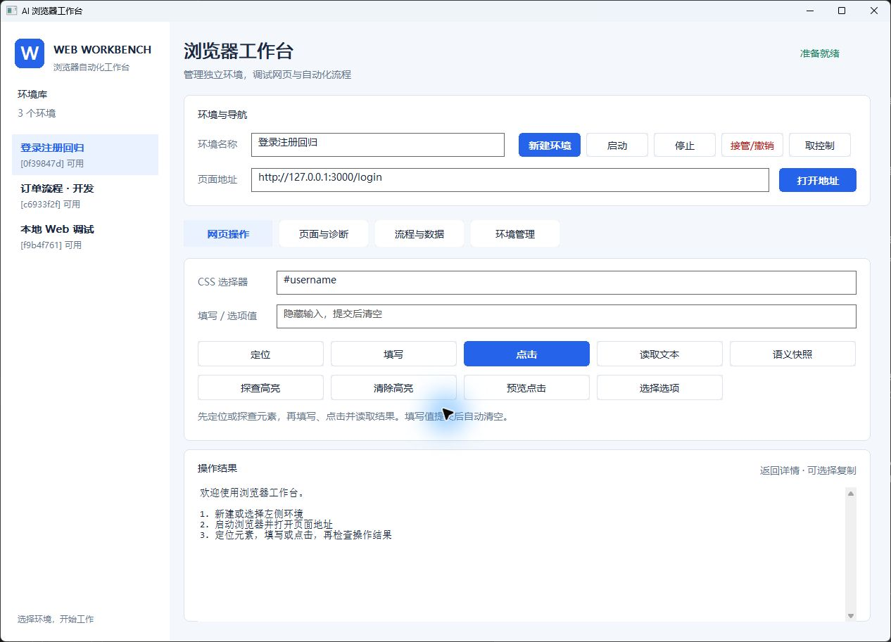
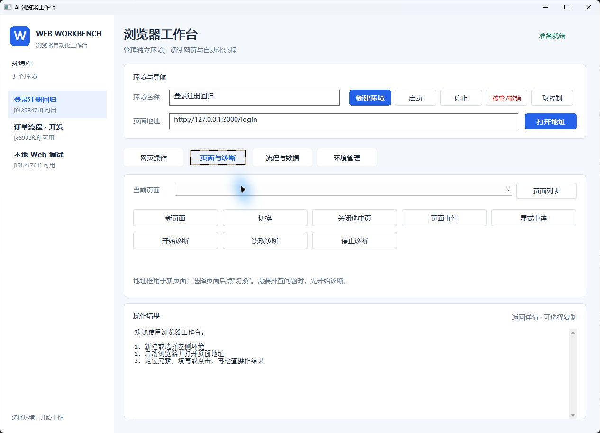
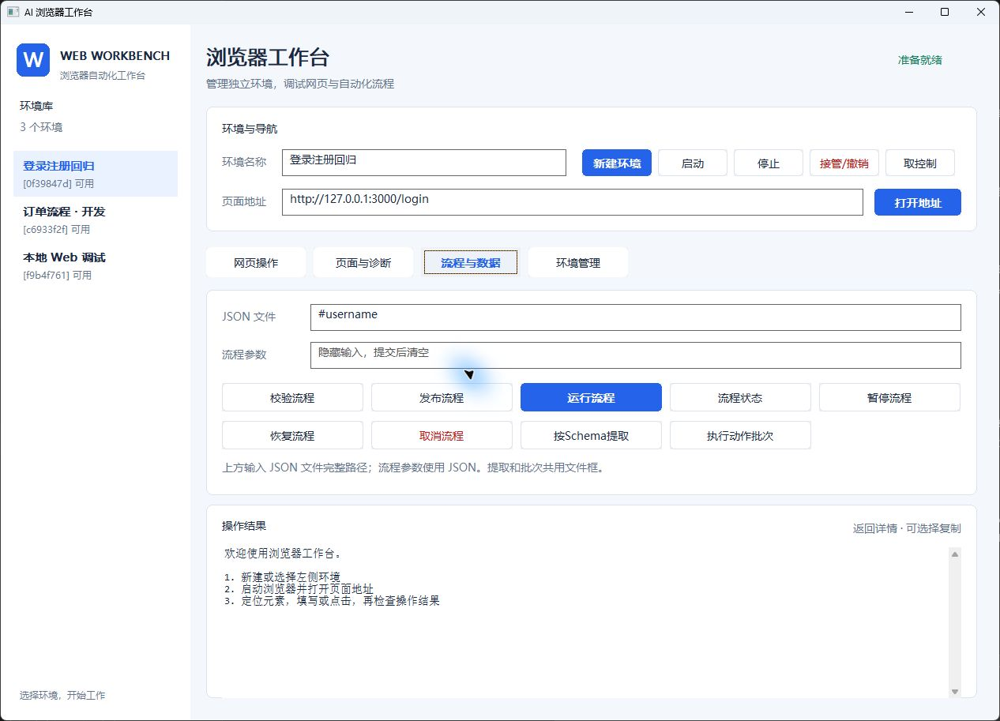
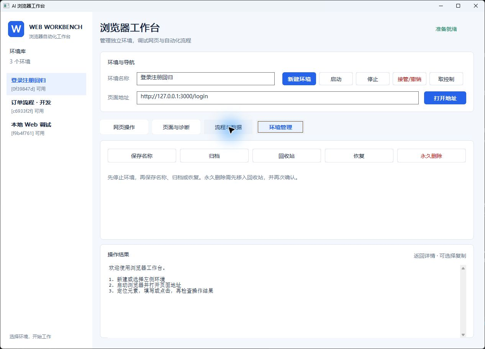

# 桌面界面美化与交互验证报告

日期：2026-11-04。版本：0.1.8-poc。范围：已有原生Win32工作台的界面与交互整理，使用C++14、VC2019/v142。本轮未将未完成的后台、商业功能或完整产品界面标记完成。

## 1 实际交付与布局

界面由环境侧栏、环境与导航卡片、四组操作入口、操作结果区组成。浅灰蓝背景、白色卡片、蓝色主按钮、中文字体和统一间距替代此前密集排列；危险操作使用红字。左侧环境按名称、ID前缀和中文生命周期分两行显示，数量来自真实本地环境列表。

截图来自本机真实Release窗口与本次专用样例环境，未启动真实业务账号。它们展示当前原生桌面，不是网页设计图。

| 区域/分组 | 实际功能 | 使用要点 |
| --- | --- | --- |
| 环境库 | 列出、选择独立环境及生命周期 | 当前选中名称同步到顶部，核对后再操作 |
| 环境与导航 | 新建、启动、停止、接管/撤销、取控制、打开地址 | 环境操作始终可见；地址须符合该环境授权来源 |
| 网页操作 | CSS定位、填写、点击、读取文本、AX快照、探查/清除高亮、预览点击、选择选项 | 填写/选项值隐藏输入，提交后清空 |
| 页面与诊断 | 页面列表、新建、切换、关闭、事件、显式重连、诊断开始/读取/停止 | 选择页面后点击切换；重连不重放业务 |
| 流程与数据 | 文件校验、发布、运行、状态、暂停/恢复/取消、Schema提取、动作批次 | JSON路径及参数须使用现有受支持方言 |
| 环境管理 | 保存名称、归档、回收站、恢复、永久删除 | 先停止；永久删除保留二次确认 |
| 操作结果 | 显示真实服务返回、可选择复制、独立滚动 | 命令完成后继续核对业务结果 |

## 2 交互与实现

切组仅隐藏原生控件，不销毁控件、不清空输入和结果。网页CSS/流程JSON路径共用输入框，填写值/流程参数也共用隐藏值框；切换后需核对标签和内容。全部原动作按钮101–138与原服务调用保留，分组按钮501–504只控制显示。共享CLI/MCP/API工具仍为44个。

顶部状态由真实命令更新为准备就绪、正在执行、操作完成或操作未完成。忙碌时动作按钮禁用，停止与接管/撤销保留；执行取消仍服从原有有界操作及租约语义，已提交网站的业务不会因界面撤销而撤回。

原生Tab/Shift+Tab切换焦点，Space激活已聚焦按钮；按钮有焦点框及悬停状态。真实窗口实测从流程分组通过Tab和Space切到环境管理。UIA可识别环境库、环境名称、页面地址和操作结果。保留原生结果文本编辑控件，支持选择复制。

`src/ui/theme.hpp`集中管理布局、字体、GDI资源及控件绘制；`src/ui/main.cpp`负责窗口消息和服务调用。Common Controls v6、PerMonitorV2及系统GDI无需新增UI运行时。源文件保留UTF-8无BOM/LF，函数带中文用途和日期，经过项目clang-format。

布局包含DPI换算、WM_DPICHANGED、随窗口变化重新布局、较小客户区横纵滚动条，以及启动时高对比度系统颜色回退。上述代码存在不等于显示兼容矩阵已通过，实际未验收范围见第5节。

## 3 测试过程与结果

使用独立数据根和随机回环Web夹具，不操作用户日常浏览器。构建、测试报告及EXE哈希集中于[证据汇总](execution/evidence/2026-11-04-ui/summary.json)。

| 检查 | 过程 | 真实结果 |
| --- | --- | --- |
| 原生VS2019 Debug/Release | 七项目编译，核心、SQLite与Win32 smoke | 两配置通过，零警告、零错误 |
| CMake Debug/Release | 同源码构建，每配置执行core/storage/win32-shell | 每配置3项CTest通过 |
| 原生Debug桌面回归 | 点击前切到所需分组，确认按钮真实可见后操作 | 修正后11检查组、111步骤通过 |
| 原生Release桌面回归 | 同样通过真实可见分组操作 | 修正后两次均11检查组通过，分别110/110步骤 |
| 登录注册 | 填写提交、值框清空、读身份、后端计数确认 | 每配置实际注册1次、登录1次 |
| 环境与页面 | 新建自动选中、隔离/重启登录态、页面开关/切换/重连、生命周期/删除确认 | 两配置通过 |
| 网页/流程/数据 | 探查高亮、预览/选择、流程控制、诊断、Schema提取/批次、撤销阻断后续写入 | 两配置通过 |
| 视觉与键盘 | 四组截图、中文标签、焦点与Tab/Space | 本机正常尺寸通过 |
| 自有源码审计 | 编码、格式、中文日期注释、未完成标记、依赖哈希 | 打包脚本调整后复审通过：54文件，0个未完成标记 |

桌面分组切换报告包含501–504全部四组。原有测试辅助方法已调整为先切组再验证IsWindowVisible，避免向隐藏按钮发送消息造成“界面通过”的误判。自动回归使用真实Win32控件与受管浏览器，人工视觉检查使用computer-use技能操作本次专用窗口。

## 4 本轮错误与修正

| 发现 | 原因/解决方案 | 复验 |
| --- | --- | --- |
| 初次主题编译触发/WX | Scale和Activity参数遮蔽成员，改为design_units、next_status | 保留初次失败日志；原生/CMake两配置重编通过 |
| 启动后选中环境与名称框不一致 | 刷新列表只选中条目，未同步名称 | Refresh使用真实选中环境名称更新输入框；实际截图与桌面回归通过 |
| 标签与输入的UIA关联不清楚 | 静态标签创建顺序不邻接输入控件 | 调整相邻创建顺序，UIA确认环境名称、页面地址、结果区可识别 |

保留[初次构建日志](execution/evidence/2026-11-04-ui/ui-first-build.log)及[最终构建日志](execution/evidence/2026-11-04-ui/ui-native-build-final.log)。没有删除失败证据来替代修复记录。

## 5 未完成边界与进度

本机正常尺寸下已实际观察四组。缩小窗口滚动、不同DPI/缩放比例、跨显示器移动、高对比度切换和完整读屏矩阵尚未实测验收；窗口边缘拖动尝试未得到有效尺寸变化，未记作通过。第二台干净Windows机器尚不可用。

此次美化不构成完整产品导航、运行日志浏览器、流程画布、鼠标拾取、账户/组织、购买/续费/席位或运营后台的实现；这些继续按原台账执行。T022保持进行中，T057“浏览器窗口排列、DPI和显示器配置”保持未开始，不用本次工作台美化替代浏览器窗口管理验收。

本地累计21完成、24进行中、65未开始，权重41/317=12.93%。ADM48、COM40尚未开始，完整产品未完成；没有未完成代码标记不意味着计划已全部落地。

## 6 新便携包与后验收

新版目录为`dist/AI-Browser-Workbench-0.1.8-win64-ui-r1`，同级ZIP及SHA-256 JSON。包括Release程序、固定浏览器、VC142运行库、全部当前源码与本报告；完整解压后双击Start-Workbench.cmd，Self-Test.cmd用于离线自检。使用、运行和编译步骤已同步文档16–18及根目录使用说明。

打包后使用全新解压副本验收通过：9项部署检查、11组桌面业务、24项协议检查，以及官方MCP SDK握手、列出44工具和代表性工具调用；中文/空格路径复制、桌面打开时自检不改用户索引、损坏/缺库拒绝、复制源码Release重编均通过。全部程序来自解压副本，原分发目录未用于运行测试。

## 7 候选包失败与时序复盘

首个0.1.8候选包的9项部署检查已通过，但随后桌面回归在按钮116“永久删除”等待结果超时，仅前10组通过；该候选包不作为最终通过制品，原ZIP和[失败报告](execution/evidence/2026-11-04-ui/candidate-desktop-failed.json)保留。

代码复核发现完成结果先写入结果框、再恢复按钮可用，快速调用者可能在禁用窗口内发送无效点击；测试也只检查可见性、没有等待按钮可用。本轮改为先恢复动作按钮、再发布完成JSON，测试明确等待真实按钮可用且只发一次点击，并记录本测试环境ID的确认回执。初始失败没有按钮时序快照，因此上述时序缺口是已修正的具体发现，尚不能证明是该次超时的唯一原因。

修正后重新执行原生/CMake双配置构建、核心/SQLite/Win32 smoke及源码审计，全部通过；原生Debug一次、Release连续两次完整桌面回归均通过11组，永久删除均取得唯一正确环境ID的确认回执。后续以新建0.1.8-ui-r1包完成独立部署回归，保留初次失败记录，不覆盖原始候选包。

原始分发目录1443个清单文件全部重新核对，未含额外文件，data为空且无test-results。ZIP大小227195242字节，SHA-256：`0e91a5906fe9cd212e8eb6f079ed94a7f6bf657eb6e83be77186f0dc216aa18b`。[下载便携ZIP](../dist/AI-Browser-Workbench-0.1.8-win64-ui-r1.zip)，[最终包证据](execution/evidence/2026-11-04-ui/final-package-summary.json)。包内source为打包时快照；本段最终哈希和后验收报告只追加到主工程，冻结ZIP保持不变。
