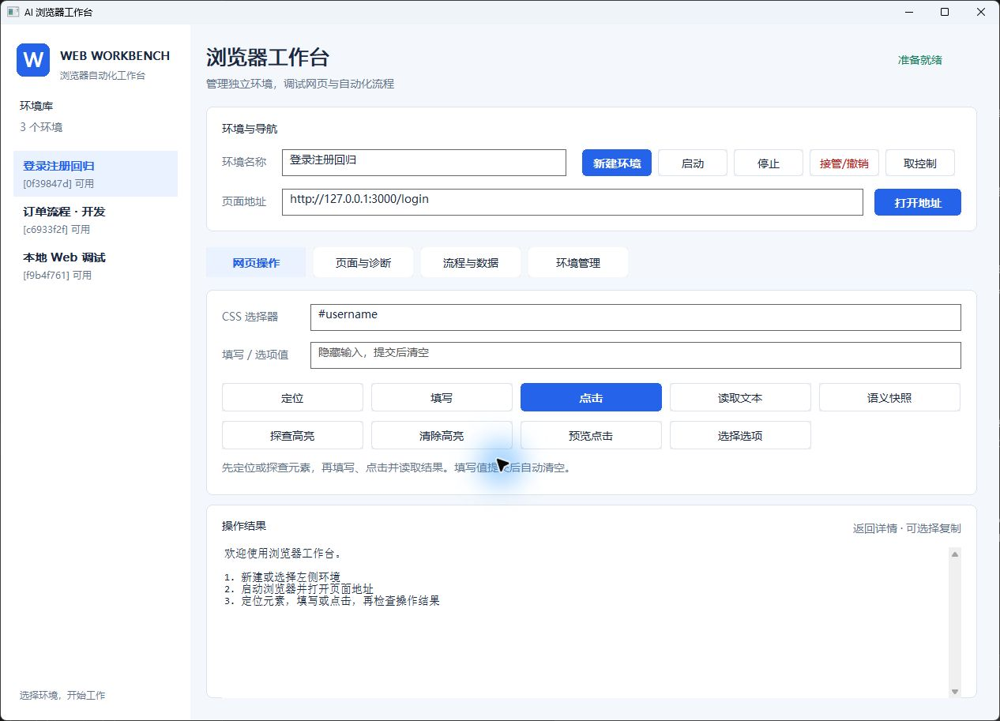

# Web系统从零到一测试操作流程

2026-11-05实现更新：已有SecretRef凭据库、类型变量/断点单步、主文档功能候选、SHA绑定定位修复草稿及模型/知识包菜单。具体操作和实际限制见[0.1.11操作与测试](35_自动化基础能力补全与测试报告.md)。本文高级目标流程仍需按台账逐项验收。

日期：2026-11-04。适用：AI浏览器工作台0.1.8-poc/ui-r1，Windows x64。面向第一次使用工作台、需要测试自己开发系统的人员。

本文先带你逐步输入帐号、密码并点击登录，再测试登录后的按钮和业务，最后把已验证的动作保存为可重复运行的流程。自己的系统无需安装本项目的练习服务；没有合适系统时，可先按第10节使用自带练习页。

追加内容业务：登录后自动识别创作/发布入口，发布准备好的文章；按关键词搜索、罗列文章，并对指定目标点赞、回复和评论。入门操作接续见第15节，完整自动化设计、当前能力与待开发边界见[文章发布、搜索与互动流程](29_文章发布搜索与互动自动化流程.md)。

## 1 先明确三个对象

| 对象 | 是什么 | 示例 |
| --- | --- | --- |
| 待测Web系统 | 你开发的前端、后端和数据库 | `http://127.0.0.1:8080/login`，须替换为实际地址 |
| 浏览器环境 | 工作台管理的一套独立浏览器数据 | “订单系统-普通用户-A”，包含独立登录态 |
| 测试流程 | 打开页面、填写、点击、检查结果的步骤 | 登录 → 查询订单 → 核对列表 |

工作台不会自动启动你的前后端或数据库。先按你自己的项目要求启动服务，确认登录页可以访问，再用工作台操作。正常Chrome里已经登录，不代表工作台的新环境也已登录。

完整路径是：准备测试帐号和页面元素 → 自检并启动工作台 → 创建环境 → 打开登录页 → 填写帐号和密码 → 点击登录 → 核对身份及业务结果 → 测试页面功能 → 保存证据 → 停止环境。手工操作稳定后，再制作自动化流程。

## 2 开始前准备一张信息表

复制下面内容，填写为你系统的真实信息。本文所有`#username`等选择器只是例子，只有自带练习页保证具有这些元素。

| 要准备的内容 | 填写示例 | 你的实际值 |
| --- | --- | --- |
| 登录页完整地址 | `http://127.0.0.1:8080/login` | 待填写 |
| 系统版本/测试数据版本 | 前端提交号、后端版本、测试库快照 | 待填写 |
| 有效测试帐号 | 专门创建的普通用户帐号 | 只在本地保存，不写密码到报告 |
| 帐号框CSS | `#username` | 待填写 |
| 密码框CSS | `#password` | 待填写 |
| 登录按钮CSS | `#login` | 待填写 |
| 登录后身份CSS及预期文字 | `#identity`；例如测试帐号名称 | 待填写 |
| 登录错误提示CSS | `#login-error` | 待填写 |
| 一个受保护业务入口 | 订单列表、用户管理或报表 | 待填写 |
| 一个查询按钮和结果CSS | `[data-testid="order-search"]`及结果统计元素 | 待填写 |

如果系统涉及支付、发送短信或删除数据，使用项目准备的测试数据与测试服务。测试流程中的预期数量应来自确定的数据集，例如预先准备2条订单；不要把实际生产数据数量写死。

## 3 首次启动工作台

1. 获取[已验收便携ZIP](../dist/AI-Browser-Workbench-0.1.8-win64-ui-r1.zip)，完整解压到本地可写目录，例如`D:\Apps\AI-Browser-Workbench-0.1.8-win64-ui-r1`。
2. 保留包内EXE、DLL、browser、source、portable.mode等目录关系，不要只复制workbench.exe。
3. 双击`Self-Test.cmd`。出现`Self-test: passed`后，才继续测试。自检报告保存在包内`test-results/run-*/report.json`。
4. 双击`Start-Workbench.cmd`，打开工作台。正常使用便携包不需要安装VS、Python或Node。
5. 确认你自己的Web服务已启动。这里的“自检通过”只证明工作台基本可运行，还没有测试你的系统。



界面上，左侧选择环境；顶部创建、启动、停止和打开地址；中部切换“网页操作/页面与诊断/流程与数据/环境管理”；底部“操作结果”查看当前动作的结果。执行中等待按钮恢复可用，再做下一步。

## 4 创建环境并打开自己的登录页

| 步骤 | 在哪里操作 | 输入/点击 | 应看到什么 |
| --- | --- | --- | --- |
| 1 | 顶部“环境名称” | 输入“我的系统-登录测试-A” | 这是环境名称，不是网站帐号 |
| 2 | 顶部“页面地址” | 输入自己的登录页完整HTTP(S)地址 | 包含正确的端口和路径 |
| 3 | 顶部按钮 | 点“新建环境” | 左侧出现并选中新环境，结果区有实际环境ID |
| 4 | 左侧环境库 | 核对选中的环境和顶部名称 | 确认没有选错已登录环境 |
| 5 | 顶部按钮 | 点“启动” | 打开该环境的独立浏览器；启动会自动取得短期控制权 |
| 6 | “页面与诊断”分组 | 点“开始诊断” | 开始收集本次页面操作的诊断元数据 |
| 7 | 顶部按钮 | 点“打开地址” | 受管浏览器显示登录页 |
| 8 | “网页操作”分组 | 准备输入CSS选择器 | 后续填写、点击针对当前选中环境及活动页面 |

创建环境时，桌面按地址确定一个允许来源。“来源”由协议、主机、端口组成：`http://127.0.0.1:8080`和`http://localhost:8080`不同；同一来源下`/login`与`/orders`可正常切换。不要在环境创建后把地址随意改成另一域名，出现ORIGIN_DENIED时应核对来源。

若登录会跳转到另一个认证站点，当前桌面没有多来源编辑面板，需开发人员用API配置所需的确切来源；流程范围也要匹配。帐号输入框位于iframe、第三方登录控件或需要验证码/MFA的系统，按第12节处理。

## 5 第一次如何找到输入框和按钮

CSS选择器是“指定页面上哪个元素”的规则。当前工作台需要填写CSS，没有产品级“用鼠标点一下自动录制整套流程”的入口。

如果页面由你开发，优先给可测试控件加稳定的id或data-testid，例如：

```html
<!-- 测试定位约定示例；日期：2026-11-04。请添加到实际业务控件，不要覆盖页面业务逻辑。 -->
<input id="username" name="username" autocomplete="username">
<input id="password" type="password" autocomplete="current-password">
<button id="login" type="submit">登录</button>
```

无法直接修改前端时，可在受管浏览器按F12打开开发者工具，使用“选择页面元素”工具点帐号框，在Elements中查看它的id/name/data-testid。也可右键DOM节点选择Copy → Copy selector。开发者工具属于浏览器功能；复制出的长路径仍需回到工作台验证是否唯一、是否稳定。

| 页面属性 | 可以填写的CSS例子 | 注意 |
| --- | --- | --- |
| `id="username"` | `#username` | 优先使用稳定且唯一的id |
| `name="username"` | `input[name="username"]` | 页面可能有多个相同name，仍需定位验证 |
| `data-testid="login-submit"` | `[data-testid="login-submit"]` | 适合自己维护的测试约定 |
| 登录表单中的按钮 | `form#login-form button[type="submit"]` | 加上确定的表单范围，减少重名 |

工作台中先把选择器填入“CSS选择器”，点“定位”，再点“探查高亮”，核对浏览器中高亮的确实是目标。按钮可点“预览点击”观察当前可见、禁用、遮挡状态。`LOCATOR_AMBIGUOUS`表示不唯一，`ELEMENT_NOT_FOUND`表示当前页面未找到；修正后再操作。

不要直接填“登录”两个字、XPath，或Playwright的`text=登录`等专用语法。当前入口使用浏览器CSS规则。前端频繁变化的随机class和很长的`:nth-child(...)`路径容易失效，应尽量换成稳定属性。

## 6 完成一次真实登录：逐步点哪里

以下假定你的真实选择器与示例一致。若不一致，全部替换为第2节记录的实际选择器。帐号密码必须是在你的系统中已经存在的有效测试帐号；工作台的“新建环境”不会注册网站用户。

| 步骤 | “CSS选择器”填什么 | “填写/选项值”填什么 | 点哪个按钮 | 如何核对 |
| --- | --- | --- | --- | --- |
| 1 | `#username` | 暂不填写 | 定位、探查高亮 | 高亮的是帐号输入框 |
| 2 | `#username` | 你的测试帐号 | 填写 | 浏览器帐号框出现帐号，工作台隐藏值框提交后清空 |
| 3 | `#password` | 暂不填写 | 定位、探查高亮 | 高亮的是密码输入框 |
| 4 | `#password` | 对应测试密码 | 填写 | 浏览器密码框有遮盖字符，隐藏值框提交后清空 |
| 5 | `#login` | 留空 | 定位、预览点击 | 确认是登录按钮，当前满足可点击条件 |
| 6 | `#login` | 留空 | 点击，仅一次 | 等待浏览器处理，查看结果区是否有命令错误 |
| 7 | 登录后身份元素，例如`#identity` | 留空 | 读取文本 | 返回的是正确帐号/姓名/角色 |
| 8 | 登录成功提示元素（如有） | 留空 | 读取文本 | 与你的业务预期一致 |
| 9 | 一个受登录保护的业务入口 | 留空 | 定位、点击 | 能进入该角色允许的页面并读取真实数据 |

“填写/选项值”是隐藏输入框，帐号和普通文字在工作台中也可能显示为遮盖字符，属于当前界面行为。“填写”针对的是你选择的网页元素；你只在值框里输入密码、没有点“填写”，网页密码框不会收到密码。

如果系统登录后跳转到新页面，旧选择器可能不存在，先核对浏览器页面。若实际打开了新标签页，到“页面与诊断”点“页面列表”，在下拉框选目标页，再点“切换”，随后重新定位。

登录是否通过，需要核对身份以及受保护业务。`ok:true`只表示工作台动作完成；HTTP 200、登录按钮被点击、地址发生变化，都不能单独证明认证正确。可以结合后端测试日志确认帐号、角色和会话的业务结果。

页面更新稍慢时，只重复“读取文本”观察结果，不要反复点登录/注册/保存。当前桌面没有独立“等待文本”按钮；自动化流程或API可使用有截止时间的文本断言/等待。

## 7 登录后如何测试系统功能

以“订单查询”为例，先准备一个已知存在的测试订单号。下表选择器仅演示写法，必须替换。

| 顺序 | 操作 | 示例CSS/值 | 检查点 |
| --- | --- | --- | --- |
| 1 | 定位菜单，预览并点击 | `[data-testid="menu-orders"]` | 页面显示订单查询区域 |
| 2 | 定位查询框并填写 | `[data-testid="order-keyword"]`；填写已知测试订单号 | 页面输入正确 |
| 3 | 如有原生select，填写精确value再点“选择选项” | `[data-testid="order-status"]`；值如`paid` | 不是选项显示文字，使用实际option value |
| 4 | 定位查询按钮，点击一次 | `[data-testid="order-search"]` | 查询完成，结果区域更新 |
| 5 | 定位并读取结果摘要 | `[data-testid="order-count"]` | 数量与预先准备的数据一致 |
| 6 | 读取特定订单的状态/金额文本 | 为测试行设置稳定属性 | 核对业务字段，不能仅验证“表格不为空” |
| 7 | 换成不存在的测试订单号再查询 | 保证没有该记录 | 显示空结果，不出现上一轮的旧数据 |

测试新建/编辑表单时，按“打开表单 → 每个字段分别定位和填写 → 核对必填/格式提示 → 保存一次 → 查询唯一测试记录 → 核对实际字段”执行。弹窗表单先确认已打开且位于当前页面；普通自定义下拉菜单按它的真实按钮/选项分别点击，不能直接套用原生select操作。

需要核对持久化时，让后端测试接口、测试日志或测试库查询提供第二份证据。工作台当前没有通用数据库查看器。日期、文件上传、富文本、拖拽、iframe等控件需要按实际能力单独评估，不能假定点“填写”就都可完成。

## 8 补齐登录与权限的反向测试

每个用例执行前确认前置状态，测试记录模板中的默认状态均为“未执行”。

| 用例 | 操作 | 预期 |
| --- | --- | --- |
| 正确帐号密码 | 全新未登录环境登录 | 身份正确，允许的受保护功能可用 |
| 错误密码 | 未登录环境，用专用反例帐号输入一次错误密码 | 明确错误提示，没有建立登录态 |
| 空帐号/空密码 | 清空对应输入后提交 | 必填提示，未建立会话 |
| 未登录访问业务 | 全新环境直接打开业务地址 | 页面/接口按设计拒绝或引导登录 |
| 已登录后退出 | 点击网站自己的退出按钮，再访问业务 | 身份退出，受保护请求被拒绝 |
| 角色权限 | 不同角色使用不同环境/帐号访问同一功能 | 按既定权限矩阵放行/拒绝 |
| 会话过期 | 使用系统提供的短会话测试配置等待过期 | 按设计要求重新登录，不能继续取得受保护数据 |
| 环境隔离 | A已登录；新建B访问同一系统 | B不继承A的帐号和登录态 |

空值测试可保持隐藏值框为空，再对当前输入框点“填写”。反例登录测试应先退出或使用全新环境；浏览器残留的旧登录态会掩盖错误密码问题。不能只看菜单有没有隐藏，权限还需验证实际业务请求是否被正确拒绝。

## 9 同一环境重开与多人测试

1. 登录成功并记录环境ID，点工作台顶部“停止”。
2. 选回相同环境，点“启动”和“打开地址”。
3. 读取身份，按网站的Cookie/会话有效期判断是否符合预期。网站只允许会话Cookie或会话已过期时，要求重新登录可能是正确行为。
4. 新建B环境，打开相同登录页，确认B没有继承A身份。

“停止浏览器”与网站的“退出登录”不同。要验证登录后的业务，可复用同一环境；要验证登录流程本身，先退出或使用全新环境。不同测试角色分别使用独立环境，避免身份混用。

默认桌面控制权有效期5分钟。出现LEASE_REQUIRED/LEASE_REVOKED等错误时，确认当前环境和活动流程，必要时先“接管/撤销”再“取控制”。对仍在运行的流程先查看状态并取消或等待终态；不要在状态不明时重复登录/保存。

## 10 没有现成系统时，先跑通自带练习页

此节可独立执行，提供一套真实可登录、可查报表的本地练习系统。练习服务需要Python3.12；它只用于练习/开发，使用工作台测试你自己的系统不因此需要Python。

### 10.1 启动练习服务

在PowerShell中执行，路径按你的实际解压位置修改：

```powershell
Set-Location 'D:\Apps\AI-Browser-Workbench-0.1.8-win64-ui-r1\source'
python tests/fixtures/web_app.py --port 3000
```

看到`Fixture: http://127.0.0.1:3000/login`后保持该窗口运行。若提示python找不到，需要先安装Python或使用你已经配置好的Python完整路径；若3000端口被占用，可换端口，但下面的地址、流程URL、allowedOrigins都要一起修改。

### 10.2 按下表完成一轮练习

下面是专用演示帐号及密码，仅用于本地练习页，不是工作台的默认帐号。

| 顺序 | 工作台操作 | 填写内容 | 预期结果 |
| --- | --- | --- | --- |
| 1 | 创建环境 | 名称“入门练习-A”；页面地址`http://127.0.0.1:3000/login` | 左侧出现并选中该环境 |
| 2 | 启动；开始诊断；打开地址 | 使用顶部和“页面与诊断”入口 | 浏览器出现登录注册练习页 |
| 3 | 网页操作：填写帐号 | CSS=`#username`，值=`demo-user-001`，点“填写” | 网页帐号框已填写 |
| 4 | 填写密码 | CSS=`#password`，值=`DemoOnly-2026!`，点“填写” | 网页密码框已有内容 |
| 5 | 首次注册 | CSS=`#register`，点“点击”一次 | 读取`#result`最终为`registered` |
| 6 | 登录 | CSS=`#login`，点“点击”一次 | 读取`#result`最终为`logged-in` |
| 7 | 核对身份 | CSS=`#identity`，点“读取文本” | `demo-user-001` |
| 8 | 查询受保护报表 | CSS=`#filter`，点“点击”一次 | 读取`#report`最终为`rows:1` |
| 9 | 退出网站 | CSS=`#logout`，点“点击”一次 | `#result`为`logged-out`，`#identity`为`anonymous` |
| 10 | 未登录查询报表 | CSS=`#filter`，点“点击”一次 | `#report`为`LOGIN_REQUIRED`，该反例测试通过 |
| 11 | 错误密码登录 | 重新填写帐号，密码用`WrongOnly-2026!`，点`#login`一次 | `#result`为`INVALID_CREDENTIALS`，`#identity`仍为`anonymous` |
| 12 | 恢复正确登录 | 重填正确帐号密码，再点`#login`一次 | 身份恢复正确，可继续测试 |

这个练习页没有预设用户，首次必须点“注册”。同一练习服务已注册过该帐号时，再注册会返回`DUPLICATE_USER`；可使用已有帐号和原密码，或改用新帐号。重启Python服务后帐号和会话表会清空，需重新注册，不能把旧浏览器Cookie当作有效服务端帐号。

练习结束可在工作台停止浏览器，再回到Python服务窗口按Ctrl+C结束。工作台普通用户文档和本轮便携包不需要重新编译。

## 11 把登录和查询保存为可重复运行的流程

### 11.1 使用已提供的练习流程

文件：[workflow-login-report.json](examples/workflow-login-report.json)。此文件固定访问本机3000端口的练习页，**只执行登录、核对身份和查询报表，不包含注册或退出**。先按第10节注册帐号并保持练习服务运行；运行流程前退出网站，以便验证一次完整登录。

将该JSON文件单独保存到例如`D:\WebTests\workflow-login-report.json`。本文档及该新示例是后续新增资料，之前冻结的ui-r1 ZIP里未包含它们；可从当前工程docs/examples取得，也可点击本文的JSON文件链接打开后另存。不要修改已验收便携包中的源文件来照抄流程。

| 步骤 | 操作 | 结果 |
| --- | --- | --- |
| 1 | 选中来源为`http://127.0.0.1:3000`的练习环境，并启动 | 浏览器运行，有有效控制权 |
| 2 | 切到“流程与数据” | 显示JSON文件、流程参数及流程按钮 |
| 3 | “JSON文件”填写文件的完整路径 | 例如`D:\WebTests\workflow-login-report.json`，不加外层引号 |
| 4 | 点“校验流程” | `valid:true`；只校验定义，不代表网站已经登录成功 |
| 5 | 点“发布流程” | 返回workflowId及不可变版本摘要 |
| 6 | “流程参数”输入下方JSON | 使用真实已注册的练习帐号；不要把输入内容放入报告 |
| 7 | 点“运行流程”一次 | 返回runId和queued等运行状态，参数框随后清空 |
| 8 | 反复点“流程状态”观察 | 最终state为`succeeded`；若失败先看实际状态与错误码 |
| 9 | 回到网页操作，重新填写CSS=`#identity`/`#report`并读取 | 分别为帐号名称及`rows:1` |

```json
{"user":"demo-user-001","password":"DemoOnly-2026!"}
```

网页CSS与流程JSON路径共用一个输入框，隐藏值与流程参数也共用；切组后一定核对内容。回到网页操作时，不要把JSON文件路径当CSS直接定位。

流程实际执行：打开`/login` → 填写帐号 → 填写密码 → 登录一次并等待`#result=logged-in` → 断言身份等于输入帐号 → 查询一次并等待`#report=rows:1` → 结束。输入值通过运行参数传递，流程JSON没有存储密码。

`queued/running`表示运行中，不是通过；只有终态`succeeded`才表示本流程断言全部通过。`outcome-unknown`表示动作可能已提交但验证未完成，不能直接重跑来假定上次没执行；先核对网页/服务端结果。错误密码属于反向用例，不能拿它运行“预期登录成功”的流程，然后把失败的正向流程当作成功。

### 11.2 改成你自己的系统

先把示例复制为自己的文件，例如`D:\WebTests\my-system-login-query.json`，再逐项修改：

| JSON位置 | 改为什么 |
| --- | --- |
| name、version | 你的测试名称和新版本 |
| policy.allowedOrigins | 你的系统确切来源；必须与目标环境的允许来源集合一致 |
| open.url | 实际登录页完整地址 |
| user/password.selector | 实际帐号/密码框的唯一CSS |
| login.selector | 登录按钮的唯一CSS |
| login.postcondition | 登录后稳定存在的提示/身份元素和精确预期文字；系统没有`#result`时要整体替换 |
| identity.selector与expected | 实际身份显示位置与预期；界面显示姓名而非帐号时改成实际姓名或增加已声明的输入字段 |
| report.selector与postcondition | 实际查询按钮、结果元素、确定的精确结果文本；若需先点菜单/填写条件，应增加相应节点并修改next链路 |
| inputSchema | 用户名/密码长度等与你的系统匹配；新增运行参数要声明类型、有界长度并列入required |

自动化click节点必须带postcondition；文本断言是精确相等，不是包含、正则或“页面看起来差不多”。如页面总是动态生成金额、时间等内容，应提供稳定的测试状态元素，或由开发人员通过现有提取/API能力另行验证，不能把示例的`rows:1`原样用于所有系统。

当前示例适用于主文档中可直接定位的同源页面。SPA异步加载、登录跳转和复杂控件应先手工跑通；定义校验通过不会证明元素在运行时存在、已加载或可操作。需要更多节点规则时看[流程执行器说明](23_流程执行器与检查点测试报告.md)。

### 11.3 运行控制

“暂停流程”先进入pausing，读取状态达到paused后才能“恢复流程”。暂停不释放该环境给其他页面动作。“取消流程”只停止后续派发，不撤销已经登录、保存或注册的业务。重开工作台后，不假定桌面仍记得发布ID/runId；当前可通过CLI/MCP的workflow_list/workflow_runs查找持久记录，具体见文档16/23。

## 12 常见卡点如何排查

| 现象 | 先检查 | 建议操作 |
| --- | --- | --- |
| 登录页打不开 | 自己的Web服务、地址、端口、网络 | 先解决系统可达性，再创建/打开环境；工作台不代启动项目 |
| 找不到帐号框 | 当前环境、活动页、CSS、元素是否已出现 | 看页面，核对DOM；新标签页先切换；重新定位 |
| 多个元素匹配 | 同名表单/弹窗/隐藏模板 | 增加稳定id或表单范围，不自动选第一个 |
| 输入后网页没变化 | 是否点了“填写”，是否定位到真实input/textarea | 重新探查，核对只读/禁用/自定义控件 |
| 点击被拒绝 | 按钮禁用、遮挡、页面尚未就绪 | 用预览/探查定位原因，不移除网页保护来假造通过 |
| 登录按钮成功但仍未登录 | 服务端响应、帐号存在性、密码、身份元素 | 读取错误提示与诊断，用业务事实判断 |
| 超时/结果未知 | 请求是否已到服务器、页面是否实际跳转 | 只读核对结果，必要时显式重连；不盲目重复提交 |
| ORIGIN_DENIED/WORKFLOW_SCOPE_MISMATCH | 协议、主机、端口、跨站认证、流程与环境来源 | 统一地址；多来源由API配置，流程集合完全匹配 |
| LEASE_REQUIRED/LEASE_REVOKED | 5分钟控制权是否过期、是否选错环境 | 核对任务状态，必要时接管/撤销后取控制 |
| 页面元素在iframe/Shadow深层 | 控件是否属于主文档 | 当前完整跨frame/Shadow动作尚未开放，需要适配或测试页面方案 |
| 验证码/短信/二次认证 | 系统测试环境是否有正式测试模式 | 人工完成被允许的验证后再继续支持的步骤；当前不能自动绕过或自动录入全部认证流程 |
| 想自动截图/导出完整测试报告 | 当前桌面没有完整报告/录像UI | 可人工保存截图及结果；开发调用方可用page_screenshot等接口保存证据 |

诊断路径：“页面与诊断”→“开始诊断”→重现一次→“读取诊断”→复制相关元数据→“停止诊断”。开始诊断后才采集，默认不包含完整请求正文、标头、Console内容或异常描述；需要业务细节时结合自己的系统日志。具体字段和边界见[诊断报告](24_诊断收集与步骤关联测试报告.md)。

## 13 每轮测试如何留档

使用[执行记录模板](examples/web-test-run-record-template.md)，复制成例如`订单系统-20261104-第一轮.md`，填写版本、环境ID、帐号别名、前置状态、实际步骤、预期和实际结果。

每条用例分别标记通过、失败、受阻或未执行。出现问题记录最短复现步骤、错误码、runId、诊断及服务端是否已收到请求；修复后再记修复版本和复验结果。截图和对外报告不包含密码、Cookie或令牌；停止浏览器后按项目约定清理测试数据。

当前没有自动生成完整测试项目报告的产品页面，这份模板需要手工填写。不能把本项目自带夹具的通过记录当成你的系统已经通过测试。

## 14 交付资料与验证范围

- [通用功能操作说明](16_功能操作说明.md)：所有当前入口。
- [运行环境配置](17_运行环境搭建配置.md)：可复制程序的部署条件。
- [界面说明与原有回归](27_桌面界面美化与交互验证报告.md)：真实界面截图及ui-r1验收。
- [登录查询流程JSON](examples/workflow-login-report.json)：用于本地练习或复制后改为实际系统。
- [本轮示例验证记录](execution/evidence/2026-11-04-quickstart/summary.json)：在当前Release程序上验证模板的结果，不代表你的系统验收。

本轮以Release CLI驱动真实受管浏览器和本机3000端口练习服务，核对5组业务场景，随后执行本文的7步流程两次，两次均为succeeded；服务器实际注册1次、成功登录3次。验证过程不重跑手工视觉检查，也不操作你的真实系统。示例流程文件与程序哈希绑定在上述记录中。

本次只增加入门操作文档、流程示例和记录模板，不修改已冻结的ui-r1程序包。未实现的录制/画布、完整测试管理、凭据库及后台功能仍按原计划状态保留。

## 15 登录后继续发布文章、搜索和互动

### 15.1 从登录到发布准备好的文章

先按第6节完成登录、核对身份，再做下列操作。示例CSS是自有内容系统可采用的约定，不是所有网站通用选择器。

| 顺序 | 页面目标 | 当前工作台如何逐项操作 | 成功条件 |
| --- | --- | --- | --- |
| 1 | 创作/发布入口 | 语义快照观察，核对DOM，定位入口并预览、点击 | 进入正确帐号的新建文章页面 |
| 2 | 标题 | CSS如`[data-testid="article-title"]`，值框填准备好的标题，点填写 | 页面标题正确 |
| 3 | 正文 | 普通textarea如`[data-testid="article-body"]`，值框填正文，点填写 | 正文完整；富文本/上传能力需另做适配 |
| 4 | 栏目/可见性 | 原生select按实际value点选择选项，其他控件分别定位点击 | 与任务配置一致 |
| 5 | 草稿/正式发布按钮 | 核对当前文章，预览后点实际网站按钮一次 | 按任务要求保存草稿或提交发布 |
| 6 | 文章详情/管理列表 | 读取实际标题、作者和发布状态 | 区分草稿、待审核和已公开；取得实际文章标识/链接 |

这里“在网站发布文章”与工作台“发布流程”不同：后者只保存自动化定义。“点击”完成不表示文章已公开；提交后超时先查看文章管理列表，不能直接再次发布。

### 15.2 搜索信息并罗列文章

1. 在当前帐号的页面找到搜索框及搜索按钮，定位后填写关键词并点击搜索。
2. 核对筛选条件，等待结果或无结果提示，读取标题、作者、时间、摘要和文章标识/链接等实际可见数据。
3. 按明确的最大页数/条数翻页、去重，列成“标题、来源、链接、匹配原因、选定操作、实际结果”的清单。
4. 选择需要互动的文章，或由任务预先声明的筛选规则和数量上限选择；仅搜索任务不自动点赞或发评论。

当前桌面没有完整搜索列表面板；page_extract也不能直接生成文章数组或读取任意href。通用列表采集、分页、链接提取和动态结果循环仍待开发。已适配页面可先逐项核对操作，完整目标见[专门流程第6节](29_文章发布搜索与互动自动化流程.md#6-搜索信息并罗列文章)。

### 15.3 点赞、评论和回复

| 操作 | 执行步骤 | 如何证明成功 |
| --- | --- | --- |
| 点赞 | 打开选定文章，先读取本人是否已赞；未赞才点一次，已赞跳过 | 目标状态确认为已赞，不能只看总数增减 |
| 评论 | 在该文章评论区填写准备好的文字，点击发送一次 | 正确文章下出现正确作者/正文/评论标识及状态 |
| 回复 | 在指定父评论行点回复，确认回复对象，填写文字再发一次 | 新回复属于正确parentCommentId，不能回复到同名其他评论 |

通用点赞状态和评论父级读取、回复定位、重复提交核对需站点适配。隐藏值框输入内容后须点“填写”才进入网页；富文本评论框不能假定与普通textarea同样支持。提交结果未知时先查实际评论/回复记录。

### 15.4 自动执行方式

产品目标是：启动时给出目标站点、帐号、准备稿件、自动发布/草稿方式、搜索条件，以及选定互动对象和文字；AI观察界面并选择正确控件，浏览器执行后逐项核验，已配置动作连续运行。现阶段可由外部AI调用已实现MCP/API工具处理已适配页面；工作台还没有一键完成上述全部业务的内置AI任务面板。

新增[内容自动化任务草案](examples/content-automation-task.example.json)和[执行记录模板](examples/content-automation-run-record-template.md)。任务草案只是设计，不能导入当前“校验流程/执行动作批次”；第11节登录报表示例是DSL1.0。现另提供[内容练习网站、可执行19步流程和互动脚本](30_内容网站脚本自动化实测与操作指南.md)，已在本机真实浏览器跑通，按该指南启动即可演练。完整开发归集及CA逐项覆盖状态见[文档29](29_文章发布搜索与互动自动化流程.md)，本站通过不代表任意外部网站已经适配。
