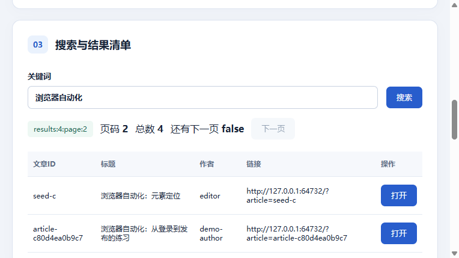
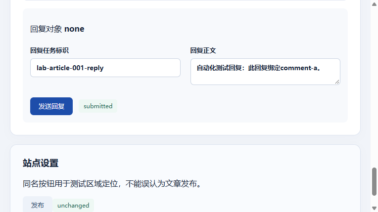

# 内容网站脚本自动化实测与操作指南

日期：2026-11-04。浏览器执行基线：0.1.8-poc/ui-r1、VC2019/v142/C++14。本轮新增Python本地网站、网页和调用脚本，未修改或重新编译C++程序，原冻结便携包保持不变。

## 1 本轮已经做成的内容

已提供[独立练习目录](../examples/content-lab/README.md)：普通帐号注册/登录、文章创作和正式发布、保存草稿/待审核、关键词搜索和分页、文章详情、本人点赞、文章评论和指定父评论回复。SQLite持久保存文章、互动关系与任务记录，重启网站后仍可读取。

可下载[独立内容练习ZIP](../dist/Content-Lab-2026-11-04.zip)，解压后按内含README.md运行。此包是网站和调用脚本，需要搭配已有的完整浏览器便携程序及Python；不包含数据库、浏览器登录资料或生产凭据。

自动化分两层：可导入工作台的[19步DSL1.0流程](../examples/content-lab/workflow-publish-search.json)执行登录、身份核对、填写稿件、发布、核对作者/全文/栏目/状态和搜索第一页；[runner.py](../examples/content-lab/runner.py)通过同一产品CLI调用页面工具，继续采集分页结果、按文章ID绑定对象、已赞跳过、提交评论/回复并生成报告。它没有直接向网站API写文章或评论。

这种使用方式就是“脚本驱动浏览器执行任务”的RPA方式。当前可以运行脚本；影刀类的可视化录制器、拖拽画布、任意站点自动适配和产品内AI规划器仍待开发。本站稳定CSS与可见ID使流程可重复，不代表无需适配就能操作所有真实网站。

后续实施见[可视化录制、拖拽编排与网站自动适配开发计划](31_可视化录制拖拽编排与网站自动适配开发计划.md)，包含录制事件、画布/DSL双向转换、变量、调试、控件/知识包/AI适配和验收任务。

## 2 从零运行一遍

需要Windows x64、Python 3.10以上，以及已完整解压的0.1.8便携程序。Python脚本只使用标准库，无需pip安装。本机验证使用Python 3.12.3；其他Python版本未单独验收。

1. 进入工程examples/content-lab，双击Start-Site.cmd，或运行`python -X utf8 server.py --port 3010`。看到`Content Lab: http://127.0.0.1:3010`后保持终端运行。
2. 第二个终端进入同一目录，执行`.\Start-Automation.cmd "D:\AI-Browser-Workbench-0.1.8-win64-ui-r1"`，把路径替换为自己的完整程序目录。
3. 观察新打开的受管浏览器：注册测试帐号、登录、写文章、发布、搜索、翻页、打开seed-a、点赞、评论、回复comment-a。
4. 结束后打开提示的runs/run-随机编号/report.json，检查result=passed、workflow.state=succeeded、results共4条及interaction结果。browser.png为真实浏览器截图。
5. 再运行一次。相同稿件标识及内容不新增文章；已点赞跳过；本站按评论/回复任务标识返回原记录。每次报告保留在新的目录。
6. 练习结束在网站终端按Ctrl+C。运行目录中包含私有浏览器数据，分享时只挑选报告与审核过的截图。

源码方式可在工程根目录执行：

```powershell
python -X utf8 examples/content-lab/runner.py --output build/evidence/my-content-run --headed
```

该命令使用默认Release构建和build/runtime浏览器。自定义程序位置使用`--executable`、`--browser`；隐藏浏览器运行则省略`--headed`。`--output`必须是不存在的新目录，防止覆盖旧证据。

练习网站只监听127.0.0.1；浏览器地址与环境来源统一使用127.0.0.1，不用localhost替换。切换端口时，runner传同一`--origin`；桌面直接导入则同时改JSON中policy.allowedOrigins及navigate.url。

## 3 准备稿件及修改脚本

修改[inputs.example.json](../examples/content-lab/inputs.example.json)的副本，通过`--inputs`传给runner。user/password是专用本机帐号；taskKey标记稿件；title/body/category是准备内容；keyword和expectedSearchStatus是搜索与精确断言。默认3篇匹配种子文章加本次发布文章，故结果数为4。

每篇新文章用新taskKey；同任务改标题/正文/发布状态会得到TASK_CONTENT_CONFLICT。更多匹配文章加入后，应更新预期搜索总数。JSON流程正文上限16384字符；网站表单允许20000，但当前全文精确断言工具最多16384。

当前互动目标明确为seed-a，回复父级为comment-a，文字在runner的interact函数中。改变对象须同时改对象标识、选择器和成功核验；不能把新搜索结果自动当作互动授权。默认采集最多3页/20条，每页2条；普通分页可运行，懒加载及任意网站列表采集尚未通用化。

在workbench.exe里运行JSON：先在本站注册帐号，再创建来源为3010站点的环境，启动浏览器；进入“流程与数据”，填JSON文件完整路径，校验并发布流程，粘贴参数文件完整JSON后运行、查看状态。桌面JSON只负责19步；Python列表/互动编排不直接导入工作台。详情见[练习目录说明](../examples/content-lab/README.md)。

## 4 实测方法、过程和结果

[浏览器集成测试源码](../tests/integration_content_lab.py)创建全新数据库和私有环境，用现有Release CLI驱动真实Chromium，页面写入后独立查询SQLite确认正文、作者、状态、父评论关系及实际写入次数。没有用数据库预写目标文章来伪造浏览器通过。

| 检查组 | 实际结果 |
| --- | --- |
| 注册/重复注册/错误密码 | registered、DUPLICATE_USER、INVALID_CREDENTIALS；错误密码仍anonymous |
| 19步发布搜索流程 | succeeded，作者/标题/完整中文多段正文/栏目/公开状态正确 |
| 同名发布按钮 | 合并定位返回LOCATOR_AMBIGUOUS；站点设置按钮未被触发 |
| 搜索与分页 | 两页4篇、文章ID和可见URL逐条核对；空搜索0条后正常结束 |
| 点赞与重复运行 | 首次已赞，再次already-satisfied；数据库只有1条本人点赞 |
| 评论及指定回复 | 归属seed-a，回复parent=comment-a；重复任务不新增互动 |
| 已确认任务再次运行 | 两次19步流程成功，原稿件仍只1篇 |
| 草稿/审核 | 分别draft和pending-review，未报公开发布 |
| 同标识不同内容/状态 | TASK_CONTENT_CONFLICT，无第二篇文章 |
| 发布已提交但HTTP回执丢失 | workflow为outcome-unknown；仅1次实际发布；后续搜索未派发；只读打开详情核对 |
| 评论已提交但HTTP回执丢失 | RECEIPT_UNKNOWN；仅1条新评论；只读读取实际评论核对，未再次发送 |
| 限流/会话过期 | RATE_LIMITED及LOGIN_REQUIRED；均无新评论 |
| 阅读者权限 | demo-reader发布返回PUBLISH_FORBIDDEN，无新文章 |
| 过期元素 | 导航后旧ref返回STALE_ELEMENT_REFERENCE，无错误填写 |
| 网站重启 | 会话、文章、点赞、评论和父级关系保留，页面能重新读取 |

最终15组集成检查通过，共327次工具调用。测试中的“回执丢失”是网站完成事务后关闭HTTP连接，浏览器控制连接仍可用；没有把它描述成CDP断连或掉电恢复全矩阵。

另外通过用户入口runner.py直接调用**原冻结便携包内的程序和浏览器**，固定3010端口连续运行两次，均passed；两次均19步succeeded、4条结果。独立数据库统计publish=1、like=1、comment=1、reply=1。这验证公开脚本入口与现有分发程序兼容，没有重新编译新引擎。

格式化后的最终源码再次通过15组/327调用回归；独立ZIP解压后另用`--headed`显示真实浏览器运行一次，19步成功、4条结果、四种业务各1次写入，[解压运行验证](execution/evidence/2026-11-04-content-lab/extracted-package-validation.json)通过。ZIP含10个源码/说明文件及哈希清单，24159字节，SHA-256为`e1b42cf999f3ec21998d7ade0d617e6346d92136ec76f8fa4469b5532d046d44`；可用[打包脚本](../tools/package_content_lab.py)重新生成到新文件。

证据：[最终集成结果](execution/evidence/2026-11-04-content-lab/integration-report.json)、[公开入口两次结果](execution/evidence/2026-11-04-content-lab/public-entry-summary.json)、[首次公开报告](execution/evidence/2026-11-04-content-lab/public-run-1.json)、[第二次公开报告](execution/evidence/2026-11-04-content-lab/public-run-2.json)。证据只包含本地练习帐号别名、测试文章/评论和工具元数据；Cookie、会话令牌、数据库和浏览器资料未分发。





## 5 发现的问题与修复

| 问题 | 原因与处理 | 复验 |
| --- | --- | --- |
| 首次服务初始化失败 | articles表8列，INSERT误用9个占位；修正种子及发布两处为8个 | 全新数据库初始化、真实发布及网站重启通过 |
| 首版流程被拒绝 | 正文输入声明20000，超过精确断言16384静态上限；改为16384，并检查workflow_validate.valid后再发布 | 19步定义和实际输入通过；两次真实运行成功 |
| 故障测试脚本KeyError | 状态记录字段实际为stepId，测试误读id；修正测试以检查后续search根本未派发 | 发布回执丢失为unknown且无search记录 |

[保留的失败记录](execution/evidence/2026-11-04-content-lab/retained-failures.json)登记各轮失败，r2/r3原始报告同时保留。以上是新增网站/样例/验证脚本问题，本轮未发现需要修改C++程序的问题。

## 6 与原验收清单的对应及剩余边界

文档29中的CA是完整产品场景，不能把本站通过直接等同于通用产品验收。CA03/04/08/12/13/14已在本机受控页面通过；其他已覆盖部分列入该文档的“部分验证”，富文本/上传、懒加载/虚拟列表、复杂恢复、暂停取消完整矩阵、网页指令隔离和新用户独立演练仍未完成。

本站去重由服务端唯一约束及任务内容一致性检查提供，不能声称任意目标网站支持exactly-once。通用调用遇到结果未知时仍须先核对，不盲重发。示例使用普通textarea，不宣称支持富文本或附件。

T068增加内容系统及本机证据，T064增加可执行教程；两者继续进行中。原本地21完成、24进行中、65未开始、41/317保持不变，未将此演示标成完整RPA产品或整个工作包完成。

[文档、源码及练习包检查](research/content_lab_document_validation_2026-11-04.json)核对链接、UTF-8无BOM/LF、函数中文日期注释、未完成标记及归档文件哈希；[台账检查](research/content_lab_progress_validation_2026-11-04.json)核对234条记录及父计划状态。新增源码经Black/Prettier格式化、Python及JavaScript语法检查通过；未发现未完成标记。完整产品未实现范围仍见台账，不因没有标记而宣称全部完成。
