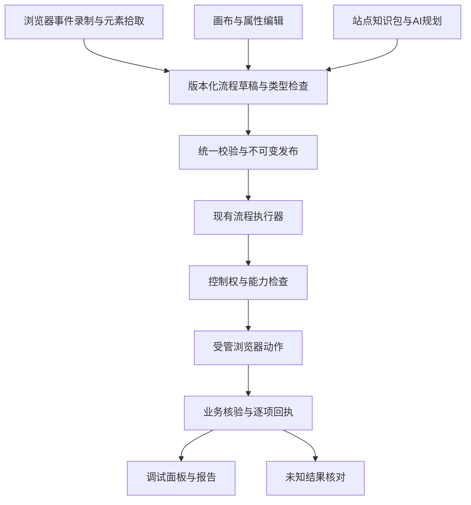

# 可视化录制、拖拽编排与网站自动适配开发计划

版本：1.2。编制与实施更新日期：2026-11-05。性质：专项实施计划，首批本机实现与测试中。工程基线：VC++2019 / MSVC v142 / C++14 / Windows x64，沿用现有Win32工作台和受管Chromium。

关联：[总体计划](01_开发计划与技术方案.md)、[原任务清单](03_开发进度与任务清单.md)、[流程引擎实际契约](23_流程执行器与检查点测试报告.md)、[内容业务目标](29_文章发布搜索与互动自动化流程.md)、[已运行内容站实测](30_内容网站脚本自动化实测与操作指南.md)。本文件与原任务台账同步真实状态，保留317人日基线和开发验证版发布结论。

## 2026-11-05 当前实施更新

本次automation-r4补齐原生环境库配置表单、分组/模板/历史操作、批次分页与保留管理，SQLite升级v7，92工具契约同步。T052经过双配置、真实桌面、并发/故障和三端验收关闭；T046/T071等未完父包继续保持开放。逐项实现、测试、错误与操作见[本轮报告](40_环境库表单与批次保留管理实现测试.md)。

本地25完成/38进行中/47未开始，基线权重54/317=17.03%；后台/商业88项尚未开始。专项6完成/19进行中/3未开始。

本轮T050、T117、T118及VE018/019按实际独立验收关闭；其它父包仅更新已完成子范围，未通过的完整验收保留开放。详见[实现、测试和修错报告](35_自动化基础能力补全与测试报告.md)、[全部未完成项收口清单](36_未完成项逐项收口清单.md)和[本轮证据](execution/evidence/2026-11-05-implementation/summary.json)。

## 1 交付目标

将目前“准备JSON/Python脚本后运行”的方式，逐步发展为可录制、可拖拽、可调试、可复用的浏览器RPA工作台。用户完成一次实际操作后，软件生成可编辑流程；用户可补充条件、循环、数据和断言，再由人工、AI或外部软件调用同一浏览器执行层。

首个完整操作路径为：新建自动化项目 → 选择浏览器环境 → 开始录制 → 人工登录并完成发布/搜索/互动 → 停止录制 → 自动生成流程草稿 → 在画布调整步骤及成功条件 → 绑定输入与凭据 → 校验 → 试运行/单步 → 发布不可变版本 → 重复执行并查看逐项结果。

“任意网站自动适配”作为跨站点扩展目标，实施时按能力分级验收。只有实际支持的页面结构、控件和认证方式才能自动执行；遇到不支持控件或不能唯一识别的目标，应显示具体原因、候选及接管入口。验证码、短信、人脸、硬件确认及网站权限限制通过正常业务方式接续，不能把绕过校验作为适配成功。

### 1.1 三项能力的最终交付形态

| 能力 | 用户可见功能 | 必须交付的执行证据 |
| --- | --- | --- |
| 可视化录制 | 开始/暂停/停止、选取元素、录制步骤列表、参数化输入、补充断言、生成草稿 | 人工录制后在新环境回放，操作对象和实际业务结果相符，无录制引起的额外提交 |
| 拖拽编排 | 节点库、连线、属性/变量面板、撤销重做、分支/循环/子流程、单步断点 | 画布/JSON转换无语义丢失，发布后执行结果与草稿预览一致 |
| 网站自动适配 | 功能发现、语义定位、控件适配、站点知识包、页面变更诊断和修复草稿 | 在声明支持的站点和控件上达到验收目标；歧义、未知提交与缺能力正确停止 |

### 1.2 专项开工基线与待建设范围（历史基线）

| 层次 | 当前事实 | 本专项工作 |
| --- | --- | --- |
| 浏览器与调用 | 独立环境、CLI/MCP/鉴权HTTP、44个共享工具 | 复用原控制权、Profile和浏览器服务，不另建旁路驱动 |
| 元素 | 主文档AX快照、唯一CSS、探查/预览、填写/点击/原生select | 鼠标选取、语义定位、跨frame/Shadow和录制事件关联 |
| 流程 | DSL1.0顺序/条件/计数循环/子流程、精确文本断言、不可变发布 | 画布、录制生成、运行时变量、结果列表循环、调试和新版本迁移 |
| 内容自动化 | 本地内容站19步JSON和Python编排已跑通，15组检查通过 | 将专用脚本中的采集与互动逻辑迁移成公开节点及可配置适配 |
| 结果恢复 | 有检查点、暂停/取消和结果未知状态 | 完整派发阶段日志、业务核对适配、调试状态一致性 |
| 界面 | Win32环境侧栏和操作卡片 | 录制区、流程画布、属性/变量/调试区、适配管理与结果详情 |
| AI与知识 | 外部AI可以调用当前工具 | 内置Provider、有限任务规划、预算、知识包和可审阅修复 |

上表记录专项开工前的能力；当前0.1.9预览增量及剩余边界见[实施与测试记录](32_可视化RPA实施与测试记录.md)。已有实现的验收范围保持不变。尤其T029不因此变成支持结果数组，T033/T034不因此变成支持任意脚本和运行时变量，T038不等于已经有鼠标录制器。

## 2 产品工作流与界面

### 2.1 录制流程

1. 用户选定环境、允许来源及录制范围，创建流程草稿。
2. 点击“开始录制”，确认当前活动页面、录制状态及事件监听已就绪。
3. 人工完成页面动作，侧栏实时显示“填写帐号、输入密码、点击登录”等语义步骤。
4. 密码等敏感输入只显示凭据槽；普通填写转换成输入参数，不把每个键盘字符保存为单独节点。
5. 导航或弹窗发生时记录归属和必要等待，重新定位当前文档。
6. 用户对重要动作补充业务断言；系统可以建议，不能把观察到的任意结果自动当作正确预期。
7. 停止录制后生成可编辑草稿、能力缺项和未完成断言清单。
8. 校验和试运行通过后才能发布可执行版本；录制结束本身不等于流程验收通过。

### 2.2 拖拽与调试流程

左侧为节点库和流程/子流程列表，中间为画布，右侧为节点属性、定位候选与变量，底部为运行步骤、断言、诊断及业务回执。不同区域显示同一份草稿和实际runId，避免画布与底层状态不同步。

用户拖入节点 → 配置目标/输入/等待及断言 → 连线 → 检查类型、必填项、作用域和预算 → 预览可能动作 → 试运行。可从失败步骤跳转到属性与证据，修改后生成新草稿；旧发布版本、原失败报告和运行记录保留。

“从这里运行”必须满足前置状态、输入、租约和目标身份校验。不能简单跳到任意保存/发布节点来绕过前面的登录与业务核对。

### 2.3 自动适配流程

用户给出站点、任务、帐号、稿件或搜索条件 → 观察页面及身份 → 匹配适用知识包 → 发现功能候选 → 用实际能力校验目标 → 生成受限流程草稿 → 按用户预设方式运行 → 逐项核验及保存回执。

任务已明确允许的动作可以连续执行，不增加每步重复确认。首次生成的草稿默认可审阅；自动运行模式必须提前明确操作范围、对象规则、数量及时间预算。任务范围变化、目标歧义或未决提交出现时停止相应后续写入。

### 2.4 关键界面清单

| 区域 | 控件与状态 | 操作要求 |
| --- | --- | --- |
| 录制工具条 | 开始、暂停、恢复、停止、插入等待/断言、录制作用域 | 明确区分正在采集、暂停、监听丢失与停止 |
| 元素拾取 | 鼠标高亮、区域/控件信息、唯一候选、替代定位 | 选取模式拦截业务点击，结束选取不会补发点击 |
| 画布 | 拖拽、缩放、平移、框选、连线、对齐、删除、撤销重做 | 草稿错误可保存，错误节点明确，未校验不运行 |
| 节点属性 | 输入、定位、后置条件、超时、能力、错误处理 | 只显示当前版本真正支持的配置 |
| 变量面板 | 输入/输出/局部变量、类型、引用、凭据槽 | 未定义/类型不符/敏感引用错误可定位到节点 |
| 调试面板 | 当前节点、步骤状态、断点、单步、继续、停止、证据 | 以执行器状态为准，不用动画表示执行成功 |
| 适配管理 | 站点版本、来源范围、能力、候选规则、验证及变更记录 | 包版本与流程版本绑定，失效时显示重新核验 |
| 运行结果 | 每个目标、动作、业务状态、错误、回执、证据 | 已提交、待审核、已公开、已满足和未知分别显示 |

## 3 技术路线与模块划分

### 3.1 工程路线

默认保留当前Win32壳。专项首个技术验证采用Windows Direct2D/DirectWrite绘制画布，使用原生控件承载属性和日志；自有代码继续C++14。画布缩放/命中测试、键盘、IME、DPI和200节点性能必须先做样例验证。

既有候选paceholder/nodeeditor需Qt5构建与维护/许可准入；只有技术验证证明原生方案无法满足交互或工时、且替代方案通过T077时才形成新ADR调整路线。WebView2网页画布也是可评审备选，需核对SDK/运行时分发、桥接权限和离线安装，不能因界面方便直接引入。路线选择在VE002完成，后续不同时建设两套正式画布。

前端画布只操作草稿和视图元数据，不直接连接CDP、不持有网站密码，也不增加任意本机代码执行节点。新增函数按用户要求写中文注释及日期；格式化并保持已有文件编码、BOM和换行。

### 3.2 运行架构

所有入口沿用Profile的写入控制权、页面归属、来源限制、动作预算和取消语义。录制器的观察模式不获取额外网页写权限，自动回放仍由统一执行器派发；人工接管/撤销后录制、回放、调试和AI的写入行为一致受控。

### 3.3 计划新增目录

以下为目标目录，创建目录不计作功能完成；可按实际重构调整，但责任保持清楚。

| 建议目录 | 责任 |
| --- | --- |
| src/recorder | 录制会话、事件去重、动作归一化、定位候选和草稿生成 |
| src/ui/flow | 画布、节点库、连线、属性、撤销、键盘与可访问性 |
| src/workflow | 草稿模型、版本转换、变量、调试和执行扩展；复用现有core实现 |
| src/browser/adapters | 语义定位、frame/Shadow、控件协议及页面变化探测 |
| src/knowledge | 站点知识包、导入差异、适用性、版本和修复草稿 |
| src/ai | Provider、预算、规划结果校验和任务状态 |
| contracts / docs/schemas | 公共数据契约与版本迁移说明 |
| tests/recording / tests/visual_flow / tests/site_adaptation | 录制、双向转换、控件、故障及适配基准 |

## 4 可视化录制设计

### 4.1 首发事件与合并规则

| 事件 | 生成的业务步骤 | 合并与边界 |
| --- | --- | --- |
| 点击按钮/链接 | 点击，必要时附导航/弹窗观察 | 相同一次手势产生的pointer/click合并，真实连续两次点击不能误合并 |
| 文本输入 | 一次填写输入参数 | 在失焦/提交/停止边界结算；IME composition结束后取最终值，不逐键回放 |
| 密码/令牌字段 | 填写凭据引用 | 采集端先分类；敏感值不进入事件队列、草稿、日志或截图 |
| select/checkbox/radio | 选择/设置期望状态 | 使用业务状态，避免toggle在重跑时反向改变 |
| Enter提交 | 一个提交意图 | 与同次表单submit/点击归并；不得额外模拟一次Enter或点击 |
| 页面导航/SPA路由 | 导航/等待及新文档定位 | 记录来源、页面归属和epoch；不保存可跨文档使用的ref |
| 弹窗/新标签 | 归属明确的页面切换 | 预先监听，按opener/任务归属绑定，不按全局第一个新窗口 |
| 等待/断言 | 显式稳定条件 | 录制耗时不直接转换成固定sleep；动态字段由用户确定预期 |
| 上传/下载/富文本 | 已准入的专用节点 | 未具备能力时标记缺项，不能降成坐标点击并声称完整支持 |

### 4.2 采集生命周期

录制会话至少保存sessionId、profileId、页面/frame归属、文档代数、事件序号、采集版本、时间和脱敏状态。开始前完成监听注册；新文档在用户动作前补齐监听；重复注入只能产生一份事件。

事件采用有界队列和明确缺口标记。丢事件、跨文档乱序、不可采集frame或队列溢出时，该段录制标为不完整，不自动猜测遗漏步骤。暂停后停止采集新动作并结算已开始的输入；停止/浏览器退出时解绑监听，不能影响后续人工操作。

拾取模式与业务录制模式分开。拾取用于选定节点属性时拦截点击并高亮；普通录制让用户真实操作，采集器观察一次动作，不再次派发，也不改变表单默认行为。

### 4.3 敏感输入处理

所有fill转换成显式必填输入或凭据槽，兼容当前DSL要求。普通输入的示例值只保留在本地草稿的独立样例区，不能擅自写成现有inputSchema不支持的default关键字。密码、Cookie、令牌和临时验证码不进入发布定义。

凭据库通过Windows DPAPI或既定秘密服务绑定；导出仅保留槽名和类型，导入后本机重新绑定。缺凭据时明确等待输入，不能回退到录制时明文。高敏感页面默认不保存截图；遮罩失败不得将原图作为替代证据输出。

## 5 拖拽画布、DSL及变量

### 5.1 节点分期

| 阶段 | 节点 | 发布规则 |
| --- | --- | --- |
| 第一阶段 | navigate、fill、click、select、assertText、condition、计数loop、call、end | 只生成当前DSL1.0；点击保留必需后置断言 |
| 第二阶段 | 元素状态/数量/URL断言、提取、变量赋值、列表遍历、结果追加 | 先发布新版本Schema、迁移器和执行器能力，再开放节点 |
| 第三阶段 | 控件适配、内容发布、搜索与选定互动模板 | 编译到已准入的步骤/子流程，不通过隐藏脚本跳过执行门禁 |

画布允许未闭合草稿，发布时必须拒绝缺失目标、不可达节点、隐式环、递归、类型错误和预算超限。循环使用结构化loop/subflow表达，不允许拉一条回边就绕过有界循环规则。错误分支只对明确可处理的失败开放，结果未知单独进入核对流程，不能流入重试写入分支。

### 5.2 双向一致性与版本

节点稳定ID、业务语义、参数/断言及子流程关系属于可执行模型；坐标、折叠、颜色、缩放和选中状态属于独立视图文件。移动节点不改变发布内容hash；修改动作或断言则生成新的可执行版本。

JSON导入画布后再导出，应在规范化后保持语义一致及输入/预算。不能静默删除未知字段/节点：可作为只读不支持草稿显示并阻止发布；若未来版本无法无损保存，则拒绝可编辑导入，保留原文件。

现有DSL1.0的单flow128步、总定义256步、最坏执行1024步、最长300000毫秒等限制继续有效。200节点作为整体草稿/多子流程交互夹具，不表示一个flow可直接运行200步；扩容必须走新版本能力和资源测试。新DSL版本号在VE001确定，本文不把规划字段作为当前可执行输入。

### 5.3 变量与列表

第二阶段区分任务输入、流程局部变量、节点输出和SecretRef。每项声明类型、最大长度/条数、作用域及敏感属性；敏感标记沿提取、表达式、子流程和报告传播。表达式为有界AST，不开放eval或任意Python/JavaScript节点。

搜索采集先形成受限结果数组，再以articleId/规范URL绑定对象，foreach按maxItems/maxIterations和总步数执行。分页游标/最大页数/无新项结束条件明确；允许缺失的字段与提取错误区分。选定对象清单独立于全部搜索结果，不能默认对每条结果点赞或评论。

## 6 网站自动适配分级

| 级别 | 范围 | 退出条件 |
| --- | --- | --- |
| A0 录制适配 | 自有或明确结构的普通主文档页面 | 录制生成定位和断言后，可在新环境稳定重跑 |
| A1 语义适配 | 标准DOM/AX、稳定测试属性、常见SPA | 区域/角色/名称候选唯一且动作与结果可核验 |
| A2 复杂控件 | 明确支持的iframe/OOPIF、开放Shadow、富文本、上传和虚拟列表 | 每一能力具备独立版本/夹具及反例；未支持的能力阻止任务继续 |
| A3 跨站点任务 | 新站点结构发现、知识包复用、模型规划和页面变更修复 | 在限定任务/站点/预算和保留站点基准上报告成功率与失败分母 |
| A4 视觉补充 | Canvas、封闭Shadow或无语义控件的OCR/截图定位候选 | 独立Worker、坐标有效期、布局核验及不确定时接管；另依赖T088 |

A4作为后续可选扩展，不包含在本次28项必选交付及146人日估算中，需单独归集T088及增量后排期；不能用OCR存在来推断Canvas和封闭Shadow都已支持。任何级别都按网站实际权限运行；不支持的原生系统弹窗在界面显示人工处理及接续条件。

### 6.1 定位与功能发现

候选按稳定testId/显式标识、role/name、标签、区域及结构锚点组合生成。排序规则记录匹配依据，模型分数不能代替唯一性、可见性、可操作条件和业务对象核对。

文章的“发布”、站点设置的“发布”、不同评论行的“回复”必须区分。定位描述绑定origin、页面/frame、目标业务对象和观察版本，执行前以当前文档重新解析。不得长期保存runtime ref、backendNodeId、坐标或列表行序号作为跨运行定位。

如果页面产生两个同等候选，进入候选选择/补充约束；不能自动取第一个。登录完成同时核对身份和权限，不能只因菜单出现就开始发文章。

### 6.2 站点知识包

包内容包含manifest、允许来源/路径、站点及语言版本、定位描述、控件适配版本、流程模板、输入槽、后置条件及来源说明；沿用文档08的知识包边界，不包含Cookie、密码、可执行程序或任意宿主脚本。

导入先校验路径/大小/Schema/依赖能力，展示新增、变更、冲突及不可执行项；与本地凭据重新绑定。导出不含运行时ref和用户数据；包版本与发布流程hash相互引用，站点变化后记录适用性下降及重新验证结果。

### 6.3 页面变化与修复

定位失败 → 停止该分支派发 → 保存原失败和脱敏证据 → 重新观察 → 生成候选及差异 → 只读验证 → 用户审阅新草稿 → 发布新版本 → 核对业务前置状态后另行运行。

首版不自动回写已发布流程，也不把预期值改成当前错误值来消除失败。已经提交但结果未知的文章/评论先核对实际记录；换定位不授权再次提交。自动修复仅在后续有明确规则、证据与独立验收后扩展。

## 7 AI、执行可靠性与调试

### 7.1 AI任务约束

Provider可配置端点、模型、超时、调用次数和输入/输出预算；密钥只在本机安全配置。无模型服务时录制、画布、确定性适配和普通回放继续可用，AI任务显示未配置，不假造推理结果。

模型输出为受限任务/流程草稿，经过结构、能力、站点、凭据、对象与资源校验后才可派发。网页及知识包notes是数据，不能修改用户目标、增加站点、换帐号或提高操作数量。自定义Provider调试日志默认不保存完整页面正文及秘密。

### 7.2 调试和未知结果

断点停在尚未派发下一动作的边界；已发动作等待结果后再进入暂停。单步只领取一个当前步骤，不能由UI重复发送点击；暂停期间原租约、输入和环境版本仍有效才可继续。取消只停止后续步骤，不撤回已经发布的文章或评论。

阶段记录至少区分intent、dispatched、verified及unknown。重启后不自动重放未决写意图；业务核对节点按站点能力读取实际记录，不能仅凭本地taskId宣布目标网站具备幂等。清理/删除/取消点赞是独立动作，不能作为默认失败回滚。

### 7.3 示例迁移目标

最终应将content-lab的19步JSON及runner中的分页、点赞、评论和指定回复转换成可视化流程。原Python脚本保留作行为对照，不从画布调用脚本来伪装节点已经实现。新流程与对照脚本在独立数据集上核对文章、互动数量和父级关系。

## 8 专项任务分解与跟踪

VE编号是原工作包的专项分解视图，不增加原台账完成数量。下表工时是待评审的完整实现估算，包含重构与专项验收；与原任务重叠部分需在VE001归集，不能直接叠加到317人日。状态按本次实测更新，逐项剩余边界及证据见[专项台账](execution/visual-rpa-tasks.json)。

角色沿用原计划：A核心/架构、B浏览器/AI、C客户端/交互、Q测试/发布、P产品设计。完成一项后勾选该行并填写证据；只有原父包全部验收满足时才更新其“完成”状态。

| ID | 工作与可验收交付 | 角色 | 估算人日 | 前置VE | 原父包 | 状态 |
| --- | --- | --- | --- | --- | --- | --- |
| VE001 | 范围/控件矩阵、录制事件/草稿契约、版本与工时归集、分期退出条件 | A/P/Q | 6 | 无 | T033/T043/T089/T115 | [x] 完成 |
| VE002 | 原生画布技术样例、DPI/200节点验证、替代方案准入与ADR | C/A | 6 | VE001 | T042/T077 | [x] 完成 |
| VE003 | 页面/frame/epoch能力模型及录制/执行归属校验 | B/A | 5 | VE001 | T018/T024/T025/T028 | [ ] 进行中 |
| VE004 | 预注册事件监听、录制会话、有界队列、缺口和停止解绑 | B/A | 6 | VE003 | T044/T080/T095 | [ ] 进行中 |
| VE005 | 输入/IME合并、Enter提交及多事件去重、敏感采集前分类 | B/Q | 5 | VE004 | T044/T080/T049 | [ ] 进行中 |
| VE006 | 录制工具条、实时步骤、参数槽与断言补全、导出v1草稿 | C/B | 4 | VE002/VE005/VE007 | T044/T043/T069 | [ ] 进行中 |
| VE007 | 鼠标拾取、高亮、唯一候选、稳定定位描述与预览 | B/C | 5 | VE003 | T027/T028/T069 | [ ] 进行中 |
| VE008 | 新标签/弹窗/SPA、iframe与开放Shadow录制/定位能力 | B/Q | 5 | VE004/VE007 | T024/T028/T080/T081 | [ ] 进行中 |
| VE009 | 节点库、拖拽、缩放平移、框选、命中测试与键盘导航 | C | 5 | VE002 | T042/T022 | [x] 完成 |
| VE010 | 分支连线、结构化循环、子流程、图错误定位与发布阻断 | C/A | 4 | VE009 | T042/T043/T089 | [ ] 进行中 |
| VE011 | 撤销重做、复制粘贴、草稿自动保存、崩溃恢复与并发revision | C/A | 4 | VE009 | T042/T043/T095 | [x] 完成 |
| VE012 | 画布/DSL无损转换、视图元数据分离、版本迁移及hash验证 | A/C | 6 | VE006/VE010/VE011 | T033/T043/T047/T089 | [ ] 进行中 |
| VE013 | 类型化运行变量、节点输出、受限列表/foreach及子流程结果 | A/B | 6 | VE012 | T043/T089 | [ ] 进行中 |
| VE014 | 可视化文本/URL/状态/数量断言、预注册观察和确定性等待 | B/C | 6 | VE007/VE012 | T019/T071/T081 | [ ] 进行中 |
| VE015 | 断点、单步、变量脱敏、错误分支和UI/执行器状态一致 | A/C | 5 | VE013/VE014/VE016/VE017 | T035/T045/T043 | [ ] 进行中 |
| VE016 | 派发阶段日志、接管/取消排空、未知结果核对与重启不重放 | A/B/Q | 5 | VE003/VE012 | T025/T026/T035/T095/T098 | [ ] 未开始 |
| VE017 | 凭据库、SecretRef绑定、敏感传播、报告/截图/导出canary检查 | A/Q | 5 | VE001/VE005 | T049/T096 | [ ] 进行中 |
| VE018 | 模型Provider配置、预算、超时、草稿校验与无模型降级 | B/A | 5 | VE012/VE017 | T050/T051 | [x] 完成 |
| VE019 | 站点知识包契约、导入差异、能力/路径校验、版本绑定和导出 | A/C | 6 | VE007/VE012/VE017/VE024 | T118/T115 | [x] 完成 |
| VE020 | 页面功能发现、语义候选及任务草稿规划、目标/范围检查 | B/C | 6 | VE013/VE014/VE018/VE019 | T027/T028/T050/T051/T119 | [ ] 进行中 |
| VE021 | 页面变更检测、定位候选对比、可审阅修复及原失败保留 | B/C | 5 | VE016/VE019/VE020 | T118/T119/T098 | [ ] 进行中 |
| VE022 | 富文本/原生与自定义选择器/上传下载控件能力、路径和结果校验 | B/Q | 6 | VE008/VE014/VE017 | T019/T046/T081 | [ ] 进行中 |
| VE023 | 搜索分页列表、对象去重、已赞期望状态、评论/指定回复可视化模板 | A/B/C | 5 | VE013/VE014/VE016/VE019/VE022 | T043/T089/T118/T098 | [ ] 未开始 |
| VE024 | 新契约生成、CLI/MCP/HTTP映射与能力发现、旧客户端兼容 | A/B | 4 | VE012/VE013/VE014 | T030/T115/T117 | [ ] 进行中 |
| VE025 | 录制/画布/复杂控件夹具、事件计数、负向和故障集自动化 | Q/B | 5 | VE006/VE008/VE012/VE016/VE017 | T032/T047/T068/T080 | [ ] 进行中 |
| VE026 | 跨站点/保留站点和模型配对基准，成功率、耗时与失败归因 | Q/B | 5 | VE020/VE021/VE023/VE025 | T062/T119/T122 | [ ] 未开始 |
| VE027 | 全工作台交互、DPI/键盘/可访问性、200节点与资源性能收口 | C/Q | 5 | VE015/VE021/VE023 | T022/T042/T087 | [ ] 进行中 |
| VE028 | 双配置回归、便携部署/迁移、新手演练、文档与专项交付 | A/C/Q/P | 6 | VE024/VE025/VE026/VE027 | T047/T061/T064/T065/T096/T122 | [ ] 进行中 |

以上28项基线估算合计146人日；按20%–30%集成/缺陷余量约176–190计划人日。它是专项工作视角，不是已批准新增146人日，也不代表原父包当前剩余工时已重新估算。

VE001需逐项记录“已覆盖原工时、原范围剩余、确属新增范围、需替代工作”，经重估后再更新总计划。父包T033等已经完成的部分只复用，不重新打开原验收或把新增功能算进旧证据。

## 9 阶段排期与交付门

以专项有效开工周为R1，建议目标20周；尚未指定实际开工日和岗位人员，不填写虚构的交付日期。原29周总体参考排期不被本专项替换。现有G0、依赖准入、浏览器稳定性和发布门保留，缺口影响相关阶段退出，不阻止可独立的设计/夹具工作。

建议人员为A/B/C各1人、Q约0.5人、P约0.2人。考虑同时处理原工程前置事项，按60%–70%专项有效投入，20周约提供222–259人日；除176–190计划人日外，保留关键路径串行、前置缺口和交叉回归的容量。各岗位工时需在VE001细排，不能把总容量当作可随意替代的人员。关键岗位缺席或前置能力延期需要顺延。单人顺序实施仅工作量就约35–38个有效工作周，另加外部依赖等待，不承诺20周。

| 阶段 | 建议窗口 | 主要工作 | 可交付结果与退出门 |
| --- | --- | --- | --- |
| R0 准备 | 正式开工前/首周 | 核对旧故障、父包归集、工具链/依赖/支持矩阵 | VE001及技术验证计划完成，未就绪项有责任与处理路径 |
| M1 录制与画布骨架 | R1–R5 | VE002–007、VE009并行 | 录制普通登录，拾取不误触，输入/IME合并，画布可编辑但只发布已支持v1节点 |
| M2 可重复运行的编辑器 | R6–R10 | VE008、VE010–012、VE014、VE016–017，夹具持续建设 | 录制→画布→DSL→回放闭环；未知提交不重放，凭据不进入导出；M1缺项全部复验 |
| M3 变量、调试与适配基础 | R11–R15 | VE013、VE015、VE018–019、VE022、VE024 | 新DSL/类型及迁移通过，列表/变量与调试可用；标准控件知识包可导入复用 |
| M4 网站适配与交付 | R16–R20 | VE020–021、VE023、VE025–028 | 内容任务无需Python旁路，跨站点基准、交互/性能与部署检查完成 |

VE025的测试与夹具随M1开始建设，表中前置是整项关闭条件。阶段退出须看实际证据；时间窗口到期不自动勾选完成。若M2能力不稳，M3/M4先完成独立设计和夹具，不能以演示路径代替前置能力关闭。

### 9.1 第一批可独立执行的工作

1. 冻结录制会话/事件/定位草稿结构和DSL1.0映射，完成VE001工时归集。
2. 建立Direct2D画布技术样例，验证缩放/命中/键盘/DPI及200节点，形成VE002选型结论。
3. 为content-lab补充录制事件计数、IME、同名按钮、表单Enter与快速导航夹具。
4. 开始VE003/VE007的页面归属和拾取能力，先做到选取不会真的提交。
5. 在敏感输入分类就绪后开发VE004/VE005，生成可校验v1草稿，再接VE006界面。

这批工作不依赖外部支付、OIDC、模型密钥或第三方网站帐号。没有模型配置时AI性能测试保持未执行，确定性录制与画布工作继续。

## 10 验收用例目录

以下VR01–VR36是本专项新增验收目录；首批仅覆盖其中的主文档/画布子范围，不替换既有WT、CA、AT、FG及发布门。

| 编号 | 场景 | 通过条件 | 状态 |
| --- | --- | --- | --- |
| VR01 | 录制开始/暂停/停止/重开 | 事件边界正确、无重复监听、停止后无采集 | 部分覆盖：主文档11组集成；完整故障矩阵待验收 |
| VR02 | 拾取与真实点击分离 | 拾取不产生提交，退出拾取不补发点击 | 本机预览通过：拾取/退出/撤销反例；纳入三轮 |
| VR03 | 同名/隐藏/禁用/遮挡控件 | 唯一性和可操作检查正确，不自动选第一个 | 未执行 |
| VR04 | 中文IME、连续输入、粘贴、失焦 | 最终值完整，输入合并不丢字、不逐键重放 | 部分覆盖：Chromium IME与输入区间；实体输入法待验收 |
| VR05 | Enter、click和submit事件重叠 | 一次用户提交只生成一个提交意图，网站计数不翻倍 | 本机预览通过：Enter/click/submit仅一次；纳入三轮 |
| VR06 | 快速导航、SPA、刷新与旧ref | 新文档及时观察，旧引用拒绝，不跨文档误写 | 部分覆盖：普通跨文档连续；SPA/快速导航全矩阵待验收 |
| VR07 | 新标签/弹窗/frame/开放Shadow | 支持范围归属准确，缺能力明确停止 | 部分覆盖：frame缺能力明确；支持能力未完成 |
| VR08 | 队列溢出/丢事件/监听断开 | 标记录制不完整，不伪造缺失动作 | 部分覆盖：1000条溢出；断连/缺口全矩阵待验收 |
| VR09 | 密码/令牌/验证码canary | 原始值不进入采集队列、草稿、发布、日志与截图 | 部分覆盖：输入不采值及密码canary；SecretRef/截图传播未完成 |
| VR10 | 节点拖拽/缩放/框选/键盘 | 模型与视图一致，缩放后命中准确 | 本机基础通过：对应VE009；实体多屏见VR33 |
| VR11 | 分支、循环、子流程及非法回边 | 合法结构可执行，隐式环/递归/不可达被阻断 | 部分覆盖：DSL1.0校验/模板；复杂图UI待验收 |
| VR12 | 撤销/重做/复制/粘贴/删除 | 稳定ID与连线正确恢复，复制不会共享错误引用 | 本机通过：历史及原生剪贴板；对应VE011 |
| VR13 | 自动保存/崩溃/过期revision | 恢复到明确版本，冲突不静默覆盖 | 本机通过：自动保存/强退恢复/revision；对应VE011 |
| VR14 | 画布/JSON往返及视图布局变化 | 业务语义无丢失，单纯移动节点不改执行hash | 部分覆盖：v1语义/布局隔离；完整格式矩阵待验收 |
| VR15 | 旧DSL/未来节点/升级迁移 | 旧流程照常运行，不支持项不静默删除或执行 | 部分覆盖：未知节点只读；正式迁移器待开发 |
| VR16 | 运行时变量/类型/敏感传播 | 作用域正确，未定义/错类型失败，秘密在输出脱敏 | 未执行 |
| VR17 | 提取数组/分页/foreach/无结果 | 有界终止、ID去重、缺字段明确，不遍历非选定对象 | 未执行 |
| VR18 | 断言与快速请求观察 | 预先监听不漏事件，期望与实际分别保存 | 未执行 |
| VR19 | 断点/单步/暂停/继续/取消 | 仅执行实际领取步骤，状态与执行器一致，无重复点击 | 未执行 |
| VR20 | 人工接管/租约撤销与TTL | 所有入口同样失效，旧控制器不能继续写 | 部分覆盖：录制/拾取撤销门；全入口/接管待验收 |
| VR21 | 写前/派发后/核验前崩溃 | 保存阶段事实，重开不重放未决写入 | 未执行 |
| VR22 | 发布/评论回执丢失与核对 | 实际只提交一次；核对或保留未知，不改断言假成功 | 未执行 |
| VR23 | 草稿/审核/公开与已点赞 | 状态不混报，已赞不反向取消，父评论绑定正确 | 未执行 |
| VR24 | 富文本/附件/下载 | 按声明控件版本验证全文、文件和结果，路径边界有效 | 未执行 |
| VR25 | 知识包正常导入/冲突/跨版本 | 有差异预览、能力与来源绑定，凭据须本地绑定 | 未执行 |
| VR26 | 坏包/路径穿越/脚本/秘密 | 明确拒绝，无额外文件写入或宿主执行 | 未执行 |
| VR27 | 无模型/超时/超预算/输出非法 | 普通流程可用，AI按预算结束且无越权派发 | 未执行 |
| VR28 | 页面/知识包中的恶意任务指令 | 不能扩大站点、帐号、数量或发出额外业务动作 | 未执行 |
| VR29 | 页面改版、候选歧义与修复 | 原失败保留，只有新草稿改变定位，不补发未知动作 | 未执行 |
| VR30 | 新站点和保留站点适配 | 按固定任务、版本与预算报告全分母，缺能力如实记录 | 未执行 |
| VR31 | API/CLI/MCP/HTTP一致性 | 相同契约、权限及结果，旧客户端兼容或明确拒绝 | 部分覆盖：共用50工具注册表；新增业务三协议全矩阵待验收 |
| VR32 | 200节点、DPI和资源限制 | 交互性能达目标，执行仍遵守当前/新版明确预算 | 部分覆盖：200节点/合成DPI；资源全矩阵待验收 |
| VR33 | 键盘、焦点、屏幕阅读及多显示器 | 主流程可用且焦点可见，移动屏幕后不误定位 | 未执行 |
| VR34 | 导出/报告/截图与制品清理 | 秘密及私有运行数据不分发，业务状态和错误完整 | 部分覆盖：录制canary/私有数据清理；全部报告截图未验收 |
| VR35 | 可视化内容流程与脚本对照 | 独立数据集的文章、点赞、评论、回复归属及数量相符 | 未执行 |
| VR36 | 新用户独立操作和复制部署 | 按文档完成录制→编辑→调试→发布→重跑，问题与复验有记录 | 部分覆盖：桌面闭环/本机部署；独立新用户和第二台待验收 |

## 11 测试矩阵、性能与质量门

### 11.1 固定测试集

| 测试集 | 设计分母 | 结果口径 |
| --- | --- | --- |
| 录制/画布确定性闭环 | 16个固定流程×3轮=48次 | 声明支持的全部流程必须48/48通过，任何误发布/重复提交均阻断阶段退出 |
| 专项边界 | VR01–VR36各3轮=108次基础场景执行 | 参数和故障变体另列；未执行/受阻不算通过，覆盖与实际执行次数分别记录 |
| AI自动适配 | 30任务×3轮=90次 | 其中6任务来自3个保留站点，不用于调参；目标至少81/90成功且错误业务写入为0 |
| content-lab对照 | 原脚本与可视化流程各3轮 | 使用各自全新数据集，额外测重复已完成任务与提交后未知，不依赖上轮状态凑通过 |

AI的30任务中，至少覆盖登录/查询、内容发布、搜索列表、指定互动、同名歧义及缺能力停止；站点需具备授权测试条件。拒绝越权或缺能力时正确停止属于对应负向场景通过，不把应完成的正向任务受阻重新归为成功。

记录站点/浏览器/适配包/模型/提示版本、预算、冷暖缓存、输入数据及失败原因。保留站点不得在冻结任务后用于修规则；若修改规则则重建基准版本重新测。至少81/90是工程目标，不代表任意网站成功率90%；没有模型时该组明确未执行。

### 11.2 性能目标

在VE002固定机器、屏幕/DPI、系统与浏览器版本后测量；以下是目标值，首批主机/原生画布测量见文档32；尚未覆盖全部实体DPI、资源与录制延迟矩阵。

| 项目 | 目标与测量条件 |
| --- | --- |
| 200节点草稿打开 | 本地已加载程序下p95不超过2秒；大图片证据不计入草稿载入 |
| 画布拖拽/命中反馈 | 200节点、100%及150%DPI，输入至可见反馈p95不超过50毫秒 |
| 语义录制显示延迟 | 普通点击/已结束的输入事件至步骤列表p95不超过200毫秒，IME合成时间单列 |
| 录制队列 | 初始最多1000条事件或8MiB归一化数据，先达到者触发明确缺口和停止策略 |
| 历史编辑 | 共享100条/8MiB上限，先达到者裁剪最远历史；保留策略可见，不无限增长内存 |
| 流程预算 | 第一阶段沿用DSL1.0限制；扩容需性能/资源和兼容报告，不能只改常量 |

不得用固定sleep降低事件丢失概率、跳过断言或扩大超时来掩盖失败。性能报告保留失败、卡顿、超时和p50/p95，不能只挑成功演示录屏。

### 11.3 交付门

专项交付至少满足：Debug/Release构建和适用回归、录制/画布往返、支持控件完整夹具、敏感canary、未知结果不重放、上述必选用例、依赖许可/编码注释检查、可复制部署和新用户演练。第二台Windows节点未具备时，该项保持待验收，不用本机重复运行代替。

原T013/T018的连接稳定性缺口及G0/G1/G2/G3、后台和商业门仍按原计划处理；专项完成不自动代表完整产品可售或全项目完成。

## 12 开源参考与准入

本轮计划使用既有调研结果，没有重新联网核验仓库HEAD或许可，不增加候选数量。具体旧取证和固定提交情况见[源码选型清单](07_补充源码选型与验证清单.md)。

| 参考 | 可借鉴内容 | 接入前必须完成 |
| --- | --- | --- |
| [Playwright](https://github.com/microsoft/playwright) | 录制事件、输入合并、定位候选、导航/弹窗观察与代码生成思路 | 固定实际文件commit、许可/NOTICE、维护与接口验证；TS内部实现不作为稳定C++ ABI |
| [paceholder/nodeeditor](https://github.com/paceholder/nodeeditor) | 节点图交互与属性结构的备选 | Qt5/C++14/v142双配置构建、依赖许可/维护评审；通过前不进入正式依赖 |
| [rrweb](https://github.com/rrweb-io/rrweb) | 可选事件证据与回放 | 遮罩、录制大小与重放HTML边界；证据回放不等于业务动作自动化 |
| [json-schema-validator](https://github.com/pboettch/json-schema-validator) | 新DSL/知识包的draft-07候选校验 | 按实际方言、C++14和并发行为准入；不能将其名称当作所有Schema特性已支持 |
| Windows Direct2D/DirectWrite与当前工程 | 默认原生画布、文字和命中测试 | SDK/字体/DPI/可访问性及部署验证，落实VE002 ADR |

优先复用已准入组件和公开协议；不复制闭源产品UI资源或把公开SDK误认为完整浏览器源码。引入独立Worker时增加版本、进程归属、取消、预算与权限测试，不能绕过现有执行器。

## 13 主要风险与处理

| 风险 | 影响 | 处理与检查点 |
| --- | --- | --- |
| 画布选型不适配现有Win32工程 | 大量界面返工、额外运行时 | VE002先做技术样例并确定单一路线，未通过不展开全量画布 |
| 录制事件合并错误 | 重复提交、输入缺字 | 手势/表单事务关联及独立服务器计数，IME和快速导航进入必选回归 |
| 事件在敏感分类前落盘 | 凭据泄露 | 采集端先分类，队列/日志/截图canary，多源敏感属性传播 |
| 画布可表示而执行器不支持 | 导出后无法运行或语义变化 | 按版本隐藏/禁用节点，统一校验，往返语义和旧流程回归 |
| 站点频繁变化、无稳定ID | 错误对象或维护成本高 | 区域/业务对象绑定、知识包版本、歧义停止及修复草稿 |
| AI规划结果不确定 | 越界或错误动作 | 预算、候选探查、执行前校验和明确后置条件，固定/保留站点基准 |
| 本地去重被当作目标网站幂等 | 重复发布/评论 | 未知先核对，区分提交事实与核验，网站无核对能力则保留未知 |
| 跨frame/系统弹窗覆盖不足 | 录制丢步、卡死 | 能力表及明确接管，不将不可采集事件悄悄略过 |
| 原工时与专项估算重叠 | 进度和资源失真 | VE001建立归集表，专项分解与原父包分别展示，不直接相加 |
| 外部模型/测试站/干净机未准备 | 某些验收无法执行 | 本机确定性工作继续，对应外部用例保留未执行及配置清单 |

## 14 完成标记、证据和文档维护

本专项实施状态：**6/28完成；17项进行中；5项未开始。** 已关闭VE001范围契约/归集、VE002原生画布技术验证与选型、VE009节点画布基础交互、VE011编辑历史/剪贴板/自动保存与恢复、VE018模型Provider及VE019数据型知识包。其他增量不等于对应整包验收；完整测试、失败修复及剩余边界见[本轮测试文档](35_自动化基础能力补全与测试报告.md)与[专项台账](execution/visual-rpa-tasks.json)。

每项至少记录：VE编号、原父包、实现文件/版本、编译配置、用例ID、预期/实际、错误码、执行日期、证据路径、失败与修复复验、剩余边界。完成标记需与实际产物核对，不能因目录已建立、编译成功或演示通过就关闭整个能力。

建议后续证据目录为docs/execution/evidence/日期-visual-rpa/，包含manifest、summary、构建/协议/夹具结果和脱敏截图；本轮已建立对应目录，失败及复验报告均保留。浏览器私有数据、口令、Cookie、模型密钥不进入交付包。

每完成VE项，更新本表及原父包的completed/evidence/remaining；父包尚有其他范围则继续进行中。同步README、功能操作手册、运行环境与源码编译文档；新增运行时/Worker必须进入部署条件和自检。任务或范围变化时重新核对总工时、依赖和阶段退出条件。

专项正式交付文档应包含录制入门、画布节点说明、变量/凭据说明、站点适配与修复指南、调试及未知结果核对、CLI/MCP/HTTP契约、源码编译与可复制部署说明、完整测试与失败复验报告。

2026-11-04文档核验：[专项计划静态检查](research/visual_rpa_plan_validation_2026-11-04.json)已核对28项编号/未开始状态、146人日、依赖无环、原父包存在、36项未执行验收及本地链接/编码；[原台账一致性检查](research/visual_rpa_progress_validation_2026-11-04.json)通过，tasks.json哈希保持不变。本次核验仅说明规划资料一致，不是上述功能的测试或验收。

2026-11-04实施增量：原任务权重保持按整包验收，预览功能不关闭完整录制/SecretRef/AI适配等父包。最新状态以[专项检查](execution/evidence/2026-11-04-visual-rpa/plan-validation.json)为准，前述research报告仅是开工前的历史静态检查。

2026-11-04复盘增量：0.1.10-poc修复恢复保存失败仍退出及已删除恢复文件不重建，两配置重新编译并复测。完整范围、有效失败、测试脚本修正和复验见[项目复盘报告](34_项目功能复盘与回归测试报告.md)。本地21完成/30进行中/59未开始、41/317及专项4完成/11进行中/13未开始保持不变；后台/商业尚未实现。
